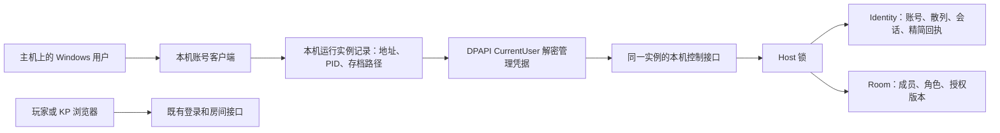

# 本机主机账号维护

- 文档类型：当前
- 文档子类：工程
- 状态：有效
- 创建日期：2026-11-05
- 最后更新：2026-11-21
- 关联文档：[工具与操作说明](../../../tools/host-accounts/README.md)、[接口契约](../../../engineering/contracts/host-control.json)、[首测工程](first-test.md)、[验证结果](../../../tools/host-accounts/results.json)

## 入口和职责

Windows 上公开 CLI 的 `serve` 在同一宿主进程中启用本机账号入口，使用已有 Host 锁、Identity 和房间存储。`host-account-request` 是供包面板调用的公开客户端；独立 WinForms 工具 `tools/host-accounts/HostAccounts.exe` 仍可创建账号和重设密码。客户端不启动第二个 Host，也不绕过文件锁。直接嵌入 `create_app` 的程序需显式提供 `HostControl`。

运行中宿主的客户端入口为 `run.py --data-dir <宿主数据目录> host-account-request [--host-control-dir <发现目录>]`。stdin 为 UTF-8 JSON，支持 `{"operation":"list"}`、`{"operation":"receipt","requestId":"UUID"}` 以及账号变更请求；密码不放在 argv 或日志中。stdout 为单个 JSON：成功或 unknown 回执退出 0，错误、rejected、pending 退出 2。

客户端按规范化 dataDir 匹配发现记录，再核对实际 instanceId、pid 和 dataDirectory；多个有效匹配报 `HOST_CONTROL_INSTANCE_AMBIGUOUS`，没有匹配报 `HOST_NOT_RUNNING`。POST 传输失败报 `HOST_CONTROL_OUTCOME_UNKNOWN`，须查询或重发原 requestId，不代表操作未执行。禁用代理及重定向。服务端参数为 `serve --port <端口> --host-control-dir <发现目录>`，发现目录参数位于子命令后。

停止宿主后，可用离线 `account-create <账号> --role kp|player`、`account-delete <账号>`、`password <账号>`；三者支持 `--request-id`，密码交互读取，并调用同一 Host 账号服务。引擎没有硬编码初始化密码。

默认实例发现目录为 `%LOCALAPPDATA%/OnlineCOC/HostControl/`；记录包含随机实例 ID、PID、本机地址、存档目录及 DPAPI CurrentUser 加密的随机密钥。凭据每次启动更新，正常退出删除记录，工具忽略失效记录。测试／部署可通过 CLI `--host-control-dir` 选择独立目录。DPAPI 失败时不发布管理权限，房间服务继续运行。当前原生工具与自动发现只支持 Windows。

## 授权边界

服务器同时要求连接来源为 loopback、正确实例 ID 和随机管理密钥；带 Origin 或 Referer 的请求拒绝，不根据 Cookie、账号 ID 或 KP 角色授予身份库管理权。工具只从本机记录连接 `http://127.0.0.1:端口`，禁用 HTTP 代理和重定向。网页适配器不会把普通网页登录变成本机维护授权。

授权代表“启动此实例的本机 Windows 用户”。同一 Windows 用户下可读取用户资料的本机程序也处于这一信任边界；这不是对该用户自身程序的隔离。没有运行实例的客户端设备不会出现可管理目标。管理密钥不放在房间投影、能力查询、备份回执或网页中。

## 接口与一致性

完整机器说明见 `engineering/contracts/host-control.json`，它是独立的主机本地控制契约版本 1，不混入普通房间命令目录。

| 路由 | 用途 |
| --- | --- |
| `GET /api/v1/host-control/accounts` | 实例信息及 items；每行 accountId/loginName/nickname/disabled/roomRole/roomActive/pending，隐藏已删除账号 |
| `POST /api/v1/host-control/accounts` | UUID requestId、operation、accountId；create/password 需要 password，create 可传 role，默认 player；delete 不传 password |
| `GET /api/v1/host-control/receipts/{requestId}` | committed/rejected/pending/unknown；pending 使用 HTTP 503，rejected 使用 404 或 409 |

请求携带 `X-OnlineCOC-Instance` 和 `X-OnlineCOC-Host-Key`。所有接口都检查本机维护授权。创建成功同时具备可登录身份及指定角色的 active 房间成员。最后一个 active 且身份可登录的 KP 不能删除，返回持久 rejected 回执 `LAST_KP_REQUIRED`；停用的 KP 不计入保护条件。

密码重设、目标会话注销和回执在一代身份库中原子提交。新密码 8–1024 位；原文不持久化。删除先禁用身份并撤销全部会话，再将成员 active 置 false、authorizationEpoch 增一；保留账号墓碑、memberId、角色、实体归属、聊天及历史记录，删除后的账号 ID 不复用。被删除成员不能由普通 member.update 重新激活。HTTP 会话和 WebSocket 在后续鉴权时失效。

创建及删除通过持久 `hostAdminRequests` 协调两个存储：身份意图（目标禁止登录）→房间成员变更→最终身份状态与 committed 回执。成员元数据记录原 requestId，恢复时不会重复递增授权版本。中间失败保留 pending，重启或下次本机变更前恢复；仅两库完成后返回成功。Host 锁覆盖正常操作，跨库失败期间目标保持禁止登录，不回滚到旧房间快照。

回执保存 requestId、操作、目标、local-host-user、时间及结果，成功时增加 roomRole/roomActive/disabled/deleted/revokedSessions，创建增加 requestedRole，拒绝增加 code。意图和回执均不保存密码原文、额外快速密码摘要或密码比较材料。旧库首次操作按需增加记录，无需另行迁移。

同一 requestId 返回首次终态结果，包括拒绝；更换目标、操作或新建角色报 `COMMAND_ID_CONFLICT`。同一 ID 携带不同密码不会再次执行，客户端必须保留原请求用于恢复。回执达到 10000 条时拒绝新操作，不静默淘汰。

日志和报告不保存认证材料。包含身份的主机备份会包含散列和精简维护审计，应继续按账号资料保护；密码重设会改变身份绑定，既有恢复约束仍然适用。

## 验证范围

2026-11-21 的账号／跨库恢复／CLI／在线会话专项见[账号与发布验收](../../../engineering/acceptance/local-accounts/README.md)，原始报告和源码摘要均保留；账号修改全部发生于合成隔离数据。原 WinForms 版本的 40 项专项及 74 项旧后端回归保存在[历史结果](../../../tools/host-accounts/results.json)，不作为新增删除能力的证据。
