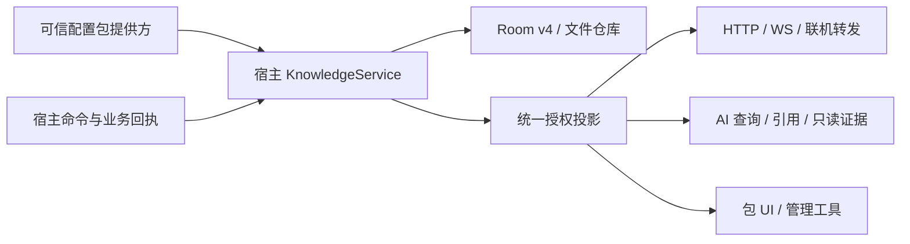

# 个人知识与资料披露：首版工程设计

- 文档类型：历史
- 状态：已归档
- 创建日期：2026-11-17
- 最后更新：2026-11-17
- 原路径：docs/plans/player-knowledge-engineering-design.md
- 原状态：进行中
- 归档日期：2026-11-17
- 归档原因：ISSUE-011首版K0—K5已实现，27项验收义务与受影响回归通过
- 替代文档：[现行知识服务](../current/engineering/player-knowledge.md)、[验收记录](../../engineering/acceptance/knowledge/README.md)
- 关联文档：[ISSUE-011](2026-11-17-issue-011-player-knowledge-authorization.md)、[施工与验收](2026-11-17-player-knowledge-construction-plan.md)、[AI 消费侧细则](../current/design/ai-player-knowledge.md)、[当前边界](../current/engineering/ai-rendering-knowledge.md)、[房间版本](../current/engineering/room-format.md)
- 授权依据：用户确认优先处理 ISSUE-011，按评估制定工程设计和施工计划；本次交付文档，不代表功能已实施。
- 契约地位：下列名称与行为是首版施工基线，尚非可调用接口；实现变更须同步本设计、机器契约和消费者。引擎接口以本页为唯一来源，AI 输出格式以消费侧细则为准。

## 1. 目标与首版边界

主机维护“向谁披露了哪部分资料、哪一版本、当前是否仍可读取”。玩家的普通页面、实时快照、AI 查询和引用详情采用相同授权结果。AI 停用后，记录和普通读取仍正常工作。配置包定义发现条件与资料分面；文件数据模块继续负责持久化，不包含知识业务规则。

| 纳入首版 | 具体约束 |
| --- | --- |
| 账号主体 | 主体绑定本房间 memberId 和 accountId；会话强制使用服务端绑定身份。角色级不开放，不自动合并为角色知识 |
| 固定观察 observed_revision | 保存小型、已披露分面的不可变正文、来源版本和摘要；适用于地点描述、名称、单条线索。再次观察另建记录 |
| 持续告知 live_scope | 只允许包声明的本人状态或指定公共规则等持续来源，表示新发布内容也持续告知该主体；不适用于“曾进入过地点” |
| 披露和撤回 | KP 显式操作、注册的可信宿主业务触发；幂等回执、当前授权复验、多授权并存 |
| 统一读取 | 明确受控资源的普通视图、查询、WS、AI、关系、操作结果／回执、素材及导出出口；未适配的相关出口拒绝 |
| 包试点 | Stumpsville 地点名称／描述／单条线索和 NPC 身份分面；另一个最小包用非地点资源证明通用性 |
| 开发接入 | 无 UI 的接口、SDK、契约样例、KP 最小披露／撤回面板、玩家只读资料及引用详情 |

不纳入：角色级主体、跨房间知识共享、向量库、AI 自动认定发现、任意字段路径披露、整世界时态数据库、动态场景持续观察订阅、通用跨包存储事务、配置删除、所有旧包自动改造。大型图片／音视频的历史版本不在首版支持范围，受控二进制不得因此通过旧公共下载旁路开放。

固定观察进入首版是与 AI 消费侧协调后的收敛：严格 PL 辅助不能把后来更新的场景正文当作当时已知。引擎提供有版本的证据；严格 PL 结果由 AI 侧验证证据选择并使用可信模板展示，不将自由生成事实文本直接当作已验证答案。

## 2. 不变量与兼容模式

1. `required-personal` 声明持久保存，不能随 adapter 未加载而消失。缺失、异常、不兼容、初始化未完成时，受控读取拒绝；不能回退 public/owner。
2. 只有已授权的分面进入投影。公开导航必须作为单独的公开分面明确注册；看到名称不表示可读取模板、属性、连接、私聊或操作该对象。
3. 固定观察只返回原快照。当前原对象修订变化，不单独使旧观察失效，也不替换旧正文；当前授权、主体、策略和来源使用约束仍必须满足。
4. 多条授权覆盖同一内容时按有效授权的并集处理。撤回一条后若存在等价授权，仍可读取；不同快照不是同一份内容，不能以当前版本代替旧版本。
5. 内容可读与事实真实性分开。传闻、角色陈述、规则判定等来源类型保留；披露不会将传闻变成已确认世界事实。
6. 数据控制与执行控制分开。规则执行仍读完整主机状态；面向玩家的输入资格与输出分面由注册规则检查，不把裁剪后的 Entity 当作权威状态交给执行器。
7. 不改未注册资源在普通游戏入口的既有可见性；旧包可继续使用 legacy 模式，但不宣称已具备严格个人披露。新PL游戏资料辅助统一要求严格能力，旧包未接入时只保留普通游戏及待就绪会话，不退回public／owner向模型供给游戏资料；KP管理员会话仍按独立权限处理。
8. 撤回阻止后续服务端读取和复用；无法删除已到达玩家或服务商的内容。网络发送前取得的授权快照是本次发送的边界；撤回之后的新发送必须重新检查。

## 3. 模块与依赖



业务模块拟放在 `engineering/backend/src/onlinecoc/knowledge/`：models/registry/service/projection/evidence 分别负责记录校验、注册、命令、读取与复验。上述是拟施工位置，不是当前目录清单。AI 模块调用宿主服务，不成为权威存储。继续复用 `FileDataStore.commit(expected_generation, state)`、宿主锁、commandId 和原回执。

本设计不依赖 ISSUE-008 的完整请求／决定集合，依据可先引用已存在的宿主命令回执。ISSUE-010 仅约束需要修改包独立存储的操作；首版不建立新跨库提交协议。KP 披露和原生宿主动作可先闭环。

## 4. 持久模型与版本

计划引入 **Room v4**，顶层新增必需 `knowledge`。无策略的房间也初始化空结构；knowledge.schemaVersion=1，消息 protocolVersion 保持 1。改变 Room 契约时同步模型校验、恢复、工件验证器摘要及所有 fixtures；不在 v3 上静默加字段。

```json
{
  "schemaVersion": 1,
  "scopeId": "host-generated-restore-scope",
  "revision": 1,
  "policies": {},
  "observations": {},
  "grants": {},
  "subjectEpochs": {}
}
```

| 记录 | 首版必需内容与约束 |
| --- | --- |
| PolicyBinding | policyId、revision、namespace、contractVersion=1、mode=required-personal、providerId、descriptorDigest、完整 selectors／facetSchemas／允许模式及出口能力。宿主从本机受信描述符复制，不接受客户端传入代码、Schema 或路径 |
| ResourceKey | `{namespace,kind,id}`；房间边界取 knowledge.scopeId。kind 为包注册的稳定资源种类，id 不重用；同名或相同显示名称不能代替身份 |
| Subject | `{kind:"account",accountId,memberId}`；memberId 必须属于对应账号及当前房间成员。删除后重建的成员不会继承旧授权 |
| Observation | observationId、resource、policyId、policyDigest、sourceRevision、sourceGuard、observedAt、sequence、facets、provenance；正文不可变，无通用 patch 命令；sourceGuard由提供方产生、宿主验证并保存 |
| Observation.facets | `{facetId:{data,digest}}`；data 通过本机注册 Schema，digest 为宿主 canonical JSON 的 SHA-256。分面没有授权的附加字段一律不接收 |
| Grant | grantId、revision、subject、resource、policyId、facetIds、mode、observationId（固定时必需，live 时为 null）、status=active/revoked、createdAt、createdBy、provenance、revokedAt/revokedBy/reason（仅撤回时） |
| Provenance | kind=kp-disclosure/host-command/import-current、服务端验证的来源引用、来源修订与采集时间；客户端 reason 只是说明，不是发现证明。来源中的秘密内容不随记录自动返回给玩家 |
| subjectEpochs | memberId 到单调整数的缓存失效提示；有效授权变化时递增。它不是唯一的证据有效性判断条件 |

Observation 的同一分面可由多条 Grant 授权；grant 撤回不修改 Observation。查询旧观察时仍需当前有效 grant。默认列表只呈现每个资源／分面最新且仍获授权的观察，按服务端 sequence 选择；历史引用继续指向原 observation，不重新解析成“最新”。同一分面的 live 与固定记录分开展示，不能混成一个伪版本。

首版限制：每次披露 1 个主体、1 个资源、最多 8 个分面；单分面 canonical 数据最多 8 KiB，单观察最多 32 KiB；每房间最多 10,000 观察和 50,000 授权，整个 knowledge canonical 数据最多 16 MiB，先达到任一限制即拒绝新增。拒绝不能留下半条授权。暂不自动清理历史；容量限制命中提供 KP 可见诊断，后续清理不属于本轮。列表默认 20、最多 50 项，详情最多 12 个引用、64 KiB 输出，超过上限明确报错，不静默截断。

## 5. 注册、策略绑定与版本模式

### 5.1 本机受信注册

新增组合入口 `host.register_knowledge_provider(descriptor, provider)`，只供宿主启动／配置包装配使用，不暴露加载任意代码的 HTTP。描述符包括稳定 providerId/namespace、版本、资源种类、分面 Schema、允许的 observed/live 模式、公开分面、操作输入／输出投影及出口清单。

provider 端口如下；均由宿主传入已验证身份，客户端或模型不能自选主体：

| 端口 | 职责 |
| --- | --- |
| `pin(resource, facetIds, context)` | 返回一致的不可变候选 `{sourceRevision,facets,sourceGuard,provenance}`，仅允许已注册分面；不得返回整个 package.json |
| `read_live(resource, facetIds, context)` | 在当前持续告知条件满足时返回新内容及 contentRevision，否则 NOT_VISIBLE；不得把到访记录当永久订阅 |
| `check_guard(sourceGuard, context)` | 检查来源受众、使用限制等硬约束；用于固定观察后续复验，不以原正文更新否定已保存快照 |
| `derive_observations(commandOutcome, context)` | 可选受信宿主钩子；从真实提交结果产生观察候选，不接受客户端自报“已进入” |
| `project_operation(operation, result, readSet, context)` | 返回注册格式的安全结果，或明确拒绝；不把裸规则结果拼入公共回执 |

描述符中的受控选择器必须落盘，例如宿主实体 configurationId 精确值／前缀、素材集合和包资源种类；只允许宿主实现的选择器种类，禁止任意 JSONPath／表达式。这样 adapter 缺失时，仍能判断哪些已有及未来对象不能走 legacy。配置修改使对象进入受控选择器后立即受控；跨命名空间同对象策略冲突在绑定时拒绝，不能按加载顺序放宽权限。

策略绑定不能等于全局发布。绑定前核对出口覆盖；相关出口只能为 `filtered` 或 `denied`，不得为 unknown。改变描述符、分面 Schema、选择器或允许模式时生成新策略修订，旧引用重新复验；旧快照不能用不兼容的新 Schema 自动解释。首版不提供静默解绑／自动降级命令，变更策略由 KP 显式审核新描述符。

### 5.2 观察与持续告知

场景描述／线索默认为 observed_revision，重新进入或明确揭示产生新观察；离开不会撤销原观察。首版不实现“仍在场景时持续订阅全部正文”的模式。live_scope 仅在描述符白名单允许且当前资格满足时使用；本人状态依赖当前归属，公共规则依赖明确的持续公开授权。资格丧失立即停止该 live 读取；不会隐式转为永久观察，需保留时另有明确观察命令。

固定快照从一次 pin 的实际字节形成，observedAt 是宿主采集时间，来源版本与字节一起保存。来源之后发布新版不改变快照。pin 不证明包／宿主跨存储原子提交：只读包资源须提供不可变版本或一致读取；不能满足时拒绝该来源。首次 KP 手动揭示可基于当前一致版本完成，自动触发另须验证真实宿主行动、主体与对应资源。

原始实体归档后，已披露的固定历史可保留，并标明为观察记录；live 读取停止。彻底停止某资料后续披露应撤回相关授权／使来源使用约束失效，不能仅删除原始对象却假定快照消失。首版不直接复制私聊原文为观察；现有参与者权限不被知识授权覆盖。

## 6. 命令与回执契约

全部沿用 `/api/v1/commands` 的宿主封套、Cookie/CSRF、authorityEpoch、commandId；调用身份来自登录。新增操作如下，均为 **计划接口**：

| op | args（除标注外必需） | 权限和结果 |
| --- | --- | --- |
| `knowledge.policy.bind` | policyId、descriptorDigest、expectedRevision（首次为0） | KP；只绑定已本机注册且出口完整的描述符，返回 policyId/revision |
| `knowledge.observe` | policyId、expectedPolicyRevision、subjectMemberId、resource、facetIds、expectedSourceRevision、reason | KP；固定快照与 active grant 同一宿主提交，返回 observationId/grantId/revision。无 mode 参数，始终 observed_revision |
| `knowledge.subscribe` | policyId、expectedPolicyRevision、subjectMemberId、resource、facetIds、reason | KP；只接受描述符允许 live 的分面，返回 grantId/revision；不能订阅场景秘密 |
| `knowledge.revoke` | grantId、expectedRevision、reason | KP；撤回指定授权，返回新revision/status；使用原 commandId 重试返回原回执 |

resource 为完整 ResourceKey；facetIds 为互不重复的注册名称；revision 为非负整数（已存在记录从1开始）；reason 长度1—500；标识符长度1—200；未知字段拒绝。客户端不得提交观察正文、actor、observedAt、任意来源权限或写入路径。服务端解析 subjectMemberId，验证活跃成员并记录账号绑定。

示例只表示拟议 payload.args，不是当前可执行命令：

```json
{
  "policyId": "sv.personal",
  "expectedPolicyRevision": 1,
  "subjectMemberId": "member-player1",
  "resource": {"namespace":"stumpsville","kind":"location","id":"3"},
  "facetIds": ["identity","description"],
  "expectedSourceRevision": "published-17",
  "reason": "KP向该玩家揭示庭院"
}
```

幂等性沿用账号＋commandId＋payload 摘要。同 ID 同参数返回原结果；同 ID 不同参数 COMMAND_ID_CONFLICT。expectedRevision 失败为 VERSION_CONFLICT。多玩家揭示是多个独立命令，面板逐项展示回执，不宣称整组原子。

可信宿主触发通过 `derive_observations` 在游戏动作结果与知识记录的同一提交中生效，稳定事件键为 `原commandId:producerId:ordinal`，重启恢复不能重复记账。只在可取得同一宿主事务的动作上开放。包侧已独立提交但无可信回执的“发现”暂不自动写权威记录，保留 KP 明确揭示入口，不靠轮询页面反向制造历史。

## 7. 读取 DTO、接口与权限

### 7.1 通用读取

| 路由／SDK | 请求与返回 |
| --- | --- |
| `GET /api/v1/knowledge/capabilities` / `knowledgeCapabilities()` | PL只返回契约版本、当前主体模式、可用版本模式、ready/blocked，不列未知资源、秘密分面或全房间计数；KP管理投影另给已安装policyId、descriptorDigest、可管理分面及当前绑定revision |
| `POST /api/v1/knowledge/preview` / `knowledgePreview(args)` | KP；`{policyId,resource,facetIds}`，返回policyRevision、sourceRevision、分面预览及摘要、capturedAt。用于确认observe参数，不创建grant；提交时再次核对源版本，预览不作为读取授权 |
| `POST /api/v1/knowledge/search` / `knowledgeSearch(args)` | `{namespace?,kinds?,query?,includeHistory?:false,limit?:20,cursor?}`；query 只搜索已授权标签／文本，includeHistory=true 也只列本人仍获授权的旧观察 |
| `POST /api/v1/knowledge/read` / `knowledgeRead(refs)` | `{refs:[KnowledgeRef]}`；逐一复验，任一无权限则整批拒绝，不以错误细节揭示对象存在性 |
| `POST /api/v1/knowledge/grants/query` / `knowledgeGrants(args)` | KP；`{subjectMemberId?,policyId?,status?,limit?:20,cursor?}`，管理授权与审计；PL不得枚举他人记录 |

POST读取沿用登录、Origin 和 CSRF。不提供 `asAccount`、`providerPath` 等参数。PL 固定本人；KP 普通管理读取可使用管理接口，查看／代执行玩家 AI 会话必须经内部 AudienceContext 强制该玩家，不取 KP 并集。

```json
{
  "ref": {
    "schemaVersion": 1,
    "scopeId": "restore-scope",
    "id": "opaque-server-reference",
    "revision": "content-revision",
    "digest": "sha256"
  },
  "label": "庭院：当时所见",
  "facetId": "description",
  "mode": "observed_revision",
  "observedAt": 1794879000,
  "data": {"text":"当次已披露的正文"},
  "provenance": {"kind":"kp-disclosure"}
}
```

这是 `KnowledgeItem`，不是完整 Entity。ref 在服务端绑定主体、resource、policy、facet、具体 observation 或 live 版本；公开 id 是不透明标识，不接受替换主体后复用。Search 返回同一结构但不带 data；详情读取返回 data。Page 为 `{schemaVersion:1,items,nextCursor,coverage:"authorized-query",viewRevision}`；按授权后稳定资源键／分面／观察序号排序再分页，不暴露隐藏条数。cursor 绑定主体、筛选和结果版本，过期后重查，不能带旧cursor拼接新版本。

label、单位及展示标签只从同一授权分面／快照或可信通用模板生成。只获得description而未获得identity时使用“观察记录”等通用标签，不能从当前实体补名称。原对象已更新或归档而玩家尚不知道时，也不附加“已有新版／已删除”等提示；仅在本人确有可读新观察时提供版本切换。

AI现有EvidencePage保留包装格式，增加kind=knowledge、sourceId=knowledge的受信来源。其ref中的scopeId/id/revision/digest映射到KnowledgeRef，schemaVersion由knowledge契约固定，宿主执行转换及主体复验；data为同一KnowledgeItem的已授权详情，不返回原始Entity。旧entity工具对受控对象不能绕过此路径。此映射与引用选择器、历史存储一并在K0机器契约中校验。

`/view` 新增可选 `knowledge` 摘要（契约版本、scopeId、viewRevision、当前前50项摘要、hasMore）；不把全历史塞进快照。受控且仅部分披露的对象从 legacy entities 去除，在知识 DTO 中读取。合法全字段实体才保留原 Entity 形状和 viewToken；不靠伪造空字段满足 Entity Schema。未接入新 DTO 的客户端仍不能通过旧字段取得受控信息。

### 7.2 错误

| 稳定 code | 含义 |
| --- | --- |
| INPUT_INVALID / PERMISSION_DENIED | 格式错误／无该类管理权限；沿用现有处理 |
| NOT_VISIBLE | 不存在或当前不可读，同一对外响应；不回显目标名、字段名及另一主体信息 |
| KNOWLEDGE_UNAVAILABLE | 严格提供方缺失、故障或尚未恢复；玩家仅获可恢复提示，详细原因限 KP |
| KNOWLEDGE_MODE_UNSUPPORTED | 不支持的角色主体、固定／持续模式或资源种类；只在调用者已获能力说明的操作上返回 |
| SOURCE_STALE / VERSION_CONFLICT | 查询引用／源版本或命令前置修订已变化 |
| QUERY_INPUT_LIMIT / QUERY_RESULT_LIMIT / KNOWLEDGE_LIMIT | 输入、输出或持久容量超限，拒绝而不提交部分内容 |

## 8. 出口矩阵与操作隔离

| 出口 | 首版必须实现的行为 |
| --- | --- |
| Host.project、`/view`、`/query`、InProcessTransport | 调用同一 KnowledgeService；筛选后的实体、知识摘要和关系来自同一捕获边界；AI关闭仍有效 |
| WS `/connect`、LAN/P2P/web 转发 | 沿用完整快照分块机制；加入主体投影版本，撤回后替换／清空客户端旧快照。重连重新授权，不复用另一主体缓存 |
| AI search/read、手选引用／点击详情 | 复用已有工具，增加 `knowledge` 资料种类及 KnowledgeItem 渲染；受控原 Entity 不通过旧 entity/ref 路径旁路。所有来源先授权再外发 |
| 关系、进度、流程等待 | 两端可见仍不足以公开关系内容；涉及受控对象时只用注册关系投影，否则隐藏。等待选项与进度也须清除受控正文或拒绝相应PL结果 |
| catalog、invoke、calculate、behavior、命令／历史回执 | 严格策略房间的 PL 规则须有注册输入资格／输出投影；未声明的规则不进入 PL 目录，直接调用亦拒绝。成功及旧回执按当前授权投影；依赖受控读取且无安全输出投影时只返回状态，不泄露结果／错误正文。KP管理权限不因此扩大私聊范围 |
| viewToken、写入命令 | 名称分面和 KnowledgeRef 不能作为可写 viewToken。合法原实体令牌增加受控授权投影绑定；验证 expectedViews 和动作资格不能只检查旧 entity revision。无令牌也必须经过操作权限检查 |
| 素材下载、附件引用 | 元数据和字节都经过同一策略。首版无受控二进制投影能力时拒绝该资产读取／导出，不仅隐藏列表；遗留 public URL 不作为例外 |
| 包静态文件、本地化词条、搜索补全、玩家导出 | 静态包只白名单导出通用 UI／非秘密资源；未知地点名称、主持指南和含秘密的整包数据不可预置。首版受控知识通过登录后动态读取，不导出到可离线长期复用的公开玩家包 |
| 备份／恢复 | 完整知识只随 KP 完整备份保存；不混入玩家导出。恢复新scope，旧客户端／引用全部拒绝；原幂等记录保留 |
| 聊天原文与模型输出 | 普通聊天继续执行原参与者边界。严格PL上下文另要求当事人受众及消息序号窗口证据，当前成员资格不能代替过去已披露证明；首版未接入此证据的历史聊天来源不外发。用户本次输入仅作本人陈述。不得通过AI历史、摘要、主持契约、修复提示或标签补全发送未授权资料；严格输出约束见AI细则 |

接口静态 Schema 和通用错误不应携带包秘密示例。每个出口都须有成功与拒绝用例；可选择拒绝尚未支持的严格资源，但不能漏接后仍声称该资源已隔离。

## 9. 证据复验、缓存与并发

提供内部 `capture_read(context, query)`、`recheck_read(context, proof)`，与现有 publication.check_context／worldDigest 的修改基线校验分离。只读回答不因无关角色移动失效；发布配置／执行批次继续执行完整旧基线、来源和权限检查，知识证据不能替代批准。

ReadProof 包含 contractVersion、knowledge.scopeId、服务端主体／会话等级、成员授权状态、策略／提供方版本、查询筛选和资料依赖。每项依赖区分 observationId＋facet＋snapshotDigest 或 live 的 contentRevision＋digest；同时保留当前有效授权及来源硬约束的复验信息。不把 proof 或 grantId 当成可转让的读取凭证。

| 变化 | 固定观察 | live_scope |
| --- | --- | --- |
| 原正文更新 | 仍读原快照，不偷偷更新详情 | 旧内容引用／缓存失效，重新读取授权的新内容 |
| 无关对象移动／他人授权变化 | 若实际依赖与资格未变则有效 | 同左；若移动影响持续资格则失效 |
| 撤回单条grant | 检查是否仍有等价内容授权；无则拒绝 | 同左 |
| 主体退出／重建、权限收紧、sourceGuard失效 | 拒绝 | 拒绝 |
| 提供方缺失／策略不兼容 | 阻断读取，即便本地仍有旧快照；恢复并复验后可继续 | 阻断，不回退 |
| 房间恢复分叉 | 旧scope引用拒绝；在新scope重新查询 | 同左 |

缓存键至少含scope、主体／会话等级、策略digest、分面、版本模式、内容标识和外发策略。subjectEpoch只用于提示重新检查，不机械把所有旧观察判废；授权变动后可重新解析等价有效授权。live内容变化即使授权版本不变也必须失效。首版不新增全局跨任务内容缓存，先保证查询和既有历史缓存正确。

故障可独立隔离时，其他已独立复验的来源可以继续读取；依赖失败来源的整段回答／摘要不可复用。跨来源批量详情遇到失败仍整批拒绝，调用者可重新请求独立来源，不能静默删项后声称原查询完整。全局主体／授权服务失效则全部阻断。

宿主状态和知识在同一锁／文件提交边界捕获。外部来源须 pin 一致字节并校验来源guard；不可取得一致版本则拒绝。AI 在每次发送模型前、工具结果追加前、生成完成和历史复用时复验。发送资格检查与撤回提交在宿主锁内排序，将已授权内容交给受控出站队列作为本次发送的线性化点；网络等待不持有房间锁。撤回先发生则不得排队，排队先发生则属于已经外发的边界，不能承诺追溯收回。

WS 每次准备分块结束标记时再次检查；检查前授权已变化则不排入可应用的旧 snapshot.end，发送 reset 后重取。已经通过检查并排队的旧快照只能在后续更新中清除。客户端未收到end不得显示临时块，断线清空块缓存；这一协议避免展示未完整验证的快照，但不声称能从恶意客户端擦除已经收到的字节。

## 10. 存档、上线和 UI

新房间直接初始化 Room v4；旧 Room v3 不在加载／查询中自动迁移。另交付离线转换命令：只读输入备份、写独立输出、验证全部字段和摘要，转换后显式导入。空knowledge转换不意味着旧包已严格；启用新策略前必须完成受控出口绑定。

Stumpsville 旧 locationKnowledge 缺少当时正文与来源时间，不能直接生成历史观察。提供 KP 预览清单：可选择“现在重新揭示”生成 import-current 来源的当前快照，或暂不授权。原始旧存档保留；严格启用后停止旧知识账本的继续写入，包UI与AI统一读宿主服务。未知／未导入记录保持未知。

同一房间正常重启保留知识scope与记录，宿主authorityEpoch更新；恢复成新副本同时更新独立knowledge.scopeId与AI scope，持久记录保留内部ID，外部ref按新scope重新发放，旧外部ref不接受。批准、未决任务与旧客户端状态沿用恢复失效规则。回滚使用原版本程序及升级前备份，不把v4文件交给v3代码。

KP首版面板提供按成员／资源查看、披露分面预览、固定观察／受限持续告知、逐项回执及撤回确认。PL只展示本人授权资料与“当时所见／持续更新”标签；点击旧引用读原版本。角色级选项、未支持快照来源与未接入写入按钮不显示为可用。该面板可由包UI和独立管理工具复用SDK，不放入服务商密钥设置页。

本设计的完成标准、实施顺序和交付证据统一见[施工计划](2026-11-17-player-knowledge-construction-plan.md)。实现完成后再将已验证事实写入 docs/current；当前生产能力仍以原工程文档为准。
