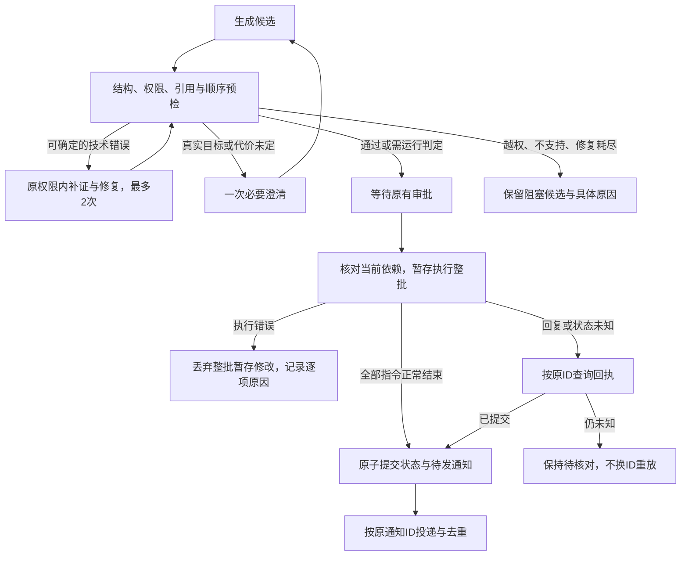

# AI 指令生成正确性、自动修复与整批执行

- 文档类型：计划
- 状态：进行中
- 本轮阶段：实现与隔离实验已交付；剩余泛化、未支持事务与正式房间复验边界见第9节
- 创建日期：2026-11-20
- 最后更新：2026-11-20
- 关联文档：[计划索引](README.md)、[ISSUE-020](Issues/issue-020-batch-partial-slot-diagnostics.md)、[当前裁决实现](../current/engineering/ai-rulings.md)、[宿主操作契约](../../engineering/contracts/operations.json)、[AI 操作契约](../../engineering/contracts/ai-operations.json)

## 1. 授权与目标

2026-11-20，用户要求将此前关于逐项预检查、整批失败撤销、失败定位的讨论，以及全部类型的指令生成测试、自动纠错方案写入计划并执行，明确允许调用 API 测试。既有授权允许通知“引擎 bro”“AI 模块bro”协作；包作者继续负责包侧和联合验收，不直接改工程。

目标是提高真实生成的格式正确率、语义正确率和隔离执行成功率，使可确定的技术错误自动处理，只有真实决策、缺失意图或权限授权需要人工。不能靠弱化校验、自动审批、隐藏失败或减少统计分母达成成功率。

## 2. 已核查基线

- AI 批次允许 25 种 host 操作和 6 种 ai 操作；当前固定格式为 `kind=batch, text, actions:[{target,op,args}]`，动作总载荷最多 32 KiB。
- 树桩镇当前有 17 个公开规则入口；`sv.scene.resolve` 另有 18 项配置化场景及选项。public 表示进入目录，KP 专用与玩家知识限制仍生效。
- 配置、Lua 和数据修改使用 `kind=draft`，须 A/B/C 校验及独立审批；数据编辑支持 append/add/replace/remove。
- 当前批次按项提交，遇拒绝停止；即使第 1 项失败也标 partial。当前没有整批原子撤销。
- 当前生成器已有格式修复轮次，但类型/字段检查不足以发现槽位混淆和业务前置条件；需要系统实验验证真实覆盖。
- ISSUE-020 现场：物品编号 3 为口粮，位于背包槽 5；模型传 slot=3，唯一回执 RULE_FAILED，实际 0 成功、1 失败、2 未执行。不能据此声称曾发生部分扣除。

本节为施工前基线；完成事实必须由下文结果与当前工程文档取代，不将计划能力提前写成现有能力。

## 3. 执行与自动纠错原则

### 3.1 分层快速检查

1. 解析 JSON、输出类型、白名单、必填字段、类型、长度、额外字段与引用格式。
2. 查验授权主体、真实对象 ID、版本、实例/配置类型；物品定义编号、槽位、用量分别提供语义信息，禁止按同一个数字猜测。
3. 按批次顺序在隔离状态中检查业务条件、先后依赖和可支持的事务范围。检查不向玩家广播、不写正式状态、不消耗正式随机序列。
4. 给出每条检查结论：通过、阻塞、需运行判定、不支持该事务范围。预检查通过不等于保证运行成功。
5. 审批时重检真实依赖；执行后记录逐项结果和批次回执。正常检定未通过属于有效规则结果，不进行回滚重掷。

### 3.2 自动处理边界

| 类型 | 默认处理 | 人工介入 |
| --- | --- | --- |
| 格式/字段错误 | 回传准确字段路径、Schema 和允许示例，限次自动修复 | 不需要 |
| 唯一可确定的引用/ID/槽位错误 | 重新查询本权限内权威数据，修复未审批候选并重新校验 | 不需要 |
| 无关聊天改变 | 继续使用发送时快照生成，不作为业务失效 | 不需要 |
| 真实依赖改变 | 自动刷新并判断是否仍符合原意；技术修订可重新形成候选 | 目标、成本、对象或规则效果改变时需要 |
| 查询工具参数错误/可恢复空结果 | 给出工具级反馈，限次纠正或按原权限重读 | 不需要 |
| 网络临时错误/限流 | 有上限的退避重试；记录次数及耗时 | 不需要 |
| 执行结果未知 | 查询原幂等回执，禁止盲目重放 | 只有无法消歧时才需要处理 |
| 权限不足/来源不可访问 | 明确阻止，不扩大权限、不换主体绕过 | 授权决策需要 |
| 多个合理目标/缺失玩法决策 | 简短列出真正需要决定的选项 | 需要 |
| 修复预算耗尽/服务不可用 | 保留失败候选及定位，明确技术阻塞，可重试 | 不伪装成玩法决策 |

自动修复不能自行更改管理员已批准的指令包。修订必须保留原需求、候选版本、差异、失败原因和来源；高危发布与运行时变更的独立审批边界继续生效。程序性自动修复不反复要求用户确认参数拼写或重新复制资料。

处理顺序如下；图中为本计划的目标流程，实际覆盖以验收记录为准。



### 3.3 整批提交与通知

- 同一可支持事务范围内，先在暂存状态执行，全部成功后一次提交；任意执行错误则整批业务修改不生效。不能用回写整个旧房间快照的方式覆盖别人的操作。
- 跨宿主/AI 存储、配置发布、外部副作用和等待外部回答的流程，必须显式声明支持范围；不支持的组合在提交前阻止，禁止静默拆成多个已提交批次。
- 通知跟随业务提交写入待发记录，提交前不发送；投递失败单独按同一通知 ID 重试，不能重复发或撤销已成功游戏状态。
- 明确区分未提交、已撤销、已提交、失败、未执行、结果未知；零成功失败不能标为部分完成。旧的真实部分执行记录保留历史含义。
- 错误包含批次 ID、原命令 ID、动作序号、操作名、对象、参数路径、规则/错误码、安全原因及撤销状态。AI 只得到其权限允许的诊断。

## 4. 全类型覆盖与样例来源

机器可读案例集必须从真实契约核对覆盖，不以提示词声称“全覆盖”。每例包含 caseId、类别、自然语言输入、最小授权上下文、允许工具、预期操作/目标/关键参数、正负例、预期副作用、判定器与执行方式。

| 层级 | 必须覆盖 |
| --- | --- |
| host 25 类 | entity.create/patch/update/archive；relation.set/remove；progress.set；asset.attach/remove；flow.respond/retry/cancel；room.status；member.add/update；notification.send；action.invoke；behavior.invoke；chat.direct.open；chat.channel.create/update；chat.message.send/share/edit/retract |
| ai 6 类 | ai.session.create/update/delete；ai.memory.create/confirm/revoke |
| 包行动 17 类 | sv.create/profile/ready/check/inventory/grant/remove/transfer/damage/rest/morale/travel/travel.auto/world/generate/adjudicate/scene.resolve |
| 数据与高危草案 | 对象配置 add/replace/remove；Lua 合法修改及非法规则边界；dataEdits append/add/replace/remove；保留未读字段；过期 editRef；重名、重复编号和错误目标 |
| 只读工具与回答 | 管理目录/Schema、对象查读、聊天/事件证据、配置节点、PL 已知资料；plan/clarification；引用失效保留历史与权限不可访问 |
| 禁止操作负例 | 底层宿主/AI 管理 API 中不在模型批次白名单的操作；混用 target、擅自审批、伪造权限、读取未知秘密 |
| 组合与故障 | 后项依赖前项；第 1/中间/末项失败；合法骰子失败；通知失败/幂等；断线/重启/重复提交；并发改动；相同意图重复候选；真实与无关资料变化 |

已落地的完整参数／输入样例见[71类有效案例集](../../engineering/acceptance/ai-command-reliability/valid-cases.json)，每例含自然语言请求、真实隔离初态、Schema与预期输出；这份有效案例集取代早期探索夹具作为本轮有效样例入口。[17类包行动样例](../../engineering/acceptance/stumpsville-action-matrix/cases.json)另含实际执行初态与正负判据。所有ID与版本均为隔离示例，使用时须查询当前授权对象。

核心回归样例：

```json
{"kind":"batch","text":"消耗第5槽口粮并短休，完成后通知玩家","actions":[
  {"target":"host","op":"action.invoke","args":{"actionId":"sv.inventory","input":{"actor":"实际角色ID","operation":"use","slot":5,"value":1}}},
  {"target":"host","op":"action.invoke","args":{"actionId":"sv.rest","input":{"actor":"实际角色ID","kind":"short","attribute":""}}},
  {"target":"host","op":"notification.send","args":{"recipientAccountIds":["player1"],"text":"口粮消耗和短休已完成，请查看角色状态。","sourceActionIndex":1}}
]}
```

该例的前置资料必须明确 item3=奶酪、item5=口粮，口粮定义编号为3。不得将示例 ID 或 revision=1 当成生产常量。需另测口粮被移到别槽、同名多物品和无口粮等变体。

### 4.1 失败处理的具体实验输入与判据

下表是验收设计，不因列出就代表已通过；最终证据须关联实际测试结果。

| 场景 | 故障输入／变化 | 应自动完成的处理 | 停止或人工边界 |
| --- | --- | --- | --- |
| F01 格式损坏 | 返回缺右括号JSON、额外Markdown或缺actions | 返回精确解析/字段反馈，在原任务中修复，保持原需求 | 2次耗尽标技术失败，不能伪装玩法问题 |
| F02 错误操作 | config.update放入运行时batch或target错配 | 查真实目录，纠正输出类别/参数，再全量校验 | 不把高危发布改成直接更新实例 |
| F03 参数错误 | action输入缺attribute、slot传字符串、未知字段 | 提供动作Schema和JSON Pointer，修正完整候选 | 不根据字段名猜未授权的效果 |
| F04 槽位混淆 | item3=6/uses3=0，item5=3/uses5=3，却传slot=3使用口粮 | 查询目标角色与定义，唯一匹配时改为slot5，预检后待审 | 多份有不同意义或目标明确限定时不得擅自替换 |
| F05 资料变化 | 生成中新增私聊；另组将口粮移动到槽6 | 前者继续发送时快照；后者给出具体依赖变化，重读未审批候选 | 已审批包内容不可静默改写 |
| F06 工具失败 | 非JSON工具参数、缺channelId、把ref.id当频道ID | 工具错误回到同一生成循环；读真实对象取得业务ID | 禁止放宽权限或猜造引用摘要 |
| F07 多目标 | 两个本包角色都匹配同一模糊称呼 | 保留已读上下文，问一次真正目标选择 | 此项属于人工决策，不强行算自动纠错成功 |
| F08 未授权 | 玩家要求读取KP秘密或批次自行审批 | 拒绝越权并保留安全原因 | 不能通过技术修复提高权限 |
| F09 整批错误 | 第1／中间／末项业务前置或Lua断言失败 | 0业务提交，按序显示失败、已撤销、未执行及规则码 | 正常骰子未通过不触发此路径 |
| F10 回复丢失 | 已提交后客户端断线，再提交同一requestId | 查询或复用原回执，资源/骰子/通知均只发生一次 | 不能换新ID盲重放 |
| F11 数量与资源 | 33条小动作；另一批超32KiB | 前者可执行，后者提交前明确拒绝 | 不静默截掉后面的动作 |
| F12 有效游戏失败 | passed=false或public.outcome=failure/blocked | 保留规则结果，区分事务提交和目标达成 | 不自动重掷，也不凭committed归档为目标已实现 |

## 5. 实验设计与统计

### 5.1 分阶段

1. 静态契约测试：全部操作正常/错误格式，以及当前目录与案例集集合相等检查。
2. 确定性隔离实验：真实宿主、规则和 AI 服务，模拟错误输出/查询错误/网络故障；检查状态、回执、通知和重启恢复。
3. 真实 API 基线：以当前配置服务商为基线，所有生成类别至少有一次真实输出；失败保留原记录，不能只存成功复跑。
4. 改进复测：同一语义案例与隔离初态，对比改进前后；优先失败类和混淆类，并有未参与提示调整的变体。区分首次通过和自动修复后通过。
5. 包侧联合测试：序号列表、预检查/失败定位、关闭小窗、通知及结果详情；隔离启动，不接入正式房间。

### 5.2 API 边界

- 使用已配置的 API，仅从本地凭据入口加载，日志不得包含凭据或正式玩家会话。
- 只发送合成且最小必要的测试资料；所有执行和审批落在隔离存储，正式配置与存档不变。
- 初始预算为总请求120次、tokens 600,000。首轮审计发现需补齐权威夹具和生产整链，2026-11-20在用户既有API测试授权内，将本轮累计硬上限调整为外部尝试200次、tokens 1,000,000；包含已发生71次／284,911 tokens，不另开账本、不重置额度。预计补齐有效类别、实际校验器修复与变体总计约182次／80–90万tokens。每例技术纠错最多2次、传输重试最多2次，单并发、任务超时和全局总账继续生效；保守计入未知用量预留。超出仍停止并报告，不静默越界。
- 2026-11-20补充实验预算第3版：有效输入v3已完成56/71时，累计136次HTTP／672,922实际tokens，包含71次首轮和9次因有效输入v2路径遗漏而中止的早期调用。9次原始输入输出独立保留，不混入v3成功率；全部计费额度照计。为完成余15类及实际Coordinator工具／自动纠错整链，在用户既有API测试授权内只将累计tokens硬限提高至1,500,000，请求数仍为200（不采用240次建议）。预计本轮最终151次直接探针加10—25次整链调用，约100—125万tokens；沿用同一总账、单并发、每例2次技术修复和2次传输重试，不无限追加。
- 2026-11-20预算第4版：188次／约1,433,225实际tokens时，新增投影后的自然slot5已实际成功；slot7自然变体因最后请求UTF-8字节保守预留约83k大于剩约66,775而被阻止。保留本次预算拒绝，不当作模型失败或成功。在用户既有API授权内，为完成该未完变体与已发现的Lua／裁定／NPC反馈复验，将累计token硬限补至1,750,000，请求数继续200，不再扩展范围。优先延续已有实验或透明重放已存首响应进入真实校验后调用修复；后者明确区别于自然完整首轮。
- 不为提高数字无限重试；不自动切换未验证模型。若比较 DeepSeek 模型或 API 模式，先查官方当前文档，并用同一案例和预算记录比较。

### 5.3 必须报告的指标

- 分母为全部唯一测试例，另列总尝试数、跳过、预算阻塞及服务失败。
- 首次格式通过率、首次语义正确率、首次可执行率、自动修复成功率、修复后最终正确率。
- 隔离执行成功、正确阻止危险/歧义操作、正常玩法失败分别统计；拒绝正确的负例不算执行成功。
- 错误类别、每例修复次数、API 调用数、实际 tokens、模型标识、耗时 p50/p95 和预算。
- 真实 API 与模拟输出不得混算；单样本通过只表示该样例，不外推为生产 100% 成功率。

## 6. 实施分工与顺序

| 负责人 | 范围 | 交付 |
| --- | --- | --- |
| 引擎 bro | 宿主预检查、事务提交/撤销、逐项安全诊断、幂等回执和通知原子边界 | 稳定接口、错误模型、故障回归及工程文档 |
| AI 模块bro | 全类型案例/真实 API 实验、生成指导和快速校验、限次技术修复、批次接线、共用裁决界面 | 案例集、原始/汇总结果、自动纠错与预检展示、当前文档 |
| Stumpsville 配置包bro | 本计划与索引、包内语义提示和逐项结果接线、包侧隔离验收、结果汇总 | 包文档、UI 与测试、范围及限制准确的最终报告 |

工程方自行登记各自精确路径；根会话统一维护 hierarchy 正文新增路径与本计划，避免目录表多人覆盖。需跨模块读取/写入时先协调占用。任务交付需提供新增路径、接口格式、执行命令、唯一用例数和剩余问题；根会话持续读取任务进展，不以已派发作为完成。

## 7. 验收条件

- 白名单 31/31 与包行动 17/17 有参数样例和正例；禁止操作、全部修复分支有负例，覆盖清单可自动核对。
- 格式、唯一引用和工具参数技术错误能在预算内自动纠正，不弹人工决策问题；歧义和权限问题不擅自猜测或越权。
- 审批前可见逐项结果；同一支持事务范围第 1/中间/末项失败均无业务残留，合法检定失败不重掷。
- 通知只在提交后一次性产生；执行结果未知核对原回执，重复提交/进程恢复无重复业务效果。
- 存在真实 API 记录、准确分母和失败原因；所有产品修复有针对性回归。真实服务未达到目标时如实保留失败与待办，不伪称全通过。
- 与本次能力变化有关的当前工程、包文档和索引同步；正式运行存档未改变；施工登记释放。

## 8. 本轮实施与实验结果

### 8.1 已实现内容

- 生成和工具调用先校验JSON、白名单、真实参数Schema与权限；可确定的技术错误在原任务内最多修复2次。反馈缩小到本次操作、失败路径、当前规则及声明依赖，不把测试oracle的正确答案作为生产反馈。
- 新批次有顺序预检与逐项结果。同宿主21类操作、纯AI单库4类操作、独立单条记忆确认／撤销按各自支持范围提交；跨范围组合提前阻止。失败丢弃暂存业务修改，未知结果按原ID核对。正常游戏失败不重掷、不因committed就声称目标达成。
- 包侧裁决与通知按序号显示检查、执行、失败原因及定位；通过／随机待判提示不再套用错误样式。旧首项拒绝正确显示0提交／1失败／其余未执行，不追认旧记录为原子撤销。
- 包声明20槽的runtimeReferences，AI通用展开已读、已授权实体与发送时定义快照，提供referenceProjections并登记两类依赖；不扩大PL或外发权限。新增NPC的isNpc标记有精确路径反馈；草稿检查失败后不能用文字plan冒充已就绪修改。

### 8.2 隔离验收

不同层级与重复运行不合并成一个成功率；下表列唯一检查组／案例。

| 层级 | 本轮结果 | 证据 |
| --- | --- | --- |
| 宿主原子批次与原回归 | 144个唯一用例通过，21种支持操作；保留288次历史执行中的5次夹具生命上限失败 | [宿主报告](../../engineering/acceptance/atomic-batches/README.md) |
| 包公开行动实际执行 | 24/24符合预期：17个公开actionId各一正例、2正常游戏失败、1业务blocked、4技术拒绝；另24次同ID重放无新状态或骰子 | [样例与报告](../../engineering/acceptance/stumpsville-action-matrix/README.md) |
| 包逐项结果UI | 9/9组，包含旧partial首拒绝、原子撤销、未知回执、规则结果与提交区分、390px及转义 | [结果](../../rulepacks/stumpsville/tests/batch-details-results.json) |
| 真实Host／AI／Edge联合 | 5/5组；2次合成模型输出完成错误slot3→slot5自动修复，批准前零副作用，批准后3项提交及定向通知，原请求重放无重复效果 | [结果](../../rulepacks/stumpsville/tests/batch-workflow-results.json) |
| 网页构建与恢复回归 | 6/6组，固定组件图、HTTP403后继续、1440/390px调试、导出及重载 | [结果](../../rulepacks/stumpsville/tests/ai-recovery-ui-results.json) |
| AI工程 | 当前626个唯一核心用例均有最近一次通过证据，另有详情浏览器2/2；最后相关51/51、投影边界15/15。并非在最终源码全跑626项，首次失败和每项覆盖版本均保留 | [工程报告](../../engineering/acceptance/ai-command-reliability/README.md)、[去重覆盖](../../engineering/acceptance/ai-command-reliability/regression-coverage.json) |

### 8.3 真实API实验

- 本轮请求模型与198次返回的模型标识均为`deepseek-flash`，未做其他模型对比。按[原始账本](../../engineering/acceptance/ai-command-reliability/live-ledger.json)的单次调用seconds统计，有效v3的71次调用p50=1.321秒、p95=2.246秒；完整流程v2的12次调用p50=1.404秒、p95=2.522秒。p50为中位数、p95为nearest-rank；这些是每次API调用耗时，不含完整任务所有工具、检查、审批及执行耗时，不能作为整页响应性能结论。
- 共登记199次尝试，198次有响应。已知usage为1,556,280 tokens；attempt194已started但无usage，保守保留44,218预留，总占用1,600,498，低于最终1,750,000硬限。未因Windows账本PermissionError删掉该次尝试；写入使用有界重试。
- 首轮71类直接探针实际284,911 tokens，初判格式67/71、严格语义40/71；部分输入缺少完整对象，且提示未注入指南正文，不能当作生产基线。另9次有效输入v2因路径遗漏而中止，独立保留、不混入v3。
- 完整有效输入v3覆盖31白名单、17包行动、3配置、4dataEdits、2Lua、2回答、12查询工具，共71/71真实响应。首次JSON／结构71/71，原始严格意图判定63/71（88.73%）；[独立复核](../../engineering/acceptance/ai-command-reliability/independent-reassessment.json)仅增加4例：不变数值随带、合法关系归属通知、准确说明flow.retry和member.add不支持，得67/71（94.37%）。此数包含正确拒绝，不是执行成功率，不覆盖原判。不同输入的40/71与63/71不能宣称严格A/B提升率。
- 对同一71个原始响应做零API执行重放：41批次提交、3配置发布、12工具实际查询、4数据编译正确；另2范围不支持、6无修改回答、1通知来源拒绝、1Lua校验阻塞、1行动预检阻塞。逐例结果见[实际重放](../../engineering/acceptance/ai-command-reliability/replay-1795183317010503400.json)，正常骰子失败与事务提交分别记录。
- 真实Coordinator初轮7场景29次调用，保留自然槽位失败、注入错误后指令与叙述不一致、NPC缺标记、Lua失败／降级plan、原判定器对句号和needs_input的误判等问题。模型只收到生产校验反馈，oracle仅用于独立评估。
- 新投影后自然slot5与slot7两个场景最终2/2生成正确且实际执行通过；批准前无写入、正确玩家仅一次通知、重复批准无额外消耗或骰子。slot7早期预算阻断仍作为未完成尝试保留，最终自然重跑与故障注入案例分开。
- NPC缺isNpc标记、主持裁定mode错误均经真实反馈及模型修复后完成隔离批准／执行和幂等。模板增／替／删、修正Lua实际调用和新增物品授予／消耗的[零API消费补验](../../engineering/acceptance/ai-command-reliability/followup-verification.json)最终5/5；新增物品首轮漏角色到会话source关系的夹具失败独立保留，补齐初态后通过。
- Lua经真实反馈修正为return rule(...)，原完整夹具C因额外bag-one缺作者场景而unknown，未绕过保护；同一修正候选在独立正确最小初态零API重放，A/B/C、发布、实际调用和幂等通过。此结果不等同所有现存对象下均可发布，也不算新增自然API成功例。

全部分轮记录、原始响应、调用用量与失败入口见[最终报告](../../engineering/acceptance/ai-command-reliability/README.md)、[机器汇总](../../engineering/acceptance/ai-command-reliability/results.json)和[失败登记](../../engineering/acceptance/ai-command-reliability/failure-register.json)。

### 8.4 输入版本与保留的失败

- 首轮严格包指南SHA256为`ce5348535c4b5489e7fa0762c54cf5ac11320000e42522f7289c67ed7c7cb651`；加入投影／NPC标记说明的实验指南为`2aa5ebd0f02391a18e8b549ad4e69c9fd20916017b201c09c46e2c9131f8ae75`，gameTerms为`b581fcc681e17196e94a7d0e25b41bdea2e674c2d5fa775b0505c5cb2575e71c`。冻结包由实际ai_snapshot及作者检查器生成，不含正式房间、会话或凭据。
- 最终作者指南仅将字段拼写对齐为复数referenceProjections，hash为`444641756d27edc37d5bc149a8855b7226a4a8a27dbbb429555462a5d740ba56`；未改写历史实验包或为这一词对齐再调用API。最后整数float／无效声明保护的代码回归与之前真实API代码摘要也分别保留。
- 包侧首次失败包括JS MIME、测试页面导航竞争、漏allowPlayerChat必填参数和CSP等待方式；修复的是夹具，原记录不删除。引擎首次曾临时引入32项上限，复核后移除，并通过33项与超32KiB负例。
- AI首次失败、重评理由、预算拒绝、自然与注入及历史首响应重放实验均保留。可执行率、意图正确率、有效玩法失败和正确澄清分别报告，不以重复执行累计分母或隐藏失败。

## 9. 后续建议与明确限制

- 当前检验范围是实际白名单31类、包公开行动17类等71个类型样例，以及组合/故障回归；不是所有自然语言表达、18个场景的所有分支或所有真实房间状态的穷举。自然请求最终通过2/2，只证明这两个样例，不能外推100%成功率。
- 尚未消除的自然语言问题：短休首轮不必要反问、成员停用时附加不合法来源通知，本轮未追加真实API复测；历史注入修复中还出现指令已正确但正文矛盾。这些失败保留，不以通用修复机制存在就宣称全部已修好。
- 同一可支持事务内采用暂存后提交；flow.*、member.add和跨存储组合仍提前阻止。扩展这些能力需设计对应事务/等待边界，不能为了通过率静默拆批。
- 结构合法、可执行与意图正确分别衡量。后续优先将原申请人、目标、成本和效果中可确定的部分形成服务端约束，检查候选及其说明一致；未知意图仍不猜测。此项属于后续设计，未实现通用自然语言意图证明。
- 库存投影采用包声明、通用解释、已读资料和版本依赖；后续资源/状态等数字引用可复用同一有限模式，避免在通用引擎硬编码游戏字段。本轮只配置本包20槽映射。
- C类未覆盖或范围扩展现在可由KP核对评估后明确采用；仍应按真实影响补作者场景/指标，不把未验证改写为已验证，也不因最小夹具通过就声称所有旧存档均兼容。A/B结构或实际执行错误仍须修复，不能借C风险采纳绕过。
- 保留全部真实失败、模型标识、输入/源码摘要、首次与修复后判定。后续新增失败样例先离线复现，再按明确预算补真实API；不自动创建持续付费的周期任务。
- 正式房间与玩家数据未被本轮实验修改。正式使用需重启房间加载新工程与作者材料，并刷新／重新导出网页资源；旧裁决保持原版本与回执，不自动重放或追认事务撤销。

## 10. 上下文压缩后的新增质量待办

ISSUE-023已补长上下文压缩、原记录回读、当前目标证据与KP来源风险采纳，包侧真实来源配置/运行时链4/4通过。新的自然语言实验仍发现：删除稳定编号物品时提出不存在的“高危例外”，删除地点技术检查未过却描述为“候选待审批”，以及未读地图时声称已参考地图。前两项未产生实际写入；后一项已强化读取前提并完成真实来源链复验。失败保留，不能因发布校验安全就计为回答质量合格。

后续优先处理技术结果与回答的一致性：不可执行的删除明确说明具体限制，不能引导KP批准不存在的例外；“已读取／已参考”应由实际读证明支撑，而不是搜索命中或模型口头声明。先用已有失败响应离线验证，再按明确预算补充不同措辞的真实API对照。不能通过隐藏原回答、删去失败样例、绕过稳定编号或反复重试已成功业务提高成功率。来源证明、正文含义和实际落地分别统计。

逐条复核还发现无关的字段数量说明不准确，以及正确NPC候选附带“可去掉强制isNpc标记”的错误建议。实际候选字段正确不抵消这些说明错误；后续减少未经证据支持的实现细节陈述，并验证建议与真实Schema约束一致。以上是明确待办，尚无通用的自然语言真实性证明机制。
