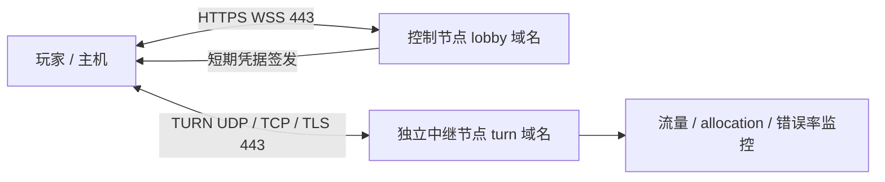

# 阿里云与腾讯云服务器选型及部署调研

- 文档类型：计划
- 状态：进行中
- 创建日期：2026-11-12
- 最后更新：2026-11-13
- 关联文档：[计划索引](README.md)、[房间发现、P2P 与配置包同步方案](room-discovery-p2p-package-sync.md)、[启动入口与服务编排](room-launch-orchestration.md)、[公网大厅草稿](browser-room-portal.md)、[首测工程](../current/engineering/first-test.md)

## 1. 结论与适用条件

2026-11-13 用户已将本轮选型限定在**腾讯云**，并确认测试者主要在**中国内地**；服务器主要提供房间发现和中转。建议采用 **一台 Linux CVM 承载目录/信令与 STUN/TURN，游戏宿主留在房主电脑**。首次按 1 名房主 + 2 名玩家验证，不直接按 80 玩家采购。

- **最低首次支出：优先申请 CVM 个人免费试用。** 官方页面列出 2 核 2G、3 Mbps、50 GB 系统盘、1 个月，符合产品新用户资格且有库存时服务器试用费用为 0 元。另有 BF1 2 核 4G/3 Mbps/50 GB 的 7 天试用，时间更短，作为备选。0 元仅指试用资源，不代表永久免费或包含域名、另购资源和到期续费。[官方免费体验馆](https://cloud.tencent.com/act/pro/free)
- **领不到试用时：在 CVM 活动配置中比较实际订单。** 官方优惠页搜索索引显示 BF1 2 核 2G/1 Mbps 为 38.64 元/月或 180.79 元/年，S5 同核内存/1 Mbps 为 199 元/年；这些是索引报价线索，当前未登录页面没有返回商品，尚不能确认可购买。短期看总支出，持续测试再比较年付；详见第 4.3 节，不把年均月价当作月付价。[官方优惠入口](https://cloud.tencent.com/act/pro/searchall)
- **本轮不推荐先买 Lighthouse 做中继。** 官方限制包含“流量穿透或非法代理服务”，但没有直接点名本项目的 TURN。尚未获得厂商对用途的确认前，不因高带宽套餐便宜就把它作为发现与中继一体的采购方案。CVM 是标准 VM 技术路线，仍遵守其适用条款；本调研不等于厂商书面许可。[轻量实例套餐与限制](https://cloud.tencent.com/document/product/1207/44755)
- **先用单机，按验收需要扩容。** 小消息和限速小文件是低带宽首测的前提；大包、更多并发或仅允许 TCP 443 的网络需要额外预算。HTTPS 与 TURN/TLS 争用同一 IP:443 时，可将 TURN 拆到独立公网 IP/节点，见第 7 节。

这一结论替代 2026-11-12 的“优先阿里 ECS、腾讯等价备选”建议，原因是用户本轮指定了腾讯云；第 4.1 节旧供应商快照仅保留比较背景。用户随后已领取腾讯 CVM 试用（广州、2 核 2 GiB、3 Mbps、50 GiB），并于 2026-11-13 完成目录/信令、STUN/TURN 部署和公网验收，实况见[当前工程说明](../current/engineering/network-p2p.md)。订单为 0 元试用，后续价格仍取决于账号、续费和实际订单，不把历史报价当作续费承诺；未提供正式域名。

## 2. 云端究竟承担什么

| 组件 | 计算与存储 | 网络特征 | 首版位置 |
| --- | --- | --- | --- |
| 房间目录、租约、准入 | 小量元数据、短期在线状态、密码校验、限流 | HTTPS 请求与长连接 WSS | 控制节点 |
| 信令 | 临时 SDP/ICE、申请批准，不长期存全文 | 少量低延迟消息 | 与目录同进程或同机 |
| STUN/TURN | 不执行游戏规则，不保存包文件 | UDP、TCP/TLS、出网流量；受连接数/带宽约束 | 首测同机，按带宽或 443 兼容需求拆分 |
| 平台入口 | 可信客户端壳与 SDK，不含房间秘密 | 旧本机入口校验 CA；新网页需浏览器信任 HTTPS | network-web 已与目录同进程部署测试网页 |
| 玩家配置包 | 主机白名单导出；旧模式整包、新网页按组获取 | 直连不经过云；TURN 时占云出网 | 主机，非云磁盘 |
| 游戏存档与 Lua | 原有 FileDataStore、主机规则与权限 | 授权投影通过 P2P 发给玩家 | 主机电脑 |
| 监控与备份 | 服务配置、发布者身份和目录服务元数据 | 少量日志/指标，限制保留 | 云端本地加独立备份 |

因此不需要把每个房间部署成一个云进程，也不需要先购买 RDS、GPU、Kubernetes 或对象存储。以后增加云端托管主机、音视频或包缓存时，必须重新估算。

2026-11-13 修订的[公网大厅与按需游戏页草稿](browser-room-portal.md)取消公开列表，采用代号准入、有效成员快速重入和房间黑名单。云端新增账号、成员关系、封禁授权副本及房主批准的包信息/规则摘要，供已加入者查看；游戏运行资源仍在独立游戏页打开后从房主获取。这些职责已由 [network-web 测试版](../current/engineering/network-web.md) 实现并部署；正式可信域名入口与长期验收仍待完成。

后续拟由本机 SessionController 统一编排平台入口和配置包专用入口，详细分工见[入口与服务编排方案](room-launch-orchestration.md)。该控制器运行在房主电脑；云目录只接收就绪后的发布、心跳及准入策略副本，不接管本机进程或游戏包生命周期。local/LAN 不要求云目录在线，也不因统一入口而强制云登录。准入策略由主机权威维护，云端按 policyRevision 做前置筛选；目录、准入、心跳和借用宿主接入已实现；完整统一编排仍在计划中。实际 API 与部署限额以[当前工程说明](../current/engineering/network-p2p.md)为准。

## 3. 产品比较

| 方案 | 优点 | 对本项目的限制 | 评价 |
| --- | --- | --- | --- |
| 阿里云 ECS | 可管理系统、防火墙、公网和进程；有固定带宽/流量计费选择 | 需要自行运维；活动低带宽限制文件中继 | 旧跨厂商比较，本轮不采购 |
| 阿里云轻量应用服务器 | 部署简单，适合小 Web 服务 | 官方禁止流量穿透；带宽为峰值而非质量承诺 | 仅目录候选，不作为 TURN 推荐 |
| 腾讯云 CVM | 标准 VM 部署，可选择公网计费方式 | 完整价格取决于地域、机型、盘和公网；需实际报价 | 本轮推荐：免费试用优先，按实测选择续期 |
| 腾讯云 Lighthouse | 套餐标价清楚，目录/信令部署方便 | 官方限制流量穿透等用途，未取得 TURN 适用确认；峰值也不是持续吞吐承诺 | 可单独评估目录，本轮不选它承载中继 |
| 云函数/普通 Web 应用托管 | 适合部分 HTTP 接口、可减少系统维护 | 本方案还需要 UDP、TURN 长驻进程和端口段；WSS 支持与空闲时限需逐产品验证 | 不作为首版统一运行环境 |
| 容器集群 ACK/TKE | 多节点、编排、滚动部署能力 | 首版小流量引入额外成本与网络运维；不能消除 TURN 公网成本 | 有规模后评估 |
| OSS/COS + CDN | 多人下载同一公共文件时可减轻主机上传 | 增加存储、请求、出网和权限管理，需允许再分发；并非 P2P 所必需 | 后续可选缓存，不默认开通 |

公网计费选择依据：[ECS 公网带宽计费](https://help.aliyun.com/zh/ecs/public-bandwidth)、[腾讯云公网网络计费](https://cloud.tencent.com.cn/document/product/215/40405)。轻量适用性依据：[阿里云使用须知](https://help.aliyun.com/zh/simple-application-server/product-overview/usage-notes)、[腾讯云实例套餐限制](https://cloud.tencent.com/document/product/1207/44755)。对首版运维成本的评价是根据本项目组件作出的工程判断，不是厂商性能排名。

## 4. 可核实的报价与边界

### 4.1 2026-11-12 产品标价快照（比较背景）

下表保留 2026-11-12 的人民币中国站比较背景，不作为本轮腾讯 CVM 采购报价；这些套餐价格未在 11 月 13 日逐项重查。未登录采购账号，未核实该账号的购买资格和优惠。

| 产品及配置 | 查阅时价格 | 能用于什么判断 |
| --- | --- | --- |
| 阿里 ECS e：2 核 2G、40G ESSD Entry、3M 固定带宽 | 活动 99 元/年，摊销 8.25 元/月；页面另列日常价 1507.56 元/年 | 活动可用时验证成本低；年度现金支出为 99 元，不是按月支付 8.25 元 |
| 腾讯 Lighthouse 内地入门：2 核 2G、40G、2 Mbps、100 GB/月 | 35 元/月 | 小目录服务候选，超额流量需另算 |
| 腾讯 Lighthouse 内地锐驰：2 核 2G、40G、200 Mbps 峰值、无限流量 | 45 元/月 | 低规格目录候选；不代表稳定 200 Mbps，也不等于已核准中继 |
| 腾讯 Lighthouse 内地锐驰：2 核 4G、50G、200 Mbps 峰值、无限流量 | 65 元/月 | 内存更充裕；与 60G/72 元档位区分 |
| 常规 ECS/CVM：2 核 2–4 GiB、40–60 GiB、按流量公网 | 待选地域后的报价单 | 不能用上面的轻量价替代标准 VM 成本 |

来源：[阿里 ECS 活动页](https://www.aliyun.com/activity/ecs/99program)、[腾讯 Lighthouse 价格总览](https://cloud.tencent.cn/document/product/1207/73452)。腾讯价格页在 2026-11-12 读取时显示更新时间为 2026-11-11；表内只是选取的套餐，售卖地域、镜像与时长以购买页为准。两类产品并非相同资源和带宽承诺，不宜只比较年价。

腾讯 CVM [定价页](https://buy.cloud.tencent.com/price/cvm)仍需按账号、地域及网络配置生成订单；11 月 13 日新增的免费试用信息与活动索引线索见第 4.3 节。不引用开发者社区推广文章补成“当前官方成交价”。

### 4.2 流量计费

腾讯公网网络文档列出的按流量参考价格：中国大陆 0.80 元/GB、中国香港 1.00 元/GB；适用性需核对最终 CVM/EIP 线路与账单产品。[腾讯公网计费表](https://cloud.tencent.com.cn/document/product/215/40405)

阿里 ECS 固定公网 IPv4 文档明确仅计出方向，并用 0.8 元/GB 做杭州示例，同时说明具体价格须以地域定价为准。它是测算参考，不应写为所有 ECS、CDT、EIP、地域的统一成交价。[阿里 ECS 计费规则](https://help.aliyun.com/zh/ecs/public-bandwidth)

固定带宽方案费用中已包含相应带宽，不再按同一出网量重复加一笔按流量费。若选 EIP、CDT、流量包、共享带宽或 CDN，需单独核对是否替代了原计费项，避免重复计算。

### 4.3 2026-11-13 腾讯云最低成本选择

本节区分官网当前可读取的试用配置、搜索引擎索引快照和实际订单。免费试用页面可以读取具体配置；优惠全站搜的索引标注为上月抓取，直接访问未登录页面时没有取得商品列表，因此付费数字**仅用于进入控制台核价，不能保证仍有库存或适用于当前账号**。

| 优先级 / 使用条件 | 产品与配置 | 费用证据 | 本轮建议 |
| --- | --- | --- | --- |
| 1：有 1 个月 CVM 试用资格 | CVM，2 核 2G、3 Mbps、50 GB 系统盘 | 当前官方试用页：0 元 / 1 个月 | 首选，准备好可部署版本后再领取，避免试用期耗在前期开发 |
| 2：只能领取短试用 | CVM BF1，2 核 4G、3 Mbps、50 GB 系统盘 | 当前官方试用页：0 元 / 7 天 | 已准备好测试包和设备时可选；先确认是否占用其他 CVM 试用资格 |
| 3：无试用资格，只测约 1 个月 | CVM BF1，2 核 2G、1 Mbps | 官方索引：38.64 元 / 1 个月 | 先核当前订单；适合小消息与限速小文件，不能当作大包下载配置 |
| 4：确定持续数月以上 | CVM BF1，2 核 2G、1 Mbps | 官方索引：180.79 元 / 年，约 15.07 元/月摊销 | 本次检索到的较低 CVM 年付候选；一次付一年，续费另核 |
| 5：BF1 年付不可用时比较 | CVM S5，2 核 2G、1 Mbps | 官方索引：199 元 / 年，约 16.58 元/月摊销 | 与同带宽 BF1 的实际订单比较，不为小规模试验盲目加内存 |

来源：[免费体验馆](https://cloud.tencent.com/act/pro/free)、[优惠全站搜](https://cloud.tencent.com/act/pro/searchall)。付费索引卡片没有完整显示系统盘等全部订单明细；不能据此宣称总费用已经锁定。卡片同时列出多种可选带宽，不表示 3/5 Mbps 也适用表中的 1 Mbps 价格。试用面向产品新用户并受库存、实名认证与活动规则约束，以账号实际领取结果为准。

建议获取配置：

- **产品：云服务器 CVM**，确认没有误选轻量应用服务器、云官网建站、无公网 IP 配置或抢占式实例。
- **地域：靠近多数测试者的中国内地地域。** 目前仅确认“内地”，尚不能在北京/上海/广州之间判断最低延迟；先在有资格和库存的地域中按玩家分布选择。
- **计算与磁盘：2 核 2G 起，系统盘约 40–50 GB。** 免费档按其 50 GB 套餐；付费档核对磁盘是否已计入订单。只放服务、元数据和受控日志。
- **系统：免费公共 Linux 镜像，优先 Ubuntu 24.04 LTS x86_64（购买页提供时）。** 不购买面板、Windows 授权或额外应用镜像。
- **公网：一个公网 IPv4。** 免费档优先保留 3 Mbps；付费 1 Mbps 仅用于第一轮小流量连通测试。需要升到 3/5 Mbps 时重新取得总价，先不另买 EIP、CLB、NAT 网关。
- **附加服务：首测不买数据库、COS/CDN、容器集群或 GPU。** 控制元数据用单机受限持久存储，游戏存档在房主电脑。
- **时长与续费：按实际测试周期选。** 仅测几小时或几天且无免费资格时，再用按量 CVM 的完整小时费用与月付比较；停机不一定释放磁盘/IP等收费项，结束后按资源清单释放。按量价格未取得，不能断言一定比活动月付便宜。[CVM 计费模式](https://cloud.tencent.com/document/product/213/2180)

本轮已取得 0 元 CVM 试用并完成通用连通验证；上述付费配置保留作续费/扩容比较线索。实际并发、测试时长和正式域名仍未确定，当前结果不证明满足 80 玩家或所有游戏包，也未确定年度总成本。

## 5. 容量和费用测算

### 5.1 计算方式

P2P 直连比例未知，首版必须采集数据，不能假设 90% 或 100% 成功。以下为工程测算假设：

- C：平均同时在线的玩家连接数，不含主机；
- r：这些连接中经 TURN 的比例；
- b：单玩家连接的双向应用数据总速率，单位 Mbps；
- T：月活跃小时数；
- D：月实际文件分发总字节数（已扣除缓存命中）；
- rf：文件分发中经 TURN 的比例，可能与 r 不同；
- k：每份数据经过的计费云出网次数；单中继路径取 1，双中继或跨节点路径需按实际路由增加；
- h：协议、重传及估算余量，示例取 1.2；信令/API 出流量单列。

采用十进制 GB：

```text
游戏中继出流量 GB = C × r × b × T × 3600 ÷ 8000 × k
文件中继出流量 GB = D ÷ 1,000,000,000 × rf × k
总出流量 = (游戏中继 + 文件中继 + 目录/信令出流量) × h
月费用 = 实例 + 磁盘 + 公网费用 + 公网IP单独费用（如有）+ 备份/日志 + 域名月摊销
```

双向 b 已包括玩家上行和主机下行，不能再机械乘 2。一个方向的数据通过单个 TURN 节点时，云端“入+出”也不等于两份出流量；若两端分别选择 TURN 或跨节点转发，再按实际出口次数计费。最终以节点网卡计量和账单核对。

### 5.2 两个示例负载

| 假设 | 后续 80 连接容量场景 | 增长场景 |
| --- | --- | --- |
| C、r、b、T | 80 连接、25% 中继、0.02 Mbps 双向、120 小时/月 | 500 连接、50% 中继、0.02 Mbps 双向、120 小时/月 |
| 文件请求 | 100 次缺缓存下载，每次 200 MiB，25% 中继 | 1000 次缺缓存下载，每次 200 MiB，50% 中继 |
| 目录/信令出流量 | 2 GB/月 | 10 GB/月 |
| 路由与余量 | k=1，h=1.2 | k=1，h=1.2 |
| 游戏中继 | 21.60 GB | 270.00 GB |
| 文件中继 | 5.24 GB | 104.86 GB |
| 含余量的总出流量 | 34.61 GB | 461.83 GB |
| 若实际流量单价为 0.8 元/GB | 约 27.69 元/月 | 约 369.46 元/月 |

上表是按量公网的计算示例，**不含实例、磁盘等费用，不是采购报价**。若增长场景的 k=2，总出流量约 911.66 GB，流量部分约 729.33 元/月。b=0.02 Mbps 也尚未测量；当前宿主会推送授权快照，应以实际游戏包测量后的 b 替换，不能拿聊天文字大小当全部带宽。

80 连接示例不是首次 1 房主 + 2 玩家的资源要求。C=80 表示在 T=120 小时内的平均并发，若只是峰值 80、绝大多数时间无人在线，应按真实积分连接时长重算。每台玩家电脑/主机自己的宽带费用不计入云账单。

### 5.3 带宽瓶颈比 CPU 更先出现

3 Mbps 理论上限为 0.375 MB/s。单份 200 MiB 文件即使独占出口，也至少需要约 **9.3 分钟**；8 名玩家各下载完整一份，需要至少 **74.6 分钟的总出口时间**，并发时带宽共享。实际还有游戏消息与协议开销，所需时间更长。因此免费 CVM 的 3 Mbps 和同类低带宽实例适合连通验证、控制服务及限速小文件，不适合作为大包高并发中继的最终方案。

付费候选的 1 Mbps 理论上限仅 0.125 MB/s：200 MiB 至少约 28 分钟，8 MiB 也至少约 67 秒；多玩家共享出口且还要留给控制流量。首测宜预置大素材、使用小分发包并限制下载并发。若正常操作期间控制请求超时，应先限下载或提高带宽，不能仅凭 CPU 空闲就认定配置够用。测试用小包不替代后续真实包验收。

20 Mbps 理论上限为 2.5 MB/s，单份 200 MiB 至少约 84 秒；若要 8 人各在 2 分钟内取得该文件，仅文件出口就需要约 112 Mbps，尚未计开销。减小客户端包、缓存、提前准备和必要时引入合规公共文件缓存，通常比盲目加 CPU 有效。

固定带宽与按流量的比较：在所需峰值带宽相同、服务质量满足条件时，用“固定带宽月价 ÷ 流量单价”求收支平衡点；再比较实际月 GB。按流量峰值通常只是限速上限，不是持续带宽保证。[阿里说明](https://help.aliyun.com/zh/ecs/public-bandwidth)、[腾讯说明](https://cloud.tencent.com.cn/document/product/215/40405)

建议试运行设置费用告警 50%/80%/100%、中继下载每日额度、每用户/房间限速。告警不是硬消费上限：达到预算策略阈值时应用停止新大文件中继并显示原因，保留必要控制流量，不能继续无限发放 TURN 凭据。待正式预算确定后再填写金额。

## 6. 地域、域名与访问

1. 用户已确认测试者主要在中国内地。选择靠近多数玩家的腾讯云大陆地域，按真实运营商线路测量；不凭地域名称承诺时延，不默认选香港或海外。
2. 香港/新加坡只在海外参与者或其他明确需求下重新评估；腾讯云文档提示内地跨境访问可能出现高延迟或丢包。[地域网络提示](https://cloud.tencent.com/document/product/1207/44755)
3. 公开浏览器入口需要可信 HTTPS/WSS；大陆网站按要求完成备案和接入。**当前一月试用 CVM 不能直接用作备案资源**，续费和资格要求见下节；现有受控客户端连通测试不等于公开网页已可上线。[腾讯备案资源常见问题](https://cloud.tencent.com/document/product/243/73180)
4. 建议分开使用 lobby 与 turn 子域名。目录 HTTPS/WSS 使用有效证书；TURN/TLS 使用与 turn 域名匹配的证书。两个域名解析到同一 IP 不能解决 TCP 443 的监听冲突。
5. 先支持公网 IPv4；IPv6 只有在主机、玩家、ICE 库、云产品、防火墙和验证矩阵均通过后才启用 AAAA。未验证的 AAAA 可能造成连接劣化。

### 6.1 在腾讯云取得并接入域名

本节于 **2026-11-13** 查阅腾讯云官方资料。现有 CVM 提供公网 IP；自定义公开域名需要另行注册，或使用已有域名/获授权的子域名。修改 Linux 主机名不会注册公网域名，域名解析也不会自动生成网站。建议先检查已有域名，避免重复购买。

面向本项目，建议用 `lobby.example.com` 承载大厅、API、WSS 和可信游戏页（例如 `/play/...`），另用 `turn.example.com` 标识中继。`example.com` 和下表 IP 仅为示例，不能作为实际配置。当前测试网页已部署于服务器 IP，见 [network-web](../current/engineering/network-web.md)；尚未配置正式域名和公网可信证书。

#### 第一步：取得域名

- **尚无域名**：进入腾讯云“域名注册”，先在“信息模板”完成所有者资料和实名审核，再查询可注册名称、绑定已审核模板并购买。比较首年与续费价格，确认后缀符合计划备案条件；域名与服务器分别续费。[注册与实名步骤](https://cloud.tencent.com/document/product/242/39039)
- **已有域名**：使用一个空闲子域名即可，不必为这台服务器再买一个。域名不必转入腾讯注册；在现有权威 DNS 添加记录，或将 DNS 托管到 DNSPod。迁移 DNS 时先保留原有网站和邮件记录，按控制台分配的 NS 地址操作。[DNS 设置指引](https://cloud.tencent.com/document/product/302/3446)

#### 第二步：先核对广州 CVM 的备案资格

在腾讯云 ICP 备案控制台输入域名，按实际情况选择首次备案或接入备案。大陆资源公开提供网站服务需完成相应备案；已在其他服务商备案的域名迁入腾讯云，也需办理接入。[备案云资源](https://cloud.tencent.com/document/product/243/18908)、[接入备案](https://cloud.tencent.com/document/api/243/37403)

当前一月试用实例不能直接视为备案资源：腾讯常见问题明确排除试用期服务器；CVM 要求境内公网资源、包年包月购买累计至少 3 个月（含续费），且备案期间剩余至少 1 个月。先在控制台确认续费后资源的实际资格和订单金额，**不要直接假定再续两个月就一定合格**。[资源资格与试用限制](https://cloud.tencent.com/document/product/243/73180)

域名所有者与备案主体按控制台要求保持一致，按真实服务用途填写资料。域名实名、账号实名和 ICP 备案是不同环节；有域名不代表已完成备案。未提供实际域名和备案状态，本轮没有发起申请或续费。

#### 第三步：添加公网 DNS 记录

进入“云解析 DNS → 权威解析 → 目标域名 → 记录管理”，手工添加所需记录。腾讯注册域名通常已在列表；外部域名使用 DNSPod 时先添加域名，并确认注册商处 NS 指向控制台分配地址。若保留其他解析商，直接在那里添加同样的 A 记录。[腾讯添加解析指引](https://cloud.tencent.com/document/product/302/3446)

| 主机记录 | 类型 | 线路 | 记录值 | 用途 |
| --- | --- | --- | --- | --- |
| `lobby` | A | 默认 | CVM 的实际公网 IPv4；例如 `203.0.113.10` | 大厅、目录、信令与可信游戏页 |
| `turn` | A | 默认 | 当前中继节点的实际公网 IPv4 | STUN/TURN；初期可与上行相同 |

TTL 先用控制台默认值。记录值只填 IP，不填 `https://`、端口或路径；根域名使用 `@`，想用 `www` 需单独设置。暂不添加未验证的 AAAA。两个域名指向同一 IP 不会增加带宽，也不能让两个进程同时占用同一 TCP 443。

本项目少量 A 记录可先用 DNSPod 免费版，不必为基本解析买付费套餐；免费 DNS 不等于免费域名。[免费解析支持范围](https://cloud.tencent.com/document/product/302/2589)

NS 变更与递归缓存可能导致各地生效时间不同，腾讯文档给出的 NS 全球生效窗口为 0–48 小时。解析成功仍需网站部署、端口与证书同时正确，不用 ping 成败代替完整验证。[生效排查](https://cloud.tencent.com/document/faq/302/30597)

#### 第四步：配置可信 HTTPS 与服务路由

在腾讯云“SSL 证书”申请匹配 `lobby` 完整域名的证书，满足额度条件时可选免费单域名 DV；域名在 DNSPod 时可用自动 DNS 验证。证书签发后还需在实际提供 HTTPS 的服务上安装证书链及私钥，并配置到期更新，不能只完成申请。[免费证书流程](https://cloud.tencent.com/document/api/400/6814)、[域名验证方式](https://cloud.tencent.com/document/api/400/4142)

网页模块已将静态页和 API/WSS 合并在原目录进程的 TCP 443。正式域名接入时更新 publicOrigin/Origin 允许列表、客户端地址及中继地址；无需再启动一个服务争用 443。

`turn` 用于 TURN/TLS 时，证书也要覆盖该名称；只改 DNS 不会让现有测试 CA 自动变成浏览器信任的证书。现有中继端口和 TCP443-only 限制仍见第 7 节。

保持现有必要端口。采用 ACME HTTP-01 验证需要放行 TCP 80；DNS-01 使用 DNS TXT 校验，可不为证书验证开放 80。若另设 HTTP 跳转，再按实际需要配置 80。具体续期机制须在部署时验证。[ACME 验证方式](https://letsencrypt.org/docs/challenge-types/)

#### 第五步：验收并交接

下列是域名确定后的检查模板，本轮没有实际域名可执行：

```powershell
Resolve-DnsName lobby.example.com -Type A
Resolve-DnsName turn.example.com -Type A
Test-NetConnection lobby.example.com -Port 443
```

解析结果应对应实际公网 IP；再从外部网络用干净浏览器确认 HTTPS 无证书警告，完成注册、短码加入、WSS、直连及强制中继测试。只测通 443 不能证明网页、WSS 或 TURN 均可用。

后续接入资料只需说明域名、DNS 管理位置、备案/接入状态、预期子域名及续费结果；不在共享文档放腾讯云密码、主账号 API 密钥或证书私钥。账号与域名费用以实际订单为准，本节不是采购或自动续费操作。

## 7. 部署方式与端口

### 7.1 已部署：一台标准 VM

当前使用广州 Ubuntu 24.04 CVM，目录/信令和 coturn 由 systemd 管理；目录直接提供 HTTPS/WSS，未采用原拟议的 Docker Compose 和反向代理。配置、服务路径、端口、安全组与 SSH 以[当前工程说明](../current/engineering/network-p2p.md#5-云端部署与-ssh)为唯一操作依据。

目录单进程保存在线租约、协商和一次性票据，重启后重新注册；持久元数据独立于游戏 FileDataStore。将来多副本需引入共享租约和限流存储，不能直接增加进程数。

100 个 relay 端口只是试验池，不等于 100 人容量；两端分配及重连时的旧 allocation 都会占用资源，后续按实测利用率扩容。云端一对一公网映射需正确设置 coturn external-ip 与等端口转发，参考[coturn 官方说明](https://github.com/coturn/coturn/blob/master/README.turnserver)。

单 IP 的 TCP 443 已用于 HTTPS/WSS，不能同时绑定 TURN/TLS；两个域名也不能解决该冲突。当前默认 TURN 使用 UDP/TCP 3478，5349 只验证 TLS 握手，仅 TCP 443 出网场景仍待下节方案验证。

### 7.2 扩展方案：控制节点与中继分开



当单机带宽不足或需要 TURN/TLS 443 兼容时再拆分，不要求第一次测试就买两台。扩展中继可从 2 核 2–4 GiB、20 Mbps 按流量峰值和受控 relay 端口池做报价/压测起点；这不是已测需求。独立公网 IP 使 TURN/TLS 可占用 TCP 443；普通 HTTPS 七层反向代理不能直接代理任意 TURN 流量。需要第二地域时增加独立中继地址，由客户端按策略尝试，记录成本，不默认跨云转发。

目录/信令可容器化，但 TURN 不宜盲目经过容器端口随机映射或普通 HTTP 负载均衡。Linux host 网络减少映射复杂度；同时需要最小权限、只读配置、进程资源限制和隔离运维面。首版无需把 Windows 游戏宿主打包进云镜像。

### 7.3 已部署基础与后续验证

部署脚本已提供，实际操作见[工程说明](../current/engineering/network-p2p.md#5-云端部署与-ssh)。当前目录身份校验、短期 TURN 凭据、allocation/吞吐配额及目标地址限制已经实现；后续工作为：

1. 补真人跨运营商、热点/CGNAT 和禁 UDP 网络测试；TURN/TCP 已有自动证据，TURN/TLS 还需浏览器数据通道及证书信任验证。
2. 验证长时会话的凭据到期/续期、重连和踢出后的资源回收。短期凭据不自动等于即时撤销既有 allocation。
3. 补费用告警、健康指标、备份恢复及正式证书续期演练；依据实际预算设置阈值。
4. 需要 TCP 443 中继兼容或更高吞吐时，再实施独立中继节点并重测。

### 7.4 用户获取资源后的交接与首测

2026-11-13 已建立[公网联机模块目录](../../engineering/network-p2p/README.md)及[本地资料区](../../engineering/network-p2p/local/README.md)。本机可直接填写其中的 `server-info.md`，配置截图及本地密钥文件也可放在该资料区；除说明文件外均被 Git 忽略。共享空白表见[接入信息模板](../../engineering/network-p2p/server-info.example.md)。

当前实例已完成接入和测试部署。以下清单保留用于更换实例或交接；已有本机资料无需重复提供：

| 信息 | 用途 |
| --- | --- |
| 产品、地域、操作系统、CPU/内存、系统盘 | 确认是 CVM，匹配部署与运行时 |
| 公网 IPv4、SSH 端口、登录用户名 | 建立运维连接；本轮按出差需求开放 TCP 22，使用密钥且禁用密码登录，现况见工程说明 |
| 已授权的本地 SSH 私钥文件路径，或另行配置的部署公钥 | 通过本机密钥认证；私钥、密码、云 API Secret 不粘贴进聊天或仓库 |
| 公网计费方式、带宽、试用到期日/续费选项 | 设置吞吐边界、费用告警和回收时间 |
| 可用域名、现有备案/接入状态、DNS 可操作范围 | 确定浏览器 HTTPS/WSS 与 TURN/TLS 的证书方案 |
| 房主及两名测试玩家的大致地区、运营商、可测试时间 | 安排跨网直连、热点和强制中继验证 |

SSH 密钥登录、目录/信令与 coturn 部署、跨机器直连/强制中继、通用玩家内容同步已经验证；证据和初始主机指纹核验边界见[工程说明](../current/engineering/network-p2p.md)。接下来是具体游戏包适配、真人异网和长时测试；当前仍需手动重新加入，原宿主及本机管理 API 不直接暴露公网。

## 8. 运维、扩容与恢复

| 指标 | 为什么采集 | 建议触发动作 |
| --- | --- | --- |
| 在线房间、WSS、join 成功率、连接时长 | 观察目录与信令体验 | 异常区分主机离线、密码拒绝、ICE/TURN 失败 |
| direct / relay 比例及节点 | 确定实际费用模型 | 高中继率时检查网络和候选策略，不凭经验写固定比例 |
| 带宽、出网 GB、文件下载排队 | 发现主要成本和下载拥塞 | 持续出口 >70% 或排队明显时限速/拆分/扩带宽 |
| TURN allocations、端口池、认证失败 | 避免容量耗尽与盗用 | 占用 >70% 压测扩容，异常认证按来源限流 |
| CPU、内存、事件循环延迟 | 识别密码校验与控制服务瓶颈 | 限制并发，必要时升规格，先保控制流量 |
| 证书有效期、磁盘剩余、备份恢复 | 防止长期运行中断 | 提前告警、清理受控日志、演练恢复 |

70% 是建议操作阈值，需按监控数据调整，不是厂商 SLA。日志仅记录 requestId、错误码、耗时和必要资源指标；限制网络地址等元数据保留期，不保存密码、票据、游戏正文及原始完整信令。

备份控制服务身份/配置/授权记录，保留密钥轮换和恢复办法；云节点不会持有主机游戏存档。建议每日备份、保留 7 个日版本并定期异机恢复测试。单机服务有停机窗口，首版不宣称高可用。

控制服务重启后客户端重新注册、审批或兑换新票据；已经建立的直连可继续，中继凭据续期和新连接会受影响。TURN 重启会中断其承载连接，需 ICE 重建和回执恢复。更新时先停止新分配、等待既有会话排空再切换；无法无损排空时提前显示维护状态。

## 9. 实施顺序与验收门槛

1. **已完成通用首轮验证。** 独立运行时、协议与分发包、0 元 CVM 部署、双玩家、跨机器直连和强制 TURN、小包同步均有自动证据；断线后手动重新加入。
2. **补真实网络和长期数据。** 测试家庭宽带跨运营商、热点/CGNAT、双重 NAT、禁 UDP、长时会话及文件失败恢复，再评估 80 玩家目标；区分自动客户端和真实设备。
3. **按瓶颈升级。** 下载影响控制消息时先限速/预置素材；仅 TCP 443 网络需要独立 TURN 公网 IP/节点。扩容前核对域名、用途和费用。
4. **按实测决定续费。** 记录出网 GB、并发、P95 延迟、故障率和完整账单，分别比较续费价与首购价。

当前已有重启无幽灵房间、私房隐藏、本机管理隔离、真实 relay 和内容同步证据，详见[0.2 的 54 项验收记录](../../engineering/network-p2p/acceptance/2026-11-13-0.2.0.json)。大包长期拥塞、账单模型、预算阈值动作、证书续期及备份恢复演练尚未验收，不能将首轮通过视为这些条件均已满足。

## 10. 待确认项与续费/扩容记录

已确认：内地测试者，腾讯广州 CVM 0 元试用，服务器用于发现与中继且已部署。待确认：后续测试时长、具体省份/运营商、实际并发与典型包体积、续费预算、正式域名及备案/接入情况。1 房主 + 2 玩家是首轮自动验收规模，并非用户给出的容量需求，也不代表真人异网测试已经完成。

采购记录应包含厂商、账号资格（不含秘密）、地域/可用区、规格、架构、系统盘、固定公网/EIP、带宽与计费方式、流量单价、月/年价、续费价、优惠期限、备份/IP等附加费、用途条款确认、报价日期和是否自动续费。未取得这些信息前不下“年度总成本已确定”的结论。

## 11. 来源与调研限制

查阅日期：原跨供应商比较为 **2026-11-12**；腾讯免费试用、优惠索引、轻量限制、CVM 计费及公网计费补核为 **2026-11-13**。域名注册、DNS、备案资源和证书流程于 **2026-11-13** 补核，官方来源见第 6.1 节。优先使用官方资料；付费搜索索引不等同于实时订单。

| 来源 | 支持的事实 |
| --- | --- |
| [腾讯免费体验馆](https://cloud.tencent.com/act/pro/free) | 11 月 13 日可读取的 CVM 免费配置、时长、试用与备案提示 |
| [腾讯优惠全站搜](https://cloud.tencent.com/act/pro/searchall) | 11 月 13 日检索到的上月索引报价；未取得登录后的可购订单 |
| [腾讯轻量实例套餐](https://cloud.tencent.com/document/product/1207/44755) | 流量穿透等用途限制、峰值带宽及跨境访问提示；没有直接点名本项目 TURN |
| [腾讯 CVM 计费模式](https://cloud.tencent.com/document/product/213/2180) | 包月与按量等计费模式，短期总成本需按资源配置核对 |
| [阿里 ECS 99 元活动](https://www.aliyun.com/activity/ecs/99program) | 活动规格、年价与页面所示续费安排 |
| [阿里轻量使用须知](https://help.aliyun.com/zh/simple-application-server/product-overview/usage-notes) | 使用限制、峰值带宽和网站备案说明 |
| [阿里 ECS 公网带宽计费](https://help.aliyun.com/zh/ecs/public-bandwidth) | 固定带宽/出网流量计费及示例的适用边界 |
| [腾讯 Lighthouse 价格总览](https://cloud.tencent.cn/document/product/1207/73452) | 中国内地具体套餐和月价 |
| [腾讯锐驰型说明](https://cloud.tencent.com/document/product/1207/115752) | 套餐类型与带宽说明 |
| [腾讯公网网络计费](https://cloud.tencent.com.cn/document/product/215/40405) | 按流量/带宽规则、地域价格 |
| [腾讯 CVM 报价入口](https://buy.cloud.tencent.com/price/cvm) | 完整标准 VM 报价需按配置查询，本文未取得报价结果 |
| [阿里轻量地域和网络](https://www.alibabacloud.com/help/en/simple-application-server/product-overview/regions-and-network-connectivity) | 地域选择与跨境线路提示；仅引用网络注意事项，不混用国际站价格 |
| [WebRTC TURN 指引](https://webrtc.org/getting-started/turn-server) | 直连失败的中继用途 |
| [coturn 官方配置](https://github.com/coturn/coturn/blob/master/README.turnserver) | 认证、带宽配额、映射和 relay 端口等组件参数 |

报价与域名步骤属于资料调研，未核实账号续费订单、实际域名或备案资格；既有部署和通用连通证据以当前工程及第 9 节链接为准，不证明本文所有扩展已经可用。本文吞吐目标和费用场景仍须实测核对。

