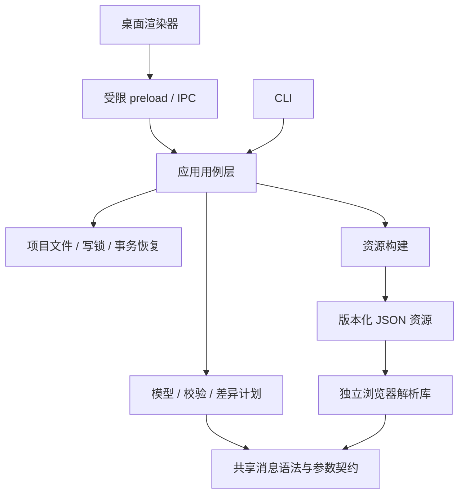

# 独立本地化工具工程设计

- 文档类型：计划
- 状态：进行中
- 创建日期：2026-11-12
- 最后更新：2026-11-12
- 关联文档：[需求与边界](localization-system.md)、[施工与验收计划](localization-construction-plan.md)、[计划索引](README.md)、[文档维护标准](../standards/document-maintenance.md)

## 1. 设计基线与交付范围

本设计将已确认的独立本地化方案细化为可施工契约。本文保留整体目标契约；L10N-0 已有部分实现，阶段 3/4 条件通过，未完成项见[当前工程入口](../current/engineering/localization.md)。未列入当前实现的格式、接口和命令仍是待实施设计。需求与归属以[方案](localization-system.md)为准，具体工程契约在本文维护，阶段状态和证据在[施工计划](localization-construction-plan.md)维护。

首版交付四项：独立桌面 GUI、独立 CLI、可读的资源发布目录、可选的浏览器解析库。默认英文 en 为源语言、中文 zh-CN 为目标；文件是唯一协作数据源。翻译不全允许发布，缺译显示 fallback 或 errorText 并继续运行。

不依赖 OnlineCOC 核心、具体配置包、游戏账号、房间接口、Python 环境或运行存档。不提供游戏权限裁决、规则计算、房间部署和存档备份。协作平台、机器翻译、云同步、自动更新、富文本和多层术语覆盖不进入首版。

## 2. 技术方案与模块边界

### 2.1 技术栈与 L10N-0 冻结结果

| 层 | 工程选择 | 理由与限制 |
| --- | --- | --- |
| 共享逻辑 | TypeScript；纯数据领域层与 Node 文件适配分离 | GUI/CLI 共用模型、校验、事务和构建；浏览器解析库不能引入 Node fs 或 Electron |
| 桌面 GUI | Electron 主进程＋隔离 preload＋React/TypeScript 界面，Vite 构建 | 提供原生目录选择和独立窗口；不要求用户另开浏览器或部署本地 Web 服务 |
| CLI | Node.js 24 LTS 基线，独立入口 | 开发环境和 CLI 发行包固定补丁版本；与 Electron 自带 Node 分别测试，领域代码使用两者共有能力 |
| 格式与校验 | JSON Schema Draft 2020-12＋Ajv 2020 校验器，另加语义校验 | schema 检查结构，语义层检查别名环、原文摘要、参数、路径和输出分类 |
| 文本解析 | intl-messageformat＋ICU parser，统一 ICU MF1 子集 | GUI 预览和解析库共用实现；格式化错误由外层处理，不直接把插件返回的原始模板显示给用户 |
| 测试 | 领域／文件集成测试、真实 Electron GUI 测试、浏览器解析演示、进程中断与独立发行验证 | GUI 自动化驱动在 L10N-0 试验后锁定；不能用纯 DOM 单测代替打包后的真实窗口验收 |

2026-11-12 的 L10N-0 已锁定精确版本及独立 package-lock.json，详见[现行架构](../../tools/localization/docs/architecture.md)。采用 Playwright 1.65.0 驱动真实打包窗口；为避免多层回退语义，直接使用 intl-messageformat 12.1.5 并统一捕获格式化异常，不增加 i18next 包装。此项替代本节原先 i18next＋插件的候选。相对于早稿“本地文件服务＋浏览器”的候选方向，本轮选择 Electron 以简化文件选择、窗口与独立分发；代价是发行体积和内存占用，须按第 10 节验收。

Electron 官方提供原生文件对话框及打包路线，并要求隔离渲染器权限；本设计采用其隔离原则。Node 的官方发布页将 24 列为 LTS；JSON Schema 与 Ajv 的 2020-12 支持是格式基线依据。见[Electron 对话框](https://www.electronjs.org/docs/latest/api/dialog)、[隔离与安全](https://www.electronjs.org/docs/latest/tutorial/security)、[发行](https://www.electronjs.org/docs/latest/tutorial/application-distribution)、[Node 发布](https://nodejs.org/en/about/previous-releases)、[JSON Schema](https://json-schema.org/draft/2020-12)、[Ajv](https://ajv.js.org/json-schema.html)。查阅日期：2026-11-12。

### 2.2 依赖方向



渲染器只持有 projectHandle 和 DTO，不直接打开磁盘路径。主进程调用原生对话框，记录用户选择的项目根目录。preload 仅暴露操作白名单，不暴露通用 IPC、fs、shell 或任意模块导入。关闭 nodeIntegration，开启 contextIsolation 和 sandbox；界面只加载发行内的静态资源，词条按文本渲染，阻止外部导航和任意窗口创建。大型扫描、校验和构建在工作进程执行，可取消，文件提交由单一写入协调器负责。

工具不监听网络端口，首次启动、编辑、预览、构建和离线使用都不需要互联网。将来外部平台适配器需单独声明网络权限，不能由打开项目文件自动执行。

## 3. 三套文件结构

以下是完整目标结构，部分 L10N-0 路径已经创建；实际文件以 hierarchy 和工具工程文档为准，尚未创建的目标路径不提前登记为已有能力。

### 3.1 模块源码

```text
tools/localization/
  README.md
  package.json                 # npm workspaces、统一检查入口
  package-lock.json            # 独立依赖锁
  tsconfig.json
  .gitignore
  schemas/
    project.schema.json
    catalog.schema.json
    translations.schema.json
    aliases.schema.json
    glossary.schema.json
    text-ref.schema.json
    exchange.schema.json
    resource-manifest.schema.json
    operation.schema.json
  packages/
    contracts/src/             # DTO、错误码、版本及 schema 导出
    messages/src/              # ICU 分析、参数、无文件依赖的解析逻辑
    core/src/
      model/                   # 词条身份、状态、摘要、分类
      validation/              # 结构与跨文件约束
      workspace/               # 加载、监视、稳定快照、路径边界
      operations/              # 创建、修改、删除、重命名的变更计划
      storage/                 # 锁、事务日志、文件写入与恢复
      exchange/                # JSON/CSV 导入导出和三方合并
      references/              # 索引、扫描覆盖、动态引用保留
      build/                   # 资源过滤、摘要和发布
    cli/src/main.ts
    desktop/src/
      main/                    # 窗口、原生对话框、操作分派
      preload/                 # 受限桥接
      renderer/                # 页面、表格、编辑器、差异与预览
    runtime/src/               # 独立 ESM/IIFE 解析入口
    adapters/
      json-textref/            # 首版完整可重写引用适配器
      js-literal/              # 显式调用模式的静态扫描
      lua-literal/             # 字面量引用扫描，不执行脚本
  examples/
    minimal/                   # en→zh-CN、静态/参数/复数、缺译
    second-project/            # 相同 key、不同 projectId
    browser-consumer/           # 无游戏后端的演示
  tests/
    unit/ integration/ gui/ runtime/ distribution/
    fixtures/                  # 冲突、损坏、越界、恢复与大数据样本
  scripts/                     # 构建、打包、独立性检查、验收报告
  docs/                        # 实施后维护实际用法、格式与验收结果
  dist/                        # 发行产物，生成目录
  .test-output/                # 隔离测试数据与证据，生成目录
```

各 workspace 自有 package.json；core 不导入 desktop，runtime 不导入 core/storage；adapters 只使用声明的文件访问接口。自动检查禁止生产依赖指向模块目录之外的工程代码、OnlineCOC 环境或具体配置包。node_modules、构建缓存、dist 和测试输出不逐文件入库；依赖锁、schema、样例和测试源码入库。验收中需留存的精选报告按文档规则登记。

### 3.2 作者项目

```text
my-localization-project/
  localization.project.json
  locales/
    en/ui.json
    zh-CN/ui.json
    meta/catalog/ui.json
    meta/translations/zh-CN/ui.json
    aliases.json
    glossary.json
  examples/view.json           # 可选的静态引用样本
  .l10n/
    locks/                     # 跨进程协调；不得提交或跨机器同步
    transactions/<id>/          # before/after、清单、提交决定与恢复状态
    drafts/                    # 未保存编辑的本机恢复副本
    cache/                     # 可重建搜索与引用索引
  build/localization/<buildId>/
    public/resource-manifest.json
    public/resources/<locale>/<namespace>.json
    public/contracts.json
    public/aliases.json
    restricted/                # 同构资源，仅交给获准的使用方
    build-report.json           # 作者报告，可包含受限条目，不公开分发
    COMMITTED                  # 整份构建完成标志
```

正文、项目设置、元数据、别名和术语表是协作源文件；.l10n 是本机工作状态，不是第二份权威库。build 是不可变产物，不能编辑后回灌。项目可独立存放，也可放在使用方开发工作区；工具不要求游戏 manifest。最近打开列表和窗口设置放在工具自己的用户设置目录，测试必须能用独立 settings-dir 隔离。

### 3.3 独立发行

GUI 交付完整 Windows x64 便携目录，包含 Localizer.exe、Electron 运行依赖和应用文件；CLI 另交付 l10n.cmd、runtime/node.exe、已编译 CLI、schema 和必要运行依赖。不得要求只复制单个 exe，也不要求用户安装 Node/npm/Python。解析库交付独立 ESM 与 IIFE 文件、类型定义及许可清单，可只配静态资源使用。

每份发行物包含 release.json、文件 SHA-256、依赖与许可证清单、使用说明；版本固定，不与 OnlineCOC 更新周期绑定。首版验收目标为 Windows 11 x64 与本地磁盘，其他系统及网络共享目录不宣称已支持。首次无需安装权限或执行下载命令；不默认自动更新。

## 4. 数据格式与跨文件约束

### 4.1 通用规则

- 源文件为 UTF-8 无 BOM、LF、两空格缩进和文件末尾换行；保存只影响变更文件，保留普通 Unicode 可读字符。导入可识别 UTF-8 BOM，但写出统一格式。
- JSON 解析必须检出重复属性，不采用悄悄保留最后一项的行为。拒绝 NaN、Infinity、不安全数值及有风险的保留属性名；用户内容是字符串，不执行表达式。
- projectId 为稳定 ASCII 标识，建议 `[a-z][a-z0-9._-]{0,63}`；namespace 采用 `[a-z][a-z0-9-]{0,47}`，直接映射文件名，不含路径分隔符；key 匹配 `[a-z][a-z0-9]*(?:[._-][a-z0-9]+)*` 且最长 160 字符，点号是字面字符，不是嵌套路径。
- 语言标签用 Intl.getCanonicalLocales 规范化；拒绝 Windows 保留文件名、大小写折叠冲突、越界路径及目录连接／符号链接逃逸。相对路径统一 `/`，源目录与输出不得互相覆盖。
- 版本 1 的已知对象禁止未知字段；提供 extensions 命名空间保留适配器数据。不支持的 schema 主版本以只读诊断打开，不擅自改写。纯语言文件始终是 key→string，不放 schema 或注释。

### 4.2 项目配置

```json
{
  "schemaVersion": 1,
  "projectId": "example-catalog",
  "localization": {
    "sourceLocale": "en",
    "supportedLocales": ["en", "zh-CN"],
    "root": "locales",
    "namespaces": ["ui"],
    "messageFormat": "icu-mf1",
    "fallbacks": {"zh-Hans": ["zh-CN"], "en-GB": ["en"]},
    "releasePolicy": {"allowIncomplete": true, "excludeMessages": []},
    "missingText": {"mode": "fallback", "errorText": "[Text unavailable]"},
    "distribution": {"default": "restricted", "publicNamespaces": ["ui"]}
  },
  "references": {
    "roots": [{"id": "project", "path": "."}],
    "adapters": [{"id": "json-textref", "include": ["examples/**/*.json"]}],
    "dynamicKeys": []
  },
  "build": {"output": "build/localization"},
  "extensions": {}
}
```

sourceLocale 必须在 supportedLocales 中；fallbacks 可以接受尚无文件的请求语言别名，但叶子需指向受支持语言。显式回退图不得成环，解析时追加源语言并去重，最多 16 个候选。allowIncomplete 在首版固定 true，结构错误与缺译分别处理。excludeMessages 为显式排除列表，每项含 locale、namespace、key、reason，可排除某个源文或译文，构建报告显示原因；不能因此排除路径/schema/分发分类检查。references 缺省为空：未扫描不等于无引用。首版源引用限定项目内部；跨目录使用方资料可先复制样本，额外工作根授权后续再扩展，不隐藏扫描其他路径。

### 4.3 语言文件与词条目录

`locales/en/ui.json`：

```json
{
  "action.confirm": "Confirm",
  "inventory.remaining": "{count, plural, one {# slot remaining} other {# slots remaining}}"
}
```

`locales/zh-CN/ui.json`：

```json
{
  "action.confirm": "确认",
  "inventory.remaining": "剩余 {count} 个槽位"
}
```

`locales/meta/catalog/ui.json` 的条目形状示例：

```json
{
  "schemaVersion": 1,
  "entries": {
    "inventory.remaining": {
      "description": "Inventory free slot count",
      "tags": ["inventory"],
      "format": "icu-mf1",
      "params": {"count": {"type": "number", "example": 3}},
      "lifecycle": "active",
      "distribution": "inherit",
      "allowEmpty": false,
      "extensions": {}
    }
  }
}
```

实际项目的每个已注册 key 均有目录条目；上例仅展示一个条目。源文只存于 en/ui.json，目录不复制原文。参数类型首版为 string、number、enum，enum 另列 values；不允许对象、函数和隐式对象查询。模板开放命名插值、select 与基数 plural；plural/select 必须有 other，非源语言可以使用本语言的复数分类，参数名与类型必须匹配目录。日期、数字地区格式通过显式格式化接口处理。

词条身份为 projectId/namespace/key，原文改名不改身份。lifecycle 为 active/deprecated；deprecated 在编辑器可见并保留兼容输出，必须显式清理才移出后续版本。已发表资源不就地修改。未注册 key 或缺源文为警告；孤立译文不会自动注册或公开，需由作者补目录或排除。

distribution 优先级：条目显式 public/restricted → 命名空间公开列表 → 项目 default（首版为 restricted）。作者可修改分类，但 GUI 显示会影响哪些语言与输出。分类是构建范围，不是游戏权限。

### 4.4 翻译状态与摘要

```json
{
  "schemaVersion": 1,
  "entries": {
    "inventory.remaining": {
      "status": "reviewed",
      "translatedAgainst": "sha256:<source-hash>",
      "translationHash": "sha256:<translation-hash>",
      "revision": 3,
      "updatedAt": "2026-11-12T08:00:00Z",
      "updatedBy": "local-author",
      "extensions": {}
    }
  }
}
```

文件位于 meta/translations/zh-CN/ui.json。摘要占位符须由实现替换为 64 位十六进制值；updatedBy 是作者声明，不是可信身份认证记录。revision 用于差异显示，不能代替文件摘要并发检查。

| 当前情况 | effectiveStatus | 工具行为 |
| --- | --- | --- |
| 无目标值，或默认不允许的空串 | missing | 保留翻译元数据的可恢复历史，构建按缺译处理 |
| 有目标值、无有效审校元数据 | draft | 可编辑和预览，正式资源默认排除 |
| 存储状态 reviewed 且源文、参数、译文摘要一致 | reviewed | 通过语法校验后可参与正式构建 |
| 原文／参数／语义说明变化，或 reviewed 译文被外部修改 | needs-review | 保留译文并提示复核，不自动恢复 reviewed |

读取时计算有效状态，不因打开文件自动落盘。编辑器保存译文进入 draft，审校操作同时固定源与译文摘要；GUI 允许单人自审。缺源文时不可确认 reviewed，但整个项目仍可按缺译发布。

保存、审校与构建使用不同校验门槛：保存要求文件结构、身份、路径和操作基线合法，允许把语法尚未完成的模板以 draft 保存；审校要求对应源文/译文语法和参数通过；构建要求所有拟输出模板合法。坏源文需要修正或显式列入 excludeMessages，坏目标译文可以作为 draft 自动排除。诊断同时标注阻断的操作，不能因为允许存草稿而将坏模板标为 reviewed。

摘要算法 C1：使用固定字段构成对象，递归按 UTF-16 代码单元序排序属性、保留数组顺序，用 JSON.stringify 的无空格编码与 UTF-8 字节计算 SHA-256；数值必须有限，-0 归一为 0。文本只统一 CRLF/CR 为 LF，不 trim、不改变 Unicode 正规形式。sourceHash 包含源文或缺失标记、format、description、params 契约；不包含参数 example、标签、时间和分发分类。translationHash 包含目标字符串。实现必须提供共享测试向量，不能用文件缩进变化触发译文过期。

### 4.5 别名、术语、引用与交换文件

| 文件／对象 | 版本 1 形状与规则 |
| --- | --- |
| aliases.json | `{schemaVersion:1, aliases:{ui:{"old.key":"new.key"}}}`；只允许同项目同 namespace，拒绝循环、冲突及悬空目标；兼容重命名生成，构建展平 |
| glossary.json | `{schemaVersion:1, terms:[{id, source, translations:{locale:text}, description, tags}]}`；术语只是提示，不自动替换有不同语境的句子 |
| 引用索引 | `.l10n/cache/references.json` 保存 sourceHash、位置、适配器及扫描覆盖；可重建，不作为作者必须同步的权威文件 |
| 动态引用 | references.dynamicKeys 显式保留 namespace/key 或前缀模式；未支持文件和动态拼接均计入扫描不完整，不能据此证明无引用 |
| JSON 交换 | `{schemaVersion:1, projectId, baseFiles, rows:[{namespace,key,locale,sourceHash,baseTranslationHash,value,status,extensions}]}`；带基线，导入先预演 |
| CSV 交换 | 固定列 projectId、namespace、key、locale、sourceHash、baseTranslationHash、value、status；作为文本交换，缺行不表示删除，删除必须是独立操作 |

CSV 正确处理引号、逗号和换行；面向电子表格的导出单独标记前缀转义模式并附交换说明，导入仅按该说明还原，不能无条件剥除用户原本的单引号。编辑器支持的宽松导入转换必须展示差异。外部 reviewed 仅在两侧摘要与语法均匹配时有效。

### 4.6 TextRef 与运行库返回值

```json
{
  "kind": "textRef",
  "projectId": "example-catalog",
  "namespace": "ui",
  "key": "inventory.remaining",
  "params": {"count": 3},
  "onMissing": "fallback",
  "fallback": "Inventory information unavailable.",
  "errorText": "[Text unavailable]"
}
```

解析器实例显式绑定 projectId、manifest、资源与可选 cacheScope。resolve(ref, locale) 返回 `{text,status,requestedLocale,resolvedLocale,diagnosticCode}`；t 包装只返回 text。它不是宿主消息，不自动连接网络、读取文件、查询账号或执行 Lua。

fallback 顺序：目标语言 → 明确后备语言 → 源语言 → ref.fallback → ref.errorText → 项目 errorText → 内置提示。errorText 模式在目标不可用后直接走错误文字链。字符串 fallback/errorText 不再次按 key 或 ICU 解释。模板出错时该候选视为不可用；插件原模板返回需转换成失败信号，不能被误判为成功。即使 key、文件、参数或源文缺失，resolve 仍返回文本，不向调用方抛出文案错误。

运行库拒绝混用 projectId/指定资源修订；找不到所需旧版本也不能静默改用最新。缓存按实例、项目、修订、语言和 cacheScope 隔离；dispose 清理实例并使未完成加载回调失效。业务授权由使用方在传入资源前完成，运行库不因缺译获取其他范围的资料。

## 5. 文件操作、并发与故障恢复

### 5.1 变更计划与提交

GUI 和 CLI 都先生成 ChangePlan：opId、操作类型、项目配置摘要、各输入文件 beforeHash、读集、拟新增／修改／删除文件、afterHash 和诊断；用户可查看按词条和文件两种差异。apply 只接受仍匹配的计划，不能保存后悄悄重算一份不同的破坏性操作。

首版采用**每项目一个短时跨进程写锁**：编辑草稿可并行，实际保存串行；不同项目不互锁。这细化并简化早稿的逐文件锁候选，避免重命名与普通翻译保存之间的读集竞争。锁含随机 token、进程身份和开始时间，不仅凭 PID 或超时清理。持有者失联时必须证明进程已退出并走恢复流程；无法确认则只读打开，提示用户核查，不擅自抢锁。

提交步骤：取得写锁 → 检查未完成事务 → 复核根目录、读集摘要与权限 → 写 before/after 及事务清单并 flush → 写持久 COMMIT 决定 → 逐文件安全替换／删除 → 校验 afterHash → 写 DONE → 刷新索引 → 释放锁。实际源文件全部使用同卷暂存文件，避免把跨卷移动当作原子替换。

多文件写入不是对普通编辑器原子可见。工具读取、扫描和构建必须通过 Workspace Snapshot：取得短时锁完成快照复制和摘要，释放后在副本处理；有未完成事务时先恢复或拒绝工作。直接编辑者也需遵守该锁／协作约定；任意外部写入无法靠摘要提供绝对并发保证。

### 5.2 中断与恢复

| 发现状态 | 处理 |
| --- | --- |
| 暂存完整但无 COMMIT | 源文件应未改变，丢弃暂存或保留为草稿恢复；不得宣称已保存 |
| 有 COMMIT、无 DONE | 按清单前滚；当前文件为 before 则应用 after，已经为 after 则跳过，继续完成 |
| 当前文件既非 before 也非 after | 停止恢复，保留三份版本并报告外部修改冲突；不覆盖用户新内容 |
| 有 DONE | 验证结果；保留可撤销信息，清理过期暂存按工具策略执行 |
| Windows 文件被占用、磁盘满、权限不足 | 保留可恢复事务，明确当前状态；不能显示保存成功，也不能开始下一次构建 |

撤销已保存操作是生成反向 ChangePlan 并再次校验当前摘要，不是直接覆盖旧副本；外部有新修改时进入三方合并。Ctrl+Z 对未保存单元格先做本地撤销。关闭工具可选择保存、丢弃或保留本机恢复草稿；.l10n/drafts 不算正式保存。已完成事务的可撤销副本默认保留最近 100 次，清理前显示保留策略；未完成事务和冲突副本不得自动清理，此策略不作用于已发布资源。

进程强制退出验收能证明约定恢复路径，不能声称覆盖断电、损坏磁盘或不遵守锁的程序。项目原文和发布资源仍可使用正常文件备份。

### 5.3 外部编辑与合并

文件监视只提供刷新提示，提交前必须重新读摘要。基于 base/ours/theirs 按词条三方比较：两方改不同 key 可合并，同一 key 两方改成相同值可合并，不同值、删除与修改、参数结构冲突必须人工选取。元数据随最终内容重新计算有效状态，不能合并文字后保留失效 reviewed。

GUI 显示冲突的原始值、外部值与当前草稿；允许逐项选择或另写值。缺失／损坏文件只读诊断，不自动覆盖为 `{}`。直接修改源文本是受支持流程，不要求先经过 GUI。

## 6. 可视化功能设计

### 6.1 页面与布局

| 页面 | 内容与主要操作 |
| --- | --- |
| 项目入口 | 新建、原生选择项目、最近项目、只读诊断；默认 en→zh-CN，不要求游戏目录 |
| 词条工作台 | 左侧 namespace/语言/状态过滤，中间双语虚拟表格，右侧语境/参数/引用/预览；默认显示 key、原文、译文、有效状态、问题 |
| 语言与项目设置 | 新增/禁用语言、回退链、输出分类、缺译显示、资源位置；更改前展示受影响文件 |
| 检查与引用 | 缺译、过期、语法、参数、分类和动态引用清单；点击定位词条或支持的源位置 |
| 导入与差异 | 文件选择、基线检查、新增/修改/冲突/跳过分组、逐项取舍、整批应用 |
| 发布与历史 | 构建诊断、公开/受限范围预览、资源版本、导出、验证、打开目录；不显示房间启用状态 |

表格支持键盘导航、Tab 换格、Ctrl+S、搜索、列宽与多选；状态用文字和图标表达，不能只靠颜色。长文本在详情编辑，ICU 参数以可插入标记显示，plural/select 提供分支表单并可查看原始模板。预览可选择语言、填样例参数、切换缺译策略和伪本地化。明确区分“未保存”“已保存但待审校”“已发布”，保存不是发布。

### 6.2 CRUD 用例与写入范围

| 操作 | 可视化流程 | 文件影响与限制 |
| --- | --- | --- |
| 增加词条 | 选择 namespace → 建议/输入 key → 英文原文与语境 → 参数确认 → 保存 | 写源文和 catalog；目标语言先缺失，不批量填空串假装已翻译 |
| 查询 | 原文/译文/key/说明搜索；按语言、状态、标签、引用和问题组合过滤 | 只读派生索引；“无引用”显示扫描覆盖，未知不得当成 0 |
| 修改译文 | 双语编辑、即时语法提示、样例预览 → 保存 → 可选审校 | 写目标文件与目标元数据；语法错误可留草稿，排除后允许缺译发布 |
| 修改原文 | 编辑原文/参数 → 查看受影响语言 → 保存 | 写源文/目录；有效状态立即变成 needs-review，不机械改写每个语言文件 |
| 删除单语言译文 | 预览回退结果 → 删除 → 可撤销 | 只删该语言值并更新相关状态，不动源文与其他译文 |
| 停用/删除词条 | 先 deprecated → 展示引用/动态保留/兼容别名 → 替换或确认清理 | 当前已知引用需先处理；扫描不完整禁止永久清理；旧发布产物保持不变 |
| 重命名 key | 预览所有值、元数据、别名和可改写引用 → 一次提交 | 兼容语义不变；首版只自动改写 JSON TextRef，JS/Lua 仅报告位置；未处理引用则保留旧别名或阻止重构提交 |
| 新增/禁用语言 | 输入标签 → 规范化 → 查看回退 → 保存 | 修改项目配置；不强制翻译完成；源语言不能直接删，变更需独立迁移流程 |
| 批量编辑 | 多选 → 标签/状态/导出/删除译文等操作 → 看数量和差异 → 应用 | 全批使用一个 ChangePlan；错误不留下半批被当成已完成 |

永久删除只清理开发数据；工具无法获知外部项目的全部引用，所以已发布资源默认保留。重命名别名不能借机改变词条语义；新语义另建 key。源语言迁移首版可提供预检查和文件计划，未完成全套检查前拒绝 apply，不将普通设置下拉框当成迁移器。

### 6.3 人与 Agent 的同等文件入口

GUI 应能“打开对应文件”“复制 key／TextRef”“查看此次文件差异”；外部编辑后有非打断式通知，脏编辑存在时不自动刷新覆盖。CLI 使用相同 ChangePlan、写锁、有效状态和校验，不能成为绕过 GUI 校验的入口。工具角色视图只简化界面，不宣称它能阻止持有文件权限的人修改内容。

## 7. 操作接口与 CLI

### 7.1 应用操作契约

| 操作族 | 输入／输出重点 |
| --- | --- |
| project.open/create/close | 主进程选择路径；返回 projectHandle、snapshotToken、诊断，不向渲染器暴露通用文件操作 |
| entries.query/get | filters、分页/游标、语言；返回有效状态和已发现引用数 |
| changes.plan/apply | mutation、baseSnapshot；返回 diff、planId；apply 验证 planId 与摘要 |
| validation.run/references.scan | 返回 jobId、进度和诊断；取消只影响后台作业，不截断已作出 COMMIT 的保存 |
| exchange.preview/apply | 文件句柄、格式、合并选项；应用必须绑定预演基线 |
| builds.plan/run/verify | 资源范围、源快照；返回不可变目录和报告，不自动部署 |
| recovery.inspect/resume | 只列当前项目未完成事务，结果可读且不静默覆盖冲突 |

诊断格式统一为 severity、code、file、jsonPointer、namespace、key、locale、message 与可选 fixHint；不把绝对用户路径或受限正文写进公开构建清单。渲染器调用必须校验来源、projectHandle、操作 schema 和有限大小。

### 7.2 拟议命令

```text
l10n init <directory> --source en --target zh-CN
l10n query --project <file> --locale zh-CN --status needs-review --json
l10n plan --project <file> --operations <operations.json> --out <plan.json>
l10n apply --project <file> --plan <plan.json>
l10n validate --project <file> --json
l10n scan --project <file> --json
l10n import --project <file> --input <exchange.json> --preview
l10n export --project <file> --locale zh-CN --out <exchange.json>
l10n build --project <file>
l10n verify --manifest <resource-manifest.json>
l10n recover --project <file> --inspect
```

上述命令尚未实现；CLI 不直接接受未经规划的任意文件覆盖。导入预演产生计划，通过通用 apply 提交；恢复续做需指定已检查的事务。stdout 的 --json 模式只输出机器结果，进度和人类提示去 stderr。

退出码拟固定：0 成功（含缺译警告），2 参数或 schema 不合法，3 乐观并发冲突，4 结构／模板校验阻断，5 I/O、写锁或恢复异常，6 作业取消。errorText 是解析状态，不能借用 CLI 失败码表示游戏失败。

## 8. 构建、分发与解析

构建先通过写锁取稳定快照，再在不可变快照上校验和生成。文件变动不会悄悄混入同一构建；报告显示所用快照，作者可另发新版本。正式输出包含有效源文和 reviewed 译文；其他状态排除并计入回退统计，缺源文/缺译不阻断发布。语法坏模板须先排除或修正，路径/schema 错误不能靠“允许缺译”跳过。

公开与受限产物分别计算 resourceRevision，各自清单不包含另一个范围的 key、名称或资源文件；restricted 类别不是内部游戏权限，仍不能直接交给所有用户。别名的输出采用源词条（如存在）和目标词条中更严格的分类，不能通过公开别名引用受限目标。

`resource-manifest.json` 形状示例：

```json
{
  "schemaVersion": 1,
  "projectId": "example-catalog",
  "resourceRevision": "sha256:<scope-content-hash>",
  "scope": "public",
  "sourceLocale": "en",
  "supportedLocales": ["en", "zh-CN"],
  "messageFormat": "icu-mf1",
  "runtimeApiVersion": 1,
  "fallbacks": {"zh-Hans": ["zh-CN"]},
  "missingText": {"mode": "fallback", "errorText": "[Text unavailable]"},
  "files": [
    {"path": "resources/en/ui.json", "kind": "messages", "locale": "en", "namespace": "ui", "sha256": "<file-hash>", "bytes": 142},
    {"path": "contracts.json", "kind": "contracts", "sha256": "<contracts-hash>", "bytes": 80},
    {"path": "aliases.json", "kind": "aliases", "sha256": "<aliases-hash>", "bytes": 2}
  ]
}
```

摘要与字节数仅示意；真实构建必须按实际文件生成。files 列出范围内全部运行资源，按 path 排序；contracts 只含参数类型、allowEmpty 等运行必要信息，不含作者语境与审核历史。资源文件可以没有某语言的任何译文，supportedLocales 仍表示允许请求的语言。

resourceRevision 为 C1 编码的清单语义字段（排除其自身）及列出的文件内容摘要的摘要；不包含时间、作者身份和外部绝对路径。同范围内容不变，修订不变；作者完整构建另有 buildId 关联两份范围结果，不能据此把受限清单混入公开资源。摘要仅用于完整性和版本识别，不代表发布者身份签名。

输出先写同卷 staging，完成文件与清单校验再发布到新目录，最后标记 COMMITTED。重复相同构建可复用已验证目录，摘要不符则拒绝覆盖。不自动删除旧资源。浏览器只取得使用方显式给出的清单、数据或加载函数；关闭编辑器后仍可解析，加载失败按缺译链返回提示。

## 9. 引用适配与协作扩展

首版完整支持项目内 JSON TextRef 扫描和可恢复改写；JS/Lua 采用语法解析或可靠词法分析识别预先声明的字面量调用，不执行源码、不用简单正则宣称完整引用覆盖。动态 key、未支持语法和未扫描文件列出为 unknown，永久删除和重构据此保守处理。

适配器以 scan(snapshot) 返回引用、位置、输入摘要与覆盖说明；只有声明 supportsRewrite 的适配器可以生成 patch，patch 仍由 core 校验并作为 ChangePlan 提交。适配器不能自行写入磁盘或调用游戏服务。首版只加载随工具发布的已声明适配器，不从项目配置自动运行任意 JS 插件。

将来第三方协作平台仅通过交换文件／适配器接入，保留 projectId、key、语言、源摘要、译文摘要和基线；平台任务 ID 放入独立 extensions 命名空间，凭据不入项目。当前只以模拟导入导出验收往返和冲突，不部署 Weblate。

## 10. 容量、风险与质量目标

首轮工作限额：单源 JSON 8 MiB、协作源文件合计 64 MiB、单条消息 32 KiB、最多 32 个参数、解析深度 16、一次变更最多 500 个文件。超过时显示明确诊断，不截断后保存。实际限额由 L10N-0/6 试验确认并统一写入 contracts；不能借用 OnlineCOC 的请求限额。

性能基准：5,000 个有效词条、5 种语言，每条平均约 100 字符，参考 Windows 11 x64、4 核、8 GiB、SSD；记录真实机器与实际样本。目标为热搜索 P95≤300ms、输入反馈 P95≤100ms、保存 100 条≤2s、完整构建≤10s、冷启动到可操作≤5s。热操作采样至少 30 次，冷启动至少 10 次；这些是待验证目标，不是当前实测结果。高耗时扫描／校验不得冻结界面，取消后保留草稿。

必须专项验证：Windows 占用文件与只读目录、保存阶段杀进程、外部修改与恢复冲突、中文/空格路径、CSV 往返、原型属性与目录逃逸、restricted 导出隔离、缓存跨项目污染及无宿主环境运行。Electron 体积、运行时 ICU/Intl 差异、外部编辑者绕过锁是已知风险，分别通过独立发行测量、共享样例与一致性测试、可恢复冲突而非静默覆盖控制。

## 11. 实施前需冻结的细节

L10N-0 在已定边界内确定 Electron、Node、依赖补丁版本、GUI 自动化驱动和发行脚本；L10N-1 固定 schema 与摘要测试向量；L10N-2 固定 Windows 文件替换与恢复流程；L10N-6 确定实际容量与性能证据。代码签名、其他操作系统、网络盘、多层覆盖和协作平台接入留待后续，不作为首版独立工具的隐含要求。

以上是实施过程中需验证的工程选择，不要求重新确认已经明确的独立归属、文件协作、英文源语言、可视化 CRUD 或缺译不中断原则。详细工作包与退出条件见[施工计划](localization-construction-plan.md)。

## 12. 技术资料

查阅日期：2026-11-12。版本与文档可能更新，正式实现需锁定兼容依赖。

- [Electron 安全与隔离](https://www.electronjs.org/docs/latest/tutorial/security)、[文件对话框](https://www.electronjs.org/docs/latest/api/dialog)、[应用打包](https://www.electronjs.org/docs/latest/tutorial/application-distribution)。
- [Node.js 发布周期](https://nodejs.org/en/about/previous-releases)。
- [React 本地应用构建](https://react.dev/learn/build-a-react-app-from-scratch)。
- [JSON Schema 2020-12](https://json-schema.org/draft/2020-12)、[Ajv schema 支持](https://ajv.js.org/json-schema.html)。
- [i18next ICU 插件](https://github.com/i18next/i18next-icu)：ICU 语法及格式化行为。
