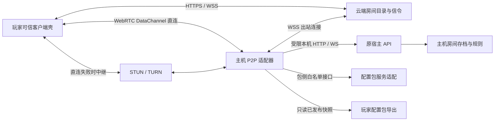
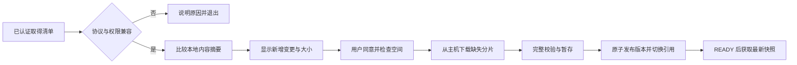

# 服务器房间发现、P2P 联机与配置包同步方案

- 文档类型：计划
- 状态：进行中
- 创建日期：2026-11-12
- 最后更新：2026-11-13
- 关联文档：[计划索引](README.md)、[启动入口与服务编排](room-launch-orchestration.md)、[云服务器选型与部署调研](cloud-server-deployment-research.md)、[公网大厅草稿](browser-room-portal.md)、[项目概况](../current/design/project-overview.md)、[首测工程](../current/engineering/first-test.md)、[LAN 模块](../current/engineering/network-lan.md)、[Lua 规则版本](../current/engineering/lua-authoring.md)

## 2026-11-13 阶段状态

| 阶段 | 已确认结果 | 剩余内容 |
| --- | --- | --- |
| P0 技术验证 | 当前宿主与 SDK、真实 DataChannel、浏览器、Windows/Ubuntu 直连及强制 TURN | 更多真实运营商/NAT 环境 |
| P1 房间目录 | 公开/私有、短房间码、密码、邀请、审批、人数、封禁、租约和票据 | 正式发布者账号体系与多节点运行 |
| P2 传输 | 原权限协议、每玩家会话、主机身份签名、三通道、信令恢复/新租约代次 | 客户端自动重入和 ICE restart |
| P3 玩家内容 | 旧整包 READY；可选 network-web 已实现按组加载、账号授权与沙箱 | 缓存淘汰、复杂依赖及版本切换 |
| P4 具体包迁移 | 通用宿主/SDK、示例玩家页及树桩镇基础启动接入已验证 | 树桩镇完整 UI 和自有 HTTP 服务尚未迁移 |
| P5 测试云 | 用户 CVM 已部署目录/信令与 coturn，UDP/TCP 中转通过 | 真人异网、长时会话、负载、正式域名证书及 TCP443-only 场景 |

云端提供控制与中转；旧本机入口继续保留，新的可选 network-web 已提供公网测试网页。借用宿主模式与操作系统会话锁已实现，完整 SessionController 创建/继续存档编排仍见[启动方案](room-launch-orchestration.md)。

2026-11-13 用户修订后的[公网大厅与按需游戏页草稿](browser-room-portal.md)不提供公开房间列表：首次凭代号加入，有效成员以后可快速重入；房主维护黑名单，成员先查看配置包、规则和人员，再打开独立游戏页按需取资源。该流程已由 [network-web 0.1.0](../current/engineering/network-web.md) 实现并测试部署；P2P 0.2.1 继续保留旧 public/private、列表和整包协议，网页房间不进入旧列表。

## 1. 目标、范围与现状

新增“通过服务器发现房间，再与主机建立 P2P 连接”的公网联机方式。支持公开/私有房间、房间说明、密码、邀请、人数限制、准入审批，以及缺包或版本不一致时向主机下载所需配置。2026-11-13 已实现独立模块并部署腾讯 CVM 测试服务，0.2.0 通过 54 项验收，增加短房间码与本机宿主识别；当前接口、限额和操作以[工程说明](../current/engineering/network-p2p.md)为准。下文保留总体方案与未完成阶段，不能把全部设计条目当作现有能力。

首版已采用 **中心房间目录与信令 + WebRTC DataChannel + STUN/TURN + 主机权威星形连接**。每名玩家连接主机，不建立玩家全互联网络。服务器承担发现、准入和连接协调；规则运算、授权投影和房间存档继续由主机负责。P2P 直连失败时允许 TURN 中继，不能承诺所有网络均能直连。

2026-11-12 核查基础：

| 核查当日实现 | 对新增方案的约束 |
| --- | --- |
| 宿主仅监听回环，HTTP/WebSocket 提供登录、命令、投影、回执和聊天 | 新传输复用协议和权限，不直接将本机服务端口暴露公网 |
| 单数据目录运行一个内部 `demo` 房间；启动更换 authorityEpoch | 公网 roomId 必须另行分配，不能用所有实例相同的 demo 作为全球标识 |
| LAN 网关为独立包，只转发白名单 API，不读存档 | P2P 适配器沿用独立边界；不能把 LAN 网关等同于已有 NAT 穿透 |
| SDK 已允许注入 transport，但 HttpTransport 绑定同源 fetch/WS | 新增 WebRtcTransport，保留现有 Client 的命令封套及回执语义 |
| 配置包有 manifest、Lua、JSON、UI、素材及自有 Python 服务 | 通用玩家包分发规范尚不存在，需新增导出契约和包侧适配 |
| 树桩镇 /package/bundle 要求 KP；/package/state 与 /package/action 由包侧服务实现 | 不能直接把现有 bundle 接口开放给玩家，也不能仅接通宿主 API 就宣称整个游戏包已支持 P2P |

核查入口：[宿主网关](../../engineering/backend/src/onlinecoc/gateway.py)、[服务边界](../../engineering/backend/src/onlinecoc/server.py)、[SDK](../../engineering/client-sdk/client.js)、[LAN 实现](../../engineering/network-lan/src/onlinecoc_lan/gateway.py)、[树桩镇 manifest](../../rulepacks/stumpsville/manifest.json)、[包侧服务](../../rulepacks/stumpsville/tools/launch.py)。

首版暂不包含语音/视频、自动主机迁移、云端运行游戏、云存档、配置包商城、玩家间分块分享。房主关闭进程后房间离线，云目录不能接管游戏。

### 1.1 与统一入口、配置包的分工

2026-11-12 补充评估建议：由本机 SessionController 编排宿主、包侧服务、内容导出与网络提供者；默认平台入口和包专用入口调用同一高层接口。P2P 提供者只负责连接、信令和中继，不替配置包初始化剧情，也不自行重复启动宿主。创建时由房主选择包，继续存档固定原包版本，加入时采用主机要求的客户端包。完整比较、生命周期、local/LAN/P2P 差异与迁移顺序见[启动入口与服务编排方案](room-launch-orchestration.md)。当前已实现借用宿主和会话锁，完整编排仍待实施。

### 1.2 服务器、房主端与玩家端的职责建议

2026-11-13 已确认需求：服务器主要提供房间发现和中转，测试者主要在中国内地。以下职责划分已用于通用首版；完整编排和具体包迁移仍按阶段推进。并发量、测试时长和预算尚未确定。

| 工作 | 建议位置 | 原因与边界 |
| --- | --- | --- |
| 房间定位、在线心跳与租约 | 云端 | 旧模式支持列表和短码；network-web 已按代号或有效成员定位，不提供公共枚举 |
| 发布者认证、加入票据、邀请前置检查、限流 | 云端；房主保留准入最终决定权 | 目录服务身份与游戏账号分开；云端票据不能直接授予 KP 或游戏数据权限 |
| SDP/ICE 信令交换、短期 TURN 凭据签发 | 云端 | 帮双方建立连接，不在信令通道转发游戏命令和文件 |
| STUN 地址探测 | 公网服务，首测可与 TURN 同机 | 参与候选发现，不承载正常游戏数据 |
| TURN 中继 | 云端 | 直连不可用或显式 relayOnly 时承载加密数据；不执行规则、不永久保存包内容 |
| 可信玩家壳、平台 SDK 的入口 | 旧本机服务与 network-web 云端测试网页并存 | 本机进程校验云端证书；不要求上传游戏包或另购 CDN |
| 创建/恢复房间、进程启停、包侧服务 | 房主电脑的本机编排层 | 主机准备完成再发布；云端不远程启动本机进程 |
| 掷骰、规则执行、权限过滤、命令幂等与权威状态 | 房主宿主 | 玩家只提交操作意图，结果由主机裁定，不能以客户端计算替代 |
| 游戏账号、私密剧情、房间存档及备份 | 房主电脑 | 玩家仅取得授权投影；云服务重启不能恢复或接管主机存档 |
| 玩家内容导出、版本清单与按权限分发 | 房主生成快照；经 DataChannel 交给玩家 | 直连时仅消耗房主上传；走 TURN 时同样计入云出口；文件白名单见第 5 节 |
| UI 渲染、输入、下载校验与内容缓存 | 玩家设备 | 不在玩家端执行收到的主机 Python/EXE，不把客户端声明当作权威状态 |
| 聊天、游戏内操作和状态更新 | 玩家与主机的 DataChannel | 主机按角色/位置过滤后发给各接收者；首版不做绕过主机的玩家全互联 |

“主机/P2P”是两个维度：主机决定谁计算和保存数据，P2P 决定数据如何到达主机。使用 TURN 后仍然是主机权威，云端只改变网络路径；P2P 也不意味着每个玩家都保存完整存档或能看见所有剧情。

例如玩家提交一次检定：玩家发命令 → 主机校验身份和权限 → 执行规则并保存结果 → 按授权投影回复。直连可用时游戏数据不经过云服务器；需要 TURN 时，同一加密通道的数据经中继送达，运算位置不变。

### 1.3 连接方式与成本取舍

| 方式 | 建议用途 | 成本与适用边界 |
| --- | --- | --- |
| local / LAN | 单机与同一局域网 | 沿用相应入口；不能用同一 Wi-Fi 成功替代公网验收 |
| WebRTC 直连，STUN/ICE 协商 | 公网联机默认优先路径 | 房主和玩家主动建连，无需要求所有家庭路由器配置端口映射；部分 NAT/防火墙仍会失败 |
| WebRTC 经 TURN | 自动兜底；测试时可强制使用 | 持续占用云出口，带宽通常比 CPU 更先成为瓶颈；同一会话仍由房主负责 |
| relayOnly | 明确需要隐藏双方真实网络地址的会话 | 应在两端限制候选并验证；承担更高中继比例，私有邀请本身不提供地址匿名 |
| 所有数据经云端 WebSocket 应用代理 | 暂不作为首版并行通路 | 还需实现第二套转发、会话和恢复语义；不能把现有 WSS 信令当作已经提供该能力 |
| 玩家全互联或云端权威宿主 | 不在本次范围 | 前者增加连接与权限复杂度；后者改变运行、存档和成本模型 |

ICE 会收集和检查候选，正常允许直连及中继候选并按结果选择；“直连优先、TURN 兜底”是目标体验，不要求应用先等待一个完整超时才请求中继候选。界面应显示实际选中的路径与失败原因。

首轮已由同一台腾讯云 CVM 承载 HTTPS/WSS 目录/信令与 coturn，浏览器访问本机可信入口。已增加同源 network-web 测试网页；正式开放仍须满足可信 HTTPS/WSS 条件，当前测试 CA 需浏览器显式信任。普通 HTTP CDN 可用于静态内容加速，不能代替目录、STUN/TURN 或承载任意 UDP 中继。只有大包重复下载成为实测瓶颈后再评估 COS/CDN。

首测范围建议为 1 名房主 + 2 名玩家，跨至少两种真实外网，分别验证直连和强制中继。免费/低价单机的端口、带宽、域名条件和获取清单以[云部署调研](cloud-server-deployment-research.md)为准；包括 TCP 443 共用限制，不把首测成功写成所有网络均可连接。

## 2. 组件与连接流程



图中“配置包服务适配”仍待具体包接入；通用模块目前只转发原宿主白名单 API。云端不保存房间存档或常规配置包文件；TURN 传输加密包，依然消耗云出网流量。目录服务是受信任的准入与信令方，能看到房间元信息和候选地址；“不存存档”不等于云端完全看不到连接元数据。

### 2.1 主机发布

1. 本机编排服务启动或明确附接原宿主、包侧服务与适配器，检查协议、包侧能力和玩家导出物；所有必需组件就绪后才发布可加入状态。没有可分发包时只允许通用操作台或明确显示“不支持自动同步”，不得提供无法完成内容准备的加入入口。
2. 使用独立设备/发布凭据向云端注册，创建不可预测的公网 roomId。公网 ID 与内部房间、主机公钥、房主账号/设备绑定；显示名称不能作为身份依据。
3. 发布房间设置并建立 WSS；持有独占 leaseId、递增 connectionEpoch。旧进程不能用旧租约覆盖新进程。
4. 建议心跳 15 秒、目录租约 60 秒；超时从可加入列表移除。正常退出立即撤销租约。恢复后校验所有权，取得新 epoch 再发布。
5. 同一存档仍只允许一个宿主写入；云端租约不替代本地 writer.lock。

### 2.2 玩家加入

下述保留旧客户端连接和整包同步流程。新网页流程改为“代号首次准入或有效成员快速重入 → 房间信息页 → 点击进入独立游戏页 → 按需加载”，成员资格与临时游戏席位分离，详见[网页草稿](browser-room-portal.md#2-使用流程)。

1. 旧客户端从列表、短码或私有邀请定位房间，点击加入才提交密码；此列表入口不用于新网页房间。
2. 云端按主机同步的准入策略进行邀请、房间密码和限流等前置检查，向在线主机请求短期席位预留。主机按有效 policyRevision 最终检查审批、封禁、人数及前置凭据；策略未对齐时拒绝发票并重同步。密码验证通过不等于取得游戏账号或 KP 权限。
3. 主机批准后由云服务签发一次性 joinTicket，绑定 roomId、leaseId、connectionEpoch、policyRevision、客户端临时公钥和过期时间。建议票据有效期 60 秒。
4. 双方通过 WSS 交换带 attemptId/epoch 的 SDP 与 ICE 信息。先尝试直连，使用受控 TURN 作为候选兜底；建议 10 秒提示正在中继尝试、30 秒整体超时。超时可重试，不把数值当作已测 SLA。
5. DataChannel 建立后交换随机挑战，证明持有 ticket 绑定私钥，并核对信令绑定的 DTLS 指纹和主机身份；主机兑换票据、拒绝重放。首版信任云目录签发的身份，老房间可固定主机公钥并对变化告警。
6. 在加密通道中完成原宿主账号登录，再取得该账号可见的包清单和授权投影。云端不接收原宿主账号密码；创建账号仍由主机本机工具完成，首版不承诺匿名账号自动映射。
7. 比较、下载、验证配置包；客户端壳显示来源、大小、内容类型和运行权限，用户同意后加载。
8. 客户端发送 READY，主机核对当前 contentEpoch、包集合摘要、权限及席位，将其转为正式成员并发送最新快照。同步中只开放认证、包同步、必要状态查询，禁止游戏写命令。

同步席位建议保留 10 分钟并由进度续租，断线保留 90 秒；这些是独立于 60 秒 joinTicket 的主机状态。取消、超时、踢出或失败必须释放席位，主机最终串行裁定人数，防止云列表延迟导致超员。

## 3. 房间设置与隐私

以下 public/private 描述现有 0.2.0 的列表和邀请语义。新网页房间不参加公共发现，另需代号准入、成员快速重入和房间黑名单策略；不直接用“private 必须有邀请”替代用户要求，见[快速重入与黑名单](browser-room-portal.md#41-快速重入与黑名单)。现有模式下，公开性、密码和审批相互独立：

| 设置 | 行为 |
| --- | --- |
| public、无密码 | 列入旧客户端公开列表，允许申请；仍需宿主身份认证 |
| public、有密码 | 旧客户端列表可见，显示锁标志；密码通过后申请 |
| private、无密码 | 不进入列表、搜索、统计细项；需不可预测邀请凭据 |
| private、有密码 | 邀请与密码都满足后申请 |
| approvalRequired | 上述任意组合均可额外要求房主审批 |

私有房间建议默认启用审批。短房间码已实现，自动生成 8 位字母数字码；只用于定位，不视为秘密；私有邀请码使用至少 128 位随机值，可限次数、设有效期和撤销。当前将邀请放在可复制的加入信息中，客户端解析后经 POST 提交；不写日志、分析事件或 Referrer。本机控制网页地址含管理能力令牌，不能当作玩家邀请发送。后续若增加深链接，再用 fragment 承载玩家邀请并及时清除。猜测房间 ID、错误邀请及不存在私房返回统一对外错误。

拟议设置与目录字段：

| 字段 | 用途与暴露范围 |
| --- | --- |
| roomId / title / summary | 公网标识、名称、简介；建议标题 64 字、简介 512 字，上屏按纯文本处理 |
| visibility / passwordRequired / approvalRequired | 大厅可见性与准入提示；不返回密码或散列 |
| gameSystem / tags / language | 搜索与筛选；不暴露秘密剧情或成员真实资料 |
| maxPlayers / playerCount / allowSpectators | 玩家与观众分别计数，建议首版 8 玩家、不含主机，观众默认关闭 |
| joinable / roomState | 等候、游玩、暂停、关闭；游玩期间能否加入独立控制 |
| protocolRange / clientVersionRange / packageSummary | 兼容性、公开包名称版本及预计体积 |
| hostDisplayName / regionHint / lastSeen | 展示与网络提示；目录不直接公布主机 IP |
| revision / connectionEpoch / policyRevision | 目录设置并发控制、连接代次及主机准入修订；更新带 expectedRevision，过期策略票据不可消费 |
| passwordVerifier / inviteHashes / banRecords | 主机准入组件持有权威策略，云端仅保存前置校验所需的受控副本；禁止列入响应和普通日志 |
| leaseToken | 仅当前发布者与云服务使用的秘密租约凭据，不传给玩家 |

公网房间密码通过 TLS 提交，服务端以带随机盐的 Argon2id 校验值保存；只在内存短暂处理明文。房主在本机更新有效策略后推进 policyRevision，通过认证发布通道同步云端所需副本；主机始终拒绝旧策略票据，不因云副本尚未刷新而放行。按 IP、设备、房间三层限速，错误详情不帮助枚举；房主可修改密码、锁房、撤销邀请、拒绝申请和踢人。修改密码撤销未消费票据；是否踢出已有成员由独立操作控制。封禁以持久账号/设备标识为主，不能只依赖易变 IP。将来开放 LAN 等其他入口时，同样接入主机准入组件，不让游戏包或另一个网络入口绕过策略；现有工程尚无此统一组件。

P2P 直连会让连接双方获知网络地址。需要隐藏主机/玩家真实地址时提供 relayOnly，使用真正禁止非 relay 候选的客户端配置，并验证两端实现支持；这会增加中继成本。私有房间仅限制发现和准入，不代表 IP 匿名。

## 4. 协议与现有工程接入

### 4.1 云端接口与后续扩展

目录、准入、租约、TURN 凭据和 WSS 信令均已实现。实际路由、认证、时限与消息上限统一见[工程说明](../current/engineering/network-p2p.md#3-准入与协议)和[directory.py](../../engineering/network-p2p/src/onlinecoc_p2p/directory.py)，不再维护另一份拟议 API 表。

当前交换完整 SDP；逐候选信令、协商超时提示与客户端自动重入仍需专项设计。信令不承载游戏命令或文件，日志不记录密码、票据、Cookie、完整 SDP/ICE 或聊天正文。

### 4.2 P2P 适配器

独立 [network-p2p 模块](../../engineering/network-p2p/README.md)已使用 aiortc 实现适配器，不导入游戏 Host、存储模块或执行 Lua。Windows Python 3.14、Ubuntu Python 3.12 与浏览器已完成联测，依赖见[版本锁](../../engineering/network-p2p/requirements.lock)；玩家源码包已独立启动验证。

DataChannel 已设为：

- control：可靠、有序，承载认证、请求/回执和订阅控制。
- state：可靠、有序，承载宿主状态推送及 reset。
- package：可靠、有序，以带 base64 数据的 JSON 分帧传输，具有限速和背压。多个通道共享底层拥塞控制；大包期间控制响应时延仍需专项验证。

适配器将客户端 request(path, options) 映射到固定上游 API。每个已认证 peer 使用独立宿主 Cookie/CSRF 会话，认证后不接受客户端任意覆盖 Cookie/accountId；从登录响应取得会话，仅在适配器内存保存，断连按策略回收。拒绝远程指定上游 URL、任意 HTTP 头、路径穿越、重定向以及 /host-control、首次初始化和本机维护能力。普通玩家的业务写权限继续由原宿主验证。

当前 RPC 请求上限 64 KiB、逻辑响应 2 MiB，大包使用独立分块协议；原宿主的素材接口未因此自动暴露，具体限额见[工程说明](../current/engineering/network-p2p.md)。命令沿用 accountId + commandId 幂等键；断线后先查回执，再按现有 epoch/规则冲突要求处理，不能自动换 commandId 重算。

`WebRtcTransport` 保持 SDK request/open 形状；壳将不可信包 UI 的能力请求转交 transport。树桩镇等额外 /package/* 接口必须逐一声明方法、体积、角色和会话规则，经房主启用后才进入适配白名单；不能开放整段任意代理路径。包内现有同源 fetch 页面需要迁移至桥接 SDK，文件下载成功不等于旧页面自动兼容。

## 5. 配置包身份与分发清单

### 5.1 分开管理的文件

| 类别 | 拟议管理方式 |
| --- | --- |
| 作者源码包 | 保留在 rulepacks；本地可编辑，不被玩家下载覆盖 |
| 主机运行内容 | 已发布的 Lua/JSON、包侧服务及私有配置，仅主机加载 |
| 玩家分发内容 | 明确白名单导出的 UI、公开配置、允许再分发素材与翻译 |
| 权限控制内容 | 私密剧情、KP 资料、未揭示地图、私聊附件，通过授权查询按需交付 |
| 运行存档与凭据 | identity、rooms、runtime、备份、日志、.env、设备密钥，永不纳入配置包传输 |
| 平台程序/插件 | EXE、DLL、Python、PowerShell、安装脚本不进入自动玩家同步；升级使用独立可信发布渠道 |

公开规则 Lua 如确有离线阅读需要，可作为明确声明的资料分发，但下载不自动执行。文件夹名称不能证明其中数据可公开；混有秘密的 JSON 必须按 schema 生成玩家投影，不使用简单“去掉几个字段”的默认导出。清单本身也不能列出未授权文件名、摘要和大小。

通用首版已提供[玩家分发描述示例](../../engineering/network-p2p/config/distribution.example.json)，显式声明原包的导出边界；具体游戏包仍需自行适配。主机先生成不可变的已批准快照，再供传输；不在下载期间读取可变化的作者源码。包里已经安装的第三方素材需检查是否允许向玩家再分发；不允许时返回来源与取得方法，并阻止宣称“一键可用”。

### 5.2 精确一致性

`packageId + version` 用于显示，实际复用按 SHA-256 内容摘要决定。相同版本号不同内容仍需更新；本地版本号更高也不能替代房间固定版本。

主机维护完整运行锁，客户端只得到该角色可见的客户端锁：
- packageId、显示版本、分发 schema 版本、客户端协议范围；
- contentEpoch、clientSetDigest、精确固定的依赖包/文件摘要；
- 每文件规范路径、字节数、SHA-256、MIME、用途和是否必需；
- 入口文件、要求的 UI 能力、素材许可声明；
- 主机签名与主机公钥标识，签名覆盖规范化清单、摘要和房间绑定。

规范化采用固定 UTF-8 JSON 编码、排序键和整数大小；摘要计算排除签名及自身摘要字段，规则需形成可复现夹具。依赖首版发布时展开成无环、无版本区间的锁定集合，拒绝循环、重名冲突及缺失依赖。对同一客户端可见集合统一计算 clientSetDigest，不向玩家公开主机私有内容清单。

SHA-256 解决内容一致性，不证明作者可信。签名证明“此主机发布了此内容”，也不证明代码安全；首次来自陌生主机的脚本 UI 必须提示与隔离。

### 5.3 下载流程与本地管理

本节描述完整客户端集合的同步流程。新网页模式已改为游戏页打开后获取启动集合、其余资源按权限和实际需要取得，见 [network-web 资源协议](../current/engineering/network-web.md#3-配置包接入与资源协议)；旧模式继续要求整包校验。



拟议桌面存储结构（当前未创建）：

```text
<用户数据目录>/packages/
  blobs/sha256/<digest>              # 校验完成的不可变内容
  manifests/<clientSetDigest>.json  # 已批准且经过验签的清单
  staging/<transferId>/             # 未完成分片及进度位图
  rooms/<publicRoomId>/lock.json    # 房间固定的客户端集合
  preferences/                     # 用户个人偏好，与包内容分开
```

浏览器端使用 IndexedDB/OPFS 表达相同逻辑，不假设可静默写用户磁盘；进入前检测容量与持久化可用性，空间不足时暂停并给出清理/桌面端选择。浏览器清理缓存后可重下，不能承诺缓存永久存在。

传输请求用 `manifestDigest + fileDigest + offset + length + transferId`，主机只允许读取当前账号清单内的摘要，不接受任意路径。建议逻辑分块 256 KiB，DataChannel 帧不超过双方协商上限，首版取 16 KiB 与实际 maxMessageSize 的较小值并扣除封套；请求窗口与 bufferedAmount 背压限制内存。每文件完成后验证字节数和 SHA-256；若要独立恢复逻辑块，清单须覆盖块摘要或 Merkle 根，否则不能信任客户端自报的部分校验。

建议首版默认：单文件 64 MiB、整套玩家内容 512 MiB、最多 10,000 文件、最多 2 个并发文件、每 peer 待发缓存 4 MiB；主机总上传默认 2 MiB/s 可调，另受 TURN 带宽与预算约束。以上为待压测的产品限额，不影响原素材接口 10 MiB 限额。优先下载必需内容；可选高清素材不能阻塞入房。

下载中断保留已校验块与清单摘要，重连重新鉴权后继续；主机换包则旧 transfer 不能混入新包。空间预检覆盖暂存和发布时可能出现的双份数据。全部必需文件完成才原子切换 lock；失败继续保留上一个完整版本。缺包、摘要不同、被篡改、下载取消均不能标为 READY。

首版按“缺失/变化的整文件”增量下载，不做二进制差分。多版本并存，房间 A/B 可固定不同版本；删除旧文件通过切换清单实现，不直接覆盖目录。缓存回收按活跃房间、固定版本、进行中传输的引用计数与 LRU，永不清理作者源码、存档和个人偏好。

### 5.4 安全与运行边界

拒绝绝对路径、..、反斜杠歧义、Windows 盘符/ADS/设备名、NUL、符号链接/硬链接、大小写折叠重名、规范化后路径碰撞。首版优先逐文件传输；若以后支持归档，必须另外限制解压总大小、文件数、压缩比和目标根路径。摘要不符即隔离并有限重试，不能执行部分文件。

可信壳负责认证、下载和连接。包 HTML/JS 在无同源权限的 sandbox iframe 或等效隔离视图加载，默认禁外网、弹窗、顶层导航、设备与本机文件访问；只经绑定当前 iframe/MessagePort 的能力桥调用白名单 SDK。不给包代码云凭据、宿主 Cookie、TURN 密钥或 Node/Python 系统能力。首版先验证该隔离桥，再接入自定义 UI；不能拿浏览器同源页面直接加载陌生主机代码。

脚本沙箱不证明内容可信；房主导入新主机规则仍需主动确认。角色权限变更立即停止新增下载并使对应会话清单失效；已经下载或看见的内容无法远程收回。因此未揭示内容必须留在主机，不能依赖下载后“隐藏”。

## 6. 配置变化、断线与异常

| 场景 | 处理 |
| --- | --- |
| 本地无包/内容不同 | 显示差异与下载量，下载主机锁定版本；保留用户已有源码 |
| 客户端协议太旧或不支持包能力 | 停止同步，提示升级客户端；不由配置包替换平台程序 |
| 主机临时改规则 | 发布新不可变运行修订，原流程沿用原修订；有客户端变化时推进 contentEpoch 并重新同步 |
| 下载期间切换版本 | 撤销旧 READY/下载授权；复用相同摘要，重新获取清单 |
| 客户端声明“已安装”但实际被修改 | 内容摘要校验失败重新下载；主机仍不信任任何客户端游戏计算 |
| 信令服务短暂离线 | 已建立直连继续；新加入、重新协商和凭据续期受影响；房间在租约到期后下线 |
| TURN 故障/凭据到期 | 尝试 ICE 重连与重新授权；失败进入断线状态，不自动改为明文代理 |
| 主机退出/重启 | 客户端停止写入；新 epoch 下重连、登录、校验包、查回执，恢复授权快照 |
| 文件传输繁忙 | 主机限制并发、暂停下载并优先游戏控制；不能堵住回执与心跳 |
| 踢出、封禁、关闭房间 | 停止 peer、下载及后续票据；回收席位，不能依赖云列表刷新实现撤权 |

主机发布包变更时，包侧配置与宿主规则激活需要协调：先准备新运行工件与客户端清单，在房间串行控制点暂停新写入，再提交版本绑定；失败维持旧绑定，恢复时检查绑定一致性。原有 rule.activate 不具备跨进程分发锁原子性，本项是新增工作，不能用文档约定代替实现。

## 7. 分阶段实施与验收

正式包接入先对齐[服务编排方案 O0—O2](room-launch-orchestration.md#9-与现有工程的迁移顺序)的启动、所有权、包侧服务和分发契约；P0 网络技术试验可独立推进。P1—P4 在统一会话上实现，不再另造配置包专属的 P2P 启动流程。

| 阶段 | 工作与产物 | 通过条件 |
| --- | --- | --- |
| P0：技术与协议试验 | aiortc/浏览器/Windows 3.14、ICE、TURN/TLS、沙箱 UI 桥、包侧代理契约 | 两台真实设备经不同网络互通；强制 relay 有证据；无依赖时明确独立运行时方案 |
| P1：房间目录与准入 | 注册、租约、列表、公开/私有、密码、邀请、审批、限制、设置页 | 四种公开性/密码组合，过期清理，猜码、重放、超员与旧主机占租用例通过 |
| P2：P2P 通用协议 | 适配器、WebRtcTransport、逐 peer 会话、快照/命令/聊天、重连 | 与 HTTP 结果一致；玩家不能获得 KP/host-control；断线重试不重复掷骰和提交 |
| P3：包分发与文件管理 | distribution、精确锁、缓存、校验、续传、原子发布、权限清单 | 无包、同版本异内容、较高本地版本、空间不足、中断、损坏、路径攻击都按规范处理 |
| P4：实际游戏包接入 | 选树桩镇接入沙箱 SDK 与声明的 /package 接口；拆分玩家/主持内容 | 首次加入无需手工复制包，实际行动和实时更新可用，玩家无法下载 KP bundle、源码存档或秘密场景 |
| P5：云端灰度 | 按云调研部署、监控、告警、恢复、跨运营商测试 | 家宽、手机热点/CGNAT、双重 NAT、UDP 被禁、IPv4/IPv6 组合都有连接结果和失败原因 |

网络验收至少使用两台物理设备，并记录 selected candidate pair、直连/中继、RTT、连接时长、下载有效吞吐、重连次数和实际云出流量；同机回环不能证明公网成功率。仅 TCP 443 可用网络也应测试 TURN/TLS，仍可能被只允许 HTTP 代理的企业网络阻断，需明确失败提示。

首轮连通性验证先采用 1 名房主 + 2 名玩家，完成直连、强制 TURN、小包同步和断线恢复。后续容量目标（待实测）：10 房间、每房 8 玩家、合计 80 个玩家连接，不含音视频；常规操作在目标地区主机/玩家间 P95 回执延迟小于 500 ms，连接 P95 小于 10 秒（排除人工审批与包下载），强制 TURN 小包下载过程中控制请求不超时。不能从 2 核配置或 WebRTC 标准推导上述目标已达标。

完成每一阶段后，才将已验证能力写入对应工程文档；新增实际文件时更新 hierarchy，旧方案归档按文档标准处理。已实现部分统一维护在[当前工程说明](../current/engineering/network-p2p.md)，本方案保留后续要求与设计依据。

## 8. 待确认问题与当前采用的假设

1. 2026-11-13 用户已确认测试者主要在中国内地；暂按文字与图片跑团、主机本地运行设计。具体省份和运营商尚未确认，若有海外成员需重新验证线路。
2. 首版每房 8 玩家、10 房间仅作为容量测试目标；实际并发、典型包体积、更新频率及预算需用试运行数据调整。
3. 房间密码保留为可选附加条件；新网页以平台账号持久成员关系支持快速重入，身份映射、封禁和原游戏账号的边界统一见[网页草稿](browser-room-portal.md#4-账号和独立游戏页)。
4. 优先支持可信壳与兼容包，旧包逐个迁移；不会默认运行主机发来的 Python/EXE。
5. 转移房主密钥、无人值守主机、音视频和云缓存不在首版；如成为必要需求需补设计和费用模型。

通用模块和试用云已完成首轮验证；后续扩容或续费仍需确认费用上限与用途条款，见云调研。

## 9. 技术来源

查阅日期均为 **2026-11-12**。下面是协议或组件能力依据；前述具体字段、限额和模块划分为本项目建议，并非引用标准强制要求。

- [RFC 8445：ICE](https://www.rfc-editor.org/rfc/rfc8445)：候选收集、连通性检查与 NAT 穿越基础。
- [RFC 8831：WebRTC Data Channels](https://www.rfc-editor.org/rfc/rfc8831)：数据通道传输基础。
- [WebRTC 官方 TURN 说明](https://webrtc.org/getting-started/turn-server)：直连不可用时需要中继。
- [aiortc 官方文档](https://aiortc.readthedocs.io/en/latest/)：Python asyncio WebRTC 实现及 DataChannel API；本项目组合尚未验收。
- [coturn 官方配置说明](https://github.com/coturn/coturn/blob/master/README.turnserver)：临时认证、配额、带宽控制、外部地址及 relay 端口。

