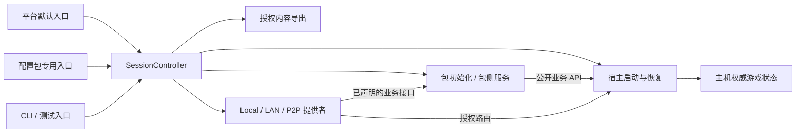

# 房间启动入口、服务编排与配置包职责方案

- 文档类型：计划
- 状态：进行中
- 创建日期：2026-11-12
- 最后更新：2026-11-13
- 关联文档：[计划索引](README.md)、[房间发现与 P2P 同步](room-discovery-p2p-package-sync.md)、[云部署调研](cloud-server-deployment-research.md)、[公网大厅草稿](browser-room-portal.md)、[桌面启动工具](../current/engineering/desktop-tools.md)、[LAN 模块](../current/engineering/network-lan.md)、[房间管理器](../current/engineering/room-manager.md)

## 1. 结论与讨论范围

建议采用 **平台维护统一编排服务和默认入口，配置包可提供调用同一服务的专用入口**。

这分开解决两个问题：用户从什么界面进入，以及由谁管理宿主、配置包服务和联机连接的启动顺序。统一界面不能代替统一生命周期；提供可复用工具也不意味着应让每个配置包自行实现完整启动流程。

- 普通用户从平台选择“创建房间 / 继续存档 / 加入房间”，创建时选择配置包和联机方式。
- 配置包作者可提供“开始树桩镇”等品牌入口、玩法设置和教程。入口预选配置包，提交启动请求，复用平台的校验、启停、联机、下载与故障处理。
- 平台提供无界面的高层 API/CLI，供专用入口、测试及无人值守工具调用。官方 GUI 只是它的一个调用方。
- 游戏规则、剧情、初始化语义和游戏 UI 仍属于配置包。底层网络、账号认证、文件同步和进程管理不要求包作者重复编写。
- 完全自主编排保留给工程开发与特殊集成，须自行承担生命周期和兼容性验收；不作为普通配置包的必要能力。

本文细化先前 P2P 方案中的“主机启动与配置包适配”部分，并将其推广到本机和 LAN；不替代协议、文件分发和云部署正文。2026-11-13 已实现[公网模块的借用宿主模式与会话锁](../current/engineering/network-p2p.md)，可独立发布/撤下联网入口，停止时保留原宿主。本文完整 SessionController、统一创建/继续存档、多入口和具体包迁移仍属待实施部分；不将本次借用模式等同于完整启动编排。

2026-11-13 需求补充：云服务器用于房间发现与必要中继，测试者主要在中国内地。建议保持 SessionController、游戏宿主、包侧服务和存档在房主电脑；云端已部署目录/信令与 STUN/TURN，可信浏览器入口由各电脑本机服务提供，玩家设备负责 UI、输入和缓存。完整 SessionController 仍待实施。主机是计算与权限边界，P2P/TURN 是传输路径；即使走中继也不把游戏计算迁到云端。职责矩阵与连接取舍见[房间发现与 P2P 方案第 1.2—1.3 节](room-discovery-p2p-package-sync.md#12-服务器房主端与玩家端的职责建议)，获取资源与成本见[云部署调研](cloud-server-deployment-research.md)。

2026-11-13 修订的[公网大厅与按需游戏页草稿](browser-room-portal.md)采用代号首次加入、有效成员快速重入和房间黑名单，不提供公开房间列表。成员先在房间页查看包信息、规则和人员，再点击打开独立游戏页；游戏页持有连接并按需取资源。房主继续使用本机宿主，开房后获得代号；该模块不代替 SessionController，不让 local/LAN 强制依赖云登录，同房多入口需统一准入。此流程尚未实施。

## 2. 当前工程说明了什么

2026-11-12 只读核查结果：

| 当前入口或模块 | 实际职责 | 统一时需要解决的问题 |
| --- | --- | --- |
| 根目录安装/启动 exe 与 launcher-config.json | 管理固定工程运行时、启动本机宿主、打开页面；默认固定存档 | 尚无通用配置包选择与多种联机编排 |
| 独立 RoomManager | 通过现有 API 管理已运行宿主，可启停 LAN 网关 | 房间管理、启动主机与进入游戏是不同动作 |
| engineering/network-lan | 独立 HTTP/WS 白名单网关，不读存档、不执行规则 | 当前只接通用宿主 API/操作台，不代理游戏包自有服务 |
| 树桩镇 launch.py / lan.py | 包侧 Runtime 启动宿主、保存 package.json、提供包接口；LAN 窗口启动该包服务 | 网络界面、业务服务与宿主生命周期存在耦合，不能直接再套一个会启动宿主的控制器 |
| 激光与情感 launch.py | 可启动新宿主，也可用 --backend 连接已有回环宿主 | 已有“自己创建 / 连接已有”区别，可作为迁移切口 |
| 各包 manifest | 标识规则、数据、UI 与版本 | 尚未形成通用运行能力、服务适配及联机兼容契约 |

依据：[启动配置](../../launcher-config.json)、[桌面监督入口](../../engineering/desktop/desktop_host.py)、[树桩镇启动](../../rulepacks/stumpsville/tools/launch.py)、[树桩镇 LAN](../../rulepacks/stumpsville/tools/lan.py)、[激光与情感启动](../../rulepacks/lasers-and-feelings/tools/launch.py)、[树桩镇 manifest](../../rulepacks/stumpsville/manifest.json)。

现有根启动工具关闭窗口会停止其子进程，浏览器关闭不会停止；LAN 网关停止不会停止上游宿主。后文拟议的关闭行为需通过迁移实现，不能当作现有行为。配置包施工仍遵循 [rulepacks 协作要求](../../rulepacks/AGENTS.md)：包作者使用公开工具和 API，工程责任者维护通用实现。

## 3. 两条路线的取舍

| 评价项 | 方案一：平台统一入口并编排 | 方案二：各包选工具并自行编排 | 推荐组合：统一编排、多种入口 |
| --- | --- | --- | --- |
| 用户操作一致性 | 高，包与联机选择位置固定 | 由每个包决定，说明容易分裂 | 默认一致，专用入口允许简化选择 |
| 游戏特色与引导 | 需要声明式扩展点 | 自由度最高 | 包负责特色页面和玩法表单 |
| 包作者工作量 | 主要提供声明、规则和 UI | 还要处理进程、端口、失败恢复、更新 | 常规包只交启动请求和适配声明 |
| 网络与安全修复 | 更新平台工具即可复用 | 可能复制工具、长期停留旧版本 | 同一个运行时契约和受控版本来源 |
| 包含独立服务的复杂玩法 | 需要服务适配接口 | 容易快速试验，长期维护分散 | 允许受信任的包侧服务，生命周期交平台 |
| 排错与测试 | 日志、状态与错误统一 | 每包 × 每种联机都要重复验证通用流程 | 网络共性由平台验收，包只验收自身能力 |
| 离线/专用发行 | 必须提供可离线调用的底层服务 | 自带启动器容易做到 | 可随包分发固定版本平台运行时，仍走同一契约 |
| 初期成本 | 要先做编排核心和包适配 | 现有包容易继续，但公网方案重复量大 | 先抽公共核心，再补默认 UI，迁移成本可分期 |

方案一适合面向普通玩家的通用平台。方案二适合作者原型、特殊设备、第三方集成以及短期验证；如果平台仍要保证“这个包能稳定联机”，就不能只交付几个 start/stop 函数，把顺序和恢复全部交给作者。

推荐组合保留方案二的入口自由，收回方案二中重复且容易出错的通用流程。代价是平台必须设计稳定契约、维护适配层及一致的升级策略，不能假装这些没有开发成本。

## 4. 职责与权限划分

| 组件/角色 | 负责 | 边界 |
| --- | --- | --- |
| 默认平台入口 | 包库、存档、联机方式、房间设置、运行状态、加入页面 | 展示和发起操作，不直接执行进程/网络逻辑 |
| 配置包专用入口 | 预选包、品牌页面、玩法设置、教学和进入游戏 | 调高层编排 API，不复制网络密码、下载与启停实现 |
| 本机房间编排服务（SessionController，拟新增） | 启动计划、依赖检查、存档占用、端口、进程归属、步骤日志、失败补偿、关闭顺序 | 只负责运行生命周期，不计算游戏结果，不直接改写宿主业务存档 |
| 原游戏宿主 | 房间账号、权限、命令幂等、规则运算、权威存档 | 不根据 LAN/P2P 决定玩法规则 |
| 配置包运行适配器 | 声明玩法初始化、客户端内容、附加服务、公开业务能力；将包业务接到宿主 API | 不自动修改工程；不绕过宿主账号/权限；不管理云账户 |
| 网络提供者（local / lan / p2p） | 建立入口、传输、连接状态和发现方式适配 | 不决定包版本、玩法初始化与游戏存档 |
| 包分发管理器 | 导出快照、差异检查、授权文件访问、校验、缓存与版本切换 | 不同步原始目录，不自动运行玩家收到的主机脚本 |
| 云目录/信令/TURN | 在线发现、前置准入与限流、连接协商和中继 | 不启动玩家电脑的宿主，不初始化游戏，不保存房间权威状态 |

SessionController 首先是公共模块和契约，不要求首版另建常驻守护进程。单房间阶段可由可信桌面进程承载，默认入口与包入口复用同一库及会话占用机制；需要跨入口附接、关窗继续或多房间管理时，再提供独立本机监管进程。该拆分不增加云端服务，也不要求一开始引入插件市场或复杂进程通信框架。

房主电脑的运行管理权限、游戏 KP 权限与普通玩家权限是三层不同授权。KP 可按游戏协议管理房间内容，但不能仅凭游戏登录会话停止操作系统进程、安装运行时或读取本机控制凭据。

SessionController 的管理通道仅供本机可信入口使用，采用受操作系统权限保护的 IPC 或带强认证的回环控制通道；不能转发到 LAN/P2P。游戏包页面中的“停止房间”若保留，只能请求可信外壳展示本机管理操作，不能直接得到控制 token。

配置包分为三种组成，而非把整个包当成可任意运行的插件：

1. 规则/数据/素材：通过既有规则导入与分发边界处理。
2. 玩家 UI：通过可信壳、SDK 与隔离视图运行。
3. 可选主机扩展服务：如现有 Python 包侧服务，仅允许房主明确安装信任的本地扩展，由平台监督进程。它具有主机代码风险，独立进程不是安全沙箱，也不能通过玩家下载流程自动安装。

## 5. 统一入口的用户流程

### 5.1 创建新房间

建议顺序：

**选择配置包 → 玩法设置 → 选择联机方式 → 房间信息及准入设置 → 检查并创建 → 进入游戏/分享入口。**

先选包更容易给出适配后的设置和能力提示；也可从“新建局域网房间”等快捷入口预选方式，两者最终形成同一份启动请求。最终可用方式是“已安装网络提供者能力 ∩ 包要求 ∩ 当前环境能力”的交集，不能只检查 manifest 写了 p2p 就显示可用。

- 平台字段：房间名称、人数、联机方式、公开/私有（需要相应发现服务）、准入密码/邀请、存档位置。
- 包字段：剧本、难度、角色生成模式、游戏开场参数等，由包声明表单/schema。
- 平台验证账号、路径、端口、服务兼容；包验证玩法参数。
- “创建存档”和“开放联网”是两个可恢复的步骤。联网失败仍保留已创建存档，显示失败原因；由用户选择重试或本机继续，不悄悄改变公开性或联机方式。
- 通用创建接口不能把现有 demo 初始化直接当所有包的最终初始化；需分开系统身份/基础房间准备与包语义初始化，并为旧包提供兼容适配。

首版允许一个房间固定一个根配置包及其锁定依赖，不提供任意把多个完整游戏包拼进同一存档的能力。

### 5.2 继续已有房间

**选择存档 → 读取其固定包与版本 → 检查兼容及缺失内容 → 选择本次联机方式 → 启动。**

配置包选择通常锁定为存档绑定的包；同包新版也不能静默替换。缺旧版本时提示安装对应版本；升级必须走单独的备份、迁移和验证流程。换网络方式不能重复“初始化游戏”，不能创建第二份世界进度。

存档 ID、内部宿主 roomId、本次 sessionId 和公网 roomId 分开保存。当前内部 roomId 为 demo，不可直接作为多存档列表或公网列表的唯一键；稳定的本机存档 ID 由新的登记层维护，与实际存档路径绑定。

### 5.3 加入已有房间

**选择连接入口（本机/地址/邀请/大厅）→ 房间准入 → 游戏账号登录 → 获取主机固定的客户端包 → 校验加载 → 进入游戏。**

加入者由房间决定包和内容版本，不先用自己选的包覆盖主机。缺包时调用公共同步工具；相同版本但摘要不同仍更新。加入动作不得在玩家电脑上自动启动一个游戏宿主或包的 Python 服务。

专用入口例如“加入树桩镇”可以筛选游戏，但连接到不同游戏或不兼容版本时必须提示，不能把专用 UI 强装到另一个房间。

### 5.4 配置包专用入口

“开始树桩镇”可直接提交 packageId 和预选剧本，平台补齐联机、存档及准入设置，再使用统一启动流程。作者可嵌入平台维护的设置组件，或自建表单后提交相同 schema。

联机提供者新增或修复后，普通包无需改写流程；需要新语义能力的包仍须验证适配。专用入口允许设置建议默认值、显示不支持原因，不得静默打开公网、修改防火墙或改变用户已选择的准入策略。

## 6. 不同联机方式下的共同点与差异

| 事项 | 本机 local | 可信局域网 lan | 公网 p2p |
| --- | --- | --- | --- |
| 权威宿主 | 房主电脑一个实例 | 同一个实例 | 同一个实例 |
| 客户端如何找到房间 | 本机房间列表/回环入口 | 输入地址/扫码；自动发现为后续可选 | 0.2 客户端列表/短码/邀请；新网页方案为代号首次加入或个人快捷重入 |
| 对外入口 | 不开放 | 指定网卡与端口 | 出站信令、ICE、必要 TURN |
| 云目录依赖 | 无 | 无 | 新加入/协商依赖 |
| 公开/私有的意义 | 无公共发现列表 | 默认无目录；不能将“知道地址”等同于已获准入 | 0.2 控制列表可见性；新网页房间不参与公开列举，代号不能绕过黑名单 |
| 准入与账号 | 本机所有者身份与游戏账号分离 | 房间准入 + 游戏账号 | 云前置检查 + 主机最终准入 + 游戏账号 |
| 配置包一致性 | 同样固定运行版本和客户端摘要 | 同一导出/校验协议通过 HTTP/WS 传输 | 同一导出/校验协议通过 DataChannel 传输 |
| 包侧业务 | 同样调用声明的能力接口 | 经授权路由表转发 | 同一逻辑请求经 P2P 适配 |
| 关闭网络 | 保留本机控制 | 停网关可保留宿主 | 撤目录/断 peer 可保留宿主 |

房间准入策略属于平台，不属于游戏包。目标设计应由主机侧准入组件维护有效 policyRevision；公网目录执行前置密码/邀请筛选，票据绑定该修订，最终由主机检查当前策略。LAN 则在主机侧直接验证同一策略，避免将来同时开放多种入口时绕过密码、人数限制或封禁。现有 LAN 尚无此统一准入组件，必须明确列为新增工作。

“公开”不要求每种方式都提供大厅。local/LAN 不支持的发现设置应隐藏或标记不适用，不用一个布尔值冒充所有模式的发现能力。私有标记也不是文件保密机制，玩家分发清单仍按当前账号权限生成。

包分发协议统一，但传输可不同；现有 LAN 仅支持通用宿主，仍需补包服务路由与导出端点。不能因为已有 HTTP 访问就把“LAN 自动下包”列为当前能力。

首版每个运行房间只选一个对外方式，另保留受控本机管理入口。并行 LAN + P2P 待单一入口稳定后再做，届时所有传输仍接同一宿主、同一准入与版本锁。P2P 的直连/TURN 切换是提供者内部路径变化，不应要求配置包重新初始化。

## 7. 拟议契约与状态

### 7.1 配置来源与优先级

| 数据 | 唯一来源 | 规则 |
| --- | --- | --- |
| 平台运行时、依赖、受信任提供者 | 平台安装配置及版本锁 | 包不复制可漂移的网络源码，不改全局安装配置 |
| 包标识、玩法设置 schema、必要能力、公开资源、服务适配 ID | 包的版本化声明 | 元数据读取不执行包内启动脚本 |
| 存档绑定的包、规则与 schema 版本 | 房间持久版本锁 | 优先于包的建议默认值，不随本次网络选择变化 |
| 房间信息、准入策略、玩家权限 | 主机权威房间配置；云端仅为受控投影/前置校验副本 | 更新带修订检查，云副本过期不能覆盖主机 |
| 上次网卡、显示偏好、默认方式 | 本机用户偏好 | 可以覆盖包建议，不覆盖存档兼容约束 |
| sessionId、进程、端口、临时凭据、云租约 | SessionController 与对应提供者的运行状态 | 秘密不放在包 manifest、命令行或普通日志 |

新存档建议放用户选择的独立数据目录。旧包的 runtime 路径可登记使用，首版不自动移动；继续遵守配置包测试不使用工程存档的约束。源码包、运行数据、玩家缓存和平台安装环境分别维护。

### 7.2 声明与高层接口

拟议包声明需要提供：packageId/version、客户端/宿主协议范围、settingsSchema、必需/可选能力、初始化/继续存档适配 ID、客户端入口、distribution 引用、附加服务及每项路由的权限/大小/方法声明。

优先声明能力，如可靠请求、状态订阅、授权文件读取、包侧业务 RPC；联机方式是否可用由平台适配后判断。包可声明硬性约束，例如需要浏览器无法提供的受信任本机扩展，但不能只用“我支持公网”跳过兼容检查。

首版可以使用受审核的 packageId 到适配器登记表，先让现有包接入；不必先造通用插件市场。以下为接口设计示意，尚不存在对应模块：

```text
PackageCatalog.inspect(packageRef) -> metadata, capabilities, trustRequirements
SessionController.plan(launchIntent) -> planId, requiredActions, unsupportedReasons
SessionController.start(planId, operationId, secretHandles) -> sessionHandle
SessionController.attach(sessionHandle) -> readOnlyStatus, playerEntry
SessionController.changeNetwork(sessionHandle, request, expectedRevision)
SessionController.stopNetwork(sessionHandle, operationId)
SessionController.stopRoom(sessionHandle, operationId)
SessionController.watch(sessionHandle) -> progress, errors, connectionStatus
JoinController.join(connectionDescriptor) -> admission, authentication, sync, ready
```

plan 只检查，不安装、不创建存档、不发布房间；start 才执行。plan 固定包摘要、运行时版本、存档状态和设置修订，执行前重验，过期计划明确返回冲突。密码通过本机安全输入取得临时 secretHandle，不存入可复制的启动配置。operationId 让重复点击/重试接续原操作，不开启第二宿主。

下层组件分别实现 HostRunner、PackageRuntimeAdapter、NetworkProvider、DistributionManager；只有 SessionController 决定顺序与资源归属。网络提供者可具有 prepare/start/publish/withdraw/stop 等生命周期，但这些下层接口主要面向工程适配，不要求普通包作者逐个调用。

### 7.3 主机启动与停止顺序



目标启动状态：
`checking → startingHost → preparingPackage → exporting → startingNetwork → ready`，任一步可进入 `failed` 或 `stopping`。离线包无导出需求时可以跳过对应工作，必须仍报告能力边界。

1. 解析请求、检查运行时与包信任，取得同一存档的本机编排占用；宿主 writer.lock 仍是最终数据排他保护。
2. 启动一个宿主或明确附接已存在宿主。就绪必须校验实例身份、存档绑定和本次启动 nonce，不能只看某端口返回 capabilities。
3. 启动必要的受信任包侧服务；服务接受上游宿主，不再隐式启动第二个宿主。新房间通过幂等包初始化创建内容；已有房间仅检查/恢复。
4. 生成和校验固定的玩家导出清单，确认 UI 与所有必需服务健康。
5. 建立选择的网络入口，注册受限业务路由；准入组件和下载能力准备完毕后，最后才发布可加入状态。
6. 返回本机游戏入口、分享描述和运行状态。默认入口关闭时可退到后台，仍须有明确的托盘/服务管理入口；未实现后台托管前不能宣称“关窗继续”。

停止顺序为：撤下可加入状态/关闭新准入 → 通知客户端并排空在途命令 → 关闭外部传输 → 包侧服务完成持久化并退出 → 停止自己拥有的宿主 → 释放占用。包侧落盘可能依赖宿主 API，不能先杀宿主。超时后明确显示恢复状态，必要的强制终止只针对本会话拥有的进程。

编排步骤日志记录操作阶段和资源归属，以便恢复，不保存业务快照。包初始化若跨多个业务事务，不宣称全局原子；使用固定 operationId、子步骤回执和包初始化版本，失败后恢复，不盲目再跑一遍。失败补偿不删除已创建的有效存档或用户数据，只清理可证明属于本操作的临时资源。

### 7.4 所有权和运行异常

| 场景 | 约定 |
| --- | --- |
| 两个入口同时启动同一存档 | 第二个附接已登记会话或返回占用；不能绕过 writer.lock |
| 启动器连接已有外部宿主 | 标记 borrowed；退出只断自身网关/包适配，不停止外部宿主 |
| 包专用入口关闭 | 作为 UI detach 或明确 stop 操作；只有编排服务发起实际启停 |
| 服务崩溃 | 宿主崩溃使房间不可加入；必需包服务崩溃也撤发布，可选服务降级按能力声明 |
| 网络失败 | 标记 networkFailed，存档和本机服务可保留；不伪报房间已联网 |
| 本机编排服务崩溃 | 依租约/父子监管策略撤发布；恢复先识别原实例与资源，不直接重启或按端口杀进程 |
| 用户只关闭联机 | withdraw/stopNetwork，保留原宿主与本机游玩 |
| 更换联机方式 | 同一宿主和存档内重新绑定网络；准备新方式后停止旧准入、切换并要求重连，失败可恢复原方式 |
| 更换配置包 | 创建新房间或经过显式迁移；不等同于换联机方式 |
| 升级包/规则 | 调用版本发布流程，协调运行修订、客户端清单和 READY；不能仅重启 UI 就当升级完成 |

进程归属至少绑定启动句柄、实例 nonce 和启动时间；PID 可被复用，端口也可被其他应用占据。端口交由子进程绑定 0 后从可信控制管道报告，或由平台持有 socket 并移交，不能先探测空闲端口、释放后假设它仍可用。

首版可不支持游玩中无缝切换网络；采用停止旧联网、保留宿主、重新开放的显式流程即可。仅改变传输不应改变宿主 authorityEpoch；若宿主确实重启，则按现有 epoch/回执恢复协议处理。

## 8. 配置包作者需要做多少工作

普通规则包的最小接入：

- 提供 manifest、玩法设置 schema、规则与数据、玩家 UI 或采用通用 UI。
- 声明初始化与继续存档方式、必须的宿主/客户端能力。
- 提供明确的玩家分发白名单和版本锁，验证不会泄露主持内容。
- 使用 SDK 访问逻辑能力，不硬编码 localhost、LAN 地址、云域名或依赖直接访问宿主端口。

有独立服务的高级包再提供：已登记的主机适配器、健康检查、声明的业务接口、持久化与停止协议、数据 schema 兼容要求。包作者实现游戏逻辑；平台启动服务、传入受限上游连接和专属数据目录、统一监督生命周期。

希望自建入口的作者再提供：品牌页面、预设 launchIntent 和状态展示；若使用平台标准控件，可减少重复表单。只想双击开房的包不必制作这些内容。

完全自行组合底层工具的集成方仍可行，但应标记为自主管理模式，保证包/宿主/网关无双重所有者，明确所支持网络和已完成测试。平台不能因其调用过某个公共函数就承诺整条流程可靠；应提供契约测试而非依靠人工阅读作者脚本。

## 9. 与现有工程的迁移顺序

| 阶段 | 工作 | 验收门槛 |
| --- | --- | --- |
| O0：确定契约 | 区分启动意图、会话、存档和包版本；定义能力、所有权与错误 | 两类入口形成相同计划，未安装能力明确显示不可用 |
| O1：本机编排核心 | 抽取 HostRunner/SessionController；支持创建、继续、附接、状态和停止 | 重复启动、崩溃恢复、borrowed 不误停、初始化重试通过 |
| O2：代表性包与 LAN | 先以树桩镇拆出“不启动宿主”的包服务适配；补 LAN 包路由/准入/导出 | 默认入口与包专用入口均可用同一存档开房，无第二宿主，无漏出的本机控制 API |
| O3：P2P 接入 | P2P 提供者接同一会话与分发能力；云发布由编排协调 | 先前 P2P 方案的 P1—P4 及跨入口恢复、撤发布通过 |
| O4：默认入口完善 | 包库、存档选择、加入、下载与状态 UI；再迁移其他包 | 普通用户无需手填内部端口，旧入口有明确替代与兼容期 |

P2P 技术试验 P0 可以与 O0/O1 独立推进；正式包接入应复用 O1/O2 契约，避免再制造一套启动器。默认 UI 可先做简单原型，但把全部流程写在窗口事件处理函数里不算完成 O1。

根目录 launcher-config.json 继续管理已有安装配置，不能在设计阶段改成不兼容结构。未来每房间启动意图另行保存，平台安装与游戏选择分开。RoomManager 保持“管理已运行房间”的职责，可嵌入相同启动/联机控件，无需为了新增入口重写已有全部管理功能。

旧启动器在兼容期继续运行；新入口发现旧实例时只按已验证协议附接或提示先停止，不同时接管。迁移验证通过后，包内旧入口改成高层调用的薄封装，再更新包文档、工程文档、测试与 hierarchy。本次没有移动任何旧入口，也没有把计划描述写入现行工程能力。

## 10. 验收矩阵与待确认事项

至少覆盖“平台入口/包专用入口 × local/LAN/P2P × 新房间/继续存档/加入”组合；只对声明支持的能力执行，未支持项必须给出原因，不静默绕行。

共同验收包括：
- 两个入口启动同一存档不会生成两个宿主，切换网络不会重复生成剧情、角色或初始物品。
- 继续存档固定原包，玩家加入采用主机版本；缺包、旧版、摘要不一致进入同一同步流程。
- LAN/P2P 的密码、封禁和人数限制在主机最终生效；远程 KP 不能执行本机生命周期管理。
- 玩家自动下载不启动 Python/EXE；包侧专用 API 不绕过权限，主持文件不进入玩家清单。
- 关闭页面、关闭联机、停止房间是可区分操作；启动失败和服务崩溃有可恢复状态，不误杀无关进程。
- 包升级需要的 schema 迁移、规则修订和客户端内容绑定失败时维持可恢复状态，不能显示完成。
- 无云网络时 local/LAN 可运行；P2P 失败有明确提示，不能因平台入口存在就强制所有模式登录云服务。

本轮建议仍待确认的产品取舍：
1. 默认统一入口是扩展现有根启动工具，还是独立房间中心？建议先复用现有安装/运行时能力，UI 外形后定。
2. 首批迁移包建议树桩镇；是否需要同时覆盖只用通用 UI 的最小包，以检验适配契约不过度依赖树桩镇？
3. 是否首版需要后台常驻和同时开多个房间？建议先每存档一个会话、单对外联机方式，后台托管及跨房间资源调度按实际需求扩展。
4. 包发行若必须完全独立安装，可携带固定版本平台运行时；更新责任、磁盘成本和依赖维护需一并约定。

即使上述 UI 取舍尚未确定，也可以先做 O0/O1。推荐架构是本轮评估结论，不表示用户已经接受，实施仍应按对应任务范围推进。

