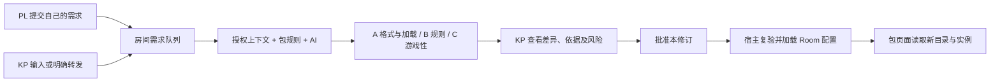

# Stumpsville AI 接入计划

- 文档类型：计划
- 状态：进行中
- 创建日期：2026-11-13
- 最后更新：2026-11-15
- 关联文档：[AI 管理器与组件](../current/engineering/ai-manager.md)、[AI 运行时](../current/engineering/ai-runtime.md)、[树桩镇当前实现](../../rulepacks/stumpsville/docs/current/implementation.md)、[计划索引](README.md)

## 目标与本轮边界

让树桩镇的 KP 在现有管理台中收到玩家需求，结合获授权的房间上下文生成方案和配置，经 A/B/C 与 KP 审核后加载。PL 使用自己的需求面板；服务商和密钥继续由独立 AI 管理器维护。

2026-11-13用户进一步授权尝试接入新增模块。树桩镇0.7.0已实现可选启动、显式个人会话、KP转交与咨询回复，真实宿主及离线服务验收通过；2026-11-14网页入口默认加载AI，新增本机AI及服务商管理双击入口，网页PL个人会话/状态和KP转交通过离线模型联测；原始AI管理/发布路由仍不向网页玩家开放。当前事实统一见[模块接入](../../rulepacks/stumpsville/docs/current/integrations.md)。配置生成/审核发布、更多包侧来源及跨设备多人试点仍待实施，以下保留这些后续目标。

网页 PL 的传输、沙箱与包侧服务桥依赖[网页联机调整规划](stumpsville-web-integration.md)。该规划S4网页个人咨询已于2026-11-14接通并通过本地双浏览器专项；仍不以联网接入替代本计划的上下文授权、作者检查或发布一致性要求。

2026-11-15 已接入[数据查询与事件资料](../current/engineering/ai-data-query.md)：场景/队伍聊天、已有申请裁决、逐玩家结果的可信只读适配，新行动可绑定消息来源。仅用于咨询，配置发布仍由本计划 SV-AI-3/4 的剩余一致性工作约束。

## 实际起点与需要补齐的接口

| 已核对事实 | 接入影响与计划 |
| --- | --- |
| [manifest](../../rulepacks/stumpsville/manifest.json) 为 0.8.0，21 个规则目录中的 Lua、7 类配置，运行数据为 game.json / scene-actions.json | 不能照搬 demo 技能契约。先明确允许 AI 变更的树桩镇规则及对应消费路径 |
| [launch.py](../../rulepacks/stumpsville/tools/launch.py) 通过公共 CLI 可选传入 ai-config / ai-pack，已接入咨询 | 已使用单宿主、同存档锁与关闭清理；继续保持包侧不直接 import 工程内部 Runtime |
| 包的 `/api/v1/` 同源代理已转发 AI 查询/咨询命令，并精确代理 headless client.js | 真实 Cookie/CSRF 沿用现有隔离；草稿、审批和发布在包侧明确拒绝，后续经契约验收再开放 |
| 通用 Pack 优先读根 manifest，并要求严格字段集；树桩镇根 manifest 还有 name/status/entry/contentLicense 且尚无 ai | 当前已使用公开 --ai-pack 指向按作者清单生成的 companion 快照解决启动；单独放 ai/manifest.json 仍不能覆盖根 manifest。后续配置扩展需完整作者验收，无需把启动适配预设为内核改动 |
| KP 管理页与本人 PL 页分离；`?view=player` 是展示投影，真实账号仍可能是 KP | 嵌入组件必须根据真实权限工作。KP 的 PL 页使用只展示需求的包装器，不因切换视图误挂完整审核台；安全判断仍由宿主完成 |
| 场景聊天 `sv-scene-N` 与队伍 `sv-party` 在 package.json 中；主机承担全局/分组/私聊 | 已有只读适配，场景/队伍资料标为私密且实时检查位置权限；不能伪装为主机来源或直接拼成公开上下文 |
| package.json 还保存笔记、描述草稿及协调状态；宿主负责实体数值和 Lua 工件 | 首批发布只触及 Room 原子事务涵盖的配置/工件。包侧文件修改需要另行事务/恢复设计，不能声称一次主机批准原子更新两处存档 |
| Context 已有按需查询及树桩镇只读适配；contextMapping 仍只是元数据 | 聊天/事件可查询，笔记等未登记来源不可读；包侧资料尚不能用于批准配置 |

## 预期使用流程

当前KP管理页顶栏已有“AI助手”，使用公开 `AiClient` 和包侧本地化界面，仅提供咨询。未来完整对话/审核区域可评估 `mountChat` 与 `mountAI`；原场景自动裁决器继续按确定性规则工作，AI 提案不直接成为其行动命令。PL 一屏三栏保持现有地图、日志和聊天布局，建议在工具栏打开需求抽屉；关闭抽屉调用组件 destroy，不复用私聊输入草稿。首版不默认监听全部聊天。

2026-11-14 通用模块新增房间文件夹对话、`/config`、`/entity`、`/data` 只读引用与补全；配置包三栏交互已有[可操作原型与接入计划](ai-pack-interaction.md)。原型演示旅行提灯改良，使用内存数据，不代表树桩镇可发布物品配置。包侧还需对新引用 API、组件模块/CSS 增加静态及服务桥白名单，并验证真实账号隔离；现有咨询接线不会自动获得这些新入口。

由 KP 主动选择“转为 AI 需求”的聊天应绑定消息 ID、修订及原作者；编辑/撤回后旧提案失效。当前场景聊天已有语义引用和来源重检；业务行动可绑定 sourceMessages。复制粘贴文字仍不能伪造“已验证来源”。自动接收后续作为独立开关，指定频道与前缀，跳过旧消息、去重、禁用循环转发。

## 包材料与首批变更选择

包作者交付建议放在 `rulepacks/stumpsville/ai/`：`manifest.json`、`contract.json`、公开条款摘录、JSON Schema、`checks.json`、正反 fixtures、`scenarios/`、`metrics.json`、KP 审核清单及可通过/必须拒绝的变更示例。其中 `ai/guide.md` 已提供咨询范围说明；当前严格 manifest、契约和固定值数据 Schema 按摘要生成在运行目录。其余配置扩展检查、场景、指标与变更示例仍为拟新增材料。

| 检查 | 主责 | 树桩镇交付与验收 |
| --- | --- | --- |
| A | 工程提供通用严格解析、合并及真实加载；包作者补数据 Schema | 验证整个平铺规则工件可加载，原 21 个规则与 2 个数据文件保留；新文件配额及路径受限，非法字段/缺引用失败 |
| B | 包作者定义规则及正反例；工程提供版本化 checker | 明确属性范围、物品字段、负重/消耗、持有人与场景权限；仅允许选定扩展路径，不允许借修改 game.json 改写整个游戏 |
| C | 包作者/规则设计者选场景指标；工程模拟；KP 评价 | 同初态比较成功率、伤害、资源与经济消耗；覆盖正常使用、资源耗尽、错误持有人、已有对象和重复使用；缺证据返回 unknown，风险理由由 KP 填写 |

首个候选建议选“新增受限物品模板”，但实施前必须完成一次规则作者确认。当前树桩镇物品由既有数据和角色库存逻辑消费，并非每个物品都对应可直接新增的宿主 Configuration；AI 新增 JSON 不会自然出现在背包或市场中。

若采用物品模板，建议先引入有版本的运行时模板目录，并让库存/生成动作和授权投影明确读取该目录；首次随包建立空扩展文件和 Schema，再允许指定命名空间的新增。工程 B 检查需补齐**数据文件内部路径级权限**与越权修改反例，不能只检查配置/规则路径。包 UI 必须通过授权目录接口读取当前活动版本，不继续读安装目录中的旧 game.json。这些是发布可用性的前置工作，不计入本轮通用面板能力。

若作者优先选择已有配置的一个默认字段，需先证明创建动作实际消费该默认值，并覆盖旧实例保持原值；不要为降低接入成本选择对游戏无实际作用的字段。确定首个范围后冻结允许字段、阈值及 C 指标，再编制实施测试。

## 分阶段实施与验收

| 阶段 | 负责方 / 工作 | 完成条件 |
| --- | --- | --- |
| SV-AI-0 启动兼容 | 包侧 companion 已通过公开 --ai-pack 接入；后续按需评估受限数据路径和授权目录接口 | 咨询启动已验证；配置变更的全工件校验与作者约束仍需 SV-AI-3 验收 |
| SV-AI-1 包契约与启动 | 包作者：上述 AI 材料、可选启动参数、只读咨询用规则摘录；工程提供接口支持 | AI 关闭仍按原样开房；开启后单宿主、不重复读写存档；错误配置可定位；模型服务不可达时仍能游玩 |
| SV-AI-2 KP / PL UI | 包作者：同源 AI 路由白名单、静态组件挂载、KP 管理区和 PL 需求抽屉；外观与文案适配 | 真实 KP/PL 登录分别验收；PL 无审核/密钥入口；退出、换视窗、撤权和迟到响应清理；键盘操作、一屏布局及中英文不退化 |
| SV-AI-3 首个配置闭环 | 包作者/规则设计者：确定一个实用范围、消费路径与 A/B/C；KP 参与 | 实际需求→方案→三检→改稿→批准→加载→创建/使用新对象；原实例不被暗改；拒绝、过期、重复加载、恢复分叉全部通过 |
| SV-AI-4 包侧上下文 | 工程：版本化 SourceAdapter 与宿主复验；包作者：场景/位置/成员/笔记/聊天授权读取 | 来源携带 scope、ID、修订、摘要、可见性和权限凭证；发送前/结果读出/审核/发布均重检；跨场景、未参与私聊、删除/编辑与降权不泄露 |
| SV-AI-5 多人试点 | 工程＋包作者＋KP：LAN 白名单和静态分发、自动需求开关、故障恢复 | 一名 KP＋两名 PL 的本机隔离浏览器及实际跨设备测试；窄屏、请求中断、房主重启、版本变化；保存可重放证据和真实玩法反馈 |

SV-AI-0的启动兼容已由包侧companion解决，SV-AI-1/2的咨询部分已完成；SV-AI-3仍是首个可发布配置闭环的前提；4 在允许包侧上下文/自动转发前完成；5 完成后再宣称多人 LAN 接入可用。包侧同源HTTP代理已连接AI模块；网页咨询已有逐玩家包服务桥；跨设备LAN、旧P2P AI路由、真实公网AI与完整配置发布仍不能由本机验证推导为已验收。

建议先完成“显式需求＋已有主机上下文＋一个受限配置扩展”，再扩展包侧记忆。每阶段先登记施工范围，分别由工程与包侧作者施工；包侧遵守 [rulepacks/AGENTS.md](../../rulepacks/AGENTS.md)，不能用包施工直接修改通用工程。

## 成本、待确认项与退出方式

成本集中在规则材料和现有数据消费路径，不在重新制作服务商面板。已有合规 PackContract 的包只需启动接线、HTTP/组件挂载及本包验收；树桩镇还需要 manifest 兼容、受限配置消费和包侧来源契约，属于中等以上适配工作。此处不提供未经排期的工日报价。阶段 0/1 后按实际规则覆盖量与首个扩展范围估算后续成本。

模型费用由请求次数、上下文、工具回合和输出量决定；自动接收默认关闭，房间预算限制仍有效。A/B/C 的本地执行不额外调用模型，但消耗宿主计算资源。真实计费测试单独记录，离线验收不替代真实 API 与 KP 试玩。

待进入包侧施工时确认：首个可发布的配置范围；C 的接受阈值；哪些场景/笔记允许外发；实际联机验证机器。它们不阻塞已完成的咨询接入。未确定前不开放任意 game.json 修改或包侧自动上下文。

停用先关闭房间 AI 和自动接收，再取消未完成请求；移除启动 AI 参数仍须保留已发布工件和游戏存档。删除面板不回滚游戏，已加载配置通过新的审核修订调整。验收使用独立存档，保留原始包与恢复证据，不在真实团档上探索不确定迁移。

2026-11-14追加：树桩镇已按新[配置包嵌入指南](../current/engineering/ai-pack-embedding.md)接入原生紧凑对话组件；KP裁决页内嵌，PL使用弹窗。公开资源固定图、语义引用查询/解析及外发复验已接线；配置发布仍关闭，包侧独立场景/笔记不是核心引用来源。实际功能与本地双浏览器证据见包侧当前接入和测试文档。
