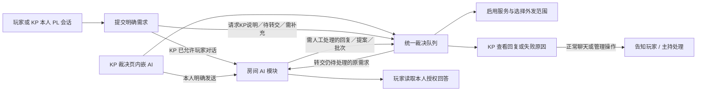

# 树桩镇 AI 与 P2P 接入

- 文档类型：当前
- 文档子类：工程
- 状态：有效
- 创建日期：2026-11-13
- 最后更新：2026-11-19
- 关联文档：[使用](usage.md)、[模块验收](../../tests/README.md)、[公网模块](../../../../docs/current/engineering/network-p2p.md)、[AI 模块](../../../../docs/current/engineering/ai-manager.md)、[未完成接口](../../../../docs/plans/Issues/issue-006-stumpsville-module-bridge.md)

最新权限、整包审批、资料披露／创作申请与术语规则见[AI 权限与裁决](ai-permissions.md)，用例扩充见[53 项场景草稿](../plans/ai-usage-scenarios.md)。

## 个人已知资料

当前依赖后端 0.3.0 / Room v4，所有启动方式独立安装知识提供方，关闭 AI 不关闭知识服务。PL 对话只消费本人授权的固定观察／持续告知状态，未接入或提供方故障时拒绝。指南和原始实体查询只用于 KP；旧存档需显式格式转换和现在揭示，见[操作与开发者说明](player-knowledge.md)。

## 启动

[start-integrated.cmd](../../start-integrated.cmd) 现打开统一Python房间面板，预选旧P2P和AI；[start-web.cmd](../../start-web.cmd)预选网页和AI，[start-ai.cmd](../../start-ai.cmd)预选本机AI。确认设置后点击“启动房间”，打开面板本身不发布。所有入口共用 `runtime/` 槽位库，选择或创建槽位后启动；各槽位数据独立，切换前先停止原房间；命令行 `start.ps1` 仍用Ctrl+C停止。本机与局域网预设默认不加载可选模块，可在面板勾选AI。

前提是工程已有宿主运行环境、联网模块的独立 Python 环境、`engineering/ai/config/ai-providers.json`、`engineering/network-p2p/local/client-config.json`。本包只读取这些配置，不安装依赖、不更改工程文件、不部署或修改云服务。服务商和凭据使用工程 [AI 管理器](../../../../engineering/ai/README.md) 配置，不能在树桩镇网页填写密钥。

启动后先打开树桩镇页面；全新存档完成首次准备后才启动宿主和联网入口。联网入口是另一张本机网页，由用户选择发布房间，不会自动公开。若端口或存档已占用，先停止原实例；两个独立房间必须使用不同的数据目录与端口。

[start-ai-manager.cmd](../../start-ai-manager.cmd)继续调用独立本机服务商管理器，状态存于 `runtime/ai-manager/`；它不持有游戏房间。面板支持 `--ai-config`、`--web-config`、`--p2p-config` 指定本地配置文件。启动成功后可打开主持/房间管理页；“联机控制页”进入网页平台管理页或旧P2P本机控制入口。`-NoBrowser` 禁止自动打开浏览器。`start.ps1` 的 `-AI`、`-P2P`、`-Web` 可分别启用，单独 `-Web` 仍可不加载AI。原有 `-Port`、`-Bind`、`-DataDir` 参数保留；AI可随包侧HTTP服务在可信局域网使用，P2P控制网页始终只绑定回环。

## AI 对话与修改裁决

PL场景桌面右栏“AI助手”标签切换到内嵌对话，聊天和AI切换不销毁组件或草稿；大厅等非场景页仍可从顶栏打开对话框。本机、LAN、网页玩家及KP本人PL视窗使用新版 `mountAIConversation` 原生组件；KP在独立“裁决”页内嵌使用同一组件，旁边为消息/裁决队列与常驻聊天。KP原生对话填满裁决页中栏，其“KP 审核与设置”定位左侧统一裁决队列；侧栏“AI 设置”独立页承载服务配置、外发范围与权限，队列设置按钮也前往此页；不再重复展示外层AI标题与设置按钮。外层页面沿用包侧中英文资源；工程原生对话内部目前主要为中文。



```text
AI 助手
├─ 共同：会话搜索、新建、置顶、归档目录、恢复和删除；独立设置历史携带轮数与回答显示
├─ 共同：请求状态、取消、刷新、未知结果的回执查询
├─ KP 裁决队列：玩家/辅助AI请求、转交、模型回复、失败、提案与批次；分页自动遍历
├─ KP 管理页：允许调用、服务配置、公开 / KP / 本人可读私密范围
└─ KP 裁决页：内嵌语义引用对话；统一队列提供会话定位、设置、历史及回执恢复
```

模块加载不等于服务商可调用。管理页会区分模块未加载、没有启用的服务配置、房间尚未允许调用、可调用但房间资料外发全关和已允许调用；房间关闭或外发范围全关时默认展开设置。先在 `start-ai-manager.cmd` 配置凭据并启用服务，再在KP助手勾选“允许调用 AI”并保存。

新房间默认关闭 AI 调用，三个外发范围默认关闭；玩家对话默认关闭；KP 开启后 PL 提交直接排队；KP在新版对话中点击发送会立即转交本人需求，这与队列中的显式“转交AI”一样受启用、预算、外发和引用复验约束。启用并转交时，需求正文会发给选定服务商，额外上下文按勾选范围发送。服务商配置还需在本地管理器中启用并具备有效凭据。设置随房间保存，重启不会抹去 KP 已明确保存的设置。频道自动接收在独立 AI 设置中显式配置，默认关闭。

AI 的运行时批次与配置候选统一进入 KP 裁决页的裁决队列。草稿、检查阻塞、部分执行和待核对也保留可见；通过 A/B/C 后才可批准配置。需要转交的原需求、玩家或辅助AI发起的可获知信息说明请求、待补充及失败任务也显示在同一区域，与角色审核、行动申请及宿主等待并列。普通完成的咨询不算待办；可勾选“查看 AI 处理记录”查看，未读聊天仍在消息队列。

队列每4秒扫描公开任务分页，不要求KP手动翻页找旧申请；已有提案/批次的请求只显示修改卡。点击“查看对应会话”打开原发起者会话；“转交 AI”调用原请求，回答回到该玩家会话，外发/知识范围仍按原玩家校验。未创建会话的手动需求提示无对应会话。结果未知时只查原命令回执，刷新也保留恢复入口。

PL 可直接点击“提交创作申请”，或从回答选项提交组合／附魔等需求，不以查询成功为前提。KP 点击“接收并生成方案”后自动打开私有管理员审核会话；原申请移入历史，生成的修改仍另行人工批准。PL 仅看申请状态，不获得审核会话或新资料。

查看整批内容和风险后，一次批准执行；玩家回答仅整理本人已知事实，不直接生成自由草稿或配置。运行时与普通配置自动批准分别开启，默认关闭；高危修改不受自动批准开关放行。不自动广播回复，包内独立状态仍由原业务操作处理。

`tools/integrations.py` 按 manifest 明确清单生成 `integrations/ai-pack-<摘要>/` companion；`tools/ai_extensions.py` 提供 NPC 模板、action/calculation 扩展的字段 Schema、B 正反例、C 场景与指标。支持 `sv.npc` 默认值及 `sv.ext.npc.*` 模板、`sv.ext.*` 规则；核心规则、地图／物品数据与删除配置走高危人工审批；结构、引用、作者场景仍需通过，flow 接口变更不自动放行。具体数值／效果限制、检查覆盖与接入责任统一见[修改裁决与配置包扩展](../../../../docs/current/engineering/ai-rulings.md)。

发布通过宿主三检提案事务，包侧读取宿主当前工件后同步活动规则和导出内容。扩展 NPC 纳入 KP 名册，PL 仍按已发现／同地点投影。重启生成新 companion；已有活动核心规则需 KP 在规则管理导入当前包规则，才能在伤害／士气中识别 isNpc。导入时保留仍需使用的自定义规则，不重置正式房间。

AI 现可按需查询主机授权资料，以及包侧场景/队伍聊天、申请裁决和逐玩家事件记录。已发布地点的个人发现已接入玩家投影；手记等未登记来源仍未接入，手工提供文字只作为用户陈述。静态快照也不声称代表后来由 KP 导入的自定义规则；咨询以宿主实际可读事实为准。私密快照、配置、联网凭据及运行日志没有静态 HTTP 路由。

## 用量查询

AI 助手顶栏的“用量统计”已接入本地 KP、PL 和网页玩家。KP可看本房间汇总，PL只看本人需求（包括KP转交后的调用）；支持日期、服务配置、当前会话筛选，区分确认输入/输出消耗、调用中预留和待核实预留。网页包通过受控 `GET ai/usage` 转发，额外账号参数被拒绝，PL请求房间汇总由宿主拒绝。统计不提供其他人的消息、回复、密钥或会话标题。

工程新配置默认关闭每日累计额度，但仍记账；当前本机DeepSeek配置已同步关闭。限额由本机AI管理器的服务商面板选择启用，包侧不能修改。重启树桩镇及AI管理器并刷新页面后加载本版，完整口径见[额度与统计](../../../../docs/current/engineering/ai-manager.md#每日限额与用量统计)。

## 会话管理与格式显示

KP 裁决页及 PL 的“AI 助手”均可点击“会话管理”：搜索/排序授权会话（KP 全部、PL 本人）、置顶、改名、归档恢复，并设置最近 0—4 轮历史携带（默认 4）。KP 还可切换格式化/原始文本及查询诊断显示。设置由当前房间 AI 仓库按账号和会话保存，网页玩家使用原有受控 API，不提供密钥或全房间队列权限。旧记录读取默认值，切换会话保留当前页面的未发送草稿；刷新或退出清除草稿。

KP 内嵌回答与统一裁决队列中的AI回复共用 Markdown 子集渲染：标题、强调、表格、列表、代码块及语义引用；代码和宽表格在容器内滚动。模型 HTML 作为文字显示，不加载远端图片。PL 在房间允许后可读自己的需求及玩家权限内的回答，显示设置不改变权限上限。组件/API 参数与格式边界见[公共组件指南](../../../../docs/current/engineering/ai-pack-embedding.md#独立会话管理与显示组件)。

本地资源按公开清单提供；网页构建包含 markdown、session-manager 的 JS/CSS。网页沙箱继续禁止原生表单导航，通过事件 composedPath 识别 Shadow DOM 内的按钮/输入并转发受控提交。操作结果未知时查询原回执；组件和包桥收到终态回执后解除待确认状态。

更新后重启树桩镇房间服务并刷新客户端，以重新构建网页资源；无需修改已有房间配置、密钥或 AI 快照。

## P2P 基础接入与限制

包侧使用联网模块公开 CLI 启动本机控制入口，将 `upstream` 指向**本次启动的树桩镇通用宿主端口**。使用独立 `integrations/p2p-state/` 保存房间身份和占用锁，不复用工程测试房间。派生配置只复制连接所需字段，保存于被 Git 忽略的运行目录；不复制 `packagePath`，不把包含 KP 真相和私密存档的整个配置包导出。

本机联网网页可发布/停止、审批加入与查看连接诊断。其地址含本机控制能力令牌，不能发送给玩家；本包现有 `-P2P` 模式的玩家使用联网模块提供的 Windows 客户端和浏览器，通过短房间码或邀请加入，不能直接访问房主本机 URL。已有局域网模式仍只需浏览器打开正确的局域网地址。

旧 P2P 入口接通登录、通用宿主状态、基础聊天和实时订阅。树桩镇的地图、预设行动、个人线索、包侧聊天与 AI API 不在旧 P2P 转发白名单中，因此**不能将旧入口当作完整树桩镇公网游玩版本**。不能把包侧请求塞进通用 `commands` 绕过白名单。完整玩家沙箱已由独立网页模式接入，旧入口限制仍保留，见 [ISSUE-006](../../../../docs/plans/Issues/issue-006-stumpsville-module-bridge.md)。

0.9.0的 [网页模式](web.md) 使用 network-web 0.3.0 / network-p2p 0.2.2，新增 `start-web.cmd`、严格包服务桥、受限存储、完整一屏玩家 UI 和按需资源。平台最低6位密码与本机记住账密继续由可信壳处理，不改变游戏账号规则。云端已于2026-11-13经用户授权部署0.2.0；旧 P2P 与网页入口不能同时用于同一宿主。网页 PL 由 KP 开启后可直接使用咨询，KP 可在本机查看。`POST package/ai` 仅接受能力查询、个人会话列表/详情、回执和 create/update/submit/cancel/delete 写命令，以及玩家主动资料／创作申请、权限／只读用量查询、knowledge引用查询、引用解析和四个固定只读数据查询接口；路径/参数严格白名单，无账号注入、任意URL、服务配置、队列、转交或发布通路。身份沿用玩家真实宿主会话，写请求保留CSRF和原AI请求ID；公开 `pack.js` 组件图（对话/视图/引用编辑器及SDK）随资源包构建，不从沙箱直接联网。无需修改或重部署工程云端。

正常退出启动器时先请求联网模块撤销房间，再停止本次联网进程和游戏宿主。单独在联网页面“停止房间”只停止 P2P 分享，树桩镇继续运行。联网启动失败保留游戏宿主，KP 助手显示失败状态，排查 `runtime/p2p.log` 与本机配置。进程显示“运行”只表示本机入口存在，不代表已发布房间或已通过公网连通性测试。异常强杀时云端租约可能需要约一分钟失效。

## 已验证边界

[专项脚本](../../tests/verify_integrations.py) 使用独立真实宿主、回环模拟 AI 服务、本地目录服务与两名真实 WebRTC 客户端；验证权限、咨询结果、无游戏状态变化、路由阻塞、撤销房间及浏览器界面。没有调用真实付费模型，没有本轮跨家庭网络或 TURN 中转验收；工程模块原有的云端验收不等同树桩镇完整玩法验收。账号、随机密码和本机控制令牌只在忽略的测试输出目录内保存。

2026-11-14新增[5组地图/网页AI验收](../../tests/map-ai-results.json)，使用两名真实WebRTC网页玩家及本机模拟服务；验证个人会话、KP界面启用/转交、跨账号与管理越权拒绝、原请求回执恢复。原本机AI/旧P2P5组及一屏6组同步重跑通过。没有真实服务商调用或公网AI新增验收。

## 新版组件与引用接线（2026-11-14）

读取[配置包嵌入指南](../../../../docs/current/engineering/ai-pack-embedding.md)后采用原生 `mountAIConversation`。本机只代理公开 `pack-manifest.json` 中的JS/CSS，不开放服务商管理资源或任意路径；网页把固定依赖图与CSS编入公开资源，保留各组件作用域和Shadow DOM，不放宽沙箱或新增工程路由。`ui/ai-embedded.js`负责身份、挂载/销毁、跨轮询保留草稿、关闭清理和未知写结果回执查询。

本机KP可使用 `/config`、`/entity`、`/data`、`/chat`、`/event`、`/ruling` 查询授权资料；网页PL桥仅允许 `/knowledge` 和有界tokens解析。PL只读资料接口仅search/read的knowledge类型可用，chat/case因历史受众证明不足拒绝。引用显示为可读名称，提交保留真实ID与修订；服务端会再次校验发起者、审核者、修订及外发范围。关闭外发时返回 `EXTERNAL_SCOPE_DISABLED`，不会偷偷发送引用内容。NPC身份通过实际定向披露形成固定观察，不授予完整数值和模板权限；引用及资料查询使用同一观察。

PL 组件使用 `review:false`，不获得裁决路由。KP 的“KP 审核与设置”和消息内“查看配置裁决／查看执行批次”均定位旁边的统一裁决队列；策略设置从独立“AI 设置”页或队列快捷按钮进入。队列使用公共 `mountRulings` 的紧凑模式与详情浮窗，跨包轮询保留未变卡片和风险输入。包服务代理不再一律拒绝配置草稿／发布，实际权限、三检和来源由宿主验证；网页 PL 桥仍不开放管理接口。

## AI 查询空列表排查（2026-11-15）

先区分“初始上下文为空”和“资料工具返回空列表”。KP 管理员采用按需查询：初始 `roomFacts.entities/configurations/messages`、rules为空是未预载的占位状态；不是宿主没有这些资料。`selectedReferences`为空只表示用户未手选引用。模型应先调用 `room_search_data`，按返回ref调用 `room_read_data`，不能仅复述roomFacts或包契约就判断没有实体。查询概览使用类型筛选及空query，并沿返回游标分页；已有指南明确给出此流程。

对本次“查看所有房间信息并梳理”的只读排查确认：真实房间三种外发范围均已开启，有30个实体、13个配置；该请求记录没有 `facts.dataQueries`，模型直接将未加载上下文解释为没有资料。此前 `query="npc"` 也不能代表实体全集。因此开启外发只是允许读取，不保证模型已执行工具。该次运行快照仍含旧指南；更新包文件后必须关闭启动窗口并重新启动房间，单纯刷新网页不会替换后台加载的AI快照。建议重新建会话，避免沿用旧错误叙述。

“AI 服务与权限设置”会比较当前加载快照和包指南；旧后台未提供诊断字段或指南不同，明确提示重启。诊断只报告版本是否一致，不修改运行中的快照或真实AI历史。`tools/integrations.py` 的KP状态增加 `ai.queryMode` 和 `ai.guideCurrent`，仍由原管理路由鉴权。

房间允许调用模型与允许外发房间资料是两项独立设置。实际模型工具查询同时检查发起者权限和所选外发范围；KP本机引用预览可读，不代表模型也获准读取。三个外发范围全部关闭时，config、entity、event 等搜索会返回空列表。当前页面会明确提示这一状态，不自动修改已保存选择。

在“AI 设置→服务与外发范围”按需选择：现有蜘蛛和守卫蛇实体属于“KP 信息”，配置定义属于“公开信息”，包侧行动/裁决事件属于“本人有权读取的私密信息”。这些选择允许相应资料发给所选服务商；PL需求直接排队时，仍受绑定玩家与执行KP的共同可读范围限制，不能因此读取KP专属NPC。

`search.query` 匹配显示名称，不是类型筛选：搜索 `npc` 不会命中“蜘蛛一”或“守卫蛇”。可按名称搜索，或先无关键词分页列举entity，再读取引用并按 `configurationId=sv.npc` 和 `numbers.location` 筛选。config是定义，memory是已确认记忆，event是事件记录，不能替代当前实体清单；没有已确认记忆时memory为空是正常结果。尚未建成运行实体的故事人物不在entity中。

[查询范围专项](../../tests/verify_ai_scopes.py)通过实际工具执行链验证全部关闭、仅KP范围、三个范围开启、PL请求转交及按需空上下文/指南快照，并补验新版实际计数、完整分页、频道详情→聊天、NPC字段读取和无工具末轮，见[8组结果](../../tests/ai-scopes-results.json)。使用隔离房间和回环模拟服务，未改变真实房间外发选择；同时通过4组消息/裁决资料和5组原生AI/网页玩家回归。单独的[真实模型专项](../../tests/verify_ai_demand.py)须显式 `--live`，只用隔离样例房间；自动passed仅检查查询链路，完整验收还须人工核对答案，见[实测汇总](../../../../engineering/acceptance/ai-runtime/issue-009-live-results.json)。

AI模块的按需载荷与系统提示明确“尚未加载”，可恢复查询错误返回模型在原额度内修正；清理连接异常不覆盖原结果。新任务的KP原生对话可展开“资料查询”查看工具次数、拒绝原因、失败阶段和脱敏代码位置，PL不接收这些诊断。模型列表结果附当前授权页实际条数；频道查询先解析详情取得业务ID。达到工具回合上限后，最后一次请求只汇总已有资料并说明未读范围。合法配置省略behaviors不再导致草稿校验崩溃。旧任务不回填。

包侧直接使用现有宿主CLI和公开原生组件，无需新增路由、迁移或放宽网页桥。`pageSummary`仅在模型工具结果中附加，不改变HTTP EvidencePage、来源摘要或复验协议。分页必须保持过滤条件和limit不变；limit不是数量，ref.id不是频道业务ID。只读概览返回plan；最后一次无工具请求仍计入原有回合、超时和预算限制。

本包[咨询指南](../../ai/guide.md)同步这些约定，并针对实测误读要求：位置编号不能推断通路，零值标志不能证明整个剧情未推进或玩家没有线索，cheese1等字段名不能推断单位/比例。先读取相关规则或执行证据；资料不可读时报告原值和未核实部分。指南随新启动快照加载，修改不会自动重写旧会话或运行中任务，也不调整正式服务商预算。此类约束的交付可离线验证，但真实模型是否始终遵守仍须人工审核。

2026-11-15经用户授权真实复验，最终分页枚举29个实体、13项配置及频道general并返回回答，本轮87项回归通过。实测使用隔离的20万预算、8192输出上限，正式配置不变；较低上限仍可能预算不足或截断。回答中未经规则验证的地图/剧情推断尚未通过人工验收，见[ISSUE-009](../../../../docs/plans/Issues/issue-009-ai-live-query-diagnostics.md)。查询成功不代表已读完全部资料或所有解释准确，仍需KP审核。原始3473 tokens失败记录保留，无法追认其确切原因。关闭启动窗口并重启房间后加载新运行时与组件；仅刷新网页不更新后台。

## 聊天与裁决资料（2026-11-15）

启用 AI 时，公开宿主 CLI 同时安装本包 `tools/ai_data.py` 只读适配器。支持场景/队伍聊天、申请、逐玩家事件与裁决资料；主机读取权限、私密外发开关和来源版本继续生效，包侧资料仅用于咨询。新增 `/chat /event /ruling` 引用和四类查询 API，具体契约见[工程说明](../../../../docs/current/engineering/ai-data-query.md)。

发起行动的 args 可携带 sourceMessages，按 channelId/messageId/revision/sequence 通过授权历史接口核验；新裁决记录决定者和时间。旧事件缺失来源保持不完整，不自动配对聊天或补造执行结果。专项脚本 tests/verify_ai_data.py 使用隔离房间和离线模型；[结果](../../tests/ai-data-results.json)不代表真实公网或 DeepSeek 验收。

## 会话权限更新（2026-11-16）

KP 设置增加“允许 PL 使用 AI 对话”和“自动批准管理员执行批次”，默认关闭。允许后玩家提交直接转交 AI，回答按绑定账号权限显示；KP 可查看全部会话，玩家仅自己。嵌入管理支持已归档目录、恢复、直接删除和原回执恢复，打开管理时暂停对话轮询。KP 设置中的完整管理入口可审核宿主／会话批次；带包侧独立资料的上下文仍仅用于咨询；可执行候选基于宿主活动工件复验。

`tools/ai_data.py` 增加 entities / known_configurations 知识投影：本人角色、本人进入过或被明确揭示的已发布地点及相关个人线索、当前可见角色／已发现 NPC 的名称位置；NPC 数值模板、未公开场景变量不随可见名称泄露。玩家网页桥仅新增 ai/access 与 ai.session.delete；实际权限由宿主再次校验。重启房间并重新生成网页导出后生效。接口细节见[AI 会话权限](../../../../docs/current/engineering/ai-session-access.md)，包内事务／完整配置发布后续见[ISSUE-010](../../../../docs/plans/Issues/issue-010-ai-package-mutations.md)。

2026-11-16 验收：模块按测试 ID 去重 323 项、树桩镇 32 组通过，覆盖分级权限、直接排队、批次审批／恢复、归档／删除、双网页玩家及原生 KP。均使用隔离存档和离线服务，未调用真实模型或修改正式存档；[验收汇总](../../../../engineering/acceptance/ai-runtime/session-access-results.json)保存逐项结果、复测关系和源码摘要。

回答采用[简洁正文、语义引用与选择卡片](../../../../docs/current/engineering/ai-responses.md)。原生与网页组件均支持选择后填写需求；模板别名由 tools/ai_data.py 提供。沿用 sv.npc 新建 NPC 属于实体实例批次，不受空配置扩展点阻止；独立包状态联动与新模板发布仍按 [ISSUE-010](../../../../docs/plans/Issues/issue-010-ai-package-mutations.md) 分工适配。更新后重启宿主并重建网页资源；旧的 raw ID 回复不猜测转换。

引用标签现可点击打开授权详情，支持键盘和移动端；轮询保留未变化的历史节点。默认回答改为一句结论加短列表，已确认的方向直接提出批次供审核。创建 NPC 不自动揭示给玩家：KP 可用既有人物揭示功能；AI 暂不能调用该包操作。剧情字段须区分宿主实体数值与 package.json 独立状态，具体见[写入目标与边界](../../../../docs/current/engineering/ai-session-access.md#运行时写入目标与树桩镇限制)。

本轮 65 项模块与 11 组包侧补验通过，新增原生／网页引用详情、键盘、精确修订与轮询稳定性，见[验收记录](../../../../engineering/acceptance/ai-runtime/reference-details-results.json)。使用离线模型与隔离存档。

## 2026-11-16 渲染与个人知识修正

AI 查询地点详情按“本人进入过或被明确揭示”过滤，发布本身不增加其他玩家知识。包页面未掌握地点显示导航占位，KP 地点管理新增“向玩家揭示”。主持指南为 kp 来源，独立 `ai/player-guide.md` 才进入玩家上下文。进入记录保存在包侧 `locationKnowledge`，离开／重启后保留；旧档无法恢复未记录的历史，请由 KP 补揭示。完整范围、基础实体 API 的限制及专项证据见[排查记录](../../../../docs/current/engineering/ai-rendering-knowledge.md)。

组件样式改为共享 adoptedStyleSheets，网页构建器同步内联，避免宿主重建 DOM 后短暂无样式。停止旧服务后重新启动并刷新，本机 companion 和网页包需使用本次构建；正式存档保留。
