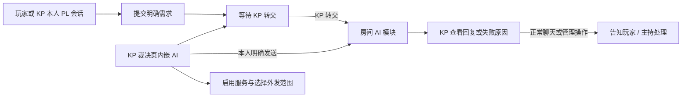

# 树桩镇 AI 与 P2P 接入

- 文档类型：当前
- 文档子类：工程
- 状态：有效
- 创建日期：2026-11-13
- 最后更新：2026-11-16
- 关联文档：[使用](usage.md)、[模块验收](../../tests/README.md)、[公网模块](../../../../docs/current/engineering/network-p2p.md)、[AI 模块](../../../../docs/current/engineering/ai-manager.md)、[未完成接口](../../../../docs/plans/Issues/issue-006-stumpsville-module-bridge.md)

## 启动

[start-integrated.cmd](../../start-integrated.cmd) 现打开统一Python房间面板，预选旧P2P和AI；[start-web.cmd](../../start-web.cmd)预选网页和AI，[start-ai.cmd](../../start-ai.cmd)预选本机AI。确认设置后点击“启动房间”，打开面板本身不发布。所有入口共用 `runtime/`，切换前先停止原面板；命令行 `start.ps1` 仍用Ctrl+C停止。本机与局域网预设默认不加载可选模块，可在面板勾选AI。

前提是工程已有宿主运行环境、联网模块的独立 Python 环境、`engineering/ai/config/ai-providers.json`、`engineering/network-p2p/local/client-config.json`。本包只读取这些配置，不安装依赖、不更改工程文件、不部署或修改云服务。服务商和凭据使用工程 [AI 管理器](../../../../engineering/ai/README.md) 配置，不能在树桩镇网页填写密钥。

启动后先打开树桩镇页面；全新存档完成首次准备后才启动宿主和联网入口。联网入口是另一张本机网页，由用户选择发布房间，不会自动公开。若端口或存档已占用，先停止原实例；两个独立房间必须使用不同的数据目录与端口。

[start-ai-manager.cmd](../../start-ai-manager.cmd)继续调用独立本机服务商管理器，状态存于 `runtime/ai-manager/`；它不持有游戏房间。面板支持 `--ai-config`、`--web-config`、`--p2p-config` 指定本地配置文件。启动成功后可打开主持/房间管理页；“联机控制页”进入网页平台管理页或旧P2P本机控制入口。`-NoBrowser` 禁止自动打开浏览器。`start.ps1` 的 `-AI`、`-P2P`、`-Web` 可分别启用，单独 `-Web` 仍可不加载AI。原有 `-Port`、`-Bind`、`-DataDir` 参数保留；AI可随包侧HTTP服务在可信局域网使用，P2P控制网页始终只绑定回环。

## AI 咨询

PL顶栏“AI 助手”打开独立对话框，保留场景桌面。本机、LAN、网页玩家及KP本人PL视窗使用新版 `mountAIConversation` 原生组件；KP在独立“裁决”页内嵌使用同一组件，旁边为消息/裁决队列与常驻聊天。原生对话填满中栏，其“KP 审核与设置”打开包侧全房间待处理需求、模型回复、服务配置与外发范围；不再重复展示外层AI标题与设置按钮。外层页面沿用包侧中英文资源；工程原生对话内部目前主要为中文。



```text
AI 助手
├─ 共同：会话搜索、新建、置顶、归档恢复；独立设置历史携带轮数与回答显示
├─ 共同：请求状态、取消、刷新、未知结果的回执查询
├─ KP 管理页：待处理需求、转交、模型回复、较早请求
├─ KP 管理页：允许调用、服务配置、公开 / KP / 本人可读私密范围
└─ KP 裁决页：内嵌语义引用对话；外层提供需求队列、设置和回执恢复
```

模块加载不等于服务商可调用。管理页会区分模块未加载、没有启用的服务配置、房间尚未允许调用、可调用但房间资料外发全关和已允许调用；房间关闭或外发范围全关时默认展开设置。先在 `start-ai-manager.cmd` 配置凭据并启用服务，再在KP助手勾选“允许调用 AI”并保存。

新房间默认关闭 AI 调用，三个外发范围默认关闭；PL提交需求不会自动调用模型；KP在新版对话中点击发送会立即转交本人需求，这与队列中的显式“转交AI”一样受启用、预算、外发和引用复验约束。启用并转交时，需求正文会发给选定服务商，额外上下文按勾选范围发送。服务商配置还需在本地管理器中启用并具备有效凭据。设置随房间保存，重启不会抹去 KP 已明确保存的设置。当前包侧界面关闭频道自动接收，只提交显式会话需求。

本轮为**咨询模式**。模型不代替骰点、场景预设、自动裁决或 KP 决定；玩家可看自己的需求和状态，模型回复仅由 KP 审阅。没有自动广播模型回复。现有场景执行仍需要管理台在线，AI 不提供额外自动执行权限。

`tools/integrations.py` 按作者 manifest 的明确清单复制全部 21 个 Lua 规则、配置和两个数据文件，在本房间 `integrations/ai-pack-<摘要>/` 生成符合 AI 严格格式的 companion manifest。原 manifest 保留 UI 元信息。快照没有配置扩展点，两个数据文件使用固定值 Schema；检查与指标为空不代表已经通过游戏性验收。包侧代理拒绝 AI 草稿、提案审批和发布接口，不挂载配置发布 UI。未来配置生成需要独立作者契约、验证场景及与包侧版本恢复一致的发布流程。

AI 现可按需查询主机授权资料，以及包侧场景/队伍聊天、申请裁决和逐玩家事件记录。个人线索、手记等未登记来源仍未接入，手工提供文字只作为用户陈述。静态快照也不声称代表后来由 KP 导入的自定义规则；咨询以宿主实际可读事实为准。私密快照、配置、联网凭据及运行日志没有静态 HTTP 路由。

## 用量查询

AI 助手顶栏的“用量统计”已接入本地 KP、PL 和网页玩家。KP可看本房间汇总，PL只看本人需求（包括KP转交后的调用）；支持日期、服务配置、当前会话筛选，区分确认输入/输出消耗、调用中预留和待核实预留。网页包通过受控 `GET ai/usage` 转发，额外账号参数被拒绝，PL请求房间汇总由宿主拒绝。统计不提供其他人的消息、回复、密钥或会话标题。

工程新配置默认关闭每日累计额度，但仍记账；当前本机DeepSeek配置已同步关闭。限额由本机AI管理器的服务商面板选择启用，包侧不能修改。重启树桩镇及AI管理器并刷新页面后加载本版，完整口径见[额度与统计](../../../../docs/current/engineering/ai-manager.md#每日限额与用量统计)。

## 会话管理与格式显示

KP 裁决页及 PL 的“AI 助手”均可点击“会话管理”：搜索/排序本人会话、置顶、改名、归档恢复，并设置最近 0—4 轮历史携带（默认 4）。KP 还可切换格式化/原始文本及查询诊断显示。设置由当前房间 AI 仓库按账号和会话保存，网页玩家使用原有受控 API，不提供密钥或全房间队列权限。旧记录读取默认值，切换会话保留当前页面的未发送草稿；刷新或退出清除草稿。

KP 内嵌回答与“KP 审核与设置”的旧咨询队列现共用 Markdown 子集渲染：标题、强调、表格、列表、代码块及语义引用；代码和宽表格在容器内滚动。模型 HTML 作为文字显示，不加载远端图片。PL 继续只读自己的需求和状态，显示设置不改变回复可见权限。组件/API 参数与格式边界见[公共组件指南](../../../../docs/current/engineering/ai-pack-embedding.md#独立会话管理与显示组件)。

本地资源按公开清单提供；网页构建包含 markdown、session-manager 的 JS/CSS。网页沙箱继续禁止原生表单导航，通过事件 composedPath 识别 Shadow DOM 内的按钮/输入并转发受控提交。操作结果未知时查询原回执；组件和包桥收到终态回执后解除待确认状态。

更新后重启树桩镇房间服务并刷新客户端，以重新构建网页资源；无需修改已有房间配置、密钥或 AI 快照。

## P2P 基础接入与限制

包侧使用联网模块公开 CLI 启动本机控制入口，将 `upstream` 指向**本次启动的树桩镇通用宿主端口**。使用独立 `integrations/p2p-state/` 保存房间身份和占用锁，不复用工程测试房间。派生配置只复制连接所需字段，保存于被 Git 忽略的运行目录；不复制 `packagePath`，不把包含 KP 真相和私密存档的整个配置包导出。

本机联网网页可发布/停止、审批加入与查看连接诊断。其地址含本机控制能力令牌，不能发送给玩家；本包现有 `-P2P` 模式的玩家使用联网模块提供的 Windows 客户端和浏览器，通过短房间码或邀请加入，不能直接访问房主本机 URL。已有局域网模式仍只需浏览器打开正确的局域网地址。

旧 P2P 入口接通登录、通用宿主状态、基础聊天和实时订阅。树桩镇的地图、预设行动、个人线索、包侧聊天与 AI API 不在旧 P2P 转发白名单中，因此**不能将旧入口当作完整树桩镇公网游玩版本**。不能把包侧请求塞进通用 `commands` 绕过白名单。完整玩家沙箱已由独立网页模式接入，旧入口限制仍保留，见 [ISSUE-006](../../../../docs/plans/Issues/issue-006-stumpsville-module-bridge.md)。

0.9.0的 [网页模式](web.md) 使用 network-web 0.3.0 / network-p2p 0.2.2，新增 `start-web.cmd`、严格包服务桥、受限存储、完整一屏玩家 UI 和按需资源。平台最低6位密码与本机记住账密继续由可信壳处理，不改变游戏账号规则。云端已于2026-11-13经用户授权部署0.2.0；旧 P2P 与网页入口不能同时用于同一宿主。网页 PL 现可使用咨询，KP仍在本机管理台转交与审阅。`POST package/ai` 仅接受能力查询、个人会话列表/详情、回执和 create/update/submit/cancel 四类写命令，以及只读用量查询、config/entity/chat/event/ruling引用查询、引用解析和四个固定只读数据查询接口；路径/参数严格白名单，无账号注入、任意URL、服务配置、队列、转交或发布通路。身份沿用玩家真实宿主会话，写请求保留CSRF和原AI请求ID；公开 `pack.js` 组件图（对话/视图/引用编辑器及SDK）随资源包构建，不从沙箱直接联网。无需修改或重部署工程云端。

正常退出启动器时先请求联网模块撤销房间，再停止本次联网进程和游戏宿主。单独在联网页面“停止房间”只停止 P2P 分享，树桩镇继续运行。联网启动失败保留游戏宿主，KP 助手显示失败状态，排查 `runtime/p2p.log` 与本机配置。进程显示“运行”只表示本机入口存在，不代表已发布房间或已通过公网连通性测试。异常强杀时云端租约可能需要约一分钟失效。

## 已验证边界

[专项脚本](../../tests/verify_integrations.py) 使用独立真实宿主、回环模拟 AI 服务、本地目录服务与两名真实 WebRTC 客户端；验证权限、咨询结果、无游戏状态变化、路由阻塞、撤销房间及浏览器界面。没有调用真实付费模型，没有本轮跨家庭网络或 TURN 中转验收；工程模块原有的云端验收不等同树桩镇完整玩法验收。账号、随机密码和本机控制令牌只在忽略的测试输出目录内保存。

2026-11-14新增[5组地图/网页AI验收](../../tests/map-ai-results.json)，使用两名真实WebRTC网页玩家及本机模拟服务；验证个人会话、KP界面启用/转交、跨账号与管理越权拒绝、原请求回执恢复。原本机AI/旧P2P5组及一屏6组同步重跑通过。没有真实服务商调用或公网AI新增验收。

## 新版组件与引用接线（2026-11-14）

读取[配置包嵌入指南](../../../../docs/current/engineering/ai-pack-embedding.md)后采用原生 `mountAIConversation`。本机只代理公开 `pack-manifest.json` 中的JS/CSS，不开放服务商管理资源或任意路径；网页把固定依赖图与CSS编入公开资源，保留各组件作用域和Shadow DOM，不放宽沙箱或新增工程路由。`ui/ai-embedded.js`负责身份、挂载/销毁、跨轮询保留草稿、关闭清理和未知写结果回执查询。

本机KP可使用 `/config`、`/entity`、`/data`、`/chat`、`/event`、`/ruling` 查询授权资料；网页PL桥允许config/entity/chat/event/ruling和有界tokens解析，原始运行文件指令data仍拒绝。只读数据接口开放search/read/chat/case，由宿主继续验证参数和可见范围。引用显示为可读名称，提交保留真实ID与修订；服务端会再次校验发起者、审核者、修订及外发范围。关闭外发时返回 `EXTERNAL_SCOPE_DISABLED`，不会偷偷发送引用内容。地图发现只允许显示名字，不等于取得NPC数值、核心实体读取或AI引用权限。

PL组件使用 `review:false`；KP组件显示“KP 审核与设置”，由 `onReview` 回调打开包侧咨询需求队列和设置，不挂载工程配置发布视图。树桩镇仍为咨询模式，服务端继续拒绝配置发布。当前companion契约没有可变扩展点，不因引入新组件就开放任意配置发布；受限配置生成及跨账本发布事务继续待实施。

## AI 查询空列表排查（2026-11-15）

先区分“初始上下文为空”和“资料工具返回空列表”。当前采用按需查询：初始 `roomFacts.entities/configurations/messages`、rules为空是未预载的占位状态；不是宿主没有这些资料。`selectedReferences`为空只表示用户未手选引用。模型应先调用 `room_search_data`，按返回ref调用 `room_read_data`，不能仅复述roomFacts或包契约就判断没有实体。查询概览使用类型筛选及空query，并沿返回游标分页；已有指南明确给出此流程。

对本次“查看所有房间信息并梳理”的只读排查确认：真实房间三种外发范围均已开启，有30个实体、13个配置；该请求记录没有 `facts.dataQueries`，模型直接将未加载上下文解释为没有资料。此前 `query="npc"` 也不能代表实体全集。因此开启外发只是允许读取，不保证模型已执行工具。该次运行快照仍含旧指南；更新包文件后必须关闭启动窗口并重新启动房间，单纯刷新网页不会替换后台加载的AI快照。建议重新建会话，避免沿用旧错误叙述。

“KP 审核与设置”会比较当前加载快照和包指南；旧后台未提供诊断字段或指南不同，明确提示重启。诊断只报告版本是否一致，不修改运行中的快照或真实AI历史。`tools/integrations.py` 的KP状态增加 `ai.queryMode` 和 `ai.guideCurrent`，仍由原管理路由鉴权。

房间允许调用模型与允许外发房间资料是两项独立设置。实际模型工具查询同时检查发起者权限和所选外发范围；KP本机引用预览可读，不代表模型也获准读取。三个外发范围全部关闭时，config、entity、event 等搜索会返回空列表。当前页面会明确提示这一状态，不自动修改已保存选择。

在“裁决→AI 助手内的 KP 审核与设置→服务与外发范围”按需选择：现有蜘蛛和守卫蛇实体属于“KP 信息”，配置定义属于“公开信息”，包侧行动/裁决事件属于“本人有权读取的私密信息”。这些选择允许相应资料发给所选服务商；PL需求经KP转交时，仍受发起玩家与KP的共同可读范围限制，不能因此读取KP专属NPC。

`search.query` 匹配显示名称，不是类型筛选：搜索 `npc` 不会命中“蜘蛛一”或“守卫蛇”。可按名称搜索，或先无关键词分页列举entity，再读取引用并按 `configurationId=sv.npc` 和 `numbers.location` 筛选。config是定义，memory是已确认记忆，event是事件记录，不能替代当前实体清单；没有已确认记忆时memory为空是正常结果。尚未建成运行实体的故事人物不在entity中。

[查询范围专项](../../tests/verify_ai_scopes.py)通过实际工具执行链验证全部关闭、仅KP范围、三个范围开启、PL请求转交及按需空上下文/指南快照，并补验新版实际计数、完整分页、频道详情→聊天、NPC字段读取和无工具末轮，见[8组结果](../../tests/ai-scopes-results.json)。使用隔离房间和回环模拟服务，未改变真实房间外发选择；同时通过4组消息/裁决资料和5组原生AI/网页玩家回归。单独的[真实模型专项](../../tests/verify_ai_demand.py)须显式 `--live`，只用隔离样例房间；自动passed仅检查查询链路，完整验收还须人工核对答案，见[实测汇总](../../../../engineering/acceptance/ai-runtime/issue-009-live-results.json)。

AI模块的按需载荷与系统提示明确“尚未加载”，可恢复查询错误返回模型在原额度内修正；清理连接异常不覆盖原结果。新任务的KP原生对话可展开“资料查询”查看工具次数、拒绝原因、失败阶段和脱敏代码位置，PL不接收这些诊断。模型列表结果附当前授权页实际条数；频道查询先解析详情取得业务ID。达到工具回合上限后，最后一次请求只汇总已有资料并说明未读范围。合法配置省略behaviors不再导致草稿校验崩溃。旧任务不回填。

包侧直接使用现有宿主CLI和公开原生组件，无需新增路由、迁移或放宽网页桥。`pageSummary`仅在模型工具结果中附加，不改变HTTP EvidencePage、来源摘要或复验协议。分页必须保持过滤条件和limit不变；limit不是数量，ref.id不是频道业务ID。只读概览返回plan；最后一次无工具请求仍计入原有回合、超时和预算限制。

本包[咨询指南](../../ai/guide.md)同步这些约定，并针对实测误读要求：位置编号不能推断通路，零值标志不能证明整个剧情未推进或玩家没有线索，cheese1等字段名不能推断单位/比例。先读取相关规则或执行证据；资料不可读时报告原值和未核实部分。指南随新启动快照加载，修改不会自动重写旧会话或运行中任务，也不调整正式服务商预算。此类约束的交付可离线验证，但真实模型是否始终遵守仍须人工审核。

2026-11-15经用户授权真实复验，最终分页枚举29个实体、13项配置及频道general并返回回答，本轮87项回归通过。实测使用隔离的20万预算、8192输出上限，正式配置不变；较低上限仍可能预算不足或截断。回答中未经规则验证的地图/剧情推断尚未通过人工验收，见[ISSUE-009](../../../../docs/plans/Issues/issue-009-ai-live-query-diagnostics.md)。查询成功不代表已读完全部资料或所有解释准确，仍需KP审核。原始3473 tokens失败记录保留，无法追认其确切原因。关闭启动窗口并重启房间后加载新运行时与组件；仅刷新网页不更新后台。

## 聊天与裁决资料（2026-11-15）

启用 AI 时，公开宿主 CLI 同时安装本包 `tools/ai_data.py` 只读适配器。支持场景/队伍聊天、申请、逐玩家事件与裁决资料；主机读取权限、私密外发开关和来源版本继续生效，包侧资料仅用于咨询。新增 `/chat /event /ruling` 引用和四类查询 API，具体契约见[工程说明](../../../../docs/current/engineering/ai-data-query.md)。

发起行动的 args 可携带 sourceMessages，按 channelId/messageId/revision/sequence 通过授权历史接口核验；新裁决记录决定者和时间。旧事件缺失来源保持不完整，不自动配对聊天或补造执行结果。专项脚本 tests/verify_ai_data.py 使用隔离房间和离线模型；[结果](../../tests/ai-data-results.json)不代表真实公网或 DeepSeek 验收。
