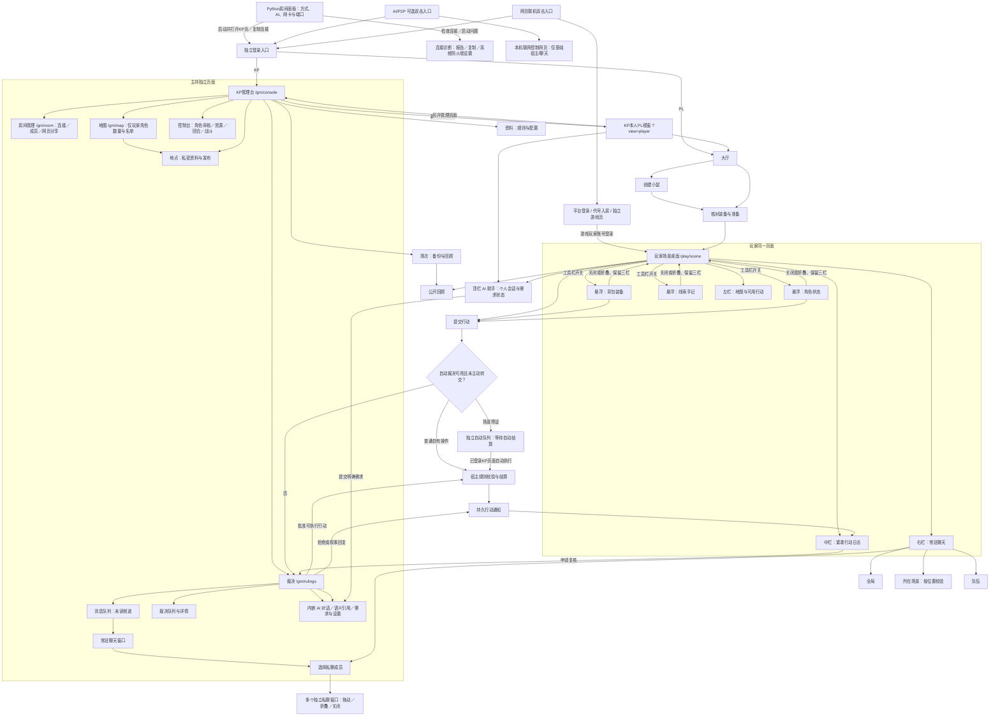

# 场景桌面与主持控制台

- 文档类型：当前
- 文档子类：设计
- 状态：有效
- 创建日期：2026-11-10
- 最后更新：2026-11-15
- 关联文档：[实现](implementation.md)、[使用](usage.md)、[原始设计计划](../plans/interface-design.md)、[验收](../../tests/README.md)

## 导航

0.5.0将KP管理与本人PL游玩分离为独立页面。管理台现提供独立房间管理、裁决、地图、控制台、地点、资料、场次页面；KP自己的PL视窗与普通玩家复用同一个桌面和游戏流程。0.6.0将玩家侧栏入口移到顶栏，主体固定为地图及行动、行动日志、常驻聊天三栏，省去重复最近行动、记录浮窗和底部聊天入口。聊天保留消息气泡、输入区及多个私聊窗口。沿用纸色、墨线、苔绿及运行插画，聊天窗口使用浅蓝灰和青绿区分交谈区域。



旧的 `/play/character`、`/play/journal` 地址回到场景并打开背包、线索浮窗；`/play/records`回到行动日志栏（窄屏切到日志）；`/gm/overview` 回到控制台，`/gm/encounters` 进入独立裁决页。KP旧玩家记录入口进入裁决页。登录槽位和权限规则不变。

## 玩家界面组成

原生Python房间管理面板与网页分别运行；本机、局域网、网页和旧P2P共用一个面板，网页路由保持不变。最小化继续运行，关闭面板结束房间，关闭网页不等于关闭面板。操作步骤见[使用说明](usage.md#启动与入场)。

0.8.0增加[网页玩家模式](web.md)：可信壳负责两次登录和资源传输，隔离包UI复用一屏桌面；网页无KP管理/初始化入口，顶栏AI助手已接入个人咨询。本机KP“房间管理”页提供“网页分享”的状态、网址/代号、开房串、平台创建/管理/加入页及停止控制；公网新桥已部署。上图网页路径复用已验证的玩家流程。

```text
Python房间管理面板
├─ 启动方式：本机／局域网／网页／旧P2P；AI加载开关
├─ 网卡名称与IPv4：自动识别、下拉选择、刷新
├─ 玩家连接端口：默认8899，可修改
├─ 首次准备：初始密码与确认；已有存档隐藏此项
├─ 启动／停止：进度、端口与存档占用错误
├─ 玩家连接地址：启动成功后显示、复制、打开主持登录页
├─ 管理：房间管理页、联机控制页、运行日志、存档目录
├─ 网页联机：公开加入网址与房间代号；复制时不含开房串
├─ 窗口：最小化继续运行；完全关闭停止房间与分享
├─ 检查连接／启动问题
│  ├─ 当前IP、本机服务、宿主状态、存档占用
│  ├─ Windows网络类别、防火墙启用状态、其他设备近期访问
│  └─ 复制诊断报告、打开系统防火墙设置、排查指引
└─ 存档位置及保持窗口、KP网页在线的提示
```

```text
场景桌面（固定一屏，整页不滚动）
├─ 可折叠顶栏：场景／大厅／回顾、账号与同步、AI 助手／规则／偏好／语言／退出
├─ 顶部工具：角色状态、背包装备、线索手记；窄屏栏目切换
├─ 左栏：地图与行动
│  ├─ 当前地点、回合、公开描述
│  ├─ 已知地图、门和通路；画幅随已知地点调整
│  ├─ 仅当前节点显示已发现角色数量；地图下为完整名单（玩家／NPC／敌人）
│  ├─ 当前地点预设／做法、相邻地点移动
│  ├─ 属性检定、自由行动、请求主持裁决（各一个入口）
│  └─ 已发现事实、剩余库存、自动执行状态
├─ 中栏：行动日志（独立滚动）
│  ├─ 最新默认展开、历史折叠，保留手动开关
│  ├─ 筛选：全部／待处理／检定
│  ├─ 等待状态、原始骰、阈值、叙述与主持回复
│  ├─ 角色与场景变化：可读字段、状态和前后值
│  └─ 请求复核、适用回执的摘要分享
├─ 右栏：常驻聊天（历史独立滚动）
│  ├─ 全局／所在场景／队伍／分组／私聊及未读数
│  ├─ 多会话列表（仅一个会话时不重复列出）
│  ├─ 消息气泡、历史、编辑／撤回、已读
│  ├─ 分会话草稿、发送、Ctrl+Enter
│  └─ 联系人 → 多个独立私聊窗口：拖动、折叠、关闭
└─ 按需浮窗（可折叠、关闭、置顶）
   ├─ 角色：三属性、生命、护甲、钱币、等级、经验、坚韧、光源
   ├─ 背包：2／2／6格、超载、详情、使用、光源、换槽、转交
   └─ 线索：检索、来源地点、本人手记
```

面板可分别关闭和折叠；工具栏可将被遮挡的面板置顶。打开、折叠及置顶偏好按登录入口与账号保存，刷新后恢复。宽度不超过1050px时，三栏在同一页以顶部按钮切换；浮窗采用接近全宽布局。尚未提供拖动面板或拖拽物品。

未保存的手记、消息、裁决表单不会因轮询被清空。当前表单未保存时，切换面板会提示先保存；导航离开需确认放弃。中栏行动日志继续接收结果，停止编辑后补绘其他状态。

## 主持界面组成

```text
主持页面
├─ 可折叠顶栏：账号、同步、打开PL视窗、规则、偏好、语言、退出
├─ 房间管理：房间状态、监听/玩家地址、连线账号、访问诊断、网页分享/停止
├─ 地图：十地点图、每房间玩家角色数/姓名摘要、完整玩家名单、进入地点管理
├─ 裁决（移除页标题横栏，桌面三栏填满剩余高度，栏目内滚动）
│  ├─ 消息队列：授权频道未读数，点选后在右栏打开
│  ├─ 裁决队列：申请上下文、批准/拒绝、回复、近期行动记录
│  ├─ 内嵌AI（填满中栏）：会话选择、语义引用、KP审核与设置→需求队列/服务设置
│  └─ 常驻聊天：全局/场景/队伍/私聊、发送、历史、已读
├─ 控制台：开场/回合/暂停/自动裁决、建角审核、玩家资源、NPC战斗工具
├─ 地点：描述/真相/线索发布、门与库存、NPC、角色发现受众与隐藏
├─ 资料：规则与配置资料
└─ 场次：备份、回顾、私密备注
```

全局／分组／私聊已读使用宿主频道游标；场景／队伍已读使用包侧持久游标，行动记录已读只是本页的界面偏好。主持仍只能看到自己有权访问的聊天频道。管理台顶部“打开PL视窗”与PL顶部“打开管理台”打开不同页面，PL视窗中没有任何管理菜单或主持数据。

所有登录后的包页面均可收起顶栏，只保留30px展开条；展开后恢复全部原有入口。折叠状态按登录槽位与账号保存，刷新和切页保留；网页沿用可信壳的账号/房间/资源版本隔离存储。切换只改变布局，不重建AI、聊天或表单，未发送草稿保留。桌面裁决页和场景页把释放的高度交给工作区；窄屏仍沿用各自响应式布局。

连线玩家按已登录页面的状态轮询判断，多页面合并为一个账号；不是WebSocket连接数。页面关闭后的在线状态有延迟，近期访问也不等于登录人数。网络详情仅在KP投影出现，KP玩家预览与PL均不可见。具体阈值和诊断解释见[使用说明](usage.md#房间管理与连线玩家)。

## 反馈语义与边界

提交中的状态是本页即时反馈；收到服务端结果后才显示结算完成。等待 KP 的申请不提前投骰或扣减资源。批准预设、检定、物品、移动和转交后显示实际宿主结果；自由行动及事件复核只记录回复，需要数值效果时由主持另行结算，不把“批准”误写成资源已变更。

场景预设的独立自动队列不计入KP人工待办。KP页面在线时自动执行固定做法，离线显示等待自动结算；玩家原提交卡完成后更新为真实结果。判定和叙述、机关／库存变化与本人资源变化分开显示，具体导航与行动树见[预设行动](scene-actions.md)。

每个账号的事件由包侧存档持久保存，最多保留最近200项。KP 能查看行动通知，PL 仅收到本人的事件、本人资源变化及公开的场次进度。转交双方分别收到自己的库存变化。重试同一行动不会重复投骰或重复增加通知。

升级前的回执继续保留，但没有可供重建的历史资源快照；前后变化仅对升级后通过本包提交的行动生成。直接绕过包侧操作宿主公共 API 不会生成包侧事件。网络结果不明时保留原行动恢复入口，不将超时当作已成功或已回滚。

## 地图可见性

KP独立地图只统计已建立的玩家角色，包含KP自己的玩家角色，不统计NPC/敌人。NPC仍在控制台战斗工具与地点管理中维护。

PL仅收到 `mapContacts`：当前地点已发现的名称、类型和显示标识，不包含角色数值、背包或其他房间名单。同地点玩家默认视为相遇，KP可在地点页按接收者隐藏；本人始终可见。蜘蛛/村民、Jack、鼠帮、守卫蛇和Ernie由相应探索预设按发起玩家登记发现；KP也可逐角色揭示或撤回。发现记录持久化，离开地点时名单消失；再次相遇仍须处于同地点且未被隐藏。NPC移动依据已鉴权的KP快照更新。

尚未核定战斗数值的故事人物只作为地图联系人，不因此创建战斗实体或虚构数值。旧存档可从本人已有明确线索恢复部分发现，不从全局机关状态推断别人发现了哪些角色。
