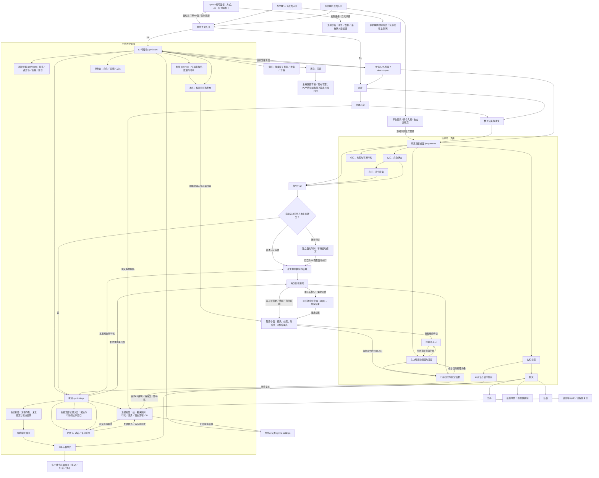

# 场景桌面与主持控制台

- 文档类型：当前
- 文档子类：设计
- 状态：有效
- 创建日期：2026-11-10
- 最后更新：2026-11-23
- 关联文档：[实现](implementation.md)、[使用](usage.md)、[原始设计计划](../plans/interface-design.md)、[验收](../../tests/README.md)

## 导航

房间页是KP默认入口，集中全局统计、开场、时钟与备份。控制台专注角色与资源，场次页专注回顾。裁决页左栏用标签切换消息与裁决队列；人工与AI请求共用卡片，首行显示时间、类型、来源，下方显示概要和操作。点击概要或查看按钮打开详情浮窗；直接执行和选择执行动作均保留，回复区默认折叠；AI信息请求打开定向揭示表单。页面不展示技术编号和重复使用说明，排查与授权明细按需展开。

支持分页的宿主每次返回 30 条 AI 裁决卡片和活动总数。可翻看较早或较新的一页，单击“查看并裁决”后读取当前完整详情。读取期间可关闭窗口，审批使用详情中的版本和风险信息。

KP管理与本人PL游玩使用独立页面。管理台现提供独立房间管理、裁决、地图、控制台、地点、资料、场次、AI设置页面；KP自己的PL视窗与普通玩家复用同一个桌面和游戏流程。玩家桌面为左栏角色状态及背包、中栏地图及行动、右栏聊天与AI标签。线索和日志共用左上可拖动折叠浮窗。聊天保留消息气泡、输入区及多个私聊窗口。沿用纸色、墨线、苔绿及运行插画，聊天窗口使用浅蓝灰和青绿区分交谈区域。



旧的 `/play/character` 回到常驻背包（窄屏切到角色栏）；`/play/journal` 和 `/play/records` 展开线索、日志浮窗；`/gm/overview` 回到控制台，`/gm/encounters` 进入独立裁决页。KP旧玩家记录入口进入裁决页。登录槽位和权限规则不变。

裁决、资料和AI设置页使用剩余视口高度，长列表内部滚动；窄屏裁决切换队列、AI、聊天。房间总览与连接信息在桌面并排显示。

## 玩家界面组成

原生Python房间管理面板与网页分别运行；本机、局域网、网页和旧P2P共用一个面板，网页路由保持不变。最小化继续运行，关闭面板结束房间，关闭网页不等于关闭面板。操作步骤见[使用说明](usage.md#启动与入场)。

[网页玩家模式](web.md)由可信壳负责两次登录和资源传输，隔离包UI复用一屏桌面；网页无KP管理/初始化入口，右栏AI标签接入个人对话。本机KP“房间管理”页提供“网页分享”的状态、网址/代号、开房串、平台创建/管理/加入页及停止控制。部署与网络验收边界见网页文档和验收索引。

```text
Python房间管理面板
├─ 房间数据：命名创建槽位、选择／刷新、显示新建或已有状态、记住选择
│  └─ 每槽位独立账号与存档；启动／运行／停止中锁定选择，停止后可切换
├─ 启动方式：本机／局域网／网页／旧P2P；AI加载开关
├─ 网卡名称与IPv4：自动识别、下拉选择、刷新
├─ 玩家连接端口：默认8899，可修改
├─ 首次准备：初始密码与确认；已有存档隐藏此项
├─ 启动／停止：进度、端口与存档占用错误
├─ 玩家连接地址：启动成功后显示、复制、打开主持登录页
├─ 管理：房间管理页、联机控制页、运行日志、存档目录
├─ 网页联机：公开加入网址与房间代号；复制时不含开房串
├─ 窗口：最小化继续运行；完全关闭停止房间与分享
├─ 检查连接／启动问题
│  ├─ 当前IP、本机服务、宿主状态、存档占用
│  ├─ Windows网络类别、防火墙启用状态、其他设备近期访问
│  └─ 复制诊断报告、打开系统防火墙设置、排查指引
└─ 存档位置及保持窗口、KP网页在线的提示
```

```text
场景桌面（固定一屏，整页不滚动）
├─ 可折叠顶栏：场景／大厅／回顾、账号、规则／偏好／语言／退出
├─ 检定小窗：默认开启；0.8秒动画／减少动画直接显示，结果展示3秒后淡出
│  └─ 实际骰点、优势／劣势、阈值、成功／失败；偏好可关闭，日志保留
├─ 反馈小窗：本人结果、新线索与持久影响、3秒淡出、日志／手记入口
│  └─ 叙述／主持回复、物品用量／燃烧进度、伤害恢复与属性状态；先检定后提示，刷新不补播
├─ 左栏：角色状态与背包（独立滚动）
│  ├─ 三属性、生命、护甲、钱币、等级、经验、坚韧、光源
│  └─ 2／2／6格与超载、物品详情、使用、光源、换槽、转交
├─ 中栏：地图与行动
│  ├─ 当前地点、回合、公开描述、已知地图、门与通路
│  ├─ 当前场景发现的玩家／NPC／敌人
│  └─ 场景预设、移动、检定、自由行动与请求裁决
├─ 右栏标签（切换保留会话和草稿）
│  ├─ 聊天：全局／场景／队伍／分组／私聊、历史、编辑、撤回、已读
│  │  └─ 联系人 → 多个独立私聊窗口：拖动、折叠、关闭
│  └─ AI：原生对话、语义引用、个人会话管理；权限由宿主检查
└─ 左上可拖动折叠浮窗
   ├─ 线索手记：检索公开线索、来源地点、本人手记
   └─ 行动日志：骰点、阈值、叙述、前后值、等待/主持回复
      ├─ 最新默认展开；历史折叠；全部／待处理／检定筛选
      └─ 标记已读、请求复核、适用回执的摘要分享
```

点击线索或日志按钮展开对应内容，再点当前按钮折叠。按钮和标题栏可拖动，方向键移动手柄，Shift加速；位置、展开状态和右栏标签按登录入口与账号保存，刷新恢复。窗口缩小后浮窗限制在可见范围内。宽度不超过1050px时用顶部按钮切换角色、场景、聊天与AI栏目。物品仍通过详情操作，不提供拖拽物品。

未保存手记时，折叠或切换线索／日志会提示先保存；拖动浮窗、切换聊天／AI保留手记输入。轮询不会清空草稿，已经展开的行动日志继续更新；停止编辑后补绘其他状态。

## 主持界面组成

```text
主持页面
├─ 可折叠顶栏：账号、同步、打开PL视窗、规则、偏好、语言、退出
├─ 房间管理：房间状态、监听/玩家地址、连线账号、访问诊断、网页分享/停止
├─ 地图：十地点图、每房间玩家角色数/姓名摘要、完整玩家名单、进入地点管理
├─ 裁决（移除页标题横栏，桌面三栏填满剩余高度，栏目内滚动）
│  ├─ 左栏：消息队列／裁决队列切换标签；顶部记录／刷新／设置入口
│  │  ├─ 消息：授权频道未读数、裁决结果通知与原因／定位详情
│  │  ├─ 裁决卡片：时间／类型／来源，概要，三列操作按钮
│  │  ├─ 人工请求：角色审核、行动／复核、宿主等待及异常流程
│  │  ├─ AI请求：转交／揭示／取消；详情可查看原会话、回复和错误
│  │  ├─ AI修改详情：完整修改与检查；接受并执行／拒绝／转AI，备注可选
│  │  └─ 记录子窗口：近期裁决与行动、已完成AI记录；未知回执保留恢复入口
│  ├─ 内嵌AI（填满中栏）：会话选择、语义引用、审核按钮定位左侧裁决队列
│  └─ 常驻聊天：全局/场景/队伍/私聊、发送、历史、已读
├─ 控制台：开场/回合/暂停/自动裁决、裁决队列入口、玩家资源、NPC战斗工具
├─ 地点：描述/真相/线索发布、门与库存、NPC、角色发现受众与隐藏
├─ 资料：规则与配置资料
└─ 场次：备份、回顾、私密备注
```

全局／分组／私聊已读使用宿主频道游标；场景／队伍已读使用包侧持久游标，行动记录已读只是本页的界面偏好。主持仍只能看到自己有权访问的聊天频道。管理台顶部“打开PL视窗”与PL顶部“打开管理台”打开不同页面，PL视窗中没有任何管理菜单或主持数据。

所有登录后的包页面均可收起顶栏，只保留30px展开条；展开后恢复全部原有入口。折叠状态按登录槽位与账号保存，刷新和切页保留；网页沿用可信壳的账号/房间/资源版本隔离存储。切换只改变布局，不重建AI、聊天或表单，未发送草稿保留。桌面裁决页和场景页把释放的高度交给工作区；窄屏仍沿用各自响应式布局。

连线玩家按已登录页面的状态轮询判断，多页面合并为一个账号；不是WebSocket连接数。页面关闭后的在线状态有延迟，近期访问也不等于登录人数。网络详情仅在KP投影出现，KP玩家预览与PL均不可见。具体阈值和诊断解释见[使用说明](usage.md#房间管理与连线玩家)。

## 反馈语义与边界

裁决详情提交行动即关闭；执行结果以即时通知和左栏消息呈现。明确拒绝／失败显示原因，详情可复制原裁决、请求或命令定位；网络结果未知时显示待核对并保留原回执恢复。结果通知在当前浏览器按房间范围与账号保留最近100条，刷新可读；它不替代服务端裁决与行动历史，不跨设备同步。高危详情仅保留一个可选备注框，点击接受时提交当前全部风险ID和精确整包指纹，服务端仍检查权限、版本和高危确认。

因房间重启而失效的高危批准显示“审批依据已失效”和具体原因；明确在批准阶段失败、未发布的原修订可使用“重新检查”。该操作关闭详情，完成后通知是否恢复待确认，再由KP重新接受；不把三检通过直接显示为已执行。恢复规则见[权限与裁决](ai-permissions.md#读取与执行)。

消息、待处理裁决与已归档裁决在同一区域切换。已处理的玩家行动、角色申请、AI申请与AI修改按服务端状态自动移入“已归档”。有明确关联的旧方案被后续已就绪方案替代后也进入历史，并保留后续入口；无须继续处理的中间AI请求或未执行候选可用“归档此项”整理，能在已归档内恢复。是否可操作以服务端 canArchive/canRestore 为准；归档不修改原业务状态、正文和回执。执行中、部分完成与结果未知继续待核对，不能借归档隐藏。记录入口继续打开行动记录子窗口。玩家场景移除行动区的长说明，执行器离线或仍有排队行动时，在“自动结算”标签中显示简短状态。

裁决与已归档卡片跨来源使用同一DOM时间线，旧项在上、新项在下，时间相同则按稳定定位排序。明确关联的后续行动全部成功并核验回执后，旧未执行项显示“需求已完成”和完成行动入口；不把同角色的其他需求自动合并。

标签下方固定27px状态行以12px小字显示处理结果或待查询回执，两者不叠加占行；窄屏省略长文本，完整失败原因仍可从结果通知查看。裁决列表滚动不移动状态行。`sourceState=stale`的申请／修改卡使用灰底并保留服务端允许显示的原文，移除绿色过期提醒块；真正无权读取的正文不会由本地缓存补造。

AI会话分别显示发送与回复时间，未知历史时间明确标注未记录。已向本会话主体发布的正文与引用详情访问分离；引用失权后保留原消息和已有标签，入口变灰且不可点击，未曾发布的隐藏资料不补回。揭示窗口显示接收玩家，优先选择可靠来源中的原玩家，没有可靠来源时由KP选择。

未完成行动显示原因、PL/KP处理办法与行动编号；弹窗内可立即阅读，关闭或刷新后仍可在持久日志查看。受阻的预设卡不标“已结算”。KP批准时失败的原申请仍在裁决队列显示阻碍，原玩家同步看到失败说明。规则未提供可识别条件时明确标注原因未知，不将猜测写成事实。


提交中的状态是本页即时反馈；收到服务端结果后才显示结算完成。等待 KP 的申请不提前投骰或扣减资源。批准预设、检定、物品、移动和转交后显示实际宿主结果；自由行动及事件复核只记录回复，需要数值效果时由主持另行结算，不把“批准”误写成资源已变更。

场景预设的独立自动队列不计入KP人工待办。KP页面在线时自动执行固定做法，离线显示等待自动结算；玩家原提交卡完成后更新为真实结果。判定和叙述、机关／库存变化与本人资源变化分开显示，具体导航与行动树见[预设行动](scene-actions.md)。

每个账号的事件由包侧存档持久保存，最多保留最近200项。KP 能查看行动通知，PL 仅收到本人的事件、本人资源变化及公开的场次进度。转交双方分别收到自己的库存变化。重试同一行动不会重复投骰或重复增加通知。

KP发放装备、修改属性等已完成角色变更，在同一持久 Job 中追加 `notification.send`，绑定成功原命令与接收账号；服务端收件箱保留未确认项，页面展示后以 `notification.ack` 确认。包侧事件与该通知按ID合并为一次弹窗，刷新保留本浏览器最近500个已展示ID；确认失败只重试确认，不重弹。离线补取和同档重启已验证。展示与确认并非跨设备原子操作，另一设备在确认成功前仍可能看到同一未确认项。通知失败不回滚原修改，应恢复原Job，不重做装备或属性操作。通用协议、权限和限额由[引擎通知接口](../../../../docs/current/engineering/notifications.md)定义。

升级前的回执继续保留，但没有可供重建的历史资源快照；前后变化仅对升级后通过本包提交的行动生成。直接绕过包侧操作宿主公共 API 不会生成包侧事件。网络结果不明时保留原行动恢复入口，不将超时当作已成功或已回滚。

## 地图可见性

KP独立地图只统计已建立的玩家角色，包含KP自己的玩家角色，不统计NPC/敌人。NPC仍在控制台战斗工具与地点管理中维护。

PL仅收到 `mapContacts`：当前地点已发现的名称、类型和显示标识，不包含角色数值、背包或其他房间名单。同地点玩家默认视为相遇，KP可在地点页按接收者隐藏；本人始终可见。蜘蛛/村民、Jack、鼠帮、守卫蛇和Ernie由相应探索预设按发起玩家登记发现；KP也可逐角色揭示或撤回。发现记录持久化，离开地点时名单消失；再次相遇仍须处于同地点且未被隐藏。NPC移动依据已鉴权的KP快照更新。

尚未核定战斗数值的故事人物只作为地图联系人，不因此创建战斗实体或虚构数值。旧存档可从本人已有明确线索恢复部分发现，不从全局机关状态推断别人发现了哪些角色。

裁决详情的参考资料评估与C评估分别展示，同一次明确接受可携带两份绑定摘要；缺少来源评估摘要时不显示批准按钮，可重新检查。配置使用“采纳评估并发布”，运行时使用“采纳评估并执行”；拒绝不提交评估接受，执行失败继续显示真实原因。

### 玩家拿取物资

玩家的包状态以 `groundItems` 展示同地点丢弃物，以 `pickupOptions` 提供本人已发现、有余量且拿取本身无附加前提的地点物资。玩家向原 `package/action` 入口提交 `pickup`。丢弃物传 `{"id":"掉落记录 ID","slot":7}`，地点物资传清单中的 `action` 和 `choice`，例如 `{"action":"storm-supplies12","choice":"17"}`。接收角色由登录身份确定。沿用原行动编号可查询同次拿取结果。在线主持执行端自动结算，手动裁决设置不阻止拿取。
