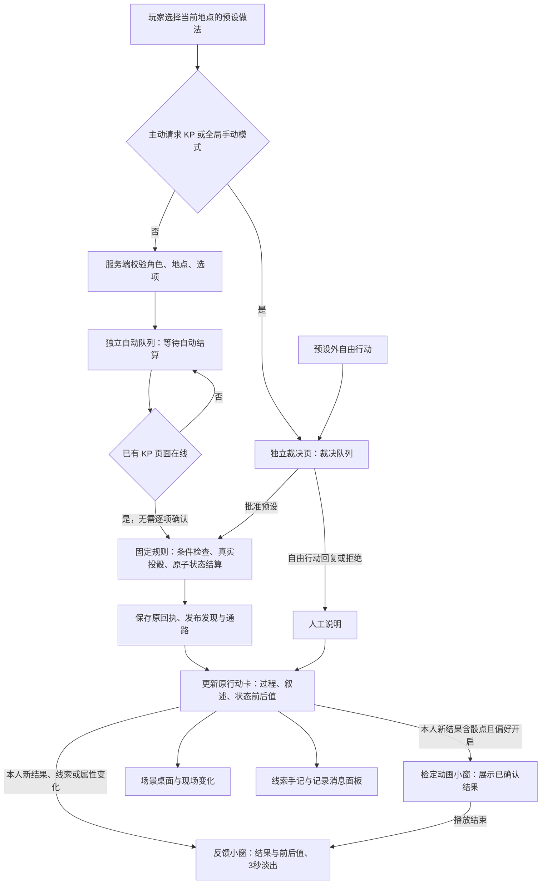

# 场景预设行动与自动结算

- 文档类型：当前
- 文档子类：工程
- 状态：有效
- 创建日期：2026-11-10
- 最后更新：2026-11-23
- 关联文档：[实现](implementation.md)、[使用](usage.md)、[界面](interface.md)、[来源边界](sources.md)、[验收](../../tests/README.md)

本页逐项记录原十地点的 18 个基础行动。0.10.0 默认包另有 22 个暴雨行动；路线和当前配置见[内容概览](content-configuration.md)及[玩家指南](player-guide.md)。

## 自动执行范围

十个地点的18个预设均有固定做法、条件、叙述和实际状态效果；玩家只看到有效观察已披露的按钮与选项。安全观察不强行检定；执行后的风险结果展示真实宿主骰点、采用值、属性阈值、成功或失败。资源、机关、门、发现和有限库存随结果实际更新。选项由 [scene-actions.json](../../config/scene-actions.json) 定义，事务由 [scene.lua](../../rules/scene.lua) 执行。玩家措辞、个人发现条件、KP 完整机制及版本升级统一见[个人已知资料](player-knowledge.md#行动内容与个人发现)。

默认自动裁决下，预设行动进入独立自动队列，**不进入 KP 人工待办**。服务端校验角色归属、所在地点和固定做法；已登录的 KP 页面独立每0.5秒尝试执行队列，无需逐项确认；不再等待聊天同步。同源同浏览器页面通过 BroadcastChannel 提醒执行和刷新；不同设备仍由轮询接续。玩家有自动任务时，状态轮询间隔从空闲的2.5秒缩至0.4秒（另有最多0.2秒调度与请求耗时），同一页面的状态请求不重叠。所有写入使用现有宿主权限，没有新增自动化账号或保存 KP 密码。至少一个 KP 页面需要保持登录在线；关闭、休眠或浏览器节流会延迟执行，玩家看见“等待自动结算”。重新打开原 KP 账号页面会继续处理。

玩家主动选择人工裁决、自由描述超出预设的行动，才进入人工队列。KP 明确关闭全局自动裁决时，新预设也按该设置转为人工申请；重新开启不会擅自批准旧人工申请。建角审批、场次开场与非预设管理功能仍沿用现有权限。



## 提交后的处理与等待

提交先校验账号、角色和行动，再保存可恢复请求；预设通过已有 KP 页面执行。宿主运行隔离规则进程、投骰、更新实体并提交存档，包侧随后发布发现、通路及个人知识，玩家最后获取授权投影与行动日志。即使本机运行，这些步骤仍有 HTTP、规则进程启动和磁盘确认开销。

当前跳过数值未变化的场景库存／门同步；知识预览前显式保存已变化的发现。新命令已有新建信封时直接发送，恢复旧信封仍先查原回执、必要时刷新运行代际。包文件一次序列化写出，继续 flush/fsync 后原子替换；没有取消持久化、幂等或权限校验。检定动画不参与此流程，不增加结算等待。

2026-11-17隔离本机样例：相同当前后端，旧前端4次预设中位3.67秒，当前前端1.8秒；使用分离浏览器上下文，未借同源唤醒。完整请求分段及样例边界见[行动体验验收](../../tests/action-experience-results.json)，不是跨设备或高负载延迟保证。

## 全部预设与结果

下表的固定做法属于本包自动游玩适配，**不是已核验的原版完整裁定**。机关伤害、地点基础资料沿用既有计划；潜水、交涉、救援、人物许可与蛇笛分支是明确的本包规则。除注明外不消耗探索轮。

| 地点／按钮 | 做法与检定 | 实际结果及失败后果 |
| --- | --- | --- |
| 01 观察地面 | 无骰观察 | 识别落石连接，保存个人线索，揭示02 |
| 01 检查奶酪 | 检查无骰；已识别后解除连接为DEX；直接拿取承担机关伤害 | 成功解除并领取唯一奶酪；解除失败受d12伤害，机关耗尽、奶酪留下；直接拿取在承受d12后仍能行动才领物；取用尝试1轮 |
| 02 检查把手 | 无骰检查 | 识别倾倒石板及绳索固定位置，保存线索 |
| 02 尝试开门 | 已检查且有绳索：耗1格用量；直接开门：DEX与d20伤害 | 绳索安全解除；直接开门成功豁免使伤害向下减半，再减甲；开放02–03并揭示庭院，1轮；已开门不重复收费 |
| 03 调查池塘 | 观察无骰；发现后打捞钱袋／鼠像为DEX | 成功领取唯一140p或四格鼠像；失败d4磕碰伤害且宝物保留；打捞1轮 |
| 03 观察梯子 | 无骰辨路 | 揭示04–08五处相邻地点 |
| 04 搜查器具 | 首次d6库存；领取一件 | 首次整理1轮，生成后不重掷；铜锅盘有限领取并入包 |
| 05 观察旧画 | 无骰阅读 | 保存节庆画与池底鼠像的个人线索 |
| 06 查看蛛网 | 无骰观察 | 发现两只蜘蛛与两名被困村民，保存线索 |
| 06 呼唤屋内 | 低声联系无骰；使用可用针剑救援为DEX | 联系得到回应；救援成功设置村民脱困并撤到庭院的场景事实；失败d6毒咬，HP溢出扣DEX并令蜘蛛警觉；救援1轮。未凭空创建未核数值的村民实体 |
| 07 观察厅堂 | 首次2d6鼠帮人数 | 人数固定，展示蛇笛与锁门线索，重复不重掷 |
| 07 交涉 | 首次口头WIL；或付1格口粮 | 成功／供粮取得通行许可，开放07–08并领取唯一蛇笛；口头失败令鼠帮戒备，可改用口粮，不重复刷口头骰；新交涉1轮 |
| 08 检查设备 | 无骰询问Jack；领搅拌桨／滤布 | 取得工具许可和线索，按有限库存入包；搅拌桨按两格占用安置 |
| 08 寻找出口 | 无骰辨路；拉本侧门闩；乘升降机 | 辨路揭示03、07、09并记录屋顶货口；首次开08–09门或移动本人回03各1轮；屋顶外部不在当前十地点范围 |
| 09 观察铁门 | 无骰检查；安抚后开门 | 识别守卫；蛇平静时开放09–10、揭示洞窟；不满足条件显示阻止原因 |
| 09 聆听 | 无骰聆听；持笛安抚；潜行绕过为DEX | 蛇笛使唯一守卫蛇平静；潜行成功开09–10，失败d8咬击且门保持关闭；安抚／潜行1轮，已开放的潜行不重掷 |
| 10 查看奶酪 | 清点无骰；未获许可时取用为DEX | 获许可后直接领取；潜行失败惊醒Ernie、不减少库存，先交谈才可再取；库存共8轮奶酪，取用1探索轮 |
| 10 观察睡者 | 无骰观察；温和唤醒交谈 | 显示熟睡／醒来状态；首次交谈1轮，取得奶酪许可与北方据点个人线索 |

有消耗的探索轮通过现有 `sv.world` 结算，因此会推进公开回合及已点亮光源的燃烧计数；每六轮消耗一格光源。伤害使用现有减甲→HP→属性→重伤豁免规则。超载及受伤的相关豁免显示劣势两骰。领取先检查普通槽位和超载卡片区；全满时不扣库存、不为领取额外投骰。

## 玩家可见内容

```text
场景预设行动
├─ 做法弹窗：本人已知选项、安全措辞、自动或主动请求KP
├─ 可折叠行动日志浮窗：最新默认展开、旧条目折叠、筛选与独立滚动
│  ├─ 已提交／等待自动执行端／已结算／条件不满足
│  ├─ 检定：属性、阈值、原始骰、优势劣势、采用值、判定
│  ├─ 数量骰与伤害骰
│  ├─ 逐条叙述与失败后果
│  └─ 机关／门／库存变化、角色资源前后值与新线索
├─ 观察记录：本人获知的事实，不把历史库存当成当前库存
├─ 已知地图：新地点与通路
└─ 顶部按需浮窗：背包实际物品、个人线索；持久记录与复核入口统一在行动日志
```

个人发现只交给该角色所属账号，KP可核查；地点发布和共享门状态不等于全队获知，PL 的地点、通路和菜单均取自其固定观察。PL 不得到完整私密场景状态、隐藏地点真相或其他角色快照。观察重复时可再次显示线索，但不重复生成有限物品或随机数量。上表是 KP 机制说明，不是初次进入时的玩家菜单。

## 恢复与边界

自动队列、原命令封套和已提交结果落盘。规则中的投骰、角色效果和场景有限库存同属一次宿主事务；随后的地点公开、门镜像与事件发布使用原命令继续。结算中断后锁住冲突操作，原 KP 账号恢复时查原回执，不重新投骰或发物。自动结果更新玩家原提交卡，避免留下永远“等待中”的旧卡片。不同 KP 账号不能接管已经开始的任务；同一账号的多个页面可以重试同一固定命令。

原始宿主 API 操作仍不生成包侧事件。对已完成行动申请复核只记录回复，修改数值须由 KP 明确操作。法术、完整战斗／追逐、原版未核表项、外部地图不属于这18个预设的自动范围。

### 一次性事件与阶段

新的地点观察按当前事件阶段生成说明和做法。接受栗婶的委托后，接取入口消失；工厂送来奶酪后可以签收，居民获救且补给签收后可以安置。泵房记录临时传动、清淤和恢复运转，渡口区分等待、援队到岸和接应。有效的旧观察仍保留当时的文字。执行旧观察或待处理申请时，包服务在扣物资、投骰和推进回合前复核阶段，已办结或互斥的步骤不能再次结算。

## 逐地点的事件结算

观察、重读、勘路和清点可以重复，各人得到自己的观察记录。一次性指房间共用一份进度。分阶段行动在结算前复核当前条件。有限库存按件结算，有两件时允许两人各取一件。表中合并列出同地点的不同做法。

| 地点 | 可重复行动 | 一次性进度、阶段与结果 |
| --- | --- | --- |
| 01 入口隧道 | 观察地面、检查奶酪、勘察路标。取空后只剩压痕 | 拆解或直接拿取共用机关和一轮奶酪。解除或触发后撤去拆解选项，机关不再造成第二次伤害。奶酪若仍在，可再取 |
| 02 主门 | 关门时可检查把手，获得本人的机关线索 | 绳索固定、冒险推门、协力撑门共用开门状态。门开后现场显示通路，旧请求不能再扣绳索、掷伤害或推进一轮 |
| 03 庭院 | 查看池底余量、辨认梯子、勘路。打捞失败后可重试 | 钱袋与鼠像分别结算，钱袋到账或鼠像入包后相应选项消失。栗婶的委托依次接取、签收公共奶酪、清点安置居民 |
| 04 洗劫屋 | 搜查器具、复查余量。拿铜锅盘逐件扣库存 | 首次搜查生成一次数量并消耗一轮；其他人搜查看到同一批锅盘，也获得自己的观察 |
| 05 废弃屋 | 重读节庆画，核对陈设并获得本人的画作线索 | 已读后的现场提示可以重看。阅读没有道具奖励，不耗回合 |
| 06 蛛网屋 | 查看蛛网；冒险割网失败后可另行尝试 | 联系村民、割网或引开蜘蛛。救援与诱敌共用脱困状态，救出后只能看到断开的束缚，不能再生成一批村民 |
| 07 大厅 | 观察鼠帮、清点物资。观察人数只在首次生成时掷骰 | 说服只掷一次，失败后可改用口粮；达成通行约定后不能再支付。若蛇笛尚未交付，可按约领取。暴雨协议可凭劳务或两轮奶酪达成一次；通行牌还需协议和剩余库存 |
| 08 奶酪工厂 | 检查设备、复查工具，取搅拌桨或滤布逐件扣库存；查看出口、勘路、清点物资；乘升降机是每位乘客自己的移动 | 打开蛇笼铁门一次，已开时只需通行。排水恢复后开机生产公共奶酪一次。交账本单独结算，生产与交账进度可同时显示 |
| 09 蛇笼 | 聆听或观察门闩，失败后可重新决定是否潜行 | 吹笛安抚后可以开门，旧吹笛请求不再耗轮；潜行成功也可开门。门开后两条开门做法均撤去 |
| 10 熟成洞 | 清点奶酪、观察 Ernie、重问许可与北方线索；有余量时按轮搬取奶酪 | 熟睡时搬动需要检定，惊醒后先交谈。首次交谈耗一轮并授予许可；后来者可重问取得线索，不再耗谈话回合。奶酪领尽后只可清点 |
| 11 树根排水间 | 勘路、清点物资、按库存取用 | 可装齿轮并密封，或先装木楔再校准；晚期涨水需先清淤。排水泵运转后撤去全部修泵选项，已安装的材料不能再次扣除 |
| 12 旧工坊 | 勘路、清点工坊物资。齿轮、密封蜡等剩几件就可取几件 | 最后一件发放后移除其选项。空仓仍可检查，不会因复查而补货 |
| 13 树冠信号台 | 勘路、清点物资 | 协议达成后可消耗信号材料发送消息，与渡口派信使共用一次送信状态；已送达时现场提示无需再点灯 |
| 14 溪岸渡口 | 勘路、清点物资；信已送达且援队未到时可主动等待下一轮 | 劳务验收、派信使、援队接应各有前提。修船或清步道、加固渡口、备粮或赊粮的结果持续有效。撤离后撤去筹备选项；同一阶段两人同时等待只推进一轮 |

同一地点的危险尝试，以及渡口等待，提交时携带该事件的版本。首个有效结算会使同一版本的待处理尝试失效；玩家看过结果后可以主动发起下一次尝试。钱袋与鼠像分别核对版本。旧版本客户端提交时由服务登记当时的版本。个人重读和仍有多件的普通库存不需要独占一次事件。KP 手动关闭的通路在重复勘路时保持原状。

### 规则配置逐项对照

下表覆盖当前 40 个行动的全部 85 个做法。“一次性”以对应的事件目标为单位；例如两种开门方法只开放同一扇门一次，互斥供粮方案只可选其一。可重复做法仍可能耗时，例如乘升降机；观察产生的个人记录与房间共享奖励分别保存。

| 地点与行动 ID | 可重复 | 一次性步骤 | 分阶段尝试或交互 | 可重复至库存耗尽 |
| --- | --- | --- | --- | --- |
| 1 · `tunnel-ground` | `inspect` | — | — | — |
| 1 · `tunnel-cheese` | `inspect` | — | `careful`、`take` | — |
| 1 · `storm-roads1` | `survey` | — | — | — |
| 2 · `gate-handle` | `inspect` | — | — | — |
| 2 · `gate-open` | — | `brace`、`force` | — | — |
| 2 · `storm-brace` | — | `slow` | — | — |
| 3 · `courtyard-pool` | `inspect` | — | `money`、`idol` | — |
| 3 · `courtyard-ladders` | `inspect` | — | — | — |
| 3 · `storm-roads3` | `survey` | — | — | — |
| 3 · `storm-commission` | — | `start`、`deliver`、`shelter` | — | — |
| 4 · `house-pots` | — | — | `search` | `take` |
| 5 · `house-painting` | `inspect` | — | — | — |
| 6 · `web-inspect` | `inspect` | — | — | — |
| 6 · `web-call` | — | `whisper` | `rescue` | — |
| 6 · `storm-decoy` | — | `lead` | — | — |
| 7 · `hall-observe` | — | — | `inspect` | — |
| 7 · `hall-negotiate` | — | — | `talk`、`food` | — |
| 7 · `storm-supplies7` | `inspect` | — | `24` | — |
| 7 · `storm-pact` | — | `work`、`food` | — | — |
| 8 · `factory-equipment` | `inspect` | — | — | `paddle`、`cloth` |
| 8 · `factory-exits` | `survey`、`lift` | `iron` | — | — |
| 8 · `storm-roads8` | `survey` | — | — | — |
| 8 · `storm-supplies8` | `inspect` | — | — | `23` |
| 8 · `storm-mill` | — | `run`、`ledger` | — | — |
| 9 · `cage-gate` | `inspect` | `open` | — | — |
| 9 · `cage-listen` | `listen` | `flute` | `sneak` | — |
| 10 · `cave-cheese` | `inspect` | — | `take` | — |
| 10 · `cave-sleeper` | `observe` | — | `talk` | — |
| 11 · `storm-roads11` | `survey` | — | — | — |
| 11 · `storm-supplies11` | `inspect` | — | — | `21`、`28` |
| 11 · `storm-pump` | — | `gear`、`wedge`、`service`、`dredge` | — | — |
| 12 · `storm-roads12` | `survey` | — | — | — |
| 12 · `storm-supplies12` | `inspect` | — | — | `17`、`18`、`19`、`20`、`27` |
| 13 · `storm-roads13` | `survey` | — | — | — |
| 13 · `storm-supplies13` | `inspect` | — | — | `21`、`22`、`26` |
| 13 · `storm-signal` | — | `light` | — | — |
| 14 · `storm-roads14` | `survey` | — | — | — |
| 14 · `storm-supplies14` | `inspect` | — | — | `25` |
| 14 · `storm-ferry` | — | `labour`、`runner`、`meet` | `wait` | — |
| 14 · `storm-escape` | — | `boat`、`path`、`brace`、`food`、`credit`、`leave` | — | — |

新房间安装当前包内规则。已有房间重启服务并刷新页面后可使用新的菜单和执行前复核；规则自身的最新版现场叙述随活动规则修订生效。已有自定义规则时，合并 `rules/scene.lua` 对应改动后再按已有规则发布流程激活。
