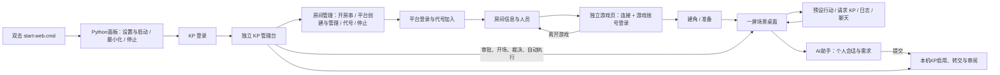

# 树桩镇网页联机

- 文档类型：当前
- 文档子类：工程
- 状态：有效
- 创建日期：2026-11-13
- 最后更新：2026-11-20
- 关联文档：[包入口](../../README.md)、[模块协议](../../../../docs/current/engineering/network-web.md)、[验收](../../tests/README.md)、[剩余计划](../../../../docs/plans/stumpsville-web-integration.md)

## 当前范围

树桩镇 0.9.0 接入 network-web 0.3.0、network-p2p 0.2.2。房主在本机运行宿主和 KP 管理台，两名浏览器 PL 已在隔离本地目录服务上通过真实 WebRTC 完成建角、入场、十地点移动、全部 18 个预设、检定及结算、线索和多频道聊天。玩家使用一屏角色/背包、地图/行动、聊天/AI标签三栏；线索与日志使用左上可拖动折叠浮窗。

部署历史见[归档](../history/2026-11-20-development-records.md)，当前平台能力以[联网模块说明](../../../../docs/current/engineering/network-web.md)和启动时能力检测为准。

网页只允许游戏账号角色为玩家的 PL。平台房主身份不能赋予游戏 KP 权限；KP 在本机独立管理台操作，也可在自己的本机 PL 视窗游玩。预设自动执行依赖至少一个已登录 KP 管理台在线；关闭时队列等待，重开后继续，已结算动作不会重掷。

## 房主与玩家操作

1. 先停止使用同一存档的旧面板，双击 [start-web.cmd](../../start-web.cmd)。Python面板预选网页联机和AI，创建或选择房间槽位，确认端口后点击启动；使用 `runtime/slots/<槽位ID>/`，启动宿主、包服务并构建网页发行包。已有工程运行时、联网独立运行时和 `engineering/network-p2p/local/client-config.json` 为前提；不会安装依赖或部署服务器。
2. 新存档先在面板填写并确认初始密码，再启动和登录KP。面板显示公开加入网址与房间代号，可直接复制；“打开房间管理页→网页分享与连接”提供开房串和平台创建/管理/玩家加入入口。房主将开房串粘贴到平台创建页，绑定账号并选择公开性与密码；开房串十分钟有效、只能使用一次，过期需重新启动分享。只将**玩家加入网址和房间代号**发给玩家，开房串不分享。
3. 玩家浏览器打开平台网址，注册/登录平台账号，凭房间代号加入；房间页只显示摘要和人员。点击“进入游戏”打开独立游戏页，再连接房主并登录房主分配的游戏账号。平台与游戏仍是两次登录；平台记住账密功能独立于包 UI。
4. 玩家建角提交后，本机 KP 审批并开场。后续预设自动结算；主动请求和超出预设的行动交给 KP。保持启动器及本机 KP 管理台在线。
5. “网页分享”中的“停止网页分享”只关闭联网适配器，保留本机游戏和存档；重新分享需重启入口。关闭整个启动器会清理本次启动的宿主和适配器。

同一宿主只选网页或旧 P2P 入口，`-Web` 与 `-P2P` 不可同时启用；网页模式管理服务只绑定 `127.0.0.1`。双击网页入口默认加载AI；KP在裁决页、网页玩家在场景右栏进入AI助手。服务商及房间调用开关仍需启用，操作见[AI接入](integrations.md)。命令行可用 `start.ps1 -Web -AI -Port 8899 -DataDir <独立存档路径>`，Python 入口的 `--web-config` 可指定另一份本机连接配置。原本机、LAN、AI/P2P 入口保持可选。

现有公共测试入口使用测试 CA，玩家需要信任 CA 公钥证书；尚不等同任意干净浏览器无准备访问。不要向玩家分发发布令牌、SSH 密钥、服务器私钥或运行目录。



```text
玩家游戏页
├─ 可信壳：连接状态、资源下载量、离开游戏
└─ 隔离包 UI
   ├─ 顶栏：场景 / 大厅 / 回顾、规则、偏好、语言、退出
   ├─ 左栏：角色状态、背包、物品操作
   ├─ 中栏：场景地图、移动、可用行动、场景变化
   ├─ 右栏标签：全局/场景/队伍/私聊；AI对话与引用
   └─ 左上可拖动折叠浮窗：线索/手记；日志/骰点/变化/复核
```

## 服务、存储与资源边界

`tools/build_web.py` 只打包固定公开模块，保留模块各自作用域，不依赖动态代码执行。`web/bridge.js` 把 API、资源与偏好适配到 MessageChannel；原页面的本地表单由 DOM 事件处理，沙箱仍禁止原生表单导航、直接联网和同源访问。

| 声明 | 可用内容 |
| --- | --- |
| 核心 `routes` | GET `view`、`chat/members`；POST `chat/history`；可信壳独立处理登录 |
| `bridge.service` | GET `package/state`；POST `package/action`；两者仅接受 `locale=zh-CN/en`；POST `package/chat/history` 与 `package/ai` 不接受查询参数 |
| `bridge.storage` | `sv.locale`、`sv.font`、`sv.desktop.*`、`stumpsville.pending.*` |
| `startup` | 单 HTML，内含脚本/样式、中文公开 UI 和公开词条元信息 |
| `locale-en` / `portraits` | 切换英语/打开相关头像时按需读取 |

AI包服务开放个人会话、回执、用量、授权调试、知识引用解析、只读查询、主动资料申请与创作申请，不开放原始 `api/v1/ai/*`。`tools/ai_bridge.py` 校验固定路径、参数和操作；引用检索只允许 `kind=knowledge`，解析仍由宿主复验。PL 可读本人权限内的回复；KP 私有审核与配置审批不向玩家开放。公开组件由固定模块图编译，CSS注入Shadow DOM，不从沙箱加载外部脚本。无效路径、未知参数、玩家主动转交或跨账号访问持续拒绝。

每名玩家使用自己的宿主 Cookie/CSRF；服务端继续校验人物、场景、私聊和动作权限。远程不开放 KP 预览、初始化、场景执行器、规则包导出、主机控制、AI管理/草稿/发布或任意代理 URL。场景真相、个人线索及受限译文只从授权投影返回；完整词库、Lua、存档、密钥、KP 文档和参考原图不进入发行清单。

可信存储按平台账号、房间、游戏账号、包 ID 和资源版本隔离。待恢复动作须先持久化再提交，未知结果保留原命令 ID；恢复时若规则修订变化则停止重发。已提交但响应丢失的操作可恢复原请求，不生成新 ID 或重复结算。资源版本变化使用新的存储作用域及新房间身份，不把旧待办自动搬入。

`runtime/slots/<槽位ID>/integrations/web/` 保存生成的源、不可变导出、每个资源摘要对应的房间身份和私密派生配置，均被 Git 忽略。相同导出重启沿用房间；源码更新造成摘要变化时自动生成新身份/代号，原游戏存档继续。旧房间成员不会自动迁移，永久关闭旧房间在平台房主管理中进行。日志为 `runtime/slots/<槽位ID>/web.log`。

重复启动使用不可变导出缓存：工程导出CLI要求新的输出目录，启动器改为每次在本房间 `.export-*` 临时目录完成导出。完整版本生成后才移入 `exports/web-<摘要>`；已有同版本逐文件校验摘要后直接复用，保持房间身份。入口页面变化、语言/头像未变化时也不会因旧分组冲突而失败。临时目录在成功或失败后清理，旧导出和游戏存档保留；既有缓存内容不一致时返回 `WEB_EXPORT_CACHE_INVALID` 并停止分享，不覆盖可疑文件。

2026-11-14通过[地图/网页AI专项](../../tests/verify_map_ai.py)的[当前结果](../../tests/map-ai-results.json)：本地双WebRTC玩家、角色发现/隐藏、独立KP页面、新版原生AI对话与引用、权限/外发校验、回执恢复和重启持久化。未将本地AI结果视为公网或真实服务商验收。

新版平台缺少开房能力时显示 `WEB_PLATFORM_REQUIRED`，在构建/发布前停止；不会静默回到旧认领入口。本次适配未部署云端。

## 验收边界

### 网页分享启动失败排查

启动器在构建和发布房间前，以现有CA校验证书，无凭据读取目录 `/v1/web/capabilities`。HTTP404/405或桥版本缺失显示 `WEB_BRIDGE_REQUIRED`，提示更新云端至network-web 0.2.0或兼容版本；不会再把404正文当JSON读取。

KP“网页分享”显示具体失败原因、处理建议、检查阶段、错误码和日志完整路径。配置/运行时缺失、证书、连接超时、HTTP服务错误、无效响应、构建导出及发布退出分别诊断；前置检查失败不会导出或发布房间，原游戏宿主保留。日志不记录发布凭据，能力检查不发送发布令牌，不跟随重定向。

代码更新后需要停止旧启动器并重新双击入口，才能加载新的后端诊断；刷新网页只更新页面。云端缺少接口时，本机重启、换游戏端口或开放局域网防火墙不能补齐接口，仍需完成云端更新。云端更新前可继续本机或LAN游玩。

[启动诊断专项](../../tests/verify_web_startup.py) 和 [6组结果](../../tests/web-startup-results.json) 验证真实HTTP404、其他错误分类、凭据与重定向边界、失败后宿主可用、KP权限及Edge提示布局。

[导出/重启专项](../../tests/verify_web_restart.py) 和 [6组结果](../../tests/web-restart-results.json) 覆盖已有导出、部分资源更新、导出中断、缓存损坏及同一存档重复启动；验证房间ID/代号与角色持久数据保留，浏览器可加载复用资源。另对当前真实导出缓存的隔离副本连续导出通过，原缓存未修改。

[网页专项](../../tests/verify_web.py) 的 [7 组结果](../../tests/web-results.json) 包含真实双浏览器、全部 18 个预设、KP 离线恢复、一次已提交响应丢失、规则版本变化、幂等、私聊、懒加载、存储隔离、重连、封禁/解封、停止分享及一屏布局。运行数据使用独立目录，不改真实存档。原 AI/旧 P2P、业务、本机布局与 LAN 回归的当前结果见[测试索引](../../tests/README.md)。

2026-11-14新增[8组公网强制TURN结果](../../tests/web-cloud-turn-results.json)：云端目录准入、两名浏览器玩家、全部18预设、恢复及撤权/停止闭环均通过，两条连接实际显示TURN中继，临时测试房间已关闭。两个浏览器仍在同一台物理电脑，流量实际经过公网中继，不能等同独立家庭实测。Python和宿主严格校验测试CA，自动化浏览器使用测试证书例外；普通玩家仍需信任现有CA。

2026-11-19 菜单安全投影已通过上述本机双浏览器 WebRTC 的7组回归，覆盖18个预设；网页使用与本地相同的个人观察和服务端提交检查。旧房间升级与重新分发步骤见[个人已知资料](player-knowledge.md#旧房间)，不因静态资源更新而自动重建旧观察。

未覆盖真人独立家庭/移动网、Safari/手机浏览器和长时间压力；本轮未重跑公网 TURN。旧 P2P 基础入口不会因此获得完整包服务；AI 配置功能以[当前模块接入](integrations.md)为准，统一账号和宿主后台自动执行器仍属后续工作。
