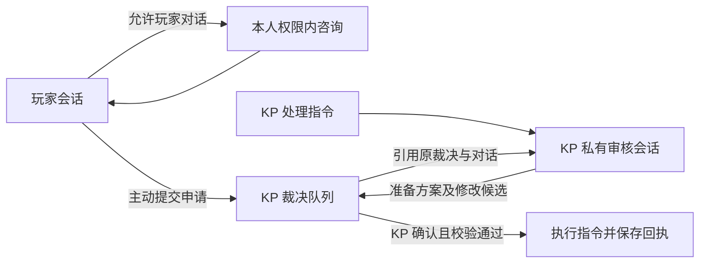

# 包侧早期实现与阶段验收记录

- 文档类型：历史
- 状态：已归档
- 创建日期：2026-11-09
- 最后更新：2026-11-20
- 原路径：docs/current/implementation.md、docs/current/integrations.md、tests/README.md（均相对配置包）
- 原状态：有效／阶段验收汇总
- 归档日期：2026-11-20
- 归档原因：现行说明按当前能力重写；保留早期决策、失败尝试、修复与阶段证据
- 替代文档：[实现](../current/implementation.md)、[模块接入](../current/integrations.md)、[验收索引](../../tests/README.md)
- 关联文档：[历史索引](README.md)

以下为归档时的历史正文，版本、能力、测试数量和一次性正式存档操作只代表其记录阶段，不是当前操作指引。结果 JSON 可能被后续专项更新，具体日期与隔离原始目录以各结果记录为准。

## 原 docs/current/implementation.md

### 树桩镇配置包实现


#### 当前格式与兼容边界

树桩镇当前使用后端0.3.0 / Room v4，包侧存档为format=2。新建直接生成完整结构；打开旧格式或缺少必需字段时拒绝，不自动补齐。已移除旧规则升级、场景补装和角色发现回填逻辑及其页面入口。正常规则导入、预览和激活继续保留，不承担格式转换。

旧宿主格式可通过引擎显式离线转换至Room v4，包启动不自动迁移。个人知识提供方独立于AI启停；旧地点集合不能补成历史观察。2026-11-19 起行动菜单在生成观察前按个人发现筛选，KP 地点页提供完整机制与可选定向披露；服务端拒绝未获知的做法，网页与本地共用此投影。v2 提供方须由旧房间 KP 显式重新绑定，旧固定观察不会自动恢复。启用、揭示、撤回及开发声明统一见[个人已知资料](../current/player-knowledge.md)。

#### 页面与交互

裁决行统一为时间、来源、概要和动作；完整内容、失败原因及风险确认进入详情浮窗。`embeddedAI` 按账号、房间和管理身份保留组件，KP导航只移挂根节点；登出、401或客户端身份变化清理。首次挂载并行读取能力与模块，包侧公开AI脚本代理复用HTTP连接；AI任务用公开 `sessionId` 直接定位会话，服务与权限由 `mountAISettings` 独立页面承载。

资料页并行读取公开KP `admin`、`contracts`、`view` 和包 `bundle`；当前规则源文件和每个数据键动态分类，配置定义按 `typeRef` 筛选。缓存按账号、房间、目录/规则修订隔离，可显式刷新；视图实例仅为活动实例。没有把管理数据写入玩家静态资源或网页桥。


2026-11-19：房间页统一全局统计与控制。包侧 `session.start` 使用已有 `Job` 命令/回执机制串接初始化、个人资料订阅、恢复与开场；不替玩家准备，不迁移旧观察。`resolve` 为自由/互动/复核请求增加受限 `resolution: {operation, input}`，仅支持 check/damage/rest/grant，固定作用于申请者；结构化请求继续执行原动作。执行结果与个人变化写入原申请及授权事件，已处理请求不重复执行。AI信息队列直接接 `location.reveal` 定向揭示表单。

页面和弹窗移除技术编号、重复操作说明；连接排查和授权管理折叠。回复框默认折叠，必要的错误原因、数据与权限选择继续显示。

0.9.0提供完整[网页玩家接入](../current/web.md)：包服务与隔离存储桥、按需资源、双击启动及本机 KP 分享控制；当前接入network-web 0.3.0；本轮在本地目录验证，公网强制TURN双浏览器记录属于原0.8.0阶段。原 AI 咨询和旧 P2P 基础入口继续可选，见[模块接入](../current/integrations.md)；AI 查询与修改仍受包契约、三检及 KP 裁决控制，见[修改裁决](../../../../docs/current/engineering/ai-rulings.md)。

0.5.0起KP管理页与自己的PL页使用独立浏览器页面。管理页默认 `#/gm/room`；2026-11-14拆分房间管理、地图和裁决，原地点、资料和场次继续独立。PL页为同一登录槽位的 `?view=player#/play/scene`，调用 `package/state?player=1` 获取本人玩家投影。此投影的role为player，移除主持真相、管理对象、他人事件及network，仅保留canManage用于返回管理台。账号的真实KP身份仍由宿主鉴权；视窗模式不是降权令牌或其他账号的模拟登录。KP本人可以建角、由管理台审批、准备及执行自身行动，PL页不运行自动场景执行器。

0.6.0玩家桌面使用100dvh和三栏布局，页面不滚动，各栏独立处理溢出；1050px及以下切换栏目。场景／大厅／回顾在顶栏；2026-11-16左栏改为常驻角色／背包，中栏地图／行动，右栏聊天／AI标签。线索／行动日志共用默认折叠的可拖动浮窗，按钮初始位于左上方。`desktop.notebook`保存位置，`desktop.communication`保存对话标签；Pointer Events拖动有阈值以避免误触，窗口缩小时限制边界，方向键可移动手柄。聊天模块 `ui/chat.js` 在场景挂载到右栏；KP裁决页右栏常驻同一聊天工具及频道管理。会话切换不复用一个全局输入框草稿：每频道独立缓存，多个私聊可以同时打开并拖动／折叠／关闭，刷新不保留私聊草稿。完整状态失去频道、断线或退出时清除相关缓存，迟到历史响应检查身份、频道与修订。在线心跳与聊天未读的变化独立更新，不因此重建整个管理台。

2026-11-17行动执行器独立0.5秒轮询，自动结算中的投影改为0.4秒间隔，空闲2.5秒；调度器每0.2秒检查且同页面不叠加状态请求。同源本地页面用 BroadcastChannel 按存档标识提醒提交／完成，不传回执或权限。`ui/dice.js`只消费授权事件中的实际结果，按存档／账号及事件ID去重；初次载入只播后续新结果。非模态小窗在页面重绘之外，0.8秒动画后展示结果，保留3秒后以280毫秒淡出；减少动画及系统偏好直接展示，`sv.desktop.dice.enabled`关闭后继续正常结算。网页固定模块图也包含此组件，偏好沿用既有受限存储。事务优化与等待边界见[场景行动](../current/scene-actions.md#提交后的处理与等待)。

2026-11-18增加 `ui/effects.js`：PL（包括KP本人的PL视窗）按房间槽位／账号／角色维护已见事件与授权角色快照。本人新终态事件的物品、用量、燃烧进度、生命、属性、护甲、钱币、成长、失能与光源变化进入反馈小窗。新终态行动无属性变化时也显示结果／叙述、场景变化或KP回复；条件受阻显示具体原因与处理办法。先播放已有检定，再显示反馈；关闭检定动画不关闭反馈提示。反馈小窗显示3秒后以280毫秒淡出，自动接续下一条，也可立即关闭；轮询不重置寿命。减少动画或系统偏好跳过淡出，但仍保留3秒阅读时间。普通操作短提示同步为3秒淡出；已有PL事件反馈不再重复发成功短提示。KP直接伤害只向受伤角色的主人附带白名单内的伤害与豁免结果。宿主／AI直接修改本人角色、没有包事件时，用授权快照差值提示“角色状态已更新”，不伪造原因或日志。运行中预设延后快照提示，等原事件完成以避免中间步骤重复；等待KP的申请不阻挡其他变化。新线索从本人事件与授权地点观察获取，以地点／线索ID去重；同一行动的结果、线索与角色变化合并，独立揭示用线索提示并可打开手记。运行中预设的线索快照等最终事件后合并；不会把全局发布或其他玩家资料当成本人新线索。初次打开／刷新只建立事件和已知线索基线，旧事件仍在日志；退出、切换账号／房间／角色清空展示队列，不借此订阅其他玩家数据。

地图连线由 `ui/map.js` 统一整理无向边，支持只有一侧披露出口的未探索占位节点；03→08避开07房间角色卡，并与08→09使用不同入口。KP地图使用当前门状态；PL仅使用已授权场景观察中的门状态，无状态的旧观察显示未知，不读取当前私密门数据。

本地化契约、覆盖范围和缺译边界见[本地化接入](../current/localization.md)。英文覆盖本包当前公开场景、预设与系统结果，不表示原版资料已终校；主持自定义文本和用户内容保持原样。

界面文案通过 `ui/i18n.js` 解析；`package/state?locale=` 和 `package/action?locale=` 在完成权限过滤后由 `tools/localization.py` 翻译响应副本。受限内容词典没有静态路由，不改变存档、命令ID、数值字段或玩家文字。

UI 为本地 FastAPI 同源服务上的原生 HTML/CSS/JavaScript。沿用纸色、墨线、苔绿和锈红的设计，三个原创运行插画与十张设计板分开存放。SVG节点图按已公开地点连接绘制，并按可见节点调整画幅；玩家窄屏仍显示地图。

| 页面 | 实际功能 |
| --- | --- |
| P01 入口 | 独立存档首次准备、账号登录、错误提示与退出；根地址自动创建独立登录页 |
| P02 大厅 | 本人角色、草稿审核状态、进入准备或主持台 |
| P03 建角 | 身份→属性→装备→确认；自制预设或主机随机属性；可交换两属性，提交 KP 审核 |
| P04 准备 | 核对角色装备、准备/取消准备、等待主持开场 |
| P05 场景桌面 | 固定一屏三栏：角色及背包／地图及行动／聊天与AI标签；左上可拖动折叠浮窗承载线索与日志 |
| P06 角色/背包面板 | 角色状态与背包装备常驻左栏：三属性、HP、基础护甲、钱币、等级/XP/Grit；2/2/6 库存与超载区、详情、耗损、光源、换槽、转交 |
| P07 线索面板 | 已公开线索检索与个人手记，其他账号页面不可读 |
| P08 行动日志浮窗 | 持久行动过程、骰点、叙述、前后值、主持回复和复核；最新默认展开、筛选、独立滚动及文字摘要分享 |
| P09 主持控制台 | 开场/回合/暂停、自动裁决、裁决队列入口、玩家资源管理、NPC战斗工具、遭遇与伤害 |
| P15 房间管理 | 房间信息、玩家地址复制、连线账号／角色／IP／心跳、访问诊断、网页分享与停止 |
| P16 地图 | 独立完整节点图、仅玩家角色数/姓名摘要/点选完整名单、进入地点管理 |
| P17 裁决 | 无页标题横栏；消息队列、统一人工裁决队列（行动/建角/流程/AI）、填满中栏的原生AI对话与引用、常驻聊天共同占满可用高度 |
| P10 地点 | 十地点草稿、主持真相、描述前后预览、逐条选择公开线索、门状态、库存领取、地点角色列表（玩家与NPC）、逐玩家发现/隐藏设置 |
| P11 旧裁定入口 | 兼容跳转到 P17 独立裁决页 |
| P12 资料 | 物品/状态资料、主持随机表编辑、JSON 导出/导入检查、隔离预览、激活/回退修订 |
| P13 场次 | 配对备份、回顾草稿/私密备注与公开发布；现场控制统一在 P09 |
| AI 助手 | 原生对话与语义引用；PL场景页使用右栏AI标签、其他页可用顶栏弹窗，KP在裁决页内嵌，组件内审核按钮定位统一裁决队列，服务、外发与权限使用独立 `/gm/ai-settings` 页；明确提示外发全关与名称搜索边界 |
| P14 回顾 | 公开回顾、已公开地点，运行中可继续探索 |

S01–S14、S17 的一般操作使用原生对话框，KP裁决由紧凑队列打开详情浮窗表单；S15–S16、S18 由连接标签、空/无权页面、待确认行动条、持久事件卡和即时提交状态呈现。弹窗支持 Esc、焦点返回；表单未保存时导航需确认放弃。地点支持 `#/gm/locations/3`。当前导航和功能树见[界面设计](../current/interface.md)，原图集保留为美术参考。

全局顶栏折叠偏好使用 `sv.desktop.topbar.<登录路径>.<账号>`，网页复用已有 `sv.desktop.*` 受限存储白名单。切换时原地更新样式和无障碍状态，保留输入草稿；裁决页使用弹性高度承接30px折叠顶栏释放的空间，不依赖固定顶栏高度。

玩家主路由为 `#/play/scene`。KP使用 `#/gm/console`、`#/gm/room`、`#/gm/map` 和 `#/gm/rulings` 分别进入控制台、房间管理、地图及裁决。旧玩家角色地址回到常驻背包（窄屏选角色栏）；线索/记录地址展开相应浮窗；主持总览兼容进入控制台，旧遭遇/消息入口进入裁决页。面板偏好按登录槽位及账号保存在浏览器；全局／私聊未读来自宿主，场景／队伍未读来自包侧，行动已读标记只影响本页。轮询不会清空正在输入的手记、消息及裁决表单，编辑期间行动日志仍更新。

0.4.2行动ID与页面心跳ID使用 `crypto.getRandomValues` 生成UUID v4，避免普通HTTP局域网环境缺少 `crypto.randomUUID` 导致提交失败。网页地址复制在Clipboard API不可用时选择输入框并尝试浏览器复制命令，仍不可用则提示手动复制。房间连接列表在编辑裁决或消息时独立刷新，不清空草稿，近期访问的展开状态在轮询中保留。

2026-11-18所有需要KP处理的已有业务来源统一显示在 `#/gm/rulings` 的裁决区域：角色草稿、玩家人工行动与复核、宿主 `role=kp` 等待、`needs_attention` 流程、待转交或待补充/失败的AI请求、AI配置与运行时批次。`keeperWaits`/`keeperFlows`仅在KP管理投影返回；包侧 `host-flow` 仅允许回应、重试、取消三项操作，宿主继续校验角色、等待修订和流程状态。普通聊天未读仍显示在消息队列。

`ui/keeper-queue.js`组合公开 `aiTasks` 与原生 `mountRulings({compact:true})`：自动遍历请求分页、按原请求ID处理、统计待办、提供已完成AI历史；已有提案/批次的请求不重复列卡。转交保留原发起账号及会话权限，不能借KP转交提升玩家可读范围。本地待办和AI卡片独立刷新，填写其他表单时也能看到新申请，未变化的风险输入保留；未知写结果在按存档/账号隔离的 `sv.desktop.aiQueue.*` 中保存原命令ID，重新载入后先查回执。控制台角色审核及旧AI需求列表改为队列入口。服务设置继续独立，自动场景及允许的普通玩家咨询不改成逐项审批。

`tools/action_errors.py`在新宿主命令封装前对标准包规则进行无副作用条件检查，解释准备/失能/属性/开场、物品用量、槽位占用与多格布局；宿主继续做最终校验。检查仅适用于与本机标准源码完全相同的已激活规则，导入或扩展源码不套用旧规则假设；已保存的命令步骤仍优先走原回执恢复。可确认的失败以 `failure`（code/reason/nextStep/actionId/operation/partial）返回并保存为账号隔离事件，不复制宿主诊断、源码或私密场景数据。原始错误码保留。

`package/action`的明确业务失败作为HTTP 200的 `status=rejected` 结果返回，避免网页服务桥只保留错误码；本地和网页前端均先检查 `failure` 并按失败处理，不能把HTTP成功视为行动完成。原失败ID固定返回原说明；KP裁决执行失败保留申请为pending，并通知发起玩家。未知连接结果不写成确定失败；已有步骤完成但明确失败的流程保留核查提示，原失败编号只返回原结果，不重复执行；只有连接结果未知才保留待恢复标识。原未完成提示改为弹窗内完整说明和持久日志，失败无可确认变化时不宣称角色资源已保持不变。

#### 规则与人工裁定

`manifest.json` 登记21个 Lua 文件，`config/configurations.json` 登记角色、场次、主持世界、地点、生物、建角骰盘、私密场景状态七类配置。所有随机与角色受保护数值由宿主规则提交。

自0.2.0起，新存档默认开启自动裁决。检定、本人物品使用/换槽/光源操作、已公开相邻且通路开启的移动无需逐项批准。成功移动改变本人位置并记录目的地允许分面的观察，不自动推进全队回合或触发待主持判断的机关。建角审核、场次开场、跨角色转交、领取私密库存、自由描述、特殊能力和法术仍由 KP 处理。

0.4.0补齐十地点18个预设按钮：固定做法实际投骰、发放有限物品、处理机关、开放门、揭示地点和记录个人线索。已涵盖的领取与机关通过预设自动执行；上段人工管理边界适用于预设外操作。条件、分支和消耗见[场景预设行动](../current/scene-actions.md)。自动任务不进入人工待办，由现有已登录KP页面执行服务端校验后的固定命令；需要至少一个KP页面在线，无需逐项批准，不新增账号、不保存KP密码。离线显示等待自动结算，原账号页面重开后继续。

玩家可在预设行动、检定、物品、移动弹窗中主动选择 KP，场景可描述任何事件申请裁决，回执可申请复核。请求进入主持队列，尚未扣资源或掷骰；批准预设/检定/物品/移动会执行对应规则，拒绝不会产生效果。对已完成事件的复核只记录主持结论，不自动重掷或撤销；必要时主持另行调整资源。玩家可见本人申请状态、理由和结算结果。

KP 在控制台关闭自动裁决后，新预设行动、检定、物品操作与移动进入人工队列；开关不自动处理旧申请。开关保存在宿主公开场次实例 `autoResolve`，仅两端均已公开的通路镜像为 `door1_2` 等通行数值供 Lua 校验，隐藏通路统一为0，不暴露实际开闭状态。公共规则检查开关，内部规则不可直接调用，人工结算走 KP 专用 `sv.adjudicate`，不借用或保存 KP 登录凭据。自动移动还在宿主检查角色控制权、准备/失能、邻接、地点公开性与门状态，因此不能通过直接请求宿主绕过。


- 建角：3d6 取最高两骰，HP/钱币 d6；随机建角的背景交叉表、背景装备和低属性补偿由 KP 查 SRD 核定。两张预设明确为自制。
- 豁免：d20≤属性，优势取低/劣势取高；超载及受伤的 STR/DEX 豁免劣势。未准备、未开场或失能角色不能检定。
- 库存：1/2/4 格物品验证碰撞；轻甲的副手+身体组合；状态卡占槽；11–20 为超载卡片区。超过250p的每250p占一格，优先填入空槽，不足则超载。
- 光源：每角色一个已点亮光源；每六探索轮消耗一格，换槽、熄灭再点亮保留已燃烧时间。
- 伤害：减甲→HP→STR/指定 DEX→重伤豁免；重伤设置失能并放入受伤卡；若20张卡已满，累计 `conditionPending` 供主持整理。装备轻甲有效时计算护甲，界面护甲数字另为 KP 设置的基础值。
- 休息：短休 d6+1 HP，并由 KP 确认照料后恢复行动；长休恢复全部HP，休息前HP已满则只恢复选定属性d6；完整休整恢复属性并移除长期状态。STR=0不允许休息复活。休息时间、食物、水、无人照料六轮死亡等由主持记录和推进。
- 遭遇：三轮提示检查；检查d6与冒险内容表分别投骰；反应2d6，士气WIL豁免。04器具和07鼠帮数量只生成一次。守卫蛇只有一个初始实例。
- 物品转交由 KP 批准，检查同地点及归属；领取扣减地点有限库存。预设已覆盖两机关、救援失败毒咬、守卫蛇咬击与蛇笛固定做法；其他战斗特效、屋顶外部地图、追逐、法术力量/用量/WIL损伤与经验成长采用主持裁定。没有自动先攻、战术碰撞或法术全文数据库。

#### 权威与存档

场景／队伍聊天由包侧 `tools/chat.py` 在已验证账号的宿主view上再次检查角色归属及当前地点，`POST package/chat/history`读取；写操作沿用幂等 `package/action` 的chat操作。虚拟频道 `sv-scene-N`、`sv-party`不创建为宿主公共频道，因此不能通过原宿主历史API绕过位置限制。全局／分组／私聊仍由宿主验证和存储，包侧历史接口仅转发。场景／队伍消息、已读位置保存在package.json的scopedChat内；正常的包锁、原子写与配对备份覆盖这些数据。场景不是加入后永久保留权限的群组，每次请求都核查位置。进入场景的角色可读该场景既有历史；此处不实现按发言时间单独限制历史的模型。

`tools/launch.py` 通过公开 CLI 启动独立宿主，不导入工程内部模块。`tools/client.py` 使用 HTTP 契约，`tools/package.py` 组合可恢复操作。工程目录只读；无工程代码改动。

2026-11-15统一为 `start-panel.cmd` → `tools/panel.py` 的Tkinter房间管理面板，其余游戏CMD入口预选对应方式。复用 `tools/lan.py` 的网卡识别、后台 `LanService`、首次准备、连接诊断和主线程事件队列；本机/LAN/网页/旧P2P模式、端口和AI可选择。后台先独占监听端口、取得包锁再准备宿主，成功后提供连接和管理入口。最小化继续服务；停止或关闭窗口先撤销分享再结束宿主和适配器，释放端口/存档锁。`pythonw.exe`不保留控制台，日志写入运行目录，面板可查看。GUI不保存密码、不改防火墙；`start.ps1`继续作为独立命令行入口。

2026-11-17增加 `tools/slots.py`：`runtime/slots/<随机ID>/slot.json` 保存名称、ID和创建时间；同目录保存整套房间数据。`runtime/slot-selection.json` 仅保存最近选择，不含密码。名称不参与路径，槽位路径验证阻止越界与联接；元信息原子替换。未选择槽位不能启动，创建槽位不初始化账号，运行/停止中禁用切换与创建，停止后更新后台服务、日志及当前目录；窄屏桌面可滚动面板。所有游戏CMD入口共享槽位库，命令行launch.py仍接受实际单档路径。此次按用户要求删除旧v3正式房间与缓存，未留备份；独立AI管理器及服务配置保留。

`tools/processes.py`统一托管宿主、初始化CLI、联网CLI和导出进程。Windows使用KILL_ON_JOB_CLOSE；先用基础Python解释器启动等待输入的包装进程，加入Job后才发送实际命令，避免venv启动器在托管前派生孤儿进程。正常停止先走网页stop-file/旧P2P停止接口，再关闭进程组；即使面板意外退出，OS也会结束后代。Job只涵盖本次进程，不扫描或关闭其他房间。宿主启动失败的lifespan也会清理，STORE_LOCKED明确指向存档占用，SCHEMA_UNSUPPORTED明确说明格式不兼容；面板后台在ASGI启动前加载宿主，避免具体异常被生命周期通用错误遮盖；不通过删锁文件绕过互斥。主程序异常退出时的云端撤销依赖租约超时，不能保证即时正常离线通知。

0.4.2窗口增加后台只读诊断：网卡IP有效性、选定HTTP入口的准备状态、包锁占用、Windows当前网卡网络类别与防火墙启用状态，以及本窗口服务的近期访问。可复制报告、打开系统防火墙设置；不自动改规则或关闭进程。本机HTTP测试绕过环境代理，其通过仅证明本机可访问，跨设备连通仍需实际玩家复测。

`GET package/state?page=<页面ID>` 先经宿主验证会话和包侧权限，再更新内存心跳；KP投影增加 `roomId` 与 `network`（地址、监听、启动时间、版本、账号连接及近期访问）。PL与KP玩家预览不返回 `network`，预览也不会冒充目标玩家心跳。连接使用会话Cookie的SHA-256与页面ID区分，不向页面返回会话摘要；按账号合并，30秒内在线、120秒内失联、之后离线。成功退出清除该会话的全部页面。连接最多256条，心跳更新时清理超过600秒的记录；最后连接时间只在本次进程内保留，重启重置，不写入游玩存档。

HTTP访问记录最多60条，仅含时间、来源IP、本机标记、页面／登录／异常类别与状态码，不记录请求正文、查询参数、密码或令牌。原生命令行与GUI入口均禁用代理头对来源IP的改写，直接使用连接来源。KP界面显示最近8条；原生诊断报告显示其中其他设备的数量及最后5条。访问数不是在线人数，无访问记录不能单独定位防火墙或路由器故障。

宿主 `runtime/slots/<槽位ID>/host/` 持有规则修订、角色数值、关系、位置、随机回执、账号及聊天。包侧 `runtime/slots/<槽位ID>/package.json` 保存地点文本/库存/门、草稿、手记、待裁定、回顾、修订导入记录、命令日志、独立自动场景队列、个人发现和按账号分区的行动事件。私密场景实体保存机关与有限库存，包侧发布步骤可按原命令恢复。RLock、单实例文件锁、fsync 与原子替换保护包侧写入；Windows 短暂文件占用会有限重试。

包投影提供由单档路径摘要生成的 `storageScope`（不返回本机路径），浏览器待恢复命令的存储键包含该范围、登录入口和账号。同端口切换槽位不显示或恢复另一槽位的行动；切回原槽位可继续原待办。

客户端为每项动作保留固定 ID。包侧先落盘精确命令封套，再发送；恢复先查询原 commandId，已提交不重掷。重启后若原命令明确 unknown 且规则版本不变，更新运行代号后继续同一命令 ID。工作流由多个主机事务组成，尚未完成的步骤不代表整个操作已成功；保持原行动恢复，勿重复建角/领物。

0.3.0 对支持的行动在执行前保存角色快照，执行后重新读取宿主状态，生成可读的属性、物品槽和位置前后变化。KP 调整角色资源、转交双方与公开回合更新分别通知相关玩家；主持快照和其他玩家资源不会混入玩家事件。完成执行结果先持久化，再生成反馈，反馈查询中断后仍可恢复原行动而不重放规则。事件最多保留每账号最近200项，固定行动 ID 去重；KP 汇总投影最多返回200项。

升级前回执保留，旧申请仍可查看；历史未记录的资源快照不伪造补建。仅通过本包提交的受支持动作生成事件，直接调用宿主 API 不产生包侧反馈。自由行动或复核批准时可选实际检定、伤害、休息或授予物品；未选执行方案时仅保存裁决回复。

每次访问根地址会转到新的 `/sessions/tab-随机编号/`。该地址刷新后保留本页登录，复制同一地址的标签页共享该槽位；“新开独立登录页”创建另一入口。原 `/sessions/kp/`、`/sessions/player1/`、`/sessions/player2/` 继续兼容，另支持1–40个英文字母/数字/下划线/连字符组成的槽位名。Cookie名称和路径、待确认操作缓存按槽位隔离；槽位名不授予身份或权限，任何槽位仍必须登录。不同页登录/退出不会覆盖其他槽位会话。

PL 只收到本人角色、本人手记与回执、公开地点，以及队友的姓名/归属/实例引用。完整物品库、NPC、隐藏地点、主持真相不下发。浏览器轮询包侧授权投影，WebSocket 代理亦经真实宿主验收；前端不依赖 WebSocket 增量缓存。

KP 的“玩家公开预览”是包侧只读投影，并非以玩家身份请求的宿主快照。真实权限使用两个 PL 账号测试。回执分享使用包侧原回执生成**普通文字摘要**；宿主原生结构卡要求读集为公开对象，与本包私有角色模型不相容，故不伪装成原生结构卡。主机运行者可访问存档，不提供对主机保密的端到端加密。

手动规则导入保留既有物品编号、类型、占用格数和用量上限，可追加新编号；AI 高危修改另须存量校验。激活不迁移已有实体数值，地图草稿按三方同步处理；并发冲突保留草稿并标明待同步。新增账号、重设密码用已有工程本机账号工具；默认首次准备提供一个 KP 和两个 PL。

#### 已验证与剩余边界

机器证据及复现命令见[验收记录](../../tests/README.md)。来源终校、官方冒险专属表项、背景表自动分配、全套法术/成长自动化、额外场景插画及完整拖拽库存仍属于后续计划。当前可用预设自动走通十地点并取得北方线索，原版未核内容明确为本包适配，不宣称已经逐字复刻完整原版冒险。

## 原 docs/current/integrations.md

### 树桩镇 AI 与 P2P 接入


最新权限、整包审批、资料披露／创作申请与术语规则见[AI 权限与裁决](../current/ai-permissions.md)，用例扩充见[53 项场景草稿](../plans/ai-usage-scenarios.md)。

#### 个人已知资料

当前依赖后端 0.3.0 / Room v4，所有启动方式独立安装知识提供方，关闭 AI 不关闭知识服务。PL 对话只消费本人授权的固定观察／持续告知状态，未接入或提供方故障时拒绝。指南和原始实体查询只用于 KP；旧存档需显式格式转换和现在揭示，见[操作与开发者说明](../current/player-knowledge.md)。

#### 启动

[start-integrated.cmd](../../start-integrated.cmd) 现打开统一Python房间面板，预选旧P2P和AI；[start-web.cmd](../../start-web.cmd)预选网页和AI，[start-ai.cmd](../../start-ai.cmd)预选本机AI。确认设置后点击“启动房间”，打开面板本身不发布。所有入口共用 `runtime/` 槽位库，选择或创建槽位后启动；各槽位数据独立，切换前先停止原房间；命令行 `start.ps1` 仍用Ctrl+C停止。本机与局域网预设默认不加载可选模块，可在面板勾选AI。

前提是工程已有宿主运行环境、联网模块的独立 Python 环境、`engineering/ai/config/ai-providers.json`、`engineering/network-p2p/local/client-config.json`。本包只读取这些配置，不安装依赖、不更改工程文件、不部署或修改云服务。服务商和凭据使用工程 [AI 管理器](../../../../engineering/ai/README.md) 配置，不能在树桩镇网页填写密钥。

启动后先打开树桩镇页面；全新存档完成首次准备后才启动宿主和联网入口。联网入口是另一张本机网页，由用户选择发布房间，不会自动公开。若端口或存档已占用，先停止原实例；两个独立房间必须使用不同的数据目录与端口。

[start-ai-manager.cmd](../../start-ai-manager.cmd)继续调用独立本机服务商管理器，状态存于 `runtime/ai-manager/`；它不持有游戏房间。面板支持 `--ai-config`、`--web-config`、`--p2p-config` 指定本地配置文件。启动成功后可打开主持/房间管理页；“联机控制页”进入网页平台管理页或旧P2P本机控制入口。`-NoBrowser` 禁止自动打开浏览器。`start.ps1` 的 `-AI`、`-P2P`、`-Web` 可分别启用，单独 `-Web` 仍可不加载AI。原有 `-Port`、`-Bind`、`-DataDir` 参数保留；AI可随包侧HTTP服务在可信局域网使用，P2P控制网页始终只绑定回环。

#### AI 对话与修改裁决

PL场景桌面右栏“AI助手”标签切换到内嵌对话，聊天和AI切换不销毁组件或草稿；大厅等非场景页仍可从顶栏打开对话框。本机、LAN、网页玩家及KP本人PL视窗使用新版 `mountAIConversation` 原生组件；KP在独立“裁决”页内嵌使用同一组件，旁边为消息/裁决队列与常驻聊天。KP原生对话填满裁决页中栏，其“KP 审核与设置”定位左侧统一裁决队列；侧栏“AI 设置”独立页承载服务配置、外发范围与权限，队列设置按钮也前往此页；不再重复展示外层AI标题与设置按钮。外层页面沿用包侧中英文资源；工程原生对话内部目前主要为中文。



```text
AI 助手
├─ 共同：会话搜索、新建、置顶、归档目录、恢复和删除；独立设置历史携带轮数与回答显示
├─ 共同：请求状态、取消、刷新、未知结果的回执查询
├─ KP 裁决队列：玩家/辅助AI请求、转交、模型回复、失败、提案与批次；分页自动遍历
├─ KP 管理页：允许调用、服务配置、公开 / KP / 本人可读私密范围
└─ KP 裁决页：内嵌语义引用对话；统一队列提供会话定位、设置、历史及回执恢复
```

模块加载不等于服务商可调用。管理页会区分模块未加载、没有启用的服务配置、房间尚未允许调用、可调用但房间资料外发全关和已允许调用；房间关闭或外发范围全关时默认展开设置。先在 `start-ai-manager.cmd` 配置凭据并启用服务，再在KP助手勾选“允许调用 AI”并保存。

新房间默认关闭 AI 调用，三个外发范围默认关闭；玩家对话默认关闭；KP 开启后 PL 提交直接排队；KP在新版对话中点击发送会立即转交本人需求，这与队列中的显式“转交AI”一样受启用、预算、外发和引用复验约束。启用并转交时，需求正文会发给选定服务商，额外上下文按勾选范围发送。服务商配置还需在本地管理器中启用并具备有效凭据。设置随房间保存，重启不会抹去 KP 已明确保存的设置。频道自动接收在独立 AI 设置中显式配置，默认关闭。

AI 的运行时批次与配置候选统一进入 KP 裁决页的裁决队列。草稿、检查阻塞、部分执行和待核对也保留可见；通过 A/B/C 后才可批准配置。需要转交的原需求、玩家或辅助AI发起的可获知信息说明请求、待补充及失败任务也显示在同一区域，与角色审核、行动申请及宿主等待并列。普通完成的咨询不算待办；可勾选“查看 AI 处理记录”查看，未读聊天仍在消息队列。

队列每4秒扫描公开任务分页，不要求KP手动翻页找旧申请；已有提案/批次的请求只显示修改卡。点击“查看对应会话”打开原发起者会话；“转 AI 处理”引用原请求并建立 KP 私有审核会话，回答不回流玩家。原申请人、当前 KP 和来源材料分别标识，修改仍人工审核。未创建会话的手动需求提示无对应会话。结果未知时只查原命令回执，刷新也保留恢复入口。

会话、消息和裁决支持定位／调试导出，详见[来源引用与调试](../current/ai-debugging.md)。

PL 可直接点击“提交创作申请”，或从回答选项提交组合／附魔等需求，不以查询成功为前提。KP 点击“接收并生成方案”后自动打开私有管理员审核会话；原申请移入历史，生成的修改仍另行人工批准。PL 仅看申请状态，不获得审核会话或新资料。

查看整批内容和风险后，一次批准执行；玩家回答仅整理本人已知事实，不直接生成自由草稿或配置。运行时与普通配置自动批准分别开启，默认关闭；高危修改不受自动批准开关放行。不自动广播回复，包内独立状态仍由原业务操作处理。

`tools/integrations.py` 按 manifest 明确清单生成 `integrations/ai-pack-<摘要>/` companion；`tools/ai_extensions.py` 提供 NPC 模板、action/calculation 扩展的字段 Schema、B 正反例、C 场景与指标。支持 `sv.npc` 默认值及 `sv.ext.npc.*` 模板、`sv.ext.*` 规则；核心规则、地图／物品数据与删除配置走高危人工审批；结构、引用、作者场景仍需通过，flow 接口变更不自动放行。具体数值／效果限制、检查覆盖与接入责任统一见[修改裁决与配置包扩展](../../../../docs/current/engineering/ai-rulings.md)。

发布通过宿主三检提案事务，包侧读取宿主当前工件后同步活动规则和导出内容。扩展 NPC 纳入 KP 名册，PL 仍按已发现／同地点投影。重启生成新 companion；已有活动核心规则需 KP 在规则管理导入当前包规则，才能在伤害／士气中识别 isNpc。导入时保留仍需使用的自定义规则，不重置正式房间。

AI 现可按需查询主机授权资料，以及包侧场景/队伍聊天、申请裁决和逐玩家事件记录。已发布地点的个人发现已接入玩家投影；手记等未登记来源仍未接入，手工提供文字只作为用户陈述。静态快照也不声称代表后来由 KP 导入的自定义规则；咨询以宿主实际可读事实为准。私密快照、配置、联网凭据及运行日志没有静态 HTTP 路由。

#### 用量查询

AI 助手顶栏的“用量统计”已接入本地 KP、PL 和网页玩家。KP可看本房间汇总，PL只看本人需求的调用；KP 私有审核的记录不向 PL 展开；支持日期、服务配置、当前会话筛选，区分确认输入/输出消耗、调用中预留和待核实预留。网页包通过受控 `GET ai/usage` 转发，额外账号参数被拒绝，PL请求房间汇总由宿主拒绝。统计不提供其他人的消息、回复、密钥或会话标题。

工程新配置默认关闭每日累计额度，但仍记账；当前本机DeepSeek配置已同步关闭。限额由本机AI管理器的服务商面板选择启用，包侧不能修改。重启树桩镇及AI管理器并刷新页面后加载本版，完整口径见[额度与统计](../../../../docs/current/engineering/ai-manager.md#每日限额与用量统计)。

#### 会话管理与格式显示

KP 裁决页及 PL 的“AI 助手”均可点击“会话管理”：搜索/排序授权会话（KP 全部、PL 本人）、置顶、改名、归档恢复，并设置最近 0—4 轮历史携带（默认 4）。KP 还可切换格式化/原始文本及查询诊断显示。设置由当前房间 AI 仓库按账号和会话保存，网页玩家使用原有受控 API，不提供密钥或全房间队列权限。旧记录读取默认值，切换会话保留当前页面的未发送草稿；刷新或退出清除草稿。

KP 内嵌回答与统一裁决队列中的AI回复共用 Markdown 子集渲染：标题、强调、表格、列表、代码块及语义引用；代码和宽表格在容器内滚动。模型 HTML 作为文字显示，不加载远端图片。PL 在房间允许后可读自己的需求及玩家权限内的回答，显示设置不改变权限上限。组件/API 参数与格式边界见[公共组件指南](../../../../docs/current/engineering/ai-pack-embedding.md#独立会话管理与显示组件)。

本地资源按公开清单提供；网页构建包含 markdown、session-manager 的 JS/CSS。网页沙箱继续禁止原生表单导航，通过事件 composedPath 识别 Shadow DOM 内的按钮/输入并转发受控提交。操作结果未知时查询原回执；组件和包桥收到终态回执后解除待确认状态。

更新后重启树桩镇房间服务并刷新客户端，以重新构建网页资源；无需修改已有房间配置、密钥或 AI 快照。

#### P2P 基础接入与限制

包侧使用联网模块公开 CLI 启动本机控制入口，将 `upstream` 指向**本次启动的树桩镇通用宿主端口**。使用独立 `integrations/p2p-state/` 保存房间身份和占用锁，不复用工程测试房间。派生配置只复制连接所需字段，保存于被 Git 忽略的运行目录；不复制 `packagePath`，不把包含 KP 真相和私密存档的整个配置包导出。

本机联网网页可发布/停止、审批加入与查看连接诊断。其地址含本机控制能力令牌，不能发送给玩家；本包现有 `-P2P` 模式的玩家使用联网模块提供的 Windows 客户端和浏览器，通过短房间码或邀请加入，不能直接访问房主本机 URL。已有局域网模式仍只需浏览器打开正确的局域网地址。

旧 P2P 入口接通登录、通用宿主状态、基础聊天和实时订阅。树桩镇的地图、预设行动、个人线索、包侧聊天与 AI API 不在旧 P2P 转发白名单中，因此**不能将旧入口当作完整树桩镇公网游玩版本**。不能把包侧请求塞进通用 `commands` 绕过白名单。完整玩家沙箱已由独立网页模式接入，旧入口限制仍保留，见 [ISSUE-006](../../../../docs/plans/Issues/issue-006-stumpsville-module-bridge.md)。

0.9.0的 [网页模式](../current/web.md) 使用 network-web 0.3.0 / network-p2p 0.2.2，新增 `start-web.cmd`、严格包服务桥、受限存储、完整一屏玩家 UI 和按需资源。平台最低6位密码与本机记住账密继续由可信壳处理，不改变游戏账号规则。云端已于2026-11-13经用户授权部署0.2.0；旧 P2P 与网页入口不能同时用于同一宿主。网页 PL 由 KP 开启后可直接使用咨询，KP 可在本机查看。`POST package/ai` 仅接受能力查询、个人会话列表/详情、回执和 create/update/submit/cancel/delete 写命令，以及玩家主动资料／创作申请、权限／只读用量与授权调试查询、knowledge引用查询、引用解析和四个固定只读数据查询接口；路径/参数严格白名单，无账号注入、任意URL、服务配置、队列、转交或发布通路。身份沿用玩家真实宿主会话，写请求保留CSRF和原AI请求ID；公开 `pack.js` 组件图（对话/视图/引用编辑器及SDK）随资源包构建，不从沙箱直接联网。无需修改或重部署工程云端。

正常退出启动器时先请求联网模块撤销房间，再停止本次联网进程和游戏宿主。单独在联网页面“停止房间”只停止 P2P 分享，树桩镇继续运行。联网启动失败保留游戏宿主，KP 助手显示失败状态，排查 `runtime/p2p.log` 与本机配置。进程显示“运行”只表示本机入口存在，不代表已发布房间或已通过公网连通性测试。异常强杀时云端租约可能需要约一分钟失效。

#### 已验证边界

[专项脚本](../../tests/verify_integrations.py) 使用独立真实宿主、回环模拟 AI 服务、本地目录服务与两名真实 WebRTC 客户端；验证权限、咨询结果、无游戏状态变化、路由阻塞、撤销房间及浏览器界面。没有调用真实付费模型，没有本轮跨家庭网络或 TURN 中转验收；工程模块原有的云端验收不等同树桩镇完整玩法验收。账号、随机密码和本机控制令牌只在忽略的测试输出目录内保存。

2026-11-14新增[5组地图/网页AI验收](../../tests/map-ai-results.json)，使用两名真实WebRTC网页玩家及本机模拟服务；验证个人会话、KP界面启用/转交、跨账号与管理越权拒绝、原请求回执恢复。原本机AI/旧P2P5组及一屏6组同步重跑通过。没有真实服务商调用或公网AI新增验收。

#### 新版组件与引用接线（2026-11-14）

读取[配置包嵌入指南](../../../../docs/current/engineering/ai-pack-embedding.md)后采用原生 `mountAIConversation`。本机只代理公开 `pack-manifest.json` 中的JS/CSS，不开放服务商管理资源或任意路径；网页把固定依赖图与CSS编入公开资源，保留各组件作用域和Shadow DOM，不放宽沙箱或新增工程路由。`ui/ai-embedded.js`负责身份、挂载/销毁、跨轮询保留草稿、关闭清理和未知写结果回执查询。

本机KP可使用 `/config`、`/entity`、`/data`、`/chat`、`/event`、`/ruling` 查询授权资料；网页PL桥仅允许 `/knowledge` 和有界tokens解析。PL只读资料接口仅search/read的knowledge类型可用，chat/case因历史受众证明不足拒绝。引用显示为可读名称，提交保留真实ID与修订；服务端会再次校验发起者、审核者、修订及外发范围。关闭外发时返回 `EXTERNAL_SCOPE_DISABLED`，不会偷偷发送引用内容。NPC身份通过实际定向披露形成固定观察，不授予完整数值和模板权限；引用及资料查询使用同一观察。

PL 组件使用 `review:false`，不获得裁决路由。KP 的“KP 审核与设置”和消息内“查看配置裁决／查看执行批次”均定位旁边的统一裁决队列；策略设置从独立“AI 设置”页或队列快捷按钮进入。队列使用公共 `mountRulings` 的紧凑模式与详情浮窗，跨包轮询保留未变卡片和风险输入。包服务代理不再一律拒绝配置草稿／发布，实际权限、三检和来源由宿主验证；网页 PL 桥仍不开放管理接口。

#### AI 查询空列表排查（2026-11-15）

先区分“初始上下文为空”和“资料工具返回空列表”。KP 管理员采用按需查询：初始 `roomFacts.entities/configurations/messages`、rules为空是未预载的占位状态；不是宿主没有这些资料。`selectedReferences`为空只表示用户未手选引用。模型应先调用 `room_search_data`，按返回ref调用 `room_read_data`，不能仅复述roomFacts或包契约就判断没有实体。查询概览使用类型筛选及空query，并沿返回游标分页；已有指南明确给出此流程。

对本次“查看所有房间信息并梳理”的只读排查确认：真实房间三种外发范围均已开启，有30个实体、13个配置；该请求记录没有 `facts.dataQueries`，模型直接将未加载上下文解释为没有资料。此前 `query="npc"` 也不能代表实体全集。因此开启外发只是允许读取，不保证模型已执行工具。该次运行快照仍含旧指南；更新包文件后必须关闭启动窗口并重新启动房间，单纯刷新网页不会替换后台加载的AI快照。建议重新建会话，避免沿用旧错误叙述。

“AI 服务与权限设置”会比较当前加载快照和包指南；旧后台未提供诊断字段或指南不同，明确提示重启。诊断只报告版本是否一致，不修改运行中的快照或真实AI历史。`tools/integrations.py` 的KP状态增加 `ai.queryMode` 和 `ai.guideCurrent`，仍由原管理路由鉴权。

房间允许调用模型与允许外发房间资料是两项独立设置。实际模型工具查询同时检查发起者权限和所选外发范围；KP本机引用预览可读，不代表模型也获准读取。三个外发范围全部关闭时，config、entity、event 等搜索会返回空列表。当前页面会明确提示这一状态，不自动修改已保存选择。

在“AI 设置→服务与外发范围”按需选择：现有蜘蛛和守卫蛇实体属于“KP 信息”，配置定义属于“公开信息”，包侧行动/裁决事件属于“本人有权读取的私密信息”。这些选择允许相应资料发给所选服务商；PL需求直接排队时，仍受绑定玩家与执行KP的共同可读范围限制，不能因此读取KP专属NPC。

`search.query` 匹配显示名称，不是类型筛选：搜索 `npc` 不会命中“蜘蛛一”或“守卫蛇”。可按名称搜索，或先无关键词分页列举entity，再读取引用并按 `configurationId=sv.npc` 和 `numbers.location` 筛选。config是定义，memory是已确认记忆，event是事件记录，不能替代当前实体清单；没有已确认记忆时memory为空是正常结果。尚未建成运行实体的故事人物不在entity中。

[查询范围专项](../../tests/verify_ai_scopes.py)通过实际工具执行链验证全部关闭、仅KP范围、三个范围开启、PL请求转交及按需空上下文/指南快照，并补验新版实际计数、完整分页、频道详情→聊天、NPC字段读取和无工具末轮，见[8组结果](../../tests/ai-scopes-results.json)。使用隔离房间和回环模拟服务，未改变真实房间外发选择；同时通过4组消息/裁决资料和5组原生AI/网页玩家回归。单独的[真实模型专项](../../tests/verify_ai_demand.py)须显式 `--live`，只用隔离样例房间；自动passed仅检查查询链路，完整验收还须人工核对答案，见[实测汇总](../../../../engineering/acceptance/ai-runtime/issue-009-live-results.json)。

AI模块的按需载荷与系统提示明确“尚未加载”，可恢复查询错误返回模型在原额度内修正；清理连接异常不覆盖原结果。新任务的KP原生对话可展开“资料查询”查看工具次数、拒绝原因、失败阶段和脱敏代码位置，PL不接收这些诊断。模型列表结果附当前授权页实际条数；频道查询先解析详情取得业务ID。达到工具回合上限后，最后一次请求只汇总已有资料并说明未读范围。合法配置省略behaviors不再导致草稿校验崩溃。旧任务不回填。

包侧直接使用现有宿主CLI和公开原生组件，无需新增路由、迁移或放宽网页桥。`pageSummary`仅在模型工具结果中附加，不改变HTTP EvidencePage、来源摘要或复验协议。分页必须保持过滤条件和limit不变；limit不是数量，ref.id不是频道业务ID。只读概览返回plan；最后一次无工具请求仍计入原有回合、超时和预算限制。

本包[咨询指南](../../ai/guide.md)同步这些约定，并针对实测误读要求：位置编号不能推断通路，零值标志不能证明整个剧情未推进或玩家没有线索，cheese1等字段名不能推断单位/比例。先读取相关规则或执行证据；资料不可读时报告原值和未核实部分。指南随新启动快照加载，修改不会自动重写旧会话或运行中任务，也不调整正式服务商预算。此类约束的交付可离线验证，但真实模型是否始终遵守仍须人工审核。

2026-11-15经用户授权真实复验，最终分页枚举29个实体、13项配置及频道general并返回回答，本轮87项回归通过。实测使用隔离的20万预算、8192输出上限，正式配置不变；较低上限仍可能预算不足或截断。回答中未经规则验证的地图/剧情推断尚未通过人工验收，见[ISSUE-009](../../../../docs/plans/Issues/issue-009-ai-live-query-diagnostics.md)。查询成功不代表已读完全部资料或所有解释准确，仍需KP审核。原始3473 tokens失败记录保留，无法追认其确切原因。关闭启动窗口并重启房间后加载新运行时与组件；仅刷新网页不更新后台。

#### 聊天与裁决资料（2026-11-15）

启用 AI 时，公开宿主 CLI 同时安装本包 `tools/ai_data.py` 只读适配器。支持场景/队伍聊天、申请、逐玩家事件与裁决资料；主机读取权限、私密外发开关和来源版本继续生效，包侧资料仅用于咨询。新增 `/chat /event /ruling` 引用和四类查询 API，具体契约见[工程说明](../../../../docs/current/engineering/ai-data-query.md)。

发起行动的 args 可携带 sourceMessages，按 channelId/messageId/revision/sequence 通过授权历史接口核验；新裁决记录决定者和时间。旧事件缺失来源保持不完整，不自动配对聊天或补造执行结果。专项脚本 tests/verify_ai_data.py 使用隔离房间和离线模型；[结果](../../tests/ai-data-results.json)不代表真实公网或 DeepSeek 验收。

#### 会话权限更新（2026-11-16）

KP 设置增加“允许 PL 使用 AI 对话”和“自动批准管理员执行批次”，默认关闭。允许后玩家提交直接转交 AI，回答按绑定账号权限显示；KP 可查看全部会话，玩家仅自己。嵌入管理支持已归档目录、恢复、直接删除和原回执恢复，打开管理时暂停对话轮询。KP 设置中的完整管理入口可审核宿主／会话批次；带包侧独立资料的上下文仍仅用于咨询；可执行候选基于宿主活动工件复验。

`tools/ai_data.py` 增加 entities / known_configurations 知识投影：本人角色、本人进入过或被明确揭示的已发布地点及相关个人线索、当前可见角色／已发现 NPC 的名称位置；NPC 数值模板、未公开场景变量不随可见名称泄露。玩家网页桥提供受控会话操作、资料／创作申请、权限、用量与授权调试查询；实际权限由宿主再次校验。重启房间并重新生成网页导出后生效。接口细节见[AI 会话权限](../../../../docs/current/engineering/ai-session-access.md)，当前配置发布与包侧同步见[AI 权限与裁决](../current/ai-permissions.md)。

2026-11-16 验收：模块按测试 ID 去重 323 项、树桩镇 32 组通过，覆盖分级权限、直接排队、批次审批／恢复、归档／删除、双网页玩家及原生 KP。均使用隔离存档和离线服务，未调用真实模型或修改正式存档；[验收汇总](../../../../engineering/acceptance/ai-runtime/session-access-results.json)保存逐项结果、复测关系和源码摘要。

回答采用[简洁正文、语义引用与选择卡片](../../../../docs/current/engineering/ai-responses.md)。原生与网页组件均支持选择后填写需求；模板别名由 tools/ai_data.py 提供。沿用 sv.npc 新建 NPC 属于实体实例批次，不受空配置扩展点阻止；新模板发布走当前配置候选与人工审批，独立包状态仍由原业务操作处理。更新后重启宿主并重建网页资源；旧的 raw ID 回复不猜测转换。

引用标签现可点击打开授权详情，支持键盘和移动端；轮询保留未变化的历史节点。默认回答改为一句结论加短列表，已确认的方向直接提出批次供审核。创建 NPC 不自动揭示给玩家：KP 可用既有人物揭示功能；AI 暂不能调用该包操作。剧情字段须区分宿主实体数值与 package.json 独立状态，具体见[写入目标与边界](../../../../docs/current/engineering/ai-session-access.md#运行时写入目标与树桩镇限制)。

本轮 65 项模块与 11 组包侧补验通过，新增原生／网页引用详情、键盘、精确修订与轮询稳定性，见[验收记录](../../../../engineering/acceptance/ai-runtime/reference-details-results.json)。使用离线模型与隔离存档。

#### 2026-11-16 渲染与个人知识修正

AI 查询地点详情按“本人进入过或被明确揭示”过滤，发布本身不增加其他玩家知识。包页面未掌握地点显示导航占位，KP 地点管理新增“向玩家揭示”。主持指南为 kp 来源，独立 `ai/player-guide.md` 才进入玩家上下文。进入记录保存在包侧 `locationKnowledge`，离开／重启后保留；旧档无法恢复未记录的历史，请由 KP 补揭示。完整范围、基础实体 API 的限制及专项证据见[排查记录](../../../../docs/current/engineering/ai-rendering-knowledge.md)。

组件样式改为共享 adoptedStyleSheets，网页构建器同步内联，避免宿主重建 DOM 后短暂无样式。停止旧服务后重新启动并刷新，本机 companion 和网页包需使用本次构建；正式存档保留。

## 原 tests/README.md

### 配置包验收

2026-11-19工作台收敛：[工作台8组](../../tests/workbench-results.json)、[开场8组](../../tests/room-workflow-results.json)、[统一裁决10组](../../tests/keeper-queue-results.json)、[失败原因6组](../../tests/action-reasons-results.json)共32组通过。新增[工作台脚本](../../tests/verify_workbench.py)覆盖紧凑长文本与详情浮窗、原会话直达、跨页组件复用、资料全分类及搜索、独立AI权限页和390px单页布局。开场与裁决专项保留执行、隐私隔离及未知回执恢复。JavaScript/Python与隔离网页构建语法通过；截图在各报告的隔离输出目录。首轮测试修正了样例未准备、异步退出等待和嵌套浮窗定位；无产品失败被忽略。测试使用隔离存档、无头Edge和本机模拟AI，不改正式存档或调用真实模型。记录的加载时间仅是本机样例，不代表模型响应或跨设备耗时。

2026-11-19 SV-ISSUE-001：[本轮52组汇总](../../tests/menu-safety-results.json)，包含[菜单9组](../../tests/menu-knowledge-results.json)、[旧观察升级6组](../../tests/menu-upgrade-results.json)、[严格知识12组](../../tests/strict-known-results.json)、[18预设业务8组](../../tests/scene-results.json)、[恢复6组](../../tests/scene-recovery-results.json)、[场景Edge4组](../../tests/scene-ui-results.json)及[双WebRTC网页7组](../../tests/web-results.json)。分组数量不代表独立规则或测试函数数量。两名玩家的不同发现、共享状态不解锁他人、隐藏选项直提、实际AI工具载荷、旧引用／历史失效、显式重新揭示、旧待执行请求拒绝及原已提交回执恢复均已覆盖。测试使用隔离本机宿主与确定性模型，无真实模型调用、正式存档写入或云端部署；网页测试的两浏览器在同一电脑，不代表公网／跨设备验收。

复跑入口：`engineering/.venv/Scripts/python.exe -B rulepacks/stumpsville/tests/verify_menu_knowledge.py` 与 `verify_menu_upgrade.py`（后者同目录）。源码：[菜单专项](../../tests/verify_menu_knowledge.py)、[升级专项](../../tests/verify_menu_upgrade.py)。两者自建独立目录并关闭测试服务；截图在对应报告的 `output` 目录，含 KP 机制、PL 基础菜单及390px揭示后界面。初轮测试夹具／旧UI断言修正和预期中断日志见汇总；不把失败尝试覆盖成通过。现行声明、显示和升级步骤见[个人已知资料](../current/player-knowledge.md)。

2026-11-18提示3秒淡出与新线索／结果：[专项10组](../../tests/notifications-results.json)由[脚本](../../tests/verify_notifications.py)验证3秒停留与280毫秒淡出、轮询不延期、队列独立计时、手动关闭／减少动画／换房间清理、事件与观察线索合并、重复观察仍有结果、新线索定向揭示、KP拒绝回复及检定后结果提示；计时断言使用暂停的浏览器时钟，业务断言使用隔离真实宿主。同步重跑[持久影响／地图12组](../../tests/effects-map-results.json)，合计22组。网页发行构建、生成脚本语法和527项中英文／目录一致性通过；未修改正式存档或调用真实模型。截图 `output/screenshots/clue-result-notice.png`。

2026-11-18持久影响与地图：[专项脚本](../../tests/verify_effects_map.py)的[12组隔离宿主／Edge记录](../../tests/effects-map-results.json)覆盖获得／消耗／转交、伤害及宿主直接修改、燃烧进度、相反变化保留队列、刷新与语言切换去重、检定先后、390px布局、10条通路和观察隔离。同一脚本的 `presenter_lifecycle` 验证等待自动执行不阻挡其他变化、换房间／退出清空提示，已纳入12组记录。[知识12组](../../tests/strict-known-results.json)、[场景8组](../../tests/scene-results.json)、[反馈7组](../../tests/feedback-results.json)同步通过（反馈脚本含预期的中断故障注入）。网页发行构建、脚本语法、524项中英文词条与目录校验通过。未改正式存档、未调用真实模型。截图：`output/screenshots/persistent-effects.png`、`persistent-effects-mobile.png`、`map-routes.png`。

2026-11-18行动失败说明：[专项6组](../../tests/action-reasons-results.json)由[脚本](../../tests/verify_action_reasons.py)验证准备/失能/属性/开场、耗尽/槽位/多格布局、失败编号去重与玩家隔离、KP批准失败留队及修正后执行、自动任务执行前状态变化、未知原因不泄露诊断、Edge弹窗与刷新后持久日志。[反馈7组](../../tests/feedback-results.json)及覆盖18预设的[场景8组](../../tests/scene-results.json)同步通过，共21组。网页发行构建、生成脚本语法及513项中英文/词条目录一致性检查通过。测试使用隔离真实宿主，无真实模型或正式存档写入；截图 `output/screenshots/action-blocked.png`。

2026-11-18统一KP裁决队列：[专项9组](../../tests/keeper-queue-results.json)由[隔离验收脚本](../../tests/verify_keeper_queue.py)验证真实宿主与Edge：角色草稿/行动/玩家辅助AI请求同页、AI任务分页、旧入口转向、配置风险输入保留与拒绝、原玩家转交及会话权限、响应丢失后按原回执恢复、宿主等待回应与异常流程取消。使用回环模型夹具，不调用真实服务商或修改正式存档。截图位于 `output/keeper-queue-*/unified-queue.png`。原[界面11组](../../tests/ui-results.json)同步通过；旧测试对未探索目的地的名称假设改为目的地标识，遵守现行个人知识投影。网页发行构建、生成脚本语法、510项中英文/目录一致性与受影响文档链接检查通过；本轮不重跑公网/TURN。

2026-11-17行动等待与检定动画：[专项11组](../../tests/action-experience-results.json)覆盖独立浏览器上下文自动执行、无骰观察、实际检定／优势骰／重伤豁免、历史去重、人工批准、玩家隔离、设置持久化、减少动画、390px、同浏览器唤醒及迟到响应防回退；[脚本](../../tests/verify_action_experience.py)使用真实隔离宿主。相同当前后端下，旧前端4次样例中位耗时3672ms，当前前端1802ms；样例加入不同操作间隔，不能当作所有机器或真实局域网的延迟保证。可选 `--baseline tests/output/中的旧app.js快照` 仅比较前端；普通执行只测当前代码。原始请求分段耗时随结果保存。另复验[18预设8组](../../tests/scene-results.json)、[恢复6组](../../tests/scene-recovery-results.json)、[行动反馈7组](../../tests/feedback-results.json)，合计32组。网页发行构建及生成脚本语法检查通过，本轮未重跑公网／TURN联测。截图位于 `output/screenshots/action-check-popup.png` 和 `action-check-mobile.png`。

2026-11-17房间槽位：[专项6组](../../tests/slots-results.json)覆盖创建/选择、名称及路径约束、两套真实账号密码与进度隔离、运行锁定、最小化/停止/关闭、重开记住选择、旧版本明确报错、同浏览器/账号/端口下待恢复行动不串档；[面板6组](../../tests/panel-results.json)复验AI加载、本地网页分享撤销、异常退出子进程清理及六个双击入口。脚本分别为[槽位](../../tests/verify_slots.py)和[面板](../../tests/verify_panel.py)，仅使用隔离目录与回环模型，不调用真实模型或部署云端。Tk验收需系统桌面；沙箱无法加载Tcl时转在桌面执行。截图在 `output/slots-*/slots-panel.png`；首次发现ASGI将宿主异常简化为通用失败并延迟退出，已改为面板后台先启动宿主，完整重跑通过。

同日按用户明确要求关闭旧面板，永久移除正式 `runtime/` 根下旧host（含账号、AI会话和存档代链）、package.json/锁、integrations（含网页缓存）及旧运行日志；不存在的备份目录无需处理，未保留旧档副本。保留独立ai-manager和服务商配置、网络偏好。这是一次性授权清理，正常关闭与槽位切换均保留数据。正式槽位库目前为空，用户命名创建后才初始化新房间。

2026-11-17 个人知识接入：[严格知识12组](../../tests/strict-known-results.json)覆盖公开不披露、普通移动／身份揭示／撤回、不可变观察、实际模型载荷、旧档现在揭示、AI关闭重启和静态导出；[场景8组](../../tests/scene-results.json)重跑全部18个预设与十地点流程。当前边界见[个人已知资料](../current/player-knowledge.md)。以下旧日期的PL资料权限验收为当时规则，不替代本轮严格知识结果。

2026-11-16 PL桌面调整：[布局专项](../../tests/verify_player_layout.py)的[5组结果](../../tests/player-layout-results.json)覆盖1920／1440／1366常驻三栏、390窄屏栏目切换、聊天/AI草稿、轮询更新、浮窗拖动阈值/键盘移动/边界/账号隔离/刷新恢复、手记保存和KP本人PL视窗；仅使用本机模型夹具，打开AI标签不会调用模型。[一屏6组](../../tests/screen-results.json)、[原界面11组](../../tests/ui-results.json)与[地图/AI 11组](../../tests/map-ai-results.json)同步通过，保留真实行动骰点和结果、筛选滚动、本地化、两名真实WebRTC玩家的AI及引用权限回归。截图在 `output/player-layout-*/player-desktop.png` 与 `player-mobile-ai.png`；验收等待原生组件异步样式加载完成后截图。本轮未调用真实模型、修改正式存档或部署云端。

2026-11-16 新增 [配置扩展验收](../../tests/verify_ai_extensions.py) 与 [6 组结果](../../tests/ai-extensions-results.json)，覆盖模板、动作／计算规则、一次裁决、自动配置策略、越界拒绝及重启。显式授权的 [真实 API 实验](../../tests/verify_ai_rulings_live.py) 需 `--live`，实际通过／失败和用量统一见[实验记录](../../../../docs/plans/ai-rulings-experiments.md)，不将首轮失败计为通过。

2026-11-16 用量统计：更新后的[地图/AI专项](../../tests/verify_map_ai.py)通过9组，[结果](../../tests/map-ai-results.json)包含KP读取本房间确认用量40 Token、每日不限额状态；两名真实WebRTC网页玩家验证本人用量、空账户零用量、房间汇总越权与账号注入拒绝。保留原格式、会话、回执及重启回归。使用隔离存档/本机模型夹具，无真实模型调用或云端变更。截图 `output/map-ai-ee016c25/ai-usage.png`；工程122项验收见[记录](../../../../engineering/acceptance/ai-runtime/usage-results.json)。

2026-11-15 格式与会话管理：更新后的 [地图/AI 专项](../../tests/verify_map_ai.py)通过 7 组，[结果](../../tests/map-ai-results.json)记录本地 KP、旧咨询队列 Markdown 标题/表格、嵌入会话设置，以及两名真实 WebRTC 网页玩家的置顶、历史轮数、归档恢复和隔离。首次网页测试发现 Shadow DOM 表单事件被重定向到宿主节点，包桥改用 composedPath 后重跑通过；未放宽沙箱原生表单导航。工程侧 51 项回归及最后 4 项防重复提交复验见[证据](../../../../engineering/acceptance/ai-runtime/rendering-sessions.json)。全部使用模拟服务和隔离存档；无真实模型调用、正式存档写入或云端变更。截图 `output/map-ai-6018c1a3/ai-markdown.png`。

2026-11-15 Python房间面板与生命周期更新：[面板6组](../../tests/panel-results.json)覆盖真实Tk最小化/恢复、初始化与AI加载、地址复制、关闭释放、同档网页重启、公开连接信息与撤销、异常退出后无孤儿宿主及六个双击入口；[LAN10组](../../tests/lan-results.json)、[AI/旧P2P5组](../../tests/integrations-results.json)、[网页重启6组](../../tests/web-restart-results.json)和[命令行入口5项](../../tests/launcher-results.json)同期通过，共32组/项。模型使用本机模拟服务，未调用真实模型或部署云端。面板截图在 `output/panel-*/panel-running.png` 与 `panel-web.png`。Tk需正常Windows桌面；沙箱无法加载系统Tcl时转在桌面运行。命令行测试的沙箱进程树清理受限，已核实并清理自建测试进程后重跑通过；新增测试最初的重复关闭和目录列表字段断言也已修正。

同日按用户明确要求清理正式旧房间：确认host.log为STORE_LOCKED、宿主和网页适配器已脱离原启动器；先用原stop-file正常撤销网页分享，再关闭仅匹配该runtime的残留宿主。已移除runtime下host、package.json/锁、integrations、backups及旧房间日志；保留独立AI管理器和服务商配置、网卡偏好。此操作是本次明确授权的一次性清理，不是面板关闭时自动删档，也没有新增删除/迁移入口。

2026-11-15工程修复后包侧适配：核对工程实测报告中的7份源码摘要均与当前文件一致；同步咨询指南的实际计数、频道ID、只读plan与有界收尾约定，补充地图/剧情/字段单位的证据要求。[查询范围8组](../../tests/ai-scopes-results.json)、[消息/裁决资料4组](../../tests/ai-data-results.json)、[地图/原生AI/网页5组](../../tests/map-ai-results.json)共17组通过。新增专项通过包侧公开CLI启动当前引擎，以回环模型执行实体分页、频道引用解析、聊天和NPC读取，验证HTTP协议不变、3工具轮次后仅1次无工具收尾、无草稿，并确认更新指南确实发给模型。首次新增断言误用需求text而非回复response，修正测试后完整重跑通过。该轮没有调用真实模型、改动正式存档/服务配置或部署云端；离线测试只验证接线和约束交付，不证明真实模型已遵守全部语义要求。

2026-11-15完成AI诊断、查询恢复、分页实际计数、频道业务ID指引、末轮收尾和可选behaviors校验修复。本轮[87项回归及真实调用汇总](../../../../engineering/acceptance/ai-runtime/issue-009-live-results.json)保留6次隔离咨询的全部结果。最终真实查询成功枚举29实体、13配置和1频道，正常回答；但答案中未经规则核验的地图/剧情推断仍待处理，不算完整语义验收。此前[98项工程与界面验收](../../../../engineering/acceptance/ai-runtime/issue-009-results.json)及10组包侧测试为前阶段证据，与本轮不累加。原3473 tokens失败记录保留，确切原因未确认，见[ISSUE-009](../../../../docs/plans/Issues/issue-009-ai-live-query-diagnostics.md)。

2026-11-15追加按需查询排查（本地10组通过）：最新真实请求外发范围已全开，但没有资料查询记录；模型将未加载roomFacts误解为空房间，并仍使用旧指南快照。包指南增加先枚举、再读取、分页与空上下文语义；设置页增加旧指南/旧后台重启提示。[查询范围5组](../../tests/ai-scopes-results.json)覆盖真实工具执行链及快照诊断，[集成专项](../../tests/integrations-results.json)覆盖当前指南无警告、旧后台诊断字段缺失时提示重启。此处模拟服务的通过不能证明真实模型一定主动查询。

[真实模型专项](../../tests/verify_ai_demand.py)必须显式 `--live`，仅在用户授权后使用当前已启用服务配置向隔离样例房间提问“查看所有房间信息并梳理”。凭据由正常宿主解析，脚本不读取或输出密钥；运行资料在忽略的output目录，精选报告不含凭据。使用新的 `--result-name ai-demand-本次英文标识.json` 保留旧结果；`--token-budget` 允许10000–200000（默认100000），`--max-output-tokens` 允许128–8192（默认2200），仅调整隔离副本。最终复验使用200000/8192、6工具轮次及最多7次请求，正式配置不变。脚本的 passed 只代表自动链路、详情与名称检查，仍须人工核对回复。原[3473 tokens失败](../../tests/ai-demand-results.json)、中途失败和[最新链路通过](../../tests/ai-demand-retest-validated-20261115.json)均保留；完整答案审核结果以汇总为准，不能仅看passed。

2026-11-15裁决布局与AI空查询定位：本轮31组通过，包含[查询范围4组](../../tests/ai-scopes-results.json)、[地图/原生AI/网页5组](../../tests/map-ai-results.json)、[本机AI/旧P2P5组](../../tests/integrations-results.json)、[一屏6组](../../tests/screen-results.json)和[浏览器交互11组](../../tests/ui-results.json)。桌面裁决去掉页标题横栏与外层重复AI标题，原生AI填满中栏；1600×1000、1440×900、1366×768无整页溢出。顶栏折叠保留草稿、切页和刷新状态，不同登录身份互不影响；真实网页玩家同时覆盖存储桥下的折叠操作。截图在 `output/map-ai-*/kp-rulings.png`、`kp-rulings-collapsed.png`。

实际工具链确认：外发范围全关会过滤全部房间搜索结果，仅KP范围可查两只蜘蛛、守卫蛇及当前位置；`npc` 不匹配它们的显示名称，memory没有已确认事实时应为空。PL申请经KP转交仍不能读取KP专属NPC。新[查询范围脚本](../../tests/verify_ai_scopes.py)使用隔离存档及回环模型服务；本轮未改真实存档、未调用真实模型、未部署云端。以下为此前阶段记录。

2026-11-15当前引擎与模块适配：树桩镇0.9.0使用Room v3和包格式2；旧升级操作、自动补字段及发现回填已移除。真实runtime已完成一次性转换，原始配对快照与完整旧房间链保存在runtime/backups/2026-11-15-current-format；30个实体、144个命令、聊天和AI scope均保留，账号库和AI历史未改。转换未保留脚本或运行入口，证据在output/current-format-faa812cf/result.json。

本轮55组通过：原业务15、自动裁决/当前格式7、场景恢复5、一屏6、启动诊断6、地图/原生AI/网页资料5、本机AI资料4、完整双WebRTC网页7（覆盖全部18预设）。

新版平台开房使用0.3.0的开房串、创建/管理/加入三页；真实双网页玩家覆盖四个AI数据查询接口与新版语义组件，本机AI资料链路覆盖消息→申请→裁决→查询及来源失效。本轮模型使用本机模拟服务，没有真实服务商调用或云端部署。下列历史阶段记录不代表当前仍提供旧格式升级功能。

2026-11-14独立页面与新版AI接入：[地图/网页AI专项](../../tests/verify_map_ai.py)及[5组结果](../../tests/map-ai-results.json)通过。实际宿主、两名WebRTC网页玩家和本机KP验证KP地图只列玩家（含KP本人）、PL同地点玩家与个人发现的NPC、手动揭示/隐藏、移动刷新与重启持久化；验证独立房间/地图/裁决页面、消息与裁决队列、常驻聊天、新版原生AI对话和语义引用、外发范围拒绝、跨账号/管理路由隔离、KP显式调用及未知结果按原回执恢复。AI只调用本机模拟服务，未调用真实服务商、未新增公网AI验收、未改真实存档。截图在 `output/map-ai-*/kp-map.png`、`kp-rulings.png`、`ai-web.png`。

本次重新通过6组一屏、5组本机AI/旧P2P、15组原业务、6组网页启动诊断、10组浏览器交互和4组场景浏览器回归。旧场景脚本原先等待已移除的控制台文字，改为核对实际执行器在线状态；聊天和裁决验收改走独立裁决页，重跑通过。新版组件的内部文案主要为中文；中英验收覆盖包侧外层UI，不代表上游原生AI内部已完成英语本地化。

此前2026-11-14首次地图/网页AI接入阶段：重新通过6组一屏和5组本机AI/旧P2P回归、网页及本机AI双击入口各5项；新增管理器入口以隔离关闭配置启动，验证UI、未登录拒绝与清理。入口结果在 `output/web-launcher-results.json`、`ai-launcher-results.json`、`ai-manager-launcher-results.json`。首次网页入口测试的进程清理因沙箱权限失败，核实仅为自建测试进程后清理并重跑通过。另以当时真实AI配置在隔离新存档启动，公开能力确认模块可用、deepseek-main仍停用；没有发起模型调用或修改该配置。

2026-11-14重复启动修复：新增[6组导出/重启专项](../../tests/web-restart-results.json)，真实复现 `EXPORT_ALREADY_EXISTS`，验证旧导出复用、部分资源变化、导出中断、缓存损坏拒绝、同一存档下适配器及完整宿主重启。房间ID/代号与所有持久化角色字段保持一致，Edge实际玩家加载复用资源并读取角色成功；宿主重启正常轮换的 `viewToken` 单独核对。另用用户当前15个导出缓存文件的隔离副本完成连续导出，原缓存摘要未变。此轮不部署云端、不修改真实存档；启动诊断6组也重新通过。

2026-11-14公网部署后，**8组强制TURN专项全部通过**，覆盖真实云端目录、双浏览器全部18预设、私聊/权限、响应丢失恢复且不重掷、重连、资源/存储、一屏、封禁及停止分享；两连接均验证为TURN中继，测试房间已永久关闭。脚本使用独立团档和随机命名测试平台账号，未改真实团档。测试账号及关闭的房间元数据保留在云端；浏览器在同一物理电脑，不声称独立家庭实测。首次公网运行在已通过18预设后触发本地默认5秒UI断言超时；外网UI等待设为有界30秒后完整重跑通过。证据见[结果](../../tests/web-cloud-turn-results.json)和[部署记录](../../../../engineering/network-web/acceptance/2026-11-14-0.2.0.json)。

公网自动化浏览器使用 `ignore_https_errors` 接受测试CA；Python、宿主与部署HTTPS检查仍严格校验证书。截图：`output/web-cloud-turn-*/web-player.png`。需要真实云端验收时显式运行 `verify_web.py --cloud --relay`；默认仍为隔离本地目录，不访问云端。

2026-11-13启动诊断修复：新增6组[诊断专项](../../tests/web-startup-results.json)，覆盖真实HTTP404文本、旧能力、无效/超大响应、HTTP服务错误、重定向、凭据隔离、CA缺失；失败在构建/发布前停止，真实宿主继续可用，仅本机KP可读诊断，Edge显示修复建议和日志路径且无溢出。启动诊断时只读核对云端接口为404；后续经用户授权已更新云端，该错误已消除。截图在 `output/web-startup-*/startup-error.png`。

2026-11-13，0.8.0网页接入：**7组网页专项通过，覆盖全部18个预设**；实际使用两个Edge上下文、独立平台与游戏账号、本地目录和真实WebRTC。覆盖KP离线/恢复、检定/叙述/资源/线索、真实UI已提交响应丢失与同ID恢复、过期规则停止重发、场景/队伍/私聊、懒加载、存储隔离、重连和封禁/解封、一屏视口及停止分享保留宿主，无浏览器JS异常。截图在 `output/web-*/web-player.png`。

本轮重新通过：15组原业务（含重启/配对备份恢复）、10组LAN（真实本机WLAN IPv4、Tk/双击入口）、6组一屏、5组AI/旧P2P、5项新增网页启动器。工程网页模块29项通过、2项云端跳过；P2P上游/传输相关回归4项通过、3项外部环境用例跳过。所有数据隔离，不改正式存档；上述本地阶段未部署云端、未强制TURN、未跨家庭/移动网，跳过不计通过；后续部署验收另行记录。功能与待上线条件见[网页说明](../current/web.md)。

0.7.0模块接入已通过5组专项、5组新增双击入口、15组原业务及6组一屏布局回归。AI仅使用本机模拟服务；P2P使用本地目录和两名真实WebRTC客户端，本轮没有真实付费模型或跨家庭网络/TURN验收。模块细节见[接入说明](../current/integrations.md)。

测试通过公开 CLI/HTTP/WebSocket 操作真实宿主；数据全部写入本包被忽略的 `tests/output/`，不使用工程存档。测试自动结束自己的服务进程，不写入正式 `runtime/`。

2026-11-13：0.6.0通过15组业务、10组页面、6组工作区、4组场景浏览器、8组全预设业务及6组一屏专项验收（共49组）。既有局域网10组结果保留其实际验收日期，本次没有改动启动或网络实现。新增覆盖KP本人随机／预设建角、审批、准备与独立PL页真实检定；玩家投影排除管理资料；场景聊天移动后的服务端读写权限、幂等与重启持久化；队伍及私聊隔离；纯文本安全显示、多私聊窗口、分会话草稿与Ctrl+Enter；中英切换、作用域拒绝、缺译回退、刷新保持语言及390px聊天布局。两套浏览器验收均未捕获JS异常。独立验证了ICU复数、参数类型错误及无效HTML模板回退。

一屏专项覆盖1920／1440／1366桌面与390窄屏、三栏边界、日志独立滚动及筛选、真实救援骰点和变化、聊天草稿、空私聊、语言切换、18个预设文本完整性和受限译文权限。截图：`output/screenshots/screen-1366.png`、`screen-english.png`、`screen-mobile-*.png`。当时385项UI及421项内容词条的覆盖边界见本地化文档。业务仍通过真实宿主接口；所有测试均未改动正式游玩存档。

2026-11-12：0.4.2扩展局域网启动10组专项并通过，已有浏览器10组回归也通过。使用实际 `pythonw.exe` 和Tk窗口，在本机真实WLAN IPv4验证网卡名称、端口与密码校验、首次准备、KP及两PL登录、Origin／本机账号控制边界、地址复制与主持页链接、占用冲突、停止释放端口、重启保留账号／存档、关闭窗口清理，以及实际 `start-lan.cmd` 的中文／空格路径。

本次新增断言覆盖KP专属房间／连线账号／IP投影、PL与预览隔离、心跳在线／失联／离线与退出清理、真实来源IP、诊断报告及密码排除。Edge使用真实HTTP局域网地址，明确断言非安全上下文，实际提交属性检定并看到结果，验证房间地址复制、近期访问折叠状态保留、390px主持页面及无JS错误。截图位于 `output/screenshots/lan-running.png`、`lan-diagnostics.png`、`lan-room-console.png`。所有客户端仍在同一物理电脑；不声称已完成跨设备或实际防火墙拦截环境验收。

2026-11-10 0.4.0通过55组验收：15组已有业务、6组通用自动裁决、7组行动反馈、10组已有浏览器交互、8组场景预设、5组场景恢复及4组场景浏览器闭环。浏览器未捕获 JavaScript 异常；包含旧地址兼容、单页面板开关/折叠/状态恢复、内嵌 KP 裁决、玩家原页结果更新、编辑手记时保留草稿、实时消息、390px窄屏及同浏览器账号隔离。

场景专项遍历全部18个预设，验证成功和失败的真实骰点、叙述、机关／库存／门／线索效果，重复领取与两玩家竞争最后一件物品，旧规则补充安装、背包已满阻止，以及主事务提交后和反馈发布时中断的恢复。自动执行使用现有已登录KP页面，不新增账号、不持久化KP凭据。浏览器覆盖离线等待、重开KP页面自动继续、主动人工申请与真实结果返回；自动队列不会显示为待KP人工批准。截图见 `output/screenshots/scene-action-*.png` 和 `scene-kp-console.png`。

反馈专项验证自动骰点、物品与位置前后值、人工申请等待/批准/拒绝、转交双方资源通知、账号可见性、重启持久化，以及“宿主已提交但反馈阶段中断”后恢复同一行动不重掷。反馈与场景恢复专项显式注入 ConnectionError，预期产生503日志，随后恢复验证通过；不是正常运行故障。业务验收同时包含配对备份恢复到第二个空目录。

2026-11-09 启动修复补验通过5项：Windows PowerShell 5.1 文件解析、真实 `start.cmd` 启动、中文/空格路径与参数透传、独立未初始化存档页面，以及测试进程清理。此前业务和浏览器脚本直接使用 Python，未覆盖 CMD/PowerShell 入口；新增测试补上这一缺口。

从项目根目录运行：

```powershell
$env:PYTHONDONTWRITEBYTECODE='1'
$env:PYTHONUTF8='1'
engineering/.venv/Scripts/python.exe -B rulepacks/stumpsville/tests/verify_package.py
engineering/.venv/Scripts/python.exe -B rulepacks/stumpsville/tests/verify_panel.py
engineering/.venv/Scripts/python.exe -B rulepacks/stumpsville/tests/verify_slots.py
engineering/.venv/Scripts/python.exe -B rulepacks/stumpsville/tests/verify_web.py
engineering/.venv/Scripts/python.exe -B rulepacks/stumpsville/tests/verify_web_startup.py
engineering/.venv/Scripts/python.exe -B rulepacks/stumpsville/tests/verify_web_restart.py
engineering/.venv/Scripts/python.exe -B rulepacks/stumpsville/tests/verify_launcher.py --web
engineering/.venv/Scripts/python.exe -B rulepacks/stumpsville/tests/verify_integrations.py
engineering/.venv/Scripts/python.exe -B rulepacks/stumpsville/tests/verify_launcher.py --integrated
engineering/.venv/Scripts/python.exe -B rulepacks/stumpsville/tests/verify_ui.py
engineering/.venv/Scripts/python.exe -B rulepacks/stumpsville/tests/verify_workspace.py
engineering/.venv/Scripts/python.exe -B rulepacks/stumpsville/tests/verify_screen.py
engineering/.venv/Scripts/python.exe -B rulepacks/stumpsville/tests/verify_player_layout.py
engineering/.venv/Scripts/python.exe -B rulepacks/stumpsville/tests/verify_automation.py
engineering/.venv/Scripts/python.exe -B rulepacks/stumpsville/tests/verify_feedback.py
engineering/.venv/Scripts/python.exe -B rulepacks/stumpsville/tests/verify_action_experience.py
engineering/.venv/Scripts/python.exe -B rulepacks/stumpsville/tests/verify_scenes.py
engineering/.venv/Scripts/python.exe -B rulepacks/stumpsville/tests/verify_scene_recovery.py
engineering/.venv/Scripts/python.exe -B rulepacks/stumpsville/tests/verify_scene_ui.py
engineering/.venv/Scripts/python.exe -B rulepacks/stumpsville/tests/verify_launcher.py
engineering/.venv/Scripts/pythonw.exe -B rulepacks/stumpsville/tests/verify_lan.py
```

| 证据 | 内容 |
| --- | --- |
| [panel-results.json](../../tests/panel-results.json) · [脚本](../../tests/verify_panel.py) | 6组真实原生面板、最小化、正常/异常退出、网页撤销、重新打开存档和六个双击入口 |
| [ai-demand-results.json](../../tests/ai-demand-results.json) · [脚本](../../tests/verify_ai_demand.py) | 原始3473 tokens真实失败，保留追溯，不代表当前链路结果 |
| [最新真实链路](../../tests/ai-demand-retest-validated-20261115.json) · [完整汇总](../../../../engineering/acceptance/ai-runtime/issue-009-live-results.json) | 87项回归、6次隔离咨询、计数核对及尚未通过的答案语义；全部尝试见汇总，不用自动passed替代人工审核 |
| [ai-scopes-results.json](../../tests/ai-scopes-results.json) · [脚本](../../tests/verify_ai_scopes.py) | 8组外发/PL权限交集、名称与空上下文、指南快照、分页计数、频道/NPC读取和无工具末轮；本机模拟模型 |
| [web-restart-results.json](../../tests/web-restart-results.json) · [脚本](../../tests/verify_web_restart.py) | 6组导出冲突、缓存完整性与同存档重复启动；截图在output/web-restart-*/restarted-player.png |
| [web-startup-results.json](../../tests/web-startup-results.json) · [脚本](../../tests/verify_web_startup.py) | 6组启动失败分类、保留宿主、权限、无凭据预检和真实Edge诊断页 |
| [web-cloud-turn-results.json](../../tests/web-cloud-turn-results.json) · [脚本](../../tests/verify_web.py) | 8组真实云端、双浏览器强制TURN、18预设及完整恢复/权限闭环 |
| [web-results.json](../../tests/web-results.json) · [脚本](../../tests/verify_web.py) | 7组真实双浏览器完整玩法、18预设、服务/存储边界、响应丢失恢复、撤权与生命周期；网页启动器结果在output/web-launcher-results.json |
| [integrations-results.json](../../tests/integrations-results.json) · [脚本](../../tests/verify_integrations.py) · [P2P 探针](../../tests/probe_p2p.py) | 5组真实宿主AI会话/权限/模拟服务、P2P双玩家/边界/生命周期及KP/PL浏览器验收；截图与启动器详细结果在忽略的output目录 |
| [screen-results.json](../../tests/screen-results.json) · [脚本](../../tests/verify_screen.py) | 6组一屏三栏、日志与聊天、语言切换及受限内容权限验收 |
| [workspace-results.json](../../tests/workspace-results.json) · [脚本](../../tests/verify_workspace.py) | 6组KP独立PL视窗、场景／队伍／私聊权限与UI、多窗口草稿、本地化及重启恢复 |
| [lan-results.json](../../tests/lan-results.json) · [脚本](../../tests/verify_lan.py) | 10组真实Tk窗口、LAN入口、房间／在线状态及权限、诊断、HTTP浏览器提交、冲突和生命周期；pythonw无控制台，完成情况查看结果文件，失败信息在output/lan-error.log |
| [scene-results.json](../../tests/scene-results.json) · [脚本](../../tests/verify_scenes.py) | 全部18个预设的8组真实宿主结果、有限库存、失败后果与权限验收 |
| [scene-recovery-results.json](../../tests/scene-recovery-results.json) · [脚本](../../tests/verify_scene_recovery.py) | 6组当前格式、无变化同步、丢失回执、中断恢复、容量及手动开关验收 |
| [scene-ui-results.json](../../tests/scene-ui-results.json) · [脚本](../../tests/verify_scene_ui.py) | 4组已有KP页面自动执行、玩家过程／结果、断线继续及主动人工裁决 |
| [package-results.json](../../tests/package-results.json) | 真实宿主业务、权限、幂等、回合/光源、物品碰撞、有限库存、公开/私密、聊天、版本、备份和重启/恢复 |
| [ui-results.json](../../tests/ui-results.json) | Edge/Playwright，规范页面及旧地址、浮层、控制台裁决、即时反馈、消息、独立会话、1440px与390px布局及JS错误 |
| [feedback-results.json](../../tests/feedback-results.json) | 7组持久行动通知、变化、隐私、人工回复及中断/重启恢复 |
| [verify_feedback.py](../../tests/verify_feedback.py) | 隔离真实宿主的反馈专项及包侧故障注入 |
| [automation-results.json](../../tests/automation-results.json) | 6组自动/人工裁决、宿主权限、复核、重启、规则升级结果 |
| [verify_automation.py](../../tests/verify_automation.py) | 独立真实宿主的自动裁决专项脚本 |
| [launcher-results.json](../../tests/launcher-results.json) | 保留的start.ps1命令行入口5项：PowerShell 5.1解析、实际HTTP启动、参数、隔离存档及清理；CMD面板入口见panel结果 |
| [verify_launcher.py](../../tests/verify_launcher.py) | 独立临时目录、随机端口、不打开浏览器的启动回归脚本 |
| `output/screenshots/` | 场景悬浮面板、主持控制台及消息、地点、窄屏实际截图，可重建 |
| [harness.py](../../tests/harness.py) | 隔离宿主/适配器生命周期与API账号夹具 |
| [probe_host.py](../../tests/probe_host.py) | 前期核对 progress 个人记录写入权限的独立探针 |

验收记录包含检查时间和具体断言分组，不能把分组数量等同全部规则覆盖。跨设备LAN、防火墙、完整原版冒险内容、长时间多人压力场景未验收。目录中的运行账号和随机口令不入库；结果JSON与截图不包含口令。

返回[当前实现](../current/implementation.md)。

- [AI 高危场景](../../tests/verify_ai_scenarios.py) · [9 组通过记录](../../tests/ai-scenarios-results.json)：真实公开 API、整包人工批准、新物品／入口、编号与引用校验、拒绝及重启恢复。
- [AI 权限与资料申请](../../tests/verify_ai_permissions.py) · [结果](../../tests/ai-permissions-results.json)：玩家主动申请、KP 预览披露、接收人隔离、全部权限开关及窄屏。
- [DeepSeek 场景实测](../../tests/verify_ai_scenarios_live.py) · [结果与失败历史](../../tests/ai-scenarios-live-results.json)：须显式 `--live`，隔离测试复活、新物品和未知资料申请；结果记录实际用量与失败，不修改正式房间。

- [verify_ai_knowledge.py](../../tests/verify_ai_knowledge.py)：隔离两玩家验证个人进入记录、KP 定向揭示页面、公开不等于已知、复制引用越权、玩家指南及重启持久化；结果见 [ai-knowledge-results.json](../../tests/ai-knowledge-results.json)。

- [PL 查询与创作申请](../../tests/verify_ai_player_requests.py) · [结果](../../tests/ai-player-requests-results.json)：12 组通过：本人装备语义、两玩家知识、网页与窄屏申请、KP 私有审阅、高危再批准与开关。
- [PL 原句 DeepSeek 复测](../../tests/verify_ai_player_requests_live.py) · [结果](../../tests/ai-player-requests-live-results.json)：显式 `--live`，隔离房间重放当前行动、已有线索和火把＋针剑需求；3 句通过，本轮 6 次真实调用、28,259 tokens；正式存档未改动。

- [KP 引用审核与调试](../../tests/verify_ai_review_debug.py) · [结果](../../tests/ai-review-debug-results.json)：13 组通过，覆盖五类包裁决、AI 原裁决／请求、已处理来源、幂等恢复、权限／外发、复制／导出与窄屏。
- [组合申请完整 DeepSeek 复测](../../tests/verify_ai_review_debug_live.py) · [结果与失败历史](../../tests/ai-review-debug-live-results.json)：显式 `--live`；PL 原申请→KP 引用审核→精确追加物品→高危人工批准→隔离发布已通过。成功复测 9 次调用、137,337 tokens；保留首次 13 次、261,009 tokens 的缺字段失败。原物品和角色背包不变，正式房间未修改。
