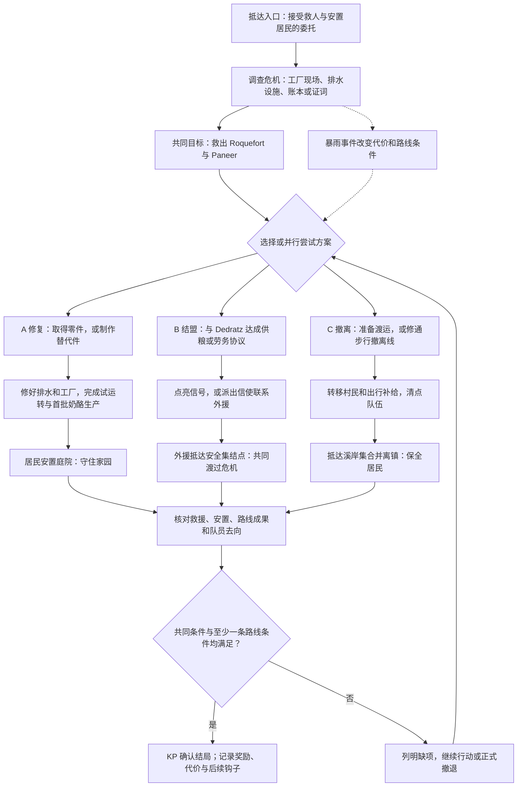
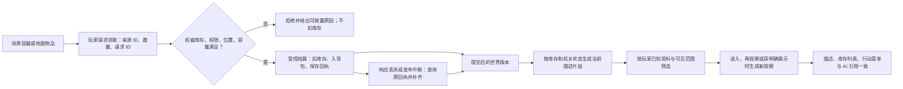
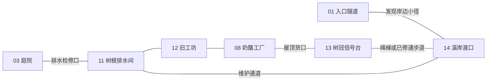

# 树桩镇故事与内容扩展计划

- 文档类型：计划
- 状态：进行中
- 创建日期：2026-11-22
- 最后更新：2026-11-22
- 关联文档：[计划索引](README.md)、[当前内容配置](../current/content-configuration.md)、[场景行动](../current/scene-actions.md)、[个人已知资料](../current/player-knowledge.md)、[来源边界](../current/sources.md)

本计划承接用户提出的六项扩展要求。第 0–8 节保留设计目标；第 9 节记录推演，第 10 节记录实际交付和仍待核验的差异；新增剧情按本包原创扩展处理，不宣称是 Stumpsville 原版故事。本文含主持剧透。

## 0. 目标与范围

| 用户要求 | 当前基础 | 本期拟交付 |
| --- | --- | --- |
| 1. 完整故事、目标与达成路径 | 推荐“探路取物”，由 KP 判定；没有完整主线判胜 | 一个有起因、冲突、转折和结局的故事；3 条主目标路线及明确终局条件 |
| 2. 更多物品，与故事有关联 | 16 类物品，包含状态卡 | 新增 12 类，总计 28 类；覆盖修复、求援、撤离和支线 |
| 3. 世界共享物品与动态描述 | 固定库存已有部分原子扣减；掉落有可恢复流程；玩家读取观察快照 | 统一共享归属与数量；领取、放回、消耗同步影响后续观察中的描述和菜单 |
| 4. 更多角色预设 | 木栗、豆叶两张自制预设 | 新增 4 张，共 6 张；不同装备、背景与故事动机 |
| 5. 更多 NPC、事件、任务 | 7 个 NPC 模板，初始化仅创建 3 个；部分数值待核 | 新增 5 个原创 NPC、6 个事件、7 项任务；补全旧 NPC 的剧情职责 |
| 6. 新场景 | 10 地点 | 新增 4 地点，共 14 地点；与原地图及三条路线互通 |

“世界共享”指**同一房间存档内所有玩家共用一个世界状态**；不同房间／槽位独立。计划优先使用包侧配置、规则和现有公开接口，不预设必须修改引擎。正式房间不因文档落地而自动迁移。

## 1. 故事、游戏目标与达成路径

### 1.1 故事提案：暴雨前的树桩镇

| 阶段 | 主持掌握的故事 | 玩家可以获知和推动的事 |
| --- | --- | --- |
| 起因 | 连雨损坏树根排水设施，工厂停产。Jack 等待零件；Ernie 为保粮封闭熟成洞；饥饿的 Dedratz 占住大厅讨要补给 | 抵达后受庭院管理员委托，调查停产与失联村民；开场明确“救人，并为居民找到安全出路” |
| 冲突 | 两名村民取道蛛网屋时被困；各方互不信任，把事故看成抢粮或故意封锁 | 从工厂、账本、村民证词和排水现场交叉确认事实；可救援、交易、修理或侦察 |
| 转折 | 暴雨将扩大积水；有证据表明危机源于设施失修，Dedratz 也需要食物，而非必须消灭的敌人 | 队伍获得三种方案：恢复本地生产、结盟等待外援、组织全镇撤离 |
| 收束 | 居民的安全与去向由实际行动决定 | 在集结点提交成果，系统列出达成证据，KP 确认对应结局与代价 |

图示为理解顺序；调查、救援、修复和交涉可由不同玩家并行推进。战斗是可选手段，任何主路线都应有不靠战斗的完整解法。

### 1.2 可核验的目标与替代解法

| 目标／路线 | 明确达成条件 | 可选做法与防卡关措施 |
| --- | --- | --- |
| 共同条件 G0 | 两名被困村民均获救，并随所选路线安置在安全地点；参与队员的生还、伤亡和去向已确认，无人处于去向未明状态 | 割网、诱开蜘蛛或获 KP 认可的其他方案；不能只靠“接过任务”完成。掉线角色仍保留原状态，由 KP 明确处理去向 |
| A 守住家园 | 排水恢复＋工厂试运转通过＋一次性首批生产完成并向公共补给点交付 2 轮奶酪＋居民安置庭院 | 主修用齿轮和密封蜡；缺齿轮可用绳索与支撑木楔做临时传动。临时方案需要追加一次维护，不要求某一张角色预设 |
| B 共同渡险 | 与 Dedratz 的协议履行＋求援消息送达＋外援实际到达＋居民进入约定安全点 | 协议可交付 2 轮奶酪，或完成码头抢修劳务；求援可点亮信号台，或护送信使经溪岸出发。不能把“已发信号”当成“外援已到” |
| C 保全居民 | 舟运或步行路线可通行＋居民转移完成＋出行补给已安排＋队伍在溪岸清点并完成离镇 | 修舟渡运，或用绳索／木楔修通岸边步道；补给可交付 2 轮奶酪，或接受渡工记录的赊粮债务 |
| 完整成功 | `G0 AND (A OR B OR C)`，并生成一次可追溯的终局记录 | 多路线同时达成可由 KP 选择主结局并追加成果，不重复发同一奖励 |
| 带代价收束／失败 | 村民伤亡、放弃救援、主动撤退或部分成员失踪等情况单独记录，不能标成完整成功 | 清楚说明保住了什么、失去了什么；KP 可以结束本次冒险，不能伪造缺失条件 |

任务判定读取已提交的世界事实与交付记录，个人是否读过某条线索不充当全队完成条件。公开任务板只展示已揭示任务；秘密前提留给 KP。关键线索至少有两个来源，失败应增加代价或开启替代方案，避免“一次失败或丢一件物品就永远卡关”。

## 2. 扩充物品，并接入故事

拟在现有 1–16 后追加，保留旧编号。下表为 12 类新物品的首版配额；剧情唯一物不能随角色预设复制。

| 拟编号／物品 | 占槽／用量 | 世界初始投放 | 故事、任务或玩法联系 |
| --- | --- | --- | --- |
| 17 黄铜齿轮 | 2／不消耗用量 | 旧工坊 1 件 | A 路线主修零件；安装后从携带状态转为设备部件，不能再当战利品领取 |
| 18 密封蜡 | 1／3 次 | 旧工坊 2 份 | 修泵、补船；每次消耗明确用量，A／C 共用资源形成取舍 |
| 19 修理工具组 | 2／3 次 | 铆须持有 1 套，可借用 | 修复行动工具；借用变更持有人，不复制 NPC 库存 |
| 20 干净绷带 | 1／3 次 | 旧工坊急救箱 2 卷 | 伤者转移与救援支线；具体治疗效果、耗时与恢复条件另行核定 |
| 21 灯油瓶 | 1／1 次 | 排水间、信号台各 1 瓶 | 信号台求援消耗；失去灯油仍可走信使路线 |
| 22 信号旗布 | 1／不消耗用量 | 信号台 1 面 | 修复昼间信号；也可与其他已知材料组合解决撤离问题，由 KP 裁定 |
| 23 供粮账本 | 1／不消耗用量 | 工厂柜内 1 本 | 说明停产原因和供粮关系；帮助交涉，但证词与现场也可提供同类证据 |
| 24 鼠帮通行牌 | 1／不消耗用量 | 灰穗持有 1 枚，协议后转交 | 可展示的协议凭证；实际通行权读取协议状态，遗失不会抹除已成立协议 |
| 25 防水行囊 | 2／3 次 | 渡口 1 件 | 渡运时保护指定携带物，不额外生成物品或无条件增加背包容量 |
| 26 攀爬钩 | 1／3 次 | 信号台 1 件 | 登台、救援和探索捷径；普通工具，不限定职业 |
| 27 支撑木楔 | 1／1 次 | 旧工坊 2 份 | 临时传动、步道抢修；使用后进入安装／消耗状态 |
| 28 安神草 | 1／1 次 | 树根排水间附近 2 份 | 安抚受惊居民、降低转移阻力；不能自动控制其他玩家角色 |

| 现有物品 | 拟增加的故事联系 |
| --- | --- |
| 奶酪、口粮 | 供粮谈判、公共补给、撤离口粮；作为交付物时按实际数量扣除，不能一份同时完成两笔交付 |
| 绳索、滤布、搅拌桨 | 临时修复、过滤设备、渡运工具；复用已有物品，增加多解法 |
| 蛇笛 | 获取熟成洞补给的一条非战斗路径，保留现有潜行等替代做法 |
| 金叶鼠像、铜锅盘 | 保留财物价值；经 NPC 明确同意可换维修或渡运服务，交易转移实物并限定奖励次数 |

初始投放、任务奖励、NPC 携带和预设装备是不同来源；必须分别登记来源与数量。工具使用条件、价格、交易比率和修复消耗在内容定稿阶段统一平衡，不直接沿用原版未核数值。

## 3. 世界共享物品与随状态变化的描述

### 3.1 共享状态与领取流程

| 对象 | 拟采用的规则 |
| --- | --- |
| 共享库存 | 同一房间内，每个场景容器／掉落实例只有一份权威库存；打开页面、切换账号、重进地点或重启均不补货 |
| 唯一物与堆叠物 | 唯一物具有稳定实例 ID；堆叠物具有稳定来源 ID、数量和剩余用量。模板定义不等于可领取实例 |
| 领取与转交 | 同时校验库存、位置、权限和容量；世界扣减与角色入包不得产生可利用的中间状态。同一请求重试返回原结果 |
| 放回、掉落、安装与消耗 | 保留同一物品来源及用量，明确目标容器或地面位置；安装／交付／消耗不再列为可领取库存，不把丢弃当作刷新来源 |
| 任务交付 | 同次受控结算记录扣物、收件方和任务进度；请求恢复不重复扣物、发奖励或推进任务 |
| 跨存储恢复 | 延续现有原回执恢复机制；不能在未验证前声称跨库原子性。处理中锁定冲突来源，已提交待同步时按原 ID 补齐，界面提示处理中 |
| 离线与权限 | 物品留在原持有人；掉线不自动返还或复制。KP 调拨需显式操作及记录，不能仅改玩家页面 |

### 3.2 描述必须由同一事实生成

| 场景变化 | 后续有权观察者应读到的描述 | 同步行为 |
| --- | --- | --- |
| 入口奶酪从 1 变 0 | “石块旁只剩放置奶酪的痕迹。” | 不再写“前方有一轮奶酪”；领取菜单移除或标记不可领取 |
| 熟成洞奶酪从 8 变 7 | 已清点者看到“架上剩 7 轮奶酪”；尚未获知数量者只见允许披露的概述 | 实际库存为 7；不得向未知玩家泄露持有人或原因 |
| 金叶鼠像被打捞 | 已调查池底者看到“原来放置鼠像的位置已经空了” | 不继续提示可领取；历史线索仍保留“曾在此发现”的语义 |
| 齿轮被领取，随后装进排水设施 | 工坊空位与排水设备中的已安装部件分别描述 | 安装位置不生成第二件齿轮；拆卸需另有合法行动 |
| 物品丢在当前地点 | 获得当前地面观察者看到该掉落物和可见用量 | 不自动恢复原柜子或原箱子的数量 |
| 柜子尚未打开 | 只描述柜子外观 | 不因内部库存改变而提前泄露藏物、秘密机关或领取者身份 |

| 描述层 | 维护方式 |
| --- | --- |
| 稳定环境 | 单独保存建筑、气味、结构等背景文字，不把会耗尽的数量写死在正文中 |
| 当前可见状态 | 使用有条件的描述片段：库存大于零、已取空、机关解除、物品安装等；数量来自权威字段 |
| NPC 台词与任务提示 | 引用同一库存／任务事实；不在物品耗尽后仍要求“去拿那里唯一的那件”，应给替代做法 |
| 历史观察与日志 | 保留观察时间、来源版本和原内容，不重写过去；明确它不是当前库存保证 |
| 新观察与在场变化 | 后进入或主动再观察者获取新的授权快照；同场可见变动可由可信事件触发新观察，范围和受众须显式确定 |
| 离场玩家与 AI | 不做全房间秘密广播；离场玩家保留旧观察，重新进入／观察后更新；AI 只读本人有效证据 |

此项扩展应覆盖场景正文、物品列表、可选行动、NPC 台词、任务提示和 AI 引用。不能只在 UI 隐藏已取走物品，也不能把历史个人知识直接替换成全知实时世界。

## 4. 增加角色预设

保留木栗、豆叶，追加下列 4 张自制预设。数值为平衡草案，故事动机与专长不授予隐藏地图、任务凭证或绕过行动权限。

| 角色／定位 | STR／DEX／WIL；HP／钱币 | 初始装备提案 | 故事动机与可参与路线 |
| --- | --- | --- | --- |
| 榛钉／修理匠 | 12／10／9；4／3p | 针剑、火把、口粮、修理工具组 | 曾在工厂学徒，想修复设备；偏 A，也能修舟走 C |
| 苔枝／照料者 | 9／10／12；5／2p | 针剑、火把、口粮、绷带、安神草 | 寻找失联村民；支持共同救援及三条路线的安置 |
| 风尾／信使 | 9／12／10；4／3p | 针剑、火把、口粮、绳索、攀爬钩 | 维护屋顶通信，愿意带出求援消息；偏 B，也能探路走 C |
| 芦舟／搬运者 | 11／11／9；5／2p | 针剑、火把、口粮、绳索、搅拌桨 | 与溪岸渡口有旧交，想带居民安全离开；偏 C，也能搬运修复物资 |

| 配置要求 | 验收要点 |
| --- | --- |
| 入场可用 | 每张预设均能按现有槽位形状合法放置，开场不超载；有照明和基本食物 |
| 路线公平 | 任意预设组合都可完成至少一条主路线；专用工具可在世界中借用、交易或替代 |
| 故事与权限分开 | 背景只给可公开的关系和动机，具体身份、线索和协议仍通过真实行动披露 |
| 起始资源 | 所有预设装备按建角事件只发一次；不得包含唯一齿轮、账本、通行牌或直接完成任务的状态 |

## 5. NPC、事件与任务

### 5.1 NPC 提案

| 新 NPC／所在地 | 动机与可互动内容 | 故事作用 |
| --- | --- | --- |
| 栗婶／03 庭院 | 管理临时集合点，优先寻找失联村民 | 发布主任务、汇总已知路线、接收安置与补给 |
| 铆须／12 旧工坊 | 保护工具，希望设施重启 | 借工具、传授临时修法、确认修复；拒绝合作时仍可从维修图获得方法 |
| 灰穗／07 大厅 | Dedratz 的谈判代表，争取可靠食物 | 奶酪或劳务协议、交付通行牌；没有强制战斗门槛 |
| 露哨／13 信号台 | 尽快联络外部车队 | 教授旗语、操作信号或充当信使；失联时由玩家执行信号方案 |
| 苇伯／14 溪岸渡口 | 保住渡口，并尽量带走居民 | 舟运、步道修复、赊粮协议与撤离接收 |

| 旧 NPC | 拟补职责与边界 |
| --- | --- |
| Jack | 说明停产与试运转要求；与工厂修复状态联动，不无限发工具 |
| Ernie | 说明封存粮食动机，协商领取／交付；库存照实扣减，不因交谈恢复 |
| Roquefort／Paneer | 作为两名独立救援目标，记录被困、获救、转移、安置与伤亡状态 |
| 两只蜘蛛／守卫蛇 | 延续现有实例和位置，补充诱导、绕行等选择；不可随事件重复刷出同名实例 |

新 NPC 的原创来源、对白、初始物品、关系和可用数值需一起验收；旧 `verified: false` 条目仍保留原版待核属性，不能因扩写剧情就声称数值已核实。

### 5.2 事件与任务表

危机时钟从接受主任务后的已提交探索轮开始计数，初稿阈值为 6／12／18 轮；耗时平衡需试玩调整。离线、页面轮询、动画与重复请求不推进时钟；KP 可暂停或调整，修改需记录。

| 事件 | 触发提案 | 世界变化与可应对方式 |
| --- | --- | --- |
| E1 雨势加剧 | 危机第 6 轮，一次性 | 首次揭示积水压力与排水间入口线索；不自动扣除未知物品 |
| E2 鼠帮催粮 | 第 12 轮且协议未成立，一次性 | 灰穗提出明确条件；开放劳务替代，不凭空刷新鼠帮 |
| E3 排水间进水 | 第 18 轮且排水未恢复，一次性 | A 增加排水／加固成本；明确提示 C 的退路，禁止无提示关闭全部解法 |
| E4 蛛网震动 | 首次救援失败或明显惊动蜘蛛 | 更新警觉状态，开启诱导／绕行提示；不重新生成被困者或蜘蛛 |
| E5 援队抵达 | 求援成功后再推进 2 个探索轮，一次性 | 援队到约定安全点；庭院不可用则在渡口接应，更新 B 的接应目标与完成证据 |
| E6 溪岸水涨 | 第 18 轮且尚未撤离，一次性 | 渡运需要加固或改走步道；仍保留可行路线，不自动杀死场外居民 |

| 任务 ID／名称 | 解锁／关联路线 | 完成证据与奖励 |
| --- | --- | --- |
| Q0 安置树桩镇 | 开场主任务 | G0 与 A／B／C 至少一条成立；记录结局，奖励只结算一次 |
| Q1 救出失联村民 | 委托或发现被困者；所有路线 | 两名村民从被困转为获救；安置单独核对，救出不等于已经安全 |
| Q2 让工厂再次运转 | 发现故障；A | 排水、传动、试运转和一次性生产记录；工厂初始封存原料只支持一批 2 轮奶酪，产出仅一次；向公共点交付后才满足 A 的补给条件 |
| Q3 与鼠帮立约 | 与灰穗接触；B 或其他路线支线 | 足额供粮或码头抢修验收；成立协议并转交通行牌，已交物资不可再次支付 |
| Q4 把消息送出去 | 发现信号台或信使；B | 信号被接收或信使到达外联点；触发 E5，不直接判定 B 完成 |
| Q5 安全撤离 | 获知渡口；C | 运输／步道、补给与逐名转移记录；结算赊粮债务等后续代价 |
| Q6 找回供粮账本 | 工厂调查；可选支线 | 实物交还或经确认分享证据；提供谈判帮助，不作为唯一真相来源，不发第二本账本 |

任务状态拟区分未发现、进行中、待交付、已完成、失败／放弃；世界进度统一，个人发现独立。先做事后接任务时可识别已有证据，但不重新发物或重放事件。

## 6. 新增场景及地图衔接

图中只画新增地点与旧地图的接点；旧十地点拓扑保留。连线表示可建立的通路，初始是否已发现／开放由下表和对应机关状态决定，不向所有玩家自动揭图。

| 新地点 | 初始状态／入口 | 内容、行动与主路线作用 |
| --- | --- | --- |
| 11 树根排水间 | 从庭院调查检修口发现；入口需开启；往渡口维护通道先排水或绕障 | 故障泵、灯油、草药；查故障、排水、安装零件；A 核心，C 可走维护通道 |
| 12 旧工坊 | 工厂侧门可检查后进入；排水间一侧需清障 | 铆须、齿轮、修理物资、维修图；借用／交易、找零件、制作替代件；支持 A／C |
| 13 树冠信号台 | 从工厂屋顶货口攀登；通渡口绳梯需检查／修复 | 露哨、旗布、灯油、攀爬钩；修信号、发送消息、观察安全点；B 核心 |
| 14 溪岸渡口 | 入口侧岸边小径可发现并通行，作为基础退路；其余入口有各自前提 | 苇伯、防水行囊、受损渡舟和岸边步道；劳务、修舟、安排补给、逐名转移；C 核心及 B 备用接应点 |

每个新场景同时配置稳定描述、状态片段、共享库存、NPC、行动选项、线索、出入口条件和至少一种失败后的继续方式。北方据点暂作为结局去向，不在本期继续扩成第二个冒险地区。

## 7. 实施顺序与文档同步

| 阶段 | 主要工作 | 完成条件 |
| --- | --- | --- |
| P0 内容定稿 | 确认主线、结局条件、四新场景、物品投放和 NPC 动机；核对旧内容来源 | 三条路线均列出前提、消耗、替代和结局；确定数值与时钟，不留强制剧情死锁 |
| P1 共享状态与描述 | 在现有有限库存／掉落基础上统一来源、受控领取、交付及恢复；实现按状态生成的新观察 | 并发最后一件、容量失败、响应丢失、掉落重领和后进入描述通过；先证明现有公开接口足够 |
| P2 内容配置 | 追加 12 类物品、4 张角色、5 个 NPC、4 地点与配套行动／知识声明 | 编号不重排，初始库存／槽位有效；玩家初见内容不泄露机制、隐藏物或未发现角色 |
| P3 故事与任务 | 接入 7 项任务、6 个事件、危机时钟与结局证据；增补 NPC 状态对白 | A／B／C 各能从开场独立走到结局；队伍并行与跨路线切换可恢复 |
| P4 联机与恢复验收 | 在隔离房间做两玩家争抢、后进入观察、断线重启、交付恢复和旧档兼容验证 | 按第 8 节完成测试；不得用正式房间试验迁移 |
| P5 交付 | 更新当前内容概览、玩家指南、场景行动、个人知识、来源与测试索引 | 仅将已实现且已验证的部分写入当前文档；剩余计划继续留在本文件 |

| 拟涉及范围 | 改动边界 |
| --- | --- |
| 包内 `config/`、`rules/` | 内容、实体状态、库存／任务／事件规则；新增字段及编号采用兼容方案 |
| 包内 `tools/`、`ui/`、`locales/` | 可恢复工作流、状态描述、任务／结局展示、个人知识与译文；由实现阶段另行登记具体范围 |
| 包内 `tests/`、`docs/` | 隔离验收、当前文档与计划状态同步；新增文件同步工程目录清单 |
| 宿主公开接口 | 能力不足时记录明确问题交工程责任者，不在包侧计划中暗含内核改造 |

旧房间保留原配置与进度。实施前设计显式升级步骤：备份、追加编号、新状态默认值、旧事实映射、未完成请求处理和回退办法；不直接把现存存档当成新剧情开局，不重置已取走物品。

## 8. 验收矩阵与待确认项

| 类别 | 必须通过的场景 |
| --- | --- |
| 主线 | A／B／C 分别完整通关；任一路线核心物品缺失时可用已写明的替代；未完成 G0 不误报完整成功 |
| 共享库存 | A、B 同时取最后一件仅一人成功；两个不同房间各自独立；旧观察不能授权重复领取 |
| 物品生命周期 | 领取→转交→丢弃→再领取→交付／安装全程守恒，唯一物不复制；背包满时不扣源库存 |
| 描述一致性 | A 取物后 B 首次进入及再次观察均看到更新；同场可见变动生成新观察；历史快照保持原文且有时间；藏物不泄露 |
| 权限与 AI | 未发现地点／任务／NPC 不显示；AI 引用与本人观察一致，撤权后不返回旧正文；不能靠全局共享状态替代个人知识 |
| 角色与新场景 | 6 张预设合法入场；14 地点可按设计到达；所有关键通路有可知的开启条件；不要求特定预设才能通关 |
| NPC／事件／任务 | NPC 不重复生成，交付与奖励只记一次；先完成行为后接任务可识别；临界轮触发事件后重启不重放 |
| 恢复与兼容 | 领取、交付、安装、结局提交后的响应丢失均按原 ID 恢复；旧房间不会自动刷新资源或获得新剧情奖励 |
| 收束质量 | 展示成功／带代价／撤退原因、各居民去向、已完成证据和遗留债务；KP 能核对，玩家只见已授权结果 |

| 待确认项 | 本草案采用的提案 |
| --- | --- |
| 故事方向 | 采用“暴雨前的树桩镇”原创主线；原“探路取物”保留为入门体验，原版未核内容继续单列 |
| 规模 | 追加 12 类物品、4 张角色、5 个 NPC、6 个事件、7 项任务、4 个地点；可在定稿时调整数量 |
| 节奏与难度 | 使用探索轮危机时钟，6／12／18 轮作为试玩起点；失败以增加代价和切换路径为主 |
| 胜负确认 | 系统汇总世界事实判定候选结局，由 KP 确认；自由方案可由 KP 显式映射到同一目标条件并留下记录 |
| 数值与来源 | 新角色、NPC、道具效果、消耗和奖励做整包平衡；本包原创设定与原版核验状态明确分开 |

## 9. 桌面推演与实施决定（2026-11-22）

| 路线 | 从庭院出发的模拟过程 | 修订 |
| --- | --- | --- |
| 共通 | 01 观察 → 02 检查并固定门 → 03 接委托、辨路 → 06 救人 → 返回庭院 | 为没有绳索的小队加入慢速撑门，为没有针剑或掷骰失败的小队加入引开蜘蛛的做法。开场点明集合地点。 |
| A | 工坊领齿轮或木楔 → 排水间维修 → 工厂试产 → 庭院交付 | 临时传动用木楔加一次维护。工厂只出一批两轮奶酪，使用公用运货筐在庭院验收，避免背包已满或队友掉线导致交付失败。 |
| B | 渡口修栈桥 → 大厅履行劳务协议 → 信号台点灯或渡口送信 → 等待两轮 → 渡口接应 | 劳务可预先完成，通行牌由代表保管。增加守候行动，重复发信不重置到达时间。 |
| C | 入口探岸路 → 渡口修船或清步道 → 筹粮或登记赊欠 → 带居民抵达 | 岸路为独立可达的退路，连续暴雨只增加加固工序。按实际交付扣粮，两名村民共同转移。 |

三条路线都由玩家完成安置、KP 清点并确认结局。物品数量、玩家披露与恢复需通过隔离验证。初次试玩使用包的默认角色、常规探索回合和现有主持管理页。

## 10. 0.10.0 交付与试玩范围

| 项目 | 实际玩法与推演调整 |
| --- | --- |
| 目标 | 庭院受托，两人获救后可走三条路线。KP 总览显示七项进度，达成路线后填队员去向并确认；主动撤退单独记录。获救村民按一组护送，伤亡与掉线去向由主持填写。 |
| 场景 | 七条新通路可在任一端勘察开放。维修和加固约束具体行动，避免场景入口和解决入口所需工具相互锁死。 |
| 物资 | 12 类新增物品。主修消耗齿轮和一格蜡，临时修法用木楔并校准。供粮交付按两件实物计数，守信送援可避开灯油需求。首批公共奶酪由生产和签收两个一次性记录表示。 |
| 压力 | 已提交的探索轮决定雨势、催粮、进水与溪岸水涨，场景行动结算时检查；援队按消息送达后的两轮接应。蜘蛛警觉沿用救援失败事件。晚修泵要清淤，晚撤离要加固。 |
| 观察 | 容器数量与可选领取做法进入个人观察。同地且已能辨认物资的角色在取物时得到新的授权观察，旧观察保留原文。丢弃实物仍保留为地面掉落，由 KP 分配。 |
| 本期边界 | 探索工具、绷带等通用道具的自由用途由 KP 裁决。个人居民伤亡状态机、旧房间就地升级、全套扩展英文文案及公网真人试玩仍待处理。 |

复验入口为 [隔离房间路线脚本](../../tests/verify_storm.py)。每条路线运行时创建独立数据目录，使用正常登录和玩家行动，结局后重启并核对记录。

| 隔离试玩 | 走法 | 实测结果 |
| --- | --- | --- |
| 修复 × 2 | 齿轮＋蜡；积水满 18 轮后清淤、装木楔并校准 | 均获救、试产、签收并结局，重启后保留结果 |
| 求援 × 2 | 修栈桥、派信使；从熟成洞取两轮奶酪实际交粮，再到信号台点灯 | 均在推进探索轮、援队到达后完成接应，重启后保留结果 |
| 撤离 × 2 | 清步道或补渡舟，再赊粮、集合 | 均完成撤离，重启后保留结果；其中一局在 Edge 房间总览填写去向并确认 |
| 双玩家观察 | KP 在入口把最后一轮奶酪分给玩家一；玩家二同场观察，离开并再次进入 | 原观察保留当时所见，新观察显示压痕，已空的领取选项消失 |

原十地点 18 个预设、15 组基础包检查与 4 组浏览器流程通过。复核时修复了扩展包暂存请求过大导致开房和重新导入失败的问题。
